<h1>
IF2150 REKAYASA PERANGKAT LUNAK
 
TUGAS 7
 
DESKRIPSI PERANCANGAN PERANGKAT LUNAK (DPPL)
</h1>
 

## *ITBELI*

### Untuk:  *Mikhael Andrian Yonatan*

Dipersiapkan oleh:

| Informasi | Keterangan |
| --- | --- |
| Kelas | *K01* |
| Kelompok | *G02*  |
| Nama Kelompok | *Indeks A*  |

| NIM | Nama |
|---|---|
| *13525124* | *Sulthan Dhiyazka Suwandi* |
| *13525034* | *Dhanesworo Muhammad Datiputro* |
| *13525115* | *Nazhif Hilmi Kistijantoro* |
| *13525121* | *I Made Adi Kusuma Ardana* |
| *13525106* | *Ghaniyul Amri Caulava* |

---

## Daftar Perubahan

| Revisi | Deskripsi |
| :--- | :--- |
| *A* | *Penyusunan awal DPPL: BAB 1 dan BAB 2 diturunkan dari dokumen SKPL dan APL, serta realisasi use case UC01–UC24 pada BAB 3.* |
| *B* | *Diagram kelas per use case (UC01–UC24) dibangkitkan ulang dari satu model kelas sehingga nama, atribut, dan metode setiap kelas seragam di seluruh use case. Diagram kelas UC17–UC24 dilengkapi visibilitas, tipe data atribut, parameter, dan tipe kembalian operasi. Kelas Otorisasi, Kriptografi, SurelAdapter, PushNotifikasiAdapter, dan PenyimpananBerkas (C41–C45) digambarkan pada setiap use case yang memakainya, dan tabel identifikasi kelas disamakan dengan diagramnya.* |
| *C* | *Sequence diagram UC01–UC08 dan UC17–UC24 diselaraskan sehingga setiap pesan merupakan operasi pada kelas tujuan, termasuk pemanggilan Otorisasi, Kriptografi, SurelAdapter, PushNotifikasiAdapter, dan PenyimpananBerkas.* |
| *D* | *Penyusunan BAB 4 (diagram kelas perancangan keseluruhan dan Tabel 4.1) serta BAB 5 (matriks kerunutan kelas terhadap use case).* |

---

# BAB 1: Pendahuluan

## 1.1 Tujuan Penulisan Dokumen
Dokumen Deskripsi Perancangan Perangkat Lunak (DPPL) ini disusun untuk menjabarkan rancangan perangkat lunak ITBELI yang memenuhi kebutuhan pada dokumen SKPL, meliputi lingkungan implementasi, arsitektur, realisasi setiap use case, diagram kelas perancangan, dan matriks kerunutan, sehingga setiap kelas pada kode program dapat ditelusuri kembali ke use case asalnya. Dokumen ini digunakan oleh pengembang sebagai acuan implementasi kelas dan interaksi antarobjek, oleh perancang sistem dan desainer antarmuka untuk menjaga konsistensi tanggung jawab setiap komponen, oleh tim penguji sebagai dasar penyusunan skenario pengujian, serta oleh manajer proyek dan pemangku kepentingan untuk memastikan seluruh use case telah dirancang sebelum tahap implementasi dimulai.

## 1.2 Lingkup Masalah
**ITBELI** adalah sebuah platform aplikasi marketplace barang preloved (bekas layak pakai) yang dirancang secara eksklusif untuk memfasilitasi transaksi jual-beli antar sivitas akademika Institut Teknologi Bandung (ITB). Sistem ini hadir sebagai solusi terpusat untuk mengatasi ketidakefisienan dan risiko penipuan pada transaksi jual-beli barang bekas mahasiswa yang selama ini tersebar tidak terstruktur di berbagai media sosial. Dengan mewajibkan verifikasi identitas menggunakan surel institusi (@itb.ac.id), perangkat lunak ini menyediakan ekosistem niaga yang aman dan tepercaya, dilengkapi dengan fitur manajemen katalog (listing), pencarian dan penyaringan barang spesifik kebutuhan kampus, ruang percakapan internal yang menjaga privasi negosiasi kesepakatan Cash on Delivery (COD), serta dasbor moderasi administratif untuk menindak tegas pelanggaran guna menjaga kenyamanan seluruh pengguna.

## 1.3 Definisi, Istilah, dan Singkatan
Semua definisi dan singkatan yang digunakan dalam dokumen ini beserta penjelasannya.

Tabel 1.3. Definisi Istilah dan Singkatan

| Singkatan, Akronim, atau Istilah | Penjelasan |
| :--- | :--- |
| *P/L* | *Singkatan dari Perangkat Lunak, yaitu aplikasi yang memberikan perintah kepada komputer untuk menjalankan tugas tertentu.* |
| *DPPL* | *Singkatan dari Deskripsi Perancangan Perangkat Lunak, yaitu dokumen ini, yang menjabarkan rancangan arsitektur, realisasi use case, dan kelas perancangan perangkat lunak sebagai acuan implementasi.* |
| *SKPL* | *Singkatan dari Spesifikasi Kebutuhan Perangkat Lunak, yaitu dokumen Tugas 5 yang memuat kebutuhan fungsional, kebutuhan non-fungsional, pemodelan use case, kelas analisis, dan traceability ITBELI. Dokumen ini menjadi masukan utama DPPL.* |
| *APL* | *Singkatan dari Arsitektur Perangkat Lunak, yaitu dokumen Tugas 6 yang menetapkan pattern arsitektur acuan, komponen penyusun aplikasi, dan model arsitektur ITBELI. Isinya menjadi dasar BAB 2 dokumen ini.* |
| *KF* | *Singkatan dari Kebutuhan Fungsional, yaitu kapabilitas, perilaku, atau aksi spesifik yang harus mampu dilakukan oleh sistem (bagaimana sistem merespons input).* |
| *KNF* | *Singkatan dari Kebutuhan Non-Fungsional, yaitu batasan, kualitas, dan kriteria kinerja sistem (seperti keamanan, keandalan, dan waktu respons) dalam menjalankan fungsi-fungsinya.* |
| *UC* | *Singkatan dari Use Case, yaitu deskripsi interaksi atau skenario langkah demi langkah antara aktor (pengguna) dengan sistem untuk mencapai tujuan tertentu.* |
| *ITBELI* | *Nama dari perangkat lunak (sistem) yang dirancang dan didokumentasikan di dalam dokumen DPPL ini.* |
| *Preloved* | *Istilah untuk barang bekas pakai milik pribadi yang kondisinya masih sangat layak fungsi untuk dijual dan digunakan kembali oleh orang lain.* |
| *Listing* | *Daftar barang dagangan yang dipublikasikan oleh penjual di dalam katalog sistem, mencakup sekumpulan data seperti foto, deskripsi, kondisi, dan harga barang.* |
| *COD* | *Singkatan dari Cash on Delivery, yaitu metode transaksi serah terima barang dan pembayaran secara langsung atau tatap muka di titik temu fisik wilayah kampus yang telah disepakati oleh pembeli dan penjual.* |
| *OTP* | *Singkatan dari One-Time Password, yaitu kode otentikasi berupa karakter numerik/alfanumerik unik yang di-generate oleh sistem dan hanya berlaku satu kali dalam batasan waktu tertentu (contoh: 15 menit) untuk memverifikasi surel pendaftar.* |
| *JWT* | *Singkatan dari JSON Web Token, yaitu standar terbuka untuk mengenkripsi dan membuat token sesi akses (bearer token) yang digunakan untuk memverifikasi hak akses otorisasi pengguna saat mereka masuk (login) ke dalam sistem.* |
| *Bcrypt / Hash* | *Fungsi algoritma kriptografi satu arah yang digunakan untuk mengacak dan menyamarkan kata sandi (password) pengguna sebelum disimpan di basis data, sehingga kerahasiaannya terjaga dan tidak dapat dibaca dalam bentuk teks murni (plain-text).* |
| *Log Audit* | *Catatan rekam jejak digital di dalam basis data sistem yang bersifat permanen, anti-ubah (immutable), dan kronologis untuk melacak kapan dan siapa admin yang melakukan tindakan moderasi tertentu.* |
| *MVC* | *Singkatan dari Model-View-Controller, yaitu pattern arsitektur yang memisahkan penyajian dan interaksi pengguna (View), penanganan permintaan dan aturan bisnis (Controller), serta data sistem beserta aturan integritasnya (Model). MVC menjadi pattern arsitektur acuan ITBELI.* |
| *View* | *Bagian MVC yang menampilkan halaman kepada pengguna dan meneruskan aksi pengguna ke Controller. Pada ITBELI, View berjalan pada peramban dan mewadahi kelas boundary.* |
| *Controller* | *Bagian MVC yang menerima permintaan dari View, memeriksa hak akses, memvalidasi masukan, menjalankan aturan bisnis, lalu memilih tampilan berikutnya. Pada ITBELI, Controller berjalan pada server dan mewadahi kelas control.* |
| *Model* | *Bagian MVC yang merepresentasikan data sistem beserta aturan integritasnya dan merupakan satu-satunya bagian yang mengakses basis data. Pada ITBELI, Model mewadahi kelas entity.* |
| *Komponen* | *Satuan penyusun aplikasi yang memiliki satu tanggung jawab utama, misalnya satu View, satu Controller, atau satu Model. Satu komponen dapat mewadahi lebih dari satu kelas.* |
| *Logical View* | *Salah satu sudut pandang (view) model arsitektur 4+1 yang menggambarkan komponen fungsional sistem beserta hubungan antarkomponennya.* |
| *Kelas Analisis* | *Kelas hasil pemodelan pada tahap analisis (dokumen SKPL) yang dikelompokkan menjadi kelas boundary, control, dan entity.* |
| *Kelas Perancangan* | *Kelas hasil tahap perancangan pada dokumen ini yang telah dilengkapi atribut bertipe data, metode berparameter dan bertipe kembalian, serta visibilitasnya, sehingga dapat langsung diimplementasikan pada kode program.* |
| *Sequence Diagram* | *Diagram UML yang menggambarkan urutan pesan (pemanggilan metode) antarobjek menurut waktu untuk menjalankan satu skenario use case.* |
| *Matriks Kerunutan* | *Tabel yang memetakan kelas perancangan terhadap use case yang direalisasikannya, sehingga setiap kelas dapat ditelusuri ke use case asalnya dan sebaliknya.* |
| *Supabase* | *Layanan cloud yang menyediakan basis data PostgreSQL terkelola (Database) dan penyimpanan berkas (Supabase Storage) yang digunakan oleh ITBELI.* |
| *Adapter* | *Komponen penghubung antara P/L dengan layanan eksternal, yaitu SurelAdapter untuk layanan SMTP dan PushNotifikasiAdapter untuk layanan Web Push, sehingga pergantian penyedia layanan tidak mengubah komponen lain.* |
| *Service Worker* | *Skrip yang dipasang oleh aplikasi web pada peramban dan berjalan terpisah dari halaman, sehingga dapat menerima dan menampilkan notifikasi push walaupun ITBELI sedang tidak dibuka.* |
| *HTTPS/TLS* | *Protokol komunikasi terenkripsi antara peramban dan server (HTTPS) serta antara server dan layanan eksternal (TLS), yang juga menyediakan secure context bagi Service Worker.* |

## 1.4 Aturan Penomoran
Aturan penomoran (ID) pada dokumen ini mengikuti pola yang telah digunakan pada dokumen SKPL (Tugas 5) dan APL (Tugas 6), sehingga setiap ID yang dirujuk pada dokumen ini memiliki arti yang sama dengan ID pada kedua dokumen tersebut. Setiap ID terdiri atas awalan huruf yang menunjukkan jenis artefak dan diikuti dua digit angka urut yang dimulai dari 01 (XX = 01, 02, 03, dst.).

Tabel 1.4. Aturan Penomoran

| Hal/Bagian | Penomoran | Keterangan |
| :--- | :--- | :--- |
| *Kebutuhan Fungsional* | *KFXX* | *KF = Kebutuhan Fungsional. Mengacu pada Tabel 3.1 dokumen SKPL (KF01–KF56) dan dirujuk pada BAB 2 dan BAB 3 dokumen ini.* |
| *Kebutuhan Non-Fungsional* | *KNFXX* | *KNF = Kebutuhan Non-Fungsional. Mengacu pada Tabel 3.2 dokumen SKPL (KNF01–KNF04) dan dirujuk pada BAB 2 dokumen ini.* |
| *Aktor* | *AXX* | *A = Aktor. Mengacu pada subbab 4.1 dokumen SKPL (A01–A03) dan muncul sebagai aktor pada sequence diagram di BAB 3.* |
| *Use Case* | *UCXX* | *UC = Use Case. Mengacu pada subbab 4.2 dokumen SKPL (UC01–UC24). Digunakan pada BAB 3 (satu subbab per use case, yaitu UC01 pada subbab 3.1 hingga UC24 pada subbab 3.24) dan BAB 5.* |
| *Kelas* | *CXX* | *C = Class. Digunakan pada BAB 3 hingga BAB 5. Kelas perancangan yang mewadahi kelas analisis SKPL memakai ID kelas analisis tersebut (C01–C12 untuk kelas pada komponen View, C13–C22 untuk kelas pada komponen Controller, dan C23–C40 untuk kelas pada komponen Model). Kelas yang baru muncul pada tahap perancangan, misalnya kelas pada komponen Pendukung dan Integrasi Eksternal, diberi ID lanjutan mulai dari C41.* |

## 1.5 Referensi
Berikut adalah referensi yang dirujuk dalam penyusunan dokumen ini.

1. Tim Pengajar IF2150, *Materi Perkuliahan (Slide) IF2150 Rekayasa Perangkat Lunak*, Sekolah Teknik Elektro dan Informatika, Institut Teknologi Bandung, Tahun Ajaran 2026/2027.
2. Kelompok G02 K01, *Spesifikasi Kebutuhan Perangkat Lunak (SKPL) ITBELI*, Tugas 5 IF2150 Rekayasa Perangkat Lunak, Institut Teknologi Bandung, 2026.
3. Kelompok G02 K01, *Arsitektur Perangkat Lunak (APL) ITBELI*, Tugas 6 IF2150 Rekayasa Perangkat Lunak, Institut Teknologi Bandung, 2026.
4. I. Sommerville, *Software Engineering 10th Edition: Chapter 6 Architectural Design (Slides)*. https://software-engineering-book.com/slides/
5. M. Fowler, *Model View Controller*, Catalog of Patterns of Enterprise Application Architecture. https://martinfowler.com/eaaCatalog/modelViewController.html
6. Wikipedia, *Entity-control-boundary*. https://en.wikipedia.org/wiki/Entity-control-boundary
7. Wikipedia, *4+1 architectural view model*. https://en.wikipedia.org/wiki/4%2B1_architectural_view_model
8. Visual Paradigm, *Mastering UML: A Complete Guide to Use Case and Class Diagrams for Software Design*. https://www.visual-paradigm.com/guide/mastering-uml-a-complete-guide-to-use-case-and-class-diagrams-for-software-design/
9. Visual Paradigm, *What is Sequence Diagram?*. https://www.visual-paradigm.com/guide/uml-unified-modeling-language/what-is-sequence-diagram/

## 1.6 Deskripsi Umum Dokumen (Ikhtisar)
Dokumen ini terdiri atas lima bab. BAB 1 menjelaskan tujuan penulisan, lingkup masalah, definisi istilah, aturan penomoran, referensi, dan ikhtisar dokumen. BAB 2 membahas perancangan arsitektur ITBELI, yang meliputi rancangan lingkungan implementasi, pattern arsitektur MVC sebagai acuan, identifikasi komponen penyusun aplikasi, dan model arsitektur dalam bentuk *logical view*. BAB 3 membahas realisasi setiap use case (UC01–UC24) melalui identifikasi kelas perancangan, *sequence diagram* untuk skenario normal dan seluruh skenario alternatif, serta diagram kelas per use case. BAB 4 menyajikan diagram kelas perancangan keseluruhan beserta daftar atribut dan metode setiap kelas. BAB 5 menyajikan matriks kerunutan yang memetakan setiap kelas perancangan terhadap use case terkait.

 

---

# BAB 2: Perancangan Arsitektur

## 2.1 Rancangan Lingkungan Implementasi

Lingkungan implementasi ITBELI mengikuti lingkungan operasi pada subbab 2.5 dokumen SKPL dan subbab 1.4 dokumen APL, dengan rincian pada Tabel 2.1.

Tabel 2.1. Rancangan Lingkungan Implementasi

| Aspek | Rancangan | Keterangan |
| :--- | :--- | :--- |
| *Operating System* (Pengembangan dan Server) | Windows 10/11, macOS, atau distribusi Linux 64-bit (misalnya Ubuntu 22.04 LTS atau lebih baru). | Node.js tersedia lintas platform, sehingga server dapat dikembangkan dan dijalankan pada sistem operasi milik setiap anggota tim. |
| *Operating System* (Klien) | Windows 10/11, macOS, Linux, ChromeOS, dan Android 10 atau lebih baru. | Klien menjalankan peramban berbasis Chromium versi stabil terbaru, sedangkan iOS dan iPadOS tidak didukung karena seluruh perambannya memakai mesin WebKit. |
| DBMS | PostgreSQL terkelola pada Supabase. | Menyimpan data seluruh komponen *Model* dan hanya diakses dari server melalui koneksi TLS. |
| Bahasa Pemrograman | JavaScript pada *runtime* Node.js 22.x LTS; HTML5, CSS3, dan JavaScript pada peramban; SQL. | JavaScript pada Node.js dipakai untuk *Controller*, *Model*, *Pendukung*, dan *Integrasi Eksternal*, HTML5, CSS3, dan JavaScript untuk *View*, serta SQL untuk skema basis data. |
| *Development Tools* | Visual Studio Code, Git dan GitHub, npm, mkcert, Supabase Dashboard, Chrome DevTools, serta PlantUML, draw.io, dan StarUML. | Dipakai untuk penulisan kode, *version control*, pengelolaan pustaka, pembuatan sertifikat HTTPS lokal, pengelolaan basis data, pengujian pada peramban, dan penyusunan diagram. |
| *Filing System* | Sistem berkas OS server untuk kode program dan Supabase Storage untuk berkas unggahan pengguna. | Foto listing dan bukti laporan disimpan pada Supabase Storage, sedangkan *Model* Barang dan Laporan hanya menyimpan lokasi berkasnya. |

## 2.2 Style/Pattern Arsitektur Acuan

ITBELI memakai *pattern* **MVC (*Model-View-Controller*)** sebagai acuan arsitektur, yang diterapkan di atas *style* **klien-server** sesuai subbab 2.5 dokumen SKPL. *Style* klien-server menentukan tempat setiap bagian dijalankan, yaitu peramban pengguna sebagai klien dan server web ITBELI sebagai server. *Pattern* MVC menentukan pembagian tanggung jawab antarkomponen serta komponen mana yang boleh berhubungan dengan komponen lain. Penetapan ini mengikuti BAB 1 dokumen APL.

### 2.2.1 Peran Setiap Bagian MVC

MVC memisahkan penyajian dan interaksi pengguna dari data sistem ke dalam tiga bagian yang saling terhubung [4]. Pada aplikasi web, permintaan dari peramban diterima oleh *Controller*, yang kemudian memakai *Model* dan memilih *View* untuk menyusun tanggapan [5].

1. ***Model*** merepresentasikan data ITBELI, seperti akun, listing, percakapan, laporan, dan *log*, beserta aturan integritasnya, misalnya status listing yang hanya bernilai "Tersedia" atau "Terjual" dan *log* audit yang hanya dapat ditambah. *Model* adalah satu-satunya bagian yang membaca dan menulis Database. ITBELI memiliki 9 komponen *Model* yang mewadahi kelas *entity* C23–C40.
2. ***View*** menyajikan halaman kepada pengguna, menangkap aksi pengguna, lalu meneruskannya ke *Controller*. *View* boleh melakukan validasi awal di sisi klien, misalnya menandai isian yang belum lengkap (KF18), tetapi validasi ini hanya untuk kenyamanan pengguna. ITBELI memiliki 12 komponen *View* yang mewadahi kelas *boundary* C01–C12.
3. ***Controller*** menerima permintaan dari *View*, memeriksa sesi dan hak akses melalui Otorisasi, memvalidasi masukan, menjalankan aturan bisnis, meminta *Model* membaca atau mengubah data, lalu memilih tampilan berikutnya beserta datanya. ITBELI memiliki 10 komponen *Controller* yang mewadahi kelas *control* C13–C22.

Selain ketiga bagian tersebut, terdapat komponen *Pendukung* (Otorisasi dan Kriptografi), *Integrasi Eksternal* (SurelAdapter dan PushNotifikasiAdapter), serta *Penyimpanan Data* (Database dan PenyimpananBerkas). Komponen-komponen ini bukan bagian keempat MVC, melainkan alat bantu yang dipanggil oleh *Controller*, kecuali Database yang hanya diakses oleh *Model*.

Agar pemisahan tersebut terjaga saat implementasi, ITBELI menetapkan aturan ketergantungan berikut.

1. *View* tidak pernah mengakses *Model*, Database, maupun PenyimpananBerkas secara langsung. Seluruh permintaan data dari *View* melewati *Controller*.
2. *Controller* tidak menyusun tampilan, melainkan hanya memilih *View* yang ditampilkan dan menyerahkan data yang dibutuhkan.
3. *Model* tidak bergantung pada *View* maupun *Controller*, sehingga dapat diuji dan dipakai ulang tanpa antarmuka.
4. Aturan bisnis dan hak akses ditegakkan di *Controller*. Validasi yang dilakukan di *View* selalu diulang di *Controller*.
5. Komponen *Pendukung*, *Integrasi Eksternal*, dan PenyimpananBerkas hanya dipanggil oleh *Controller*, sedangkan Database hanya diakses oleh *Model*. Otorisasi memang membaca data sesi dan peran dari *Model* Otentikasi dan Akun, tetapi hal ini tidak melanggar aturan karena Otorisasi sendiri tetap hanya dipanggil oleh *Controller*.

### 2.2.2 Alasan Pemilihan

1. **Meneruskan struktur *boundary–control–entity* pada SKPL.** Diagram kelas keseluruhan pada subbab 5.3 dokumen SKPL tersusun atas kelas *boundary* (C01–C12), *control* (C13–C22), dan *entity* (C23–C40), dengan 15 asosiasi *boundary–control* dan 33 dependensi *control–entity/control*, tanpa relasi langsung antara *boundary* dan *entity*. Aturan hubungan ini sama dengan MVC [6], sehingga setiap kelas analisis dapat dipetakan langsung ke *View*, *Controller*, atau *Model* tanpa mengubah rancangan, dan keterlacakan dari KF hingga kode program tetap terjaga.
2. **Satu data ditampilkan dengan banyak cara kepada tiga jenis pengguna.** Data listing pada *Model* Barang ditampilkan pada KatalogView dan DetailBarangView bagi pembeli, pada ProfilView dan ListingPenjualView bagi penjual, serta menjadi objek laporan pada DasborAdminView bagi admin. Kondisi ketika data yang sama dilihat dan diolah dengan banyak cara merupakan situasi utama penggunaan MVC [4].
3. **Aturan bisnis dan hak akses ditegakkan di satu tempat yang tidak dapat dilewati pengguna.** Banyak KF ITBELI berbentuk penolakan, misalnya surel di luar domain @itb.ac.id (KF05), *login* akun yang diblokir (KF53), perubahan listing oleh bukan pemilik (KF22), berkas foto yang melanggar ketentuan (KF24), akses percakapan oleh pihak luar (KF35), dan akses moderasi oleh bukan admin (KF56). Kode di peramban dapat diubah penggunanya, sehingga MVC menempatkan aturan tersebut di *Controller* yang berjalan di server.
4. **Privasi percakapan dan keamanan data dijamin oleh struktur.** *Controller* melakukan *hash* kata sandi dan enkripsi pesan melalui Kriptografi sebelum data diserahkan ke *Model* (KF09, KF36), sehingga Database hanya menyimpan nilai *hash* dan teks terenkripsi (KNF03). ModerasiController sebagai satu-satunya *Controller* yang melayani DasborAdminView tidak bergantung pada *Model* Percakapan, sehingga tidak ada jalur dari tampilan admin menuju isi pesan (KF35, KF38).
5. **Alur proses bisnis berbentuk permintaan dan tanggapan.** Seluruh skenario use case pada SKPL mengikuti pola aktor beraksi, lalu sistem memvalidasi, menyimpan atau mengambil data, dan menampilkan hasilnya. Pola ini sama dengan siklus *View* → *Controller* → *Model* → *Controller* → *View*. Efek samping seperti pengiriman kode verifikasi (KF06), notifikasi pesan baru (KF34), dan pencatatan *log* (KF48, KF55) cukup dipicu oleh *Controller* yang menangani aksi tersebut.
6. **Mendukung kebutuhan non-fungsional.** Tampilan dapat diperbaiki berulang kali berdasarkan uji coba pengguna tanpa menyentuh logika bisnis (KNF01). Pencatatan aktivitas berpusat pada *Model* LogAktivitas sehingga penelusuran masalah lebih mudah (KNF02). Sesi *login* disimpan sebagai data pada *Model* Otentikasi, bukan di memori server, sehingga *Controller* tidak menyimpan keadaan antarpermintaan dan kapasitas server dapat ditambah ketika jumlah pengguna bertambah (KNF04).
7. **Sesuai dengan keterbatasan tim dan rencana pengembangan lanjutan.** MVC memungkinkan anggota tim mengerjakan *View* dan *Controller*/*Model* suatu fitur secara paralel selama format data yang dipertukarkan sudah disepakati. Aplikasi *mobile* pada *roadmap* Tugas 1 juga cukup ditambahkan sebagai *View* baru yang memanggil *Controller* yang sama.

Kelemahan MVC adalah bertambahnya jumlah kode untuk alur yang sederhana [4], misalnya UC06 yang hanya melibatkan DokumenLegalView, DokumenLegalController, dan *Model* DokumenLegal. Tambahan ini diterima demi keseragaman alur, sedangkan fungsi yang dipakai berulang oleh beberapa *Controller* dipisahkan ke komponen *Pendukung* dan *Integrasi Eksternal* agar *Controller* tidak membengkak. *Pattern* lain juga telah dipertimbangkan. *Client-server* tidak mengatur susunan komponen di dalam server, sehingga hanya dipakai sebagai *style* penempatan. *Layered architecture* membatasi setiap lapisan hanya melayani lapisan tepat di atasnya, padahal *Controller* ITBELI juga memilih tampilan dan satu *Model* ditampilkan oleh banyak *View*. *Repository* tidak menjelaskan alur interaksi pengguna yang menjadi inti ITBELI. *Pipe and filter* cocok untuk pemrosesan data bertahap, bukan untuk sistem interaktif.

### 2.2.3 Penerapan MVC pada ITBELI

<i>Gambar 2.1. Penerapan Pola MVC pada ITBELI</i>

Gambar 2.1 menempatkan seluruh komponen pada Tabel 2.3 ke dalam bagian MVC dengan nama yang sama, sekaligus menunjukkan lingkungan tempat setiap bagian dijalankan. Kotak *View* berisi 12 komponen yang berjalan pada peramban (zona Klien). Kotak *Controller* dan *Model* berada pada zona Server Web ITBELI bersama komponen *Pendukung* dan *Integrasi Eksternal*, sedangkan komponen *Penyimpanan Data* berada pada Supabase. Layanan Web Push dan layanan SMTP digambarkan dengan kotak bergaris putus-putus karena berada di luar P/L ITBELI. Kode kelas di samping nama komponen (misalnya C01) menunjukkan kelas perancangan pada Tabel 4.1 yang diwadahi komponen tersebut. Kode C01–C40 sama dengan kelas analisis SKPL, sedangkan C41–C45 adalah kelas baru pada tahap perancangan.

## 2.3 Identifikasi Komponen / Modul / Subsistem

Komponen ITBELI diambil dari Tabel 2.1 dokumen APL dan dikelompokkan berdasarkan lapisan MVC yang ditetapkan pada subbab 2.2. Kelas *boundary* (C01–C12) menjadi komponen *View*, kelas *control* (C13–C22) menjadi komponen *Controller*, dan kelas *entity* (C23–C40) dikelompokkan berdasarkan data yang dikelolanya menjadi komponen *Model*, sehingga satu komponen *Model* dapat mewadahi lebih dari satu kelas. Selain itu, terdapat tiga kelompok komponen di luar lapisan MVC, yaitu *Pendukung* (fungsi bantu yang dipakai bersama oleh beberapa *Controller*), *Integrasi Eksternal* (penghubung ke layanan surel SMTP dan layanan Web Push), dan *Penyimpanan Data* (basis data dan penyimpanan berkas pada Supabase). Komponen *Pendukung*, *Integrasi Eksternal*, dan PenyimpananBerkas tidak memiliki padanan kelas analisis pada SKPL, sehingga kelasnya diberi ID lanjutan C41–C45 sesuai aturan penomoran pada subbab 1.4.

Tabel 2.3. Identifikasi Komponen/Modul/Subsistem

| Nama Komponen/Modul/Subsistem | Jenis | Penjelasan |
| :--- | :--- | :--- |
| **Lapisan *View*** | | |
| OtentikasiView | *View* | Menampilkan formulir pendaftaran beserta kebijakan privasi dan kendali persetujuannya, formulir kode verifikasi beserta hitung mundur dan tombol kirim ulang, formulir *login*, serta tombol keluar. Seluruh aksi diteruskan ke AkunController. Mewadahi kelas C01 HalamanOtentikasi. |
| ProfilView | *View* | Menampilkan nama, NIM, surel, dan daftar listing milik akun (melalui KartuProdukView), menu pengaturan akun, serta tautan Kebijakan Privasi. Aksi diteruskan ke AkunController. Mewadahi kelas C02 HalamanProfil. |
| ListingPenjualView | *View* | Menampilkan seluruh listing milik penjual yang dikelompokkan per status ("Tersedia" dan "Terjual") beserta tombol ubah, hapus, tandai terjual, dan batalkan penandaan terjual. Aksi diteruskan ke BarangController, sedangkan tombol ubah membuka FormulirBarangView. Mewadahi kelas C03 HalamanListingPenjual. |
| FormulirBarangView | *View* | Menampilkan formulir pembuatan dan pengubahan listing (judul, harga, deskripsi kondisi, kategori, lokasi titik temu COD, dan foto), melakukan validasi awal di sisi klien, dan menandai isian yang belum lengkap sebelum diteruskan ke BarangController. Mewadahi kelas C04 FormulirBarang. |
| KatalogView | *View* | Menampilkan katalog listing berhalaman (maksimum 20 listing per halaman), kolom pencarian, pilihan filter dan pengurutan, serta pesan barang tidak ditemukan. Seluruh aksi (kata kunci, filter, pengurutan, dan perpindahan halaman) diteruskan ke KatalogController dalam satu permintaan. Mewadahi kelas C05 HalamanKatalog. |
| KartuProdukView | *View* | Menampilkan ringkasan satu listing (foto utama, judul, harga, dan status). Dipakai bersama oleh KatalogView, ProfilView, dan ListingPenjualView. Mewadahi kelas C06 KartuProduk. |
| DetailBarangView | *View* | Menampilkan seluruh foto, judul, harga, deskripsi kondisi, kategori, lokasi titik temu COD, dan identitas penjual sebuah listing, beserta tombol "Hubungi Penjual" dan aksi pelaporan. Data listing diambil melalui BarangController, tombol "Hubungi Penjual" diteruskan ke PercakapanController lalu membuka PercakapanView, dan aksi pelaporan membuka FormulirLaporanView. Mewadahi kelas C07 HalamanDetailBarang. |
| PercakapanView | *View* | Menampilkan daftar percakapan beserta cuplikan pesan terakhir dan penanda pesan belum dibaca, ruang percakapan berisi pesan yang berurutan beserta waktu pengiriman, kolom pengiriman pesan, serta tautan Kebijakan Privasi. Aksi diteruskan ke PercakapanController. Mewadahi kelas C08 HalamanPercakapan. |
| NotifikasiView | *View* | Menampilkan daftar pemberitahuan serta penanda jumlah pesan atau notifikasi yang belum dibaca, lalu meneruskan penandaan sudah dibaca ke NotifikasiController. Mewadahi kelas C09 PanelNotifikasi. |
| FormulirLaporanView | *View* | Menampilkan formulir pelaporan berisi pilihan kategori laporan (penipuan, konten tidak pantas, atau *bug*), isian alasan, dan unggahan bukti tangkapan layar, lalu meneruskannya ke LaporanController. Mewadahi kelas C10 FormulirLaporan. |
| DasborAdminView | *View* | Menampilkan daftar laporan beserta penyaring status, detail laporan, serta tombol ubah status, hapus listing, blokir akun, dan buka blokir akun lengkap dengan isian alasan dan konfirmasi. Aksi diteruskan ke ModerasiController. Mewadahi kelas C11 DasborAdmin. |
| DokumenLegalView | *View* | Menampilkan isi Kebijakan Privasi dan Ketentuan Penggunaan, termasuk menyoroti pernyataan bahwa isi percakapan pribadi tidak dapat diakses oleh admin maupun pengembang. Aksi diteruskan ke DokumenLegalController. Mewadahi kelas C12 HalamanDokumenLegal. |
| **Lapisan *Controller*** | | |
| AkunController | *Controller* | Memproses pendaftaran akun (validasi domain @itb.ac.id, keunikan surel, dan persetujuan kebijakan), pembuatan, pengiriman ulang, dan pencocokan kode verifikasi, *login* (pencocokan kata sandi dan pemeriksaan status akun), *logout*, serta pengambilan data profil. Mewadahi kelas C13 AkunController. |
| BarangController | *Controller* | Memproses pembuatan, pengubahan, dan penghapusan listing, validasi isian dan foto, verifikasi kepemilikan listing, perubahan status "Tersedia"/"Terjual", pengambilan daftar listing milik penjual, serta pengambilan detail listing. Mewadahi kelas C14 BarangController. |
| KatalogController | *Controller* | Mengambil listing berstatus "Tersedia" milik akun yang tidak diblokir, membaginya menjadi halaman berisi maksimum 20 listing, dan mengurutkannya sesuai kriteria terbaru, harga terendah, atau harga tertinggi. Memanggil PencarianController dan FilterController untuk menyusun kriteria, lalu meminta *Model* Barang menjalankan kueri. Mewadahi kelas C15 KatalogController. |
| PencarianController | *Controller* | Menormalisasi kata kunci dan menyusun kriteria kecocokannya terhadap judul serta deskripsi listing. Dipanggil oleh KatalogController. Mewadahi kelas C16 PencarianController. |
| FilterController | *Controller* | Memvalidasi parameter filter dan menyusun kriteria penyaringan berdasarkan kategori, rentang harga minimum–maksimum, dan lokasi titik temu COD. Dipanggil oleh KatalogController. Mewadahi kelas C17 FilterController. |
| PercakapanController | *Controller* | Membuka ruang percakapan antara pembeli dan penjual sebuah listing, memastikan hanya kedua peserta yang dapat mengaksesnya, mengenkripsi dan mendekripsi pesan melalui Kriptografi, menyimpan pesan, serta menyusun daftar percakapan beserta cuplikan pesan terakhir dan jumlah pesan belum dibaca. Meminta NotifikasiController mengirim notifikasi pesan baru. Mewadahi kelas C18 PercakapanController. |
| NotifikasiController | *Controller* | Membuat dan mengirim pemberitahuan kepada pengguna, yaitu kode verifikasi dan pemberitahuan tindakan moderasi melalui SurelAdapter, notifikasi pesan baru melalui PushNotifikasiAdapter, serta notifikasi di dalam aplikasi. Juga memperbarui status baca notifikasi. Mewadahi kelas C19 NotifikasiController. |
| LaporanController | *Controller* | Memproses pembuatan laporan, meliputi validasi data dan berkas bukti, penyusunan metadata percakapan tanpa isi pesan, penyimpanan laporan berstatus "Baru" beserta buktinya, serta pencatatan penerimaan laporan ke *log* audit. Mewadahi kelas C20 LaporanController. |
| ModerasiController | *Controller* | Memproses fungsi moderasi khusus admin, meliputi penampilan dan penyaringan laporan, perubahan status penanganan, penghapusan listing yang dilaporkan, pemblokiran dan pembukaan blokir akun (termasuk menonaktifkan dan memulihkan listing milik akun tersebut), serta pencatatan tindakan ke *log* admin dan *log* audit. Berkas foto listing yang dihapus ikut dihapus dari PenyimpananBerkas. Mewadahi kelas C21 ModerasiController. |
| DokumenLegalController | *Controller* | Mengambil versi terbaru dokumen Kebijakan Privasi dan Ketentuan Penggunaan beserta klausul privasi percakapan. Mewadahi kelas C22 DokumenLegalController. |
| **Lapisan *Model*** | | |
| Akun | *Model* | Merepresentasikan data akun pengguna (identitas, *hash* kata sandi, status verifikasi, status blokir, dan peran) beserta peran Pembeli, Penjual, dan Admin, serta metode untuk mengakses dan mengubahnya. Mewadahi kelas C23 Akun, C24 Pembeli, C25 Penjual, dan C26 Admin. |
| Otentikasi | *Model* | Merepresentasikan kode verifikasi surel yang berlaku 15 menit dan sesi *login* bertoken yang berlaku paling lama 24 jam, serta metode untuk membuat, mencocokkan, dan menonaktifkannya. Mewadahi kelas C27 TokenVerifikasi dan C28 SesiLogin. |
| Barang | *Model* | Merepresentasikan data listing (judul, harga, deskripsi kondisi, kategori, lokasi titik temu COD, status, dan pemilik) beserta metadata fotonya (maksimum 5 foto per listing), serta metode untuk mengakses dan mengubahnya. Mewadahi kelas C29 Barang dan C30 FotoBarang. |
| DataReferensi | *Model* | Merepresentasikan daftar kategori barang tetap dan daftar titik temu COD yang menjadi pilihan pada formulir listing dan filter katalog. Mewadahi kelas C31 Kategori dan C32 LokasiCOD. |
| Percakapan | *Model* | Merepresentasikan ruang percakapan antara pembeli dan penjual untuk satu listing beserta pesan terenkripsi di dalamnya dan status bacanya, serta metode untuk mengakses dan mengubahnya. Mewadahi kelas C33 Percakapan dan C34 Pesan. |
| Notifikasi | *Model* | Merepresentasikan pemberitahuan kepada pengguna beserta status sudah atau belum dibaca. Mewadahi kelas C35 Notifikasi. |
| Laporan | *Model* | Merepresentasikan laporan pengguna (pelapor, objek yang dilaporkan, kategori, alasan, dan status penanganan) beserta metadata berkas buktinya, serta metode untuk mengakses dan mengubahnya. Mewadahi kelas C36 Laporan dan C37 BuktiLaporan. |
| LogAktivitas | *Model* | Merepresentasikan *log* audit atas penerimaan dan tindak lanjut laporan yang hanya dapat ditambah, tidak dapat diubah maupun dihapus, serta *log* admin atas setiap tindakan moderasi beserta pelaku, objek, waktu, dan alasannya. Mewadahi kelas C38 LogAudit dan C39 LogAdmin. |
| DokumenLegal | *Model* | Merepresentasikan dokumen Kebijakan Privasi dan Ketentuan Penggunaan beserta versi, status publikasi, dan tautannya. Mewadahi kelas C40 DokumenLegal. |
| **Di luar lapisan MVC** | | |
| Otorisasi | *Pendukung* | Memeriksa token sesi pada setiap permintaan yang memerlukan *login*, mengidentifikasi akun yang sedang masuk sebagai dasar verifikasi kepemilikan dan keanggotaan percakapan, serta menolak akses ke fungsi moderasi oleh akun yang tidak berperan admin. Data sesi dibaca dari *Model* Otentikasi dan peran admin diperiksa melalui *Model* Akun. Dipakai bersama oleh AkunController, BarangController, PercakapanController, LaporanController, dan ModerasiController. Diwujudkan sebagai kelas C41 Otorisasi. |
| Kriptografi | *Pendukung* | Menyediakan fungsi *hash* dan pencocokan kata sandi dengan bcrypt untuk AkunController, serta enkripsi dan dekripsi isi pesan untuk PercakapanController, sehingga kata sandi dan isi pesan tidak pernah tersimpan dalam bentuk teks biasa. Diwujudkan sebagai kelas C42 Kriptografi. |
| SurelAdapter | *Integrasi Eksternal* | Mengirim surel melalui layanan SMTP dengan TLS, yaitu kode verifikasi ke alamat surel @itb.ac.id pendaftar serta pemberitahuan tindakan moderasi beserta alasannya kepada pengguna yang bersangkutan. Dipanggil oleh NotifikasiController. Diwujudkan sebagai kelas C43 SurelAdapter. |
| PushNotifikasiAdapter | *Integrasi Eksternal* | Mengirim notifikasi pesan baru melalui layanan Web Push milik peramban sehingga notifikasi muncul di perangkat penerima, termasuk saat ITBELI sedang tidak dibuka. Notifikasi ditampilkan oleh *Service Worker* ITBELI pada peramban penerima. Dipanggil oleh NotifikasiController. Diwujudkan sebagai kelas C44 PushNotifikasiAdapter. |
| Database | *Penyimpanan Data* | Basis data PostgreSQL pada Supabase yang menyimpan seluruh data *Model* secara persisten dan terpusat sehingga data konsisten bagi seluruh perangkat. Hanya diakses oleh komponen *Model*. |
| PenyimpananBerkas | *Penyimpanan Data* | Supabase Storage yang menyimpan berkas foto listing dan berkas bukti tangkapan layar laporan, sedangkan lokasi berkasnya dicatat pada *Model* Barang dan Laporan. Diakses oleh BarangController, LaporanController, dan ModerasiController. Diwujudkan sebagai kelas C45 PenyimpananBerkas yang membungkus akses ke Supabase Storage. |

Seluruh 40 kelas analisis pada SKPL tercakup oleh 31 komponen *View*, *Controller*, dan *Model* di atas, sehingga seluruh use case UC01–UC24 dapat dijalankan oleh komponen-komponen tersebut. Nama komponen pada Tabel 2.3 menjadi acuan pengelompokan kelas perancangan pada BAB 3 hingga BAB 5. Alur antarkomponen pada tabel ini telah diselaraskan dengan realisasi use case pada BAB 3, misalnya KatalogView yang cukup memanggil KatalogController dan DetailBarangView yang membuka FormulirLaporanView.

## 2.4 Model Arsitektur Perangkat Lunak

Model arsitektur ITBELI diambil dari BAB 3 dokumen APL, lalu diselaraskan dengan hasil perancangan kelas pada BAB 3 dan BAB 4 dokumen ini, dan digambarkan dengan satu *view*, yaitu ***logical view*** [7]. *View* lain tidak digambarkan karena belum memberi informasi tambahan yang berarti. *Physical view* hanya akan mengulang Gambar 2.1 yang sudah menunjukkan tempat setiap bagian dijalankan (peramban, server Node.js, dan Supabase). *Process view* kurang dibutuhkan karena hampir seluruh alur ITBELI berbentuk permintaan dan tanggapan, dan urutan interaksinya sudah dirinci per use case melalui *sequence diagram* pada BAB 3. *Development view* baru dapat digambarkan secara akurat setelah struktur kode program disusun pada tahap implementasi.

### 2.4.1 Logical View

*Logical view* dipilih karena menunjukkan seluruh komponen pada Tabel 2.3 beserta hubungan fungsionalnya, sehingga setiap komponen terlihat memiliki batas tanggung jawab yang jelas dan berhubungan dengan komponen lain sesuai rancangan pada SKPL. *View* ini digambarkan dalam bentuk *block diagram*, bukan diagram kelas, karena yang perlu ditunjukkan adalah interaksi antarkomponen yang masing-masing dapat mewadahi lebih dari satu kelas.

<i>Gambar 2.2. Logical View ITBELI</i>

Gambar 2.2 membagi komponen ke dalam tiga lajur, yaitu *View*, *Controller*, dan *Model*. Komponen *Pendukung* dan *Integrasi Eksternal* berada di sebelah kanan, sedangkan komponen *Penyimpanan Data* berada di bagian bawah. Garis putus-putus berpanah berarti "memanggil" atau "bergantung pada", garis tegas berlabel "akses" berarti *Controller* mengakses *Model*, dan garis tegas di bawah lajur *Model* adalah relasi antar-*Model* beserta multiplisitasnya. Seluruh hubungan diturunkan dari relasi kelas perancangan pada Gambar 4.1 dengan memetakan setiap kelas ke komponen yang mewadahinya pada Tabel 2.3.

1. ***View***. Terdapat 12 hubungan "memanggil" dari *View* ke *Controller*. KatalogView cukup memanggil KatalogController, sedangkan DetailBarangView memanggil BarangController untuk data listing dan PercakapanController untuk tombol "Hubungi Penjual". Tiga hubungan "membuka" menggambarkan perpindahan halaman, yaitu ListingPenjualView ke FormulirBarangView, serta DetailBarangView ke PercakapanView dan FormulirLaporanView. KatalogView, ProfilView, dan ListingPenjualView memuat KartuProdukView melalui komposisi.
2. ***Controller***. KatalogController memanggil PencarianController dan FilterController untuk menyusun kriteria kata kunci dan filter. AkunController, PercakapanController, dan ModerasiController meminta NotifikasiController mengirim pemberitahuan melalui SurelAdapter dan PushNotifikasiAdapter. Lima *controller* yang memerlukan *login* memanggil Otorisasi, yang kemudian membaca data sesi pada Otentikasi dan memeriksa peran admin pada Akun.
3. ***Controller* → *Model***. Akses ke Barang, Akun, dan Otentikasi yang dilakukan beberapa *controller* digambarkan sebagai jalur bersama (bus) berlabel "akses ke Barang", "akses ke Akun", dan "akses ke Otentikasi (sesi aktif)". Setiap *controller* yang terhubung ke jalur tersebut mengakses *Model* yang dituju.
4. ***Model***. Terdapat 12 relasi antar-*Model*, misalnya komposisi Akun–Barang dan asosiasi Barang–Percakapan, dan seluruh *Model* menyimpan datanya pada Database.

Dibandingkan dengan Logical View pada dokumen APL, Gambar 2.2 memuat penyesuaian hasil perancangan berikut. Hubungan langsung KatalogView ke PencarianController dan FilterController, DetailBarangView ke LaporanController, serta PencarianController dan FilterController ke Barang dihapus. Sebaliknya, ditambahkan hubungan "membuka" antar-*View*, pemanggilan PencarianController dan FilterController oleh KatalogController, akses beberapa *controller* ke Otentikasi, Akun, Barang, dan Percakapan, penghapusan berkas oleh ModerasiController, serta pemeriksaan peran admin oleh Otorisasi.

Seluruh hubungan tersebut mematuhi aturan ketergantungan pada subbab 2.2.1. Salah satu akibatnya, ModerasiController tidak mengakses *Model* Percakapan, sehingga tidak ada jalur dari DasborAdminView menuju isi pesan (KF35).

 

---

# BAB 3: Realisasi Use Case

Bab ini mendeskripsikan realisasi use case ITBELI ke dalam perancangan perangkat lunak untuk use case UC01 sampai dengan UC24. Setiap subbab use case memuat identifikasi kelas perancangan yang terlibat, *sequence diagram* untuk skenario normal dan seluruh skenario alternatif berdasarkan dokumen SKPL, serta diagram kelas perancangan yang memuat spesifikasi lengkap atribut dan operasi. Seluruh diagram kelas per use case diturunkan dari satu model kelas yang sama dengan BAB 4, sehingga setiap kelas memakai nama, atribut, dan metode yang konsisten di semua use case.

---

## 3.1 Use Case Mendaftar Akun

**ID Use Case:** UC01  
**Nama Use Case:** Mendaftar Akun

### 3.1.1 Identifikasi Kelas

Realisasi use case pendaftaran akun melibatkan kelas *boundary* untuk menyajikan formulir dan menangkap masukan, kelas *control* untuk menegakkan aturan bisnis (validasi domain @itb.ac.id, keunikan surel, *hashing* kata sandi, serta pemicuan verifikasi surel), kelas *entity* untuk persistensi data, serta kelas *pendukung* dan *integrasi eksternal*.

Tabel 3.1. Identifikasi Kelas Use Case UC01

| No | Nama Kelas Perancangan | Nama Kelas Analisis Terkait | Peran / Tanggung Jawab dalam Use Case |
| :--- | :--- | :--- | :--- |
| 1 | HalamanOtentikasi | C01 HalamanOtentikasi | Menyajikan formulir pendaftaran, memvalidasi kelengkapan isian di sisi klien, dan menampilkan pesan galat atau mengarahkan ke halaman verifikasi. |
| 2 | AkunController | C13 AkunController | Mengorkestrasikan pendaftaran: validasi kelengkapan, verifikasi domain @itb.ac.id, pengecekan keunikan surel, pemanggilan fungsi hash kata sandi, serta pembuatan token verifikasi. |
| 3 | NotifikasiController | C19 NotifikasiController | Mengelola pembuatan notifikasi surel verifikasi dan meneruskannya ke surel adapter. |
| 4 | Akun | C23 Akun | Menyimpan entitas akun baru dengan status awal "Belum Terverifikasi". |
| 5 | TokenVerifikasi | C27 TokenVerifikasi | Menyimpan kode verifikasi unik (OTP) dengan masa berlaku 15 menit dan status aktif. |
| 6 | Notifikasi | C35 Notifikasi | Menyimpan rekaman riwayat pemberitahuan verifikasi yang dikirimkan kepada pengguna. |
| 7 | DokumenLegal | C40 DokumenLegal | Menyediakan naskah Kebijakan Privasi dan Ketentuan Penggunaan yang disetujui pendaftar. |
| 8 | Kriptografi | C42 Kriptografi (Pendukung) | Melakukan enkripsi satu arah (*hashing*) kata sandi menggunakan pustaka bcrypt sebelum disimpan. |
| 9 | SurelAdapter | C43 SurelAdapter (Integrasi) | Mengirimkan kode verifikasi ke alamat surel @itb.ac.id pengguna melalui protokol SMTP berenkripsi TLS. |

### 3.1.2 Sequence Diagram

- **Skenario Normal**

Alur pendaftaran normal diawali saat calon pengguna membuka halaman pendaftaran akun, mengisi identitas lengkap dengan surel berdomain @itb.ac.id, menyetujui ketentuan privasi, dan menekan tombol daftar. Sistem melakukan validasi, mengenkripsi kata sandi, menyimpan akun baru berstatus "Belum Terverifikasi", membangkitkan token verifikasi, serta mengirimkan kode ke surel pengguna.

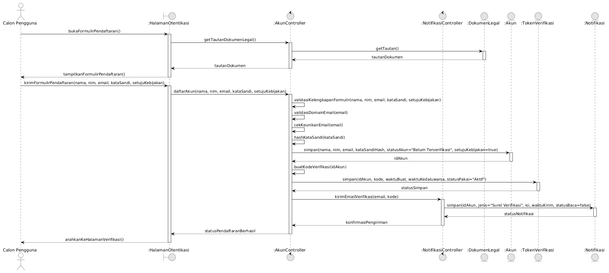

<i>Gambar 3.1. Sequence Diagram UC01 - Skenario Normal</i>

- **Skenario Alternatif 1: Domain Email Tidak Valid**

Skenario ini terjadi apabila calon pengguna memasukkan alamat surel yang tidak berakhiran domain institusi resmi (@itb.ac.id), seperti @gmail.com atau @yahoo.com. AkunController mendeteksi ketidaksesuaian domain, membatalkan penyimpanan, dan HalamanOtentikasi menampilkan pesan galat validasi institusi.

<i>Gambar 3.2. Sequence Diagram UC01 - Skenario Alternatif 1: Domain Email Tidak Valid</i>

- **Skenario Alternatif 2: Email Sudah Terdaftar**

Skenario ini terjadi apabila calon pengguna mendaftar dengan surel yang telah tersimpan sebelumnya pada basis data ITBELI. Pengecekan keunikan surel oleh AkunController menghasilkan status terdaftar, sehingga proses pembuatan akun digagalkan dan sistem menyarankan pengguna untuk masuk atau menggunakan alamat lain.

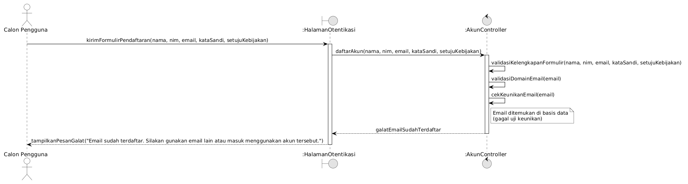

<i>Gambar 3.3. Sequence Diagram UC01 - Skenario Alternatif 2: Email Sudah Terdaftar</i>

### 3.1.3 Diagram Kelas

HalamanOtentikasi berasosiasi dengan AkunController. AkunController bergantung pada Akun, TokenVerifikasi, DokumenLegal, NotifikasiController, dan Kriptografi. NotifikasiController bergantung pada Notifikasi dan SurelAdapter. Relasi antar-*entity* pada diagram ini adalah Akun ke TokenVerifikasi berupa asosiasi 1 ke 0..*, Akun ke Notifikasi berupa asosiasi 1 ke 0..*, dan Akun ke DokumenLegal berupa asosiasi 0..* ke 1. Setiap kelas menampilkan atribut bertipe data dan operasi yang dipakai pada UC01, sehingga seluruh operasi yang dipanggil pada *sequence diagram* subbab sebelumnya tercantum pada kelas yang bersangkutan.

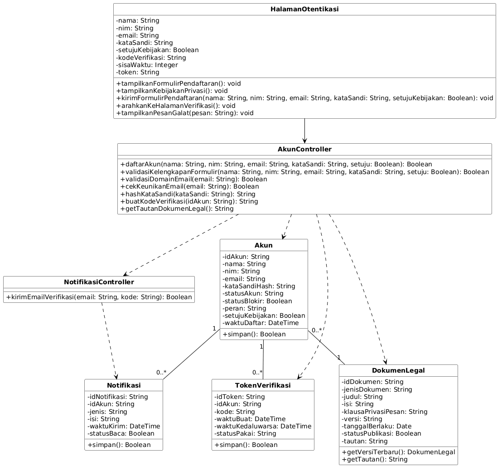

<i>Gambar 3.4. Diagram Kelas Use Case UC01</i>

---

## 3.2 Use Case Memverifikasi Surel

**ID Use Case:** UC02  
**Nama Use Case:** Memverifikasi Surel

### 3.2.1 Identifikasi Kelas

Realisasi use case verifikasi surel melibatkan antarmuka verifikasi untuk menerima kode masukan dan menampilkan hitung mundur waktu kedaluwarsa, kelas pengendali untuk memverifikasi keabsahan kode dan memperbarui status akun, serta entitas token verifikasi dan surel adapter untuk kebutuhan pengiriman ulang kode.

Tabel 3.2. Identifikasi Kelas Use Case UC02

| No | Nama Kelas Perancangan | Nama Kelas Analisis Terkait | Peran / Tanggung Jawab dalam Use Case |
| :--- | :--- | :--- | :--- |
| 1 | HalamanOtentikasi | C01 HalamanOtentikasi | Menyajikan kolom isian kode verifikasi, indikator hitung mundur 15 menit, opsi tombol kirim ulang, serta notifikasi hasil validasi. |
| 2 | AkunController | C13 AkunController | Memvalidasi kode verifikasi terhadap basis data token, memeriksa batas waktu kedaluwarsa, memperbarui status akun, serta memproses permintaan kode baru. |
| 3 | NotifikasiController | C19 NotifikasiController | Menangani pengiriman surel kode verifikasi baru ketika diminta pengiriman ulang. |
| 4 | Akun | C23 Akun | Menyimpan pembaruan status akun dari "Belum Terverifikasi" menjadi "Terverifikasi". |
| 5 | TokenVerifikasi | C27 TokenVerifikasi | Melakukan pencocokan kode masukan, pengecekan kedaluwarsa 15 menit, penandaan status terpakai, dan penandaan hangus saat kode baru dibangkitkan. |
| 6 | Notifikasi | C35 Notifikasi | Menyimpan rekaman riwayat pengiriman ulang kode verifikasi. |
| 7 | SurelAdapter | C43 SurelAdapter (Integrasi) | Mengirimkan surel berisi kode verifikasi baru ke alamat pengguna melalui SMTP. |

### 3.2.2 Sequence Diagram

- **Skenario Normal**

Pada skenario normal, pengguna menyalin kode verifikasi dari surel, memasukkannya ke antarmuka, lalu menekan tombol verifikasi. Sistem mencocokkan kode dengan data token, memastikan waktu belum melampaui 15 menit, mengubah status token menjadi terpakai, memperbarui status akun menjadi "Terverifikasi", dan mengarahkan pengguna ke halaman beranda/login.

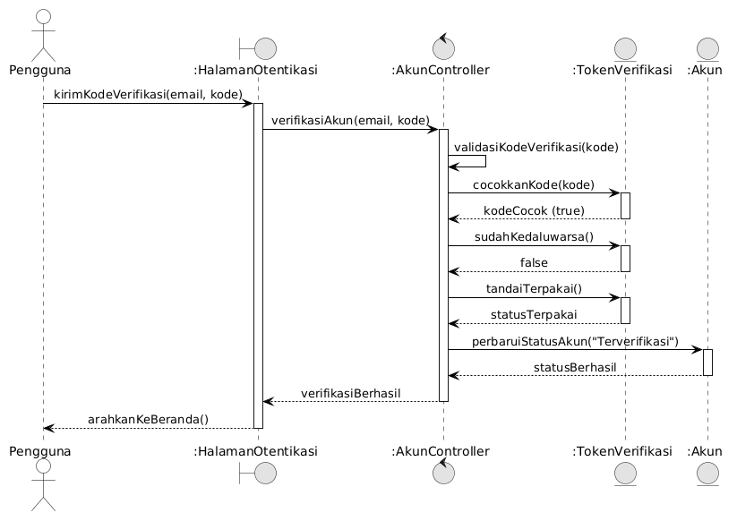

<i>Gambar 3.5. Sequence Diagram UC02 - Skenario Normal</i>

- **Skenario Alternatif 1: Kode Tidak Valid / Kedaluwarsa**

Skenario ini terjadi jika kode yang dimasukkan salah atau waktu penginputan telah melewati batas toleransi 15 menit. Sistem menolak pembaruan status akun dan menampilkan pesan galat yang menginstruksikan pengguna untuk meminta kode verifikasi baru.

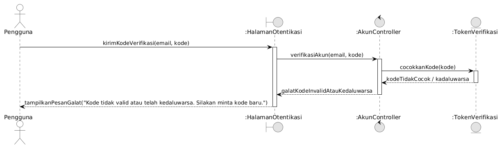

<i>Gambar 3.6. Sequence Diagram UC02 - Skenario Alternatif 1: Kode Tidak Valid / Kedaluwarsa</i>

- **Skenario Alternatif 2: Meminta Pengiriman Ulang Kode**

Skenario ini terjadi saat pengguna menekan tombol "Kirim Ulang Kode". Sistem menandai token lama sebagai hangus (*invalidated*), membangkitkan kode baru dengan batas waktu 15 menit baru, menyimpannya ke basis data, mengirimkannya melalui SurelAdapter, dan me-reset hitung mundur di layar antarmuka.

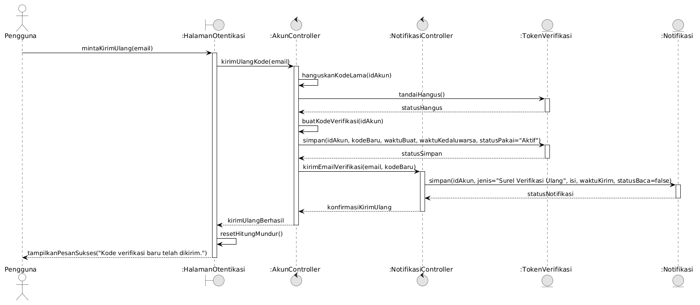

<i>Gambar 3.7. Sequence Diagram UC02 - Skenario Alternatif 2: Meminta Pengiriman Ulang Kode</i>

### 3.2.3 Diagram Kelas

HalamanOtentikasi berasosiasi dengan AkunController. AkunController bergantung pada Akun, TokenVerifikasi, dan NotifikasiController. NotifikasiController bergantung pada Notifikasi dan SurelAdapter. Relasi antar-*entity* pada diagram ini adalah Akun ke TokenVerifikasi berupa asosiasi 1 ke 0..* dan Akun ke Notifikasi berupa asosiasi 1 ke 0..*. Setiap kelas menampilkan atribut bertipe data dan operasi yang dipakai pada UC02, sehingga seluruh operasi yang dipanggil pada *sequence diagram* subbab sebelumnya tercantum pada kelas yang bersangkutan.

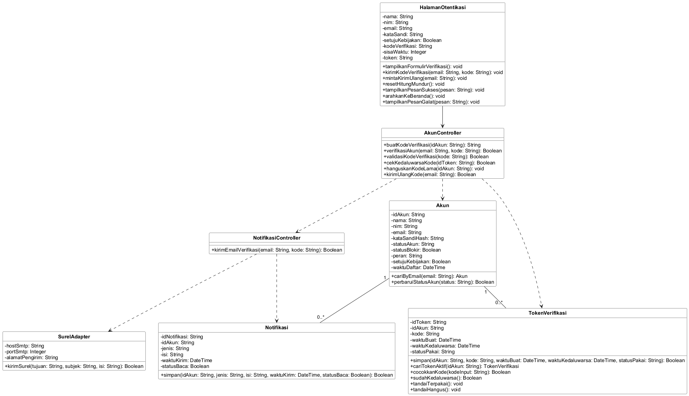

<i>Gambar 3.8. Diagram Kelas Use Case UC02</i>

---

## 3.3 Use Case Masuk ke Sistem (Login)

**ID Use Case:** UC03  
**Nama Use Case:** Masuk ke Sistem (Login)

### 3.3.1 Identifikasi Kelas

Realisasi use case login melibatkan antarmuka autentikasi untuk menerima kredensial, controller untuk memverifikasi kecocokan hash sandi dan memeriksa status keaktifan akun, modul kriptografi untuk verifikasi bcrypt, serta entitas sesi untuk pembentukan token akses (JWT).

Tabel 3.3. Identifikasi Kelas Use Case UC03

| No | Nama Kelas Perancangan | Nama Kelas Analisis Terkait | Peran / Tanggung Jawab dalam Use Case |
| :--- | :--- | :--- | :--- |
| 1 | HalamanOtentikasi | C01 HalamanOtentikasi | Menyajikan formulir login, menangkap surel dan kata sandi, serta menampilkan pesan kegagalan (kredensial salah, belum verifikasi, atau terblokir). |
| 2 | AkunController | C13 AkunController | Mengorkestrasikan login: pencarian akun, pemanggilan verifikasi hash sandi, pemeriksaan status akun dan blokir, serta penerbitan token sesi. |
| 3 | Akun | C23 Akun | Menyimpan data kredensial, status verifikasi akun, status pemblokiran, dan peran pengguna (Pembeli/Penjual/Admin). |
| 4 | SesiLogin | C28 SesiLogin | Membangkitkan token sesi (JWT) bertenggat kedaluwarsa 24 jam dan menyimpannya sebagai catatan sesi aktif. |
| 5 | Kriptografi | C42 Kriptografi (Pendukung) | Membandingkan kata sandi teks murni dengan nilai hash bcrypt yang tersimpan secara aman. |

### 3.3.2 Sequence Diagram

- **Skenario Normal**

Pada skenario normal, pengguna memasukkan surel dan kata sandi yang valid. AkunController mengambil data akun, memverifikasi hash melalui Kriptografi, memastikan status akun adalah "Terverifikasi" dan tidak terblokir, membangkitkan token sesi 24 jam melalui SesiLogin, serta mengarahkan pengguna ke beranda aplikasi.

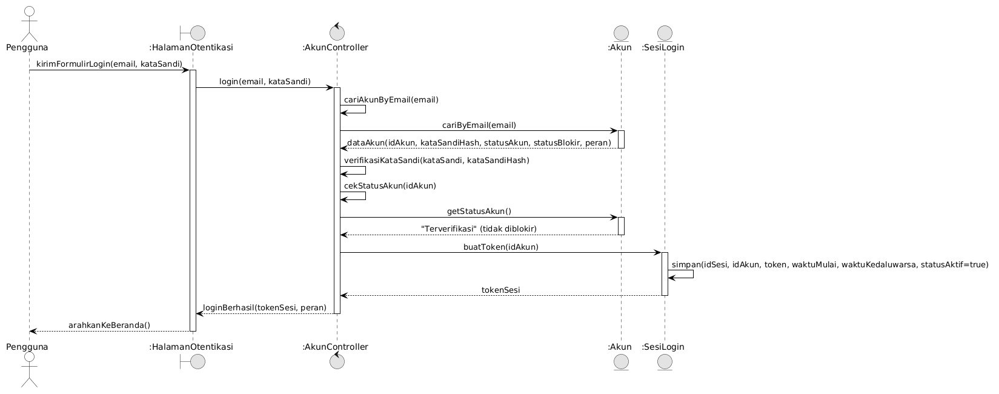

<i>Gambar 3.9. Sequence Diagram UC03 - Skenario Normal</i>

- **Skenario Alternatif 1: Kredensial Tidak Sesuai**

Skenario ini terjadi saat surel tidak ditemukan pada sistem atau kata sandi yang dimasukkan tidak cocok dengan nilai hash yang tersimpan. Sistem menolak pembentukan sesi dan memunculkan pesan galat kredensial salah.

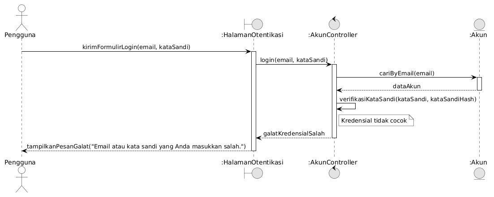

<i>Gambar 3.10. Sequence Diagram UC03 - Skenario Alternatif 1: Kredensial Tidak Sesuai</i>

- **Skenario Alternatif 2: Akun Belum Terverifikasi**

Skenario ini terjadi ketika kredensial pengguna cocok, namun atribut status akun masih bernilai "Belum Terverifikasi". Sistem menahan pembuatan sesi login dan menampilkan pesan peringatan beserta tombol pintasan untuk verifikasi/kirim ulang kode.

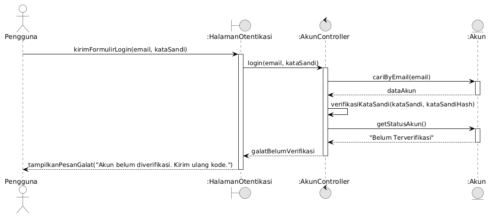

<i>Gambar 3.11. Sequence Diagram UC03 - Skenario Alternatif 2: Akun Belum Terverifikasi</i>

- **Skenario Alternatif 3: Akun Sedang Diblokir**

Skenario ini terjadi jika kredensial cocok dan akun terverifikasi, namun nilai atribut statusBlokir bernilai true (telah ditangguhkan oleh admin). Sistem membatalkan sesi masuk dan menampilkan pesan penangguhan resmi.

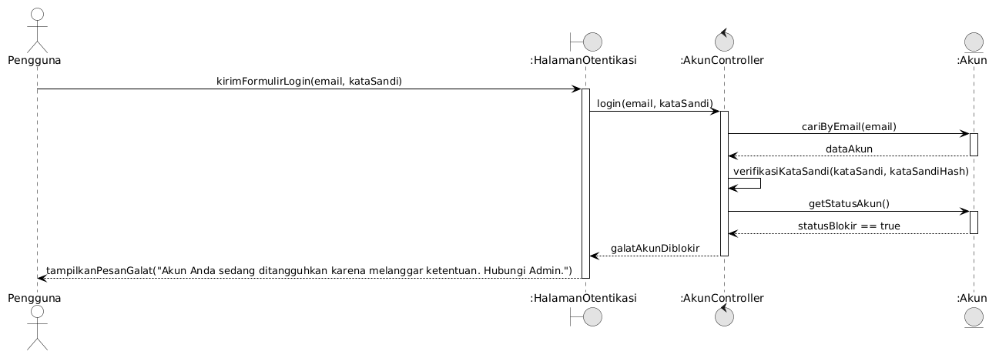

<i>Gambar 3.12. Sequence Diagram UC03 - Skenario Alternatif 3: Akun Sedang Diblokir</i>

### 3.3.3 Diagram Kelas

HalamanOtentikasi berasosiasi dengan AkunController. AkunController bergantung pada Akun, SesiLogin, dan Kriptografi. Relasi antar-*entity* pada diagram ini adalah Akun ke SesiLogin berupa asosiasi 1 ke 0..*. Setiap kelas menampilkan atribut bertipe data dan operasi yang dipakai pada UC03, sehingga seluruh operasi yang dipanggil pada *sequence diagram* subbab sebelumnya tercantum pada kelas yang bersangkutan.

<i>Gambar 3.13. Diagram Kelas Use Case UC03</i>

---

## 3.4 Use Case Keluar dari Sistem (Logout)

**ID Use Case:** UC04  
**Nama Use Case:** Keluar dari Sistem (Logout)

### 3.4.1 Identifikasi Kelas

Realisasi use case logout melibatkan komponen antarmuka yang menyediakan tombol keluar, controller untuk memproses pencabutan otorisasi, modul otorisasi untuk validasi token, serta entitas sesi login untuk menonaktifkan token secara permanen.

Tabel 3.4. Identifikasi Kelas Use Case UC04

| No | Nama Kelas Perancangan | Nama Kelas Analisis Terkait | Peran / Tanggung Jawab dalam Use Case |
| :--- | :--- | :--- | :--- |
| 1 | HalamanOtentikasi | C01 HalamanOtentikasi | Menampilkan opsi tombol "Keluar", mengirimkan permintaan logout, menghapus token lokal peramban, dan mengalihkan ke halaman login. |
| 2 | AkunController | C13 AkunController | Memproses permintaan pencabutan sesi di sisi server web. |
| 3 | Akun | C23 Akun | Entitas pemilik sesi login yang sedang aktif. |
| 4 | SesiLogin | C28 SesiLogin | Mengubah status sesi menjadi tidak aktif (*revoked*) atau menghapus rekaman sesi aktif dari basis data. |
| 5 | Otorisasi | C41 Otorisasi (Pendukung) | Memvalidasi keberlakuan token sesi pengguna sebelum dieksekusi pencabutannya. |

### 3.4.2 Sequence Diagram

- **Skenario Normal**

Pengguna yang sedang masuk mengklik menu profil dan memilih "Keluar". Permintaan diteruskan ke AkunController yang memvalidasi token melalui Otorisasi dan mencabut sesi di entitas SesiLogin. Setelah berhasil, token pada penyimpanan lokal peramban dihapus dan tampilan dialihkan ke halaman login.

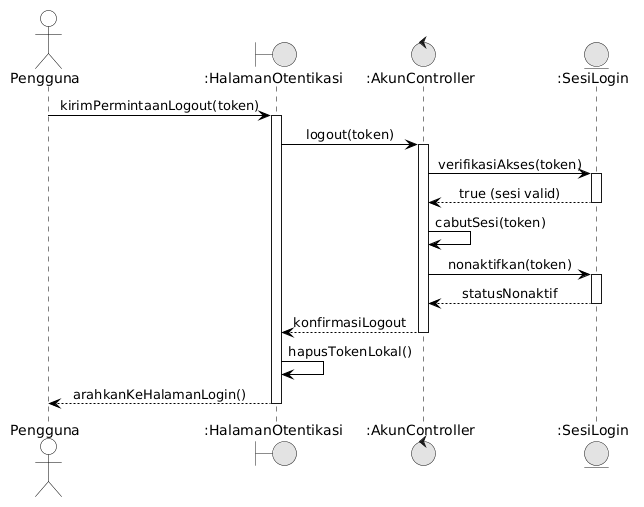

<i>Gambar 3.14. Sequence Diagram UC04 - Skenario Normal</i>

### 3.4.3 Diagram Kelas

HalamanOtentikasi berasosiasi dengan AkunController. AkunController bergantung pada SesiLogin dan Otorisasi. Otorisasi bergantung pada SesiLogin. Relasi antar-*entity* pada diagram ini adalah Akun ke SesiLogin berupa asosiasi 1 ke 0..*. Setiap kelas menampilkan atribut bertipe data dan operasi yang dipakai pada UC04, sehingga seluruh operasi yang dipanggil pada *sequence diagram* subbab sebelumnya tercantum pada kelas yang bersangkutan.

<i>Gambar 3.15. Diagram Kelas Use Case UC04</i>

---

## 3.5 Use Case Melihat Profil Akun

**ID Use Case:** UC05  
**Nama Use Case:** Melihat Profil Akun

### 3.5.1 Identifikasi Kelas

Realisasi use case melihat profil melibatkan antarmuka profil akun dan komponen kartu produk, controller akun untuk menghimpun data identitas dan daftar listing milik pengguna, modul otorisasi untuk mengekstrak identitas dari token sesi, serta entitas Akun, Barang, dan DokumenLegal.

Tabel 3.5. Identifikasi Kelas Use Case UC05

| No | Nama Kelas Perancangan | Nama Kelas Analisis Terkait | Peran / Tanggung Jawab dalam Use Case |
| :--- | :--- | :--- | :--- |
| 1 | HalamanProfil | C02 HalamanProfil | Menampilkan informasi identitas (nama, NIM, surel), daftar kartu barang dagangan milik sendiri, dan menu pengaturan akun. |
| 2 | KartuProduk | C06 KartuProduk | Komponen visual penyaji ringkasan tiap listing produk milik akun pada antarmuka profil. |
| 3 | AkunController | C13 AkunController | Mengambil identitas akun dan deretan listing yang berelasi dengan idAkun sesi pengguna aktif. |
| 4 | Akun | C23 Akun | Menyediakan data identitas profil (nama, NIM, surel). |
| 5 | Pembeli | C24 Pembeli | Peran pembeli dari akun yang melihat profil. |
| 6 | Penjual | C25 Penjual | Peran penjual dari akun yang melihat profil dan mengelola barang dagangannya. |
| 7 | SesiLogin | C28 SesiLogin | Menyediakan konteks idAkun yang terikat pada token sesi login aktif. |
| 8 | Barang | C29 Barang | Menyediakan sekumpulan entitas produk yang dimiliki oleh idAkun pengguna. |
| 9 | DokumenLegal | C40 DokumenLegal | Menyediakan tautan Kebijakan Privasi yang dapat dibuka melalui menu pengaturan akun. |
| 10 | Otorisasi | C41 Otorisasi (Pendukung) | Mengekstrak dan memverifikasi idAkun dari token sesi otentikasi. |

### 3.5.2 Sequence Diagram

- **Skenario Normal**

Pengguna membuka menu profil. Sistem mengekstrak idAkun dari token sesi melalui Otorisasi, mengambil data identitas dari Akun, mengambil daftar listing dari entitas Barang, dan merender tampilan profil beserta kartu produk. Ketika pengguna membuka pengaturan akun, sistem menyediakan tautan dokumen kebijakan privasi.

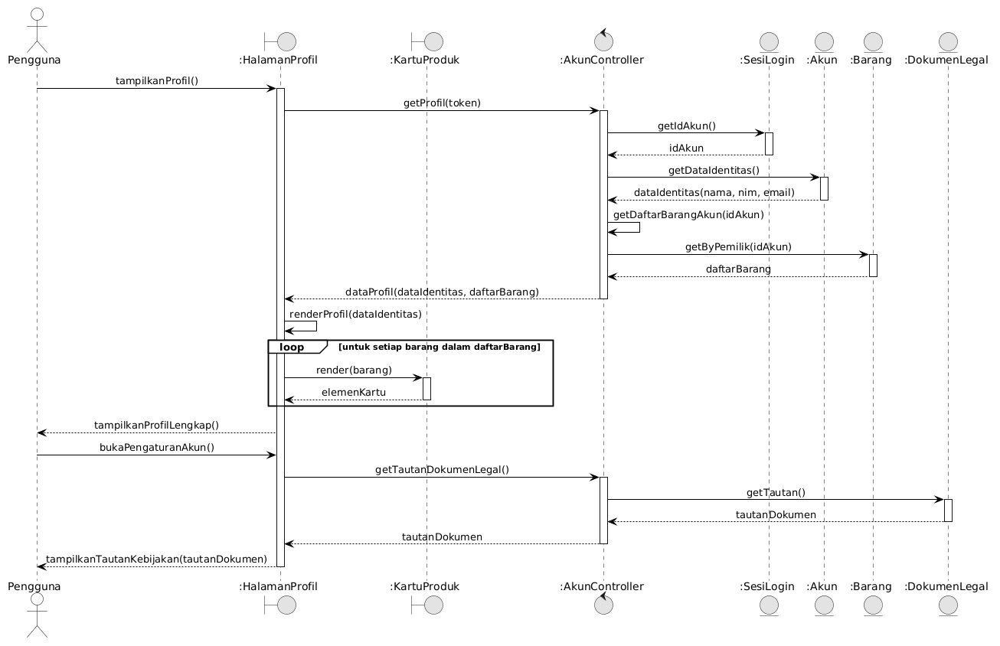

<i>Gambar 3.16. Sequence Diagram UC05 - Skenario Normal</i>

### 3.5.3 Diagram Kelas

HalamanProfil berasosiasi dengan AkunController. HalamanProfil memiliki relasi komposisi 1 ke 0..* terhadap KartuProduk. AkunController bergantung pada Akun, SesiLogin, Barang, DokumenLegal, dan Otorisasi. Otorisasi bergantung pada SesiLogin. Pembeli dan Penjual merupakan turunan (generalisasi) dari Akun. Relasi antar-*entity* pada diagram ini adalah Akun ke SesiLogin berupa asosiasi 1 ke 0..*, Akun ke DokumenLegal berupa asosiasi 0..* ke 1, dan Penjual ke Barang berupa komposisi 1 ke 0..*. Setiap kelas menampilkan atribut bertipe data dan operasi yang dipakai pada UC05, sehingga seluruh operasi yang dipanggil pada *sequence diagram* subbab sebelumnya tercantum pada kelas yang bersangkutan.

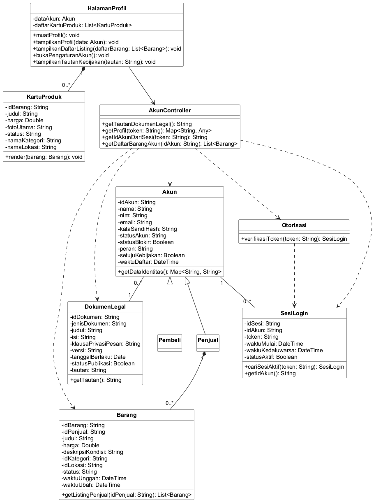

<i>Gambar 3.17. Diagram Kelas Use Case UC05</i>

---

## 3.6 Use Case Melihat Kebijakan Privasi dan Ketentuan Penggunaan

**ID Use Case:** UC06  
**Nama Use Case:** Melihat Kebijakan Privasi dan Ketentuan Penggunaan

### 3.6.1 Identifikasi Kelas

Realisasi use case dokumen legal melibatkan antarmuka pembaca naskah hukum, controller pengambil dokumen legal yang sedang berlaku, serta entitas DokumenLegal yang menyimpan teks statis dan klausul penjaminan kerahasiaan percakapan pribadi.

Tabel 3.6. Identifikasi Kelas Use Case UC06

| No | Nama Kelas Perancangan | Nama Kelas Analisis Terkait | Peran / Tanggung Jawab dalam Use Case |
| :--- | :--- | :--- | :--- |
| 1 | HalamanDokumenLegal | C12 HalamanDokumenLegal | Merender teks dokumen hukum secara penuh dan memberikan penekanan visual khusus pada klausul privasi percakapan. |
| 2 | DokumenLegalController | C22 DokumenLegalController | Mengambil naskah dokumen kebijakan versi aktif dan klausul proteksi percakapan. |
| 3 | DokumenLegal | C40 DokumenLegal | Menyimpan data dokumen hukum (versi, tanggal berlaku, teks isi, dan klausul privasi). |

### 3.6.2 Sequence Diagram

- **Skenario Normal**

Pengguna mengklik tautan dokumen hukum dari formulir pendaftaran, profil, atau ruang percakapan. DokumenLegalController mengambil naskah versi terbaru beserta klausul spesifik yang menyatakan bahwa isi percakapan pribadi dienkripsi dan tidak dapat diakses admin maupun pengembang sistem. HalamanDokumenLegal merender teks dan menyoroti klausul tersebut.

<i>Gambar 3.18. Sequence Diagram UC06 - Skenario Normal</i>

### 3.6.3 Diagram Kelas

HalamanDokumenLegal berasosiasi dengan DokumenLegalController. DokumenLegalController bergantung pada DokumenLegal. Setiap kelas menampilkan atribut bertipe data dan operasi yang dipakai pada UC06, sehingga seluruh operasi yang dipanggil pada *sequence diagram* subbab sebelumnya tercantum pada kelas yang bersangkutan.

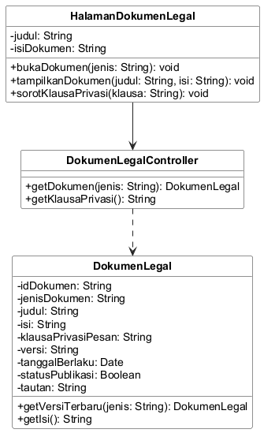

<i>Gambar 3.19. Diagram Kelas Use Case UC06</i>

---

## 3.7 Use Case Membuat Listing

**ID Use Case:** UC07  
**Nama Use Case:** Membuat Listing

### 3.7.1 Identifikasi Kelas

Realisasi use case pembuatan listing melibatkan antarmuka formulir barang (dengan validasi berkas dan isian di sisi klien), controller barang untuk validasi ganda di sisi server dan orkestrasinya, modul otorisasi untuk identifikasi penjual, entitas data referensi (Kategori dan LokasiCOD), entitas utama Barang dan FotoBarang, serta layanan penyimpanan berkas (Supabase Storage).

Tabel 3.7. Identifikasi Kelas Use Case UC07

| No | Nama Kelas Perancangan | Nama Kelas Analisis Terkait | Peran / Tanggung Jawab dalam Use Case |
| :--- | :--- | :--- | :--- |
| 1 | FormulirBarang | C04 FormulirBarang | Menampilkan formulir input barang, memvalidasi tipe data dan spesifikasi foto di browser, menandai isian kosong, serta mengirimkan data ke backend. |
| 2 | BarangController | C14 BarangController | Menjalankan validasi server (kelengkapan isian dan keabsahan berkas), mengunggah berkas foto ke storage, menyimpan objek Barang dan FotoBarang, serta menerbitkan produk ke katalog. |
| 3 | Penjual | C25 Penjual | Aktor pengguna yang berwenang menerbitkan produk jualan. |
| 4 | SesiLogin | C28 SesiLogin | Menyediakan konteks idPenjual dari sesi login aktif. |
| 5 | Barang | C29 Barang | Menyimpan informasi utama listing dengan status ketersediaan awal "Tersedia". |
| 6 | FotoBarang | C30 FotoBarang | Menyimpan metadata berkas foto produk (1 sampai 5 foto, JPG/PNG, ukuran ≤ 5 MB). |
| 7 | Kategori | C31 Kategori | Menyediakan daftar kategori barang tetap dan memvalidasi keabsahan kategori yang dipilih. |
| 8 | LokasiCOD | C32 LokasiCOD | Menyediakan pilihan titik temu fisik transaksi COD di wilayah kampus ITB. |
| 9 | Otorisasi | C41 Otorisasi (Pendukung) | Memverifikasi token sesi dan memastikan idAkun berstatus aktif. |
| 10 | PenyimpananBerkas | C45 PenyimpananBerkas (Penyimpanan Data) | Layanan Supabase Storage untuk menyimpan fisik berkas foto produk secara persisten. |

### 3.7.2 Sequence Diagram

- **Skenario Normal**

Penjual mengisi formulir produk, mengunggah foto yang memenuhi syarat (maksimum 5 foto JPG/PNG, ≤ 5 MB), lalu menekan tombol simpan. Sistem melakukan verifikasi token, validasi ganda kelengkapan formulir dan foto di sisi server, mengunggah berkas ke Supabase Storage, menyimpan entitas Barang dengan status "Tersedia", menyimpan rujukan FotoBarang, dan menerbitkannya ke katalog utama.

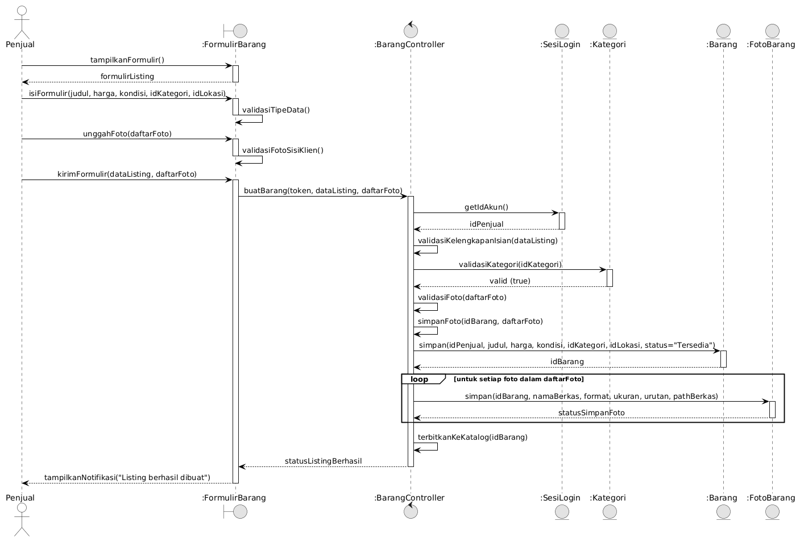

<i>Gambar 3.20. Sequence Diagram UC07 - Skenario Normal</i>

- **Skenario Alternatif 1: Isian Formulir Tidak Lengkap**

Skenario ini terjadi apabila penjual mengosongkan kolom wajib (misalnya judul, harga, atau tidak memilih kategori). FormulirBarang mendeteksi kegagalan pada validasi wajib-isi di sisi klien, membatalkan pengiriman ke backend, dan memberi penanda visual merah pada kolom yang terlewat.

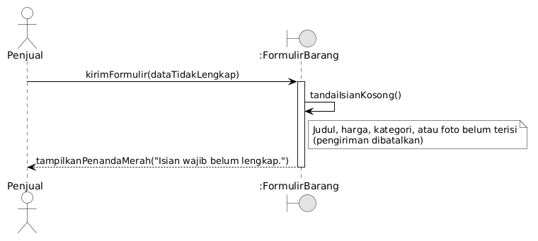

<i>Gambar 3.21. Sequence Diagram UC07 - Skenario Alternatif 1: Isian Formulir Tidak Lengkap</i>

- **Skenario Alternatif 2: Pelanggaran Syarat Unggahan Foto**

Skenario ini terjadi ketika penjual mencoba mengunggah foto berformat di luar JPG/PNG (misal .pdf atau .heic), berkas berukuran lebih dari 5 MB, atau mencoba mengunggah lebih dari 5 foto. FormulirBarang memblokir pratinjau berkas dan menampilkan pesan galat spesifikasi berkas.

<i>Gambar 3.22. Sequence Diagram UC07 - Skenario Alternatif 2: Pelanggaran Syarat Unggahan Foto</i>

### 3.7.3 Diagram Kelas

FormulirBarang berasosiasi dengan BarangController. BarangController bergantung pada SesiLogin, Barang, FotoBarang, Kategori, LokasiCOD, Otorisasi, dan PenyimpananBerkas. Otorisasi bergantung pada SesiLogin. Relasi antar-*entity* pada diagram ini adalah Penjual ke Barang berupa komposisi 1 ke 0..*, Barang ke FotoBarang berupa komposisi 1 ke 1..5, Kategori ke Barang berupa asosiasi 1 ke 0..*, dan LokasiCOD ke Barang berupa asosiasi 1 ke 0..*. Setiap kelas menampilkan atribut bertipe data dan operasi yang dipakai pada UC07, sehingga seluruh operasi yang dipanggil pada *sequence diagram* subbab sebelumnya tercantum pada kelas yang bersangkutan.

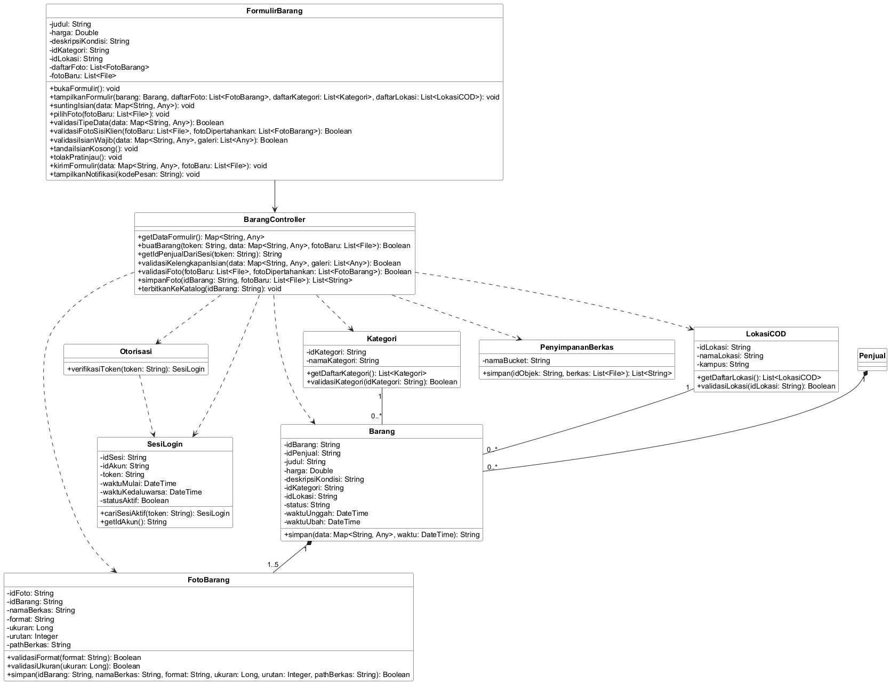

<i>Gambar 3.23. Diagram Kelas Use Case UC07</i>

---

## 3.8 Use Case Melihat Daftar Listing Milik Sendiri

**ID Use Case:** UC08  
**Nama Use Case:** Melihat Daftar Listing Milik Sendiri

### 3.8.1 Identifikasi Kelas

Realisasi use case ini melibatkan antarmuka dasbor listing penjual dan komponen kartu produk, controller barang untuk mengambil dan mengelompokkan data berdasarkan status, modul otorisasi untuk mengekstrak identitas penjual dari token sesi, serta entitas Penjual, SesiLogin, dan Barang.

Tabel 3.8. Identifikasi Kelas Use Case UC08

| No | Nama Kelas Perancangan | Nama Kelas Analisis Terkait | Peran / Tanggung Jawab dalam Use Case |
| :--- | :--- | :--- | :--- |
| 1 | HalamanListingPenjual | C03 HalamanListingPenjual | Menyajikan dasbor kelola jualan dengan pemisahan tab barang "Tersedia" dan tab riwayat "Terjual". |
| 2 | KartuProduk | C06 KartuProduk | Merender representasi visual ringkas tiap produk pada masing-masing tab. |
| 3 | BarangController | C14 BarangController | Mengambil seluruh listing milik idPenjual yang sedang masuk dan mengelompokkannya menurut label status. |
| 4 | Penjual | C25 Penjual | Aktor pemilik listing yang mengakses riwayat jualannya. |
| 5 | SesiLogin | C28 SesiLogin | Menyediakan konteks idAkun penjual dari token sesi yang aktif. |
| 6 | Barang | C29 Barang | Entitas data produk jualan beserta status ketersediaannya. |
| 7 | Otorisasi | C41 Otorisasi (Pendukung) | Memverifikasi token sesi dan mengekstrak identitas pengguna. |

### 3.8.2 Sequence Diagram

- **Skenario Normal**

Penjual membuka menu "Listing Saya". Sistem memvalidasi token sesi, mengambil seluruh data listing milik idPenjual dari entitas Barang, mengelompokkan barang ke dalam daftar "Tersedia" dan riwayat "Terjual", lalu merender HalamanListingPenjual dengan tab aktif yang menampilkan kartu produk untuk masing-masing item.

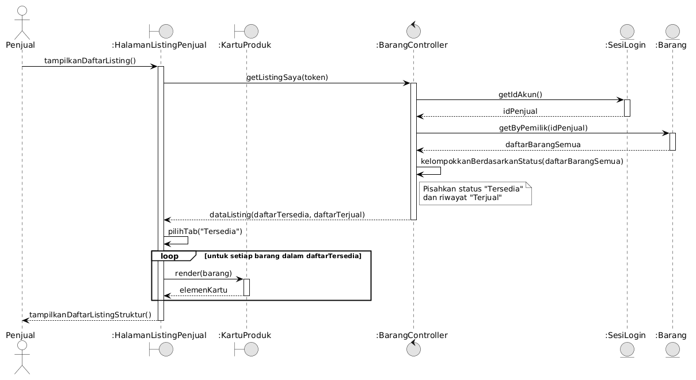

<i>Gambar 3.24. Sequence Diagram UC08 - Skenario Normal</i>

### 3.8.3 Diagram Kelas

HalamanListingPenjual berasosiasi dengan BarangController. HalamanListingPenjual memiliki relasi komposisi 1 ke 0..* terhadap KartuProduk. BarangController bergantung pada SesiLogin, Barang, dan Otorisasi. Otorisasi bergantung pada SesiLogin. Relasi antar-*entity* pada diagram ini adalah Penjual ke Barang berupa komposisi 1 ke 0..*. Setiap kelas menampilkan atribut bertipe data dan operasi yang dipakai pada UC08, sehingga seluruh operasi yang dipanggil pada *sequence diagram* subbab sebelumnya tercantum pada kelas yang bersangkutan.

<i>Gambar 3.25. Diagram Kelas Use Case UC08</i>

 

---

## 3.9 Use Case Mengubah Listing

**ID Use Case:** UC09  
**Nama Use Case:** Mengubah Listing

### 3.9.1 Identifikasi Kelas

Realisasi use case pengubahan listing melibatkan antarmuka daftar listing penjual sebagai titik masuk, formulir barang untuk menyunting isian dan galeri foto beserta validasi sisi klien, controller barang untuk verifikasi kepemilikan dan validasi ulang di sisi server, modul otorisasi untuk identifikasi penjual, entitas Barang, FotoBarang, Kategori, dan LokasiCOD, serta penyimpanan berkas untuk foto baru maupun foto yang dibuang.

Tabel 3.9. Identifikasi Kelas Use Case UC09

| No | Nama Kelas Perancangan | Nama Kelas Analisis Terkait | Peran / Tanggung Jawab dalam Use Case |
| :--- | :--- | :--- | :--- |
| 1 | HalamanListingPenjual | C03 HalamanListingPenjual | Menyediakan tombol "Ubah Listing" pada kartu listing milik penjual sebagai titik masuk pengubahan. |
| 2 | FormulirBarang | C04 FormulirBarang | Menampilkan formulir berisi nilai lama dan galeri foto, memvalidasi tipe data, isian wajib, serta ketentuan foto di sisi klien, lalu mengirim perubahan. |
| 3 | BarangController | C14 BarangController | Memverifikasi kepemilikan, mengulang validasi isian dan foto di sisi server, mengunggah foto baru, menghapus foto yang dibuang, dan menyimpan perubahan. |
| 4 | Penjual | C25 Penjual | Peran pemilik listing yang berwenang mengubah listing. |
| 5 | SesiLogin | C28 SesiLogin | Menyediakan idAkun penjual dari sesi aktif untuk verifikasi kepemilikan. |
| 6 | Barang | C29 Barang | Menyimpan perubahan atribut listing beserta waktu pengubahan. |
| 7 | FotoBarang | C30 FotoBarang | Menyediakan galeri foto lama dan memperbarui susunan foto (1 sampai 5 berkas). |
| 8 | Kategori | C31 Kategori | Menyediakan daftar kategori tetap dan memvalidasi kategori yang dipilih. |
| 9 | LokasiCOD | C32 LokasiCOD | Menyediakan daftar titik temu COD dan memvalidasi lokasi yang dipilih. |
| 10 | Otorisasi | C41 Otorisasi (Pendukung) | Memverifikasi token sesi penjual. |
| 11 | PenyimpananBerkas | C45 PenyimpananBerkas (Penyimpanan Data) | Menyimpan foto baru dan menghapus berkas foto yang dibuang pada Supabase Storage. |

### 3.9.2 Sequence Diagram

- **Skenario Normal**

Penjual menekan "Ubah Listing" pada halaman "Listing Saya". BarangController memverifikasi token melalui Otorisasi, mencocokkan idAkun dari sesi dengan pemilik listing, lalu mengirim data listing, galeri foto, daftar kategori, dan daftar lokasi untuk ditampilkan pada FormulirBarang. Penjual menyunting isian dan mengganti sebagian foto, sementara FormulirBarang memvalidasi tipe data dan ketentuan foto di sisi klien. Saat "Simpan Perubahan" ditekan, BarangController mengulang verifikasi kepemilikan serta validasi isian dan foto, mengunggah foto baru ke PenyimpananBerkas, menghapus berkas foto yang dibuang, memperbarui galeri FotoBarang, dan menyimpan perubahan Barang. Penjual kemudian diarahkan ke halaman detail listing.

<i>Gambar 3.26. Sequence Diagram UC09 - Skenario Normal</i>

- **Skenario Alternatif 1:  Kolom Wajib Dikosongkan saat Pengubahan**

Skenario ini terjadi apabila penjual mengosongkan kolom wajib, misalnya harga atau kategori, lalu menekan "Simpan Perubahan". FormulirBarang mendeteksi isian wajib yang kosong, menandai kolom tersebut, dan tidak mengirim perubahan, sehingga listing tetap pada versi lamanya (KF18). Setelah kolom dilengkapi dan disimpan ulang, penyimpanan berjalan seperti skenario normal.

<i>Gambar 3.27. Sequence Diagram UC09 — Skenario Alternatif 1</i>

- **Skenario Alternatif 2: Pelanggaran Syarat Unggahan Foto saat Pengubahan**

Skenario ini terjadi apabila penjual menambahkan foto berformat selain JPG/PNG, berukuran lebih dari 5 MB, atau membuat jumlah foto melebihi 5. FormulirBarang menolak pratinjau berkas tersebut dan menampilkan pesan ketentuan yang dilanggar. Penyimpanan tidak dijalankan sampai berkas diperbaiki (KF24).

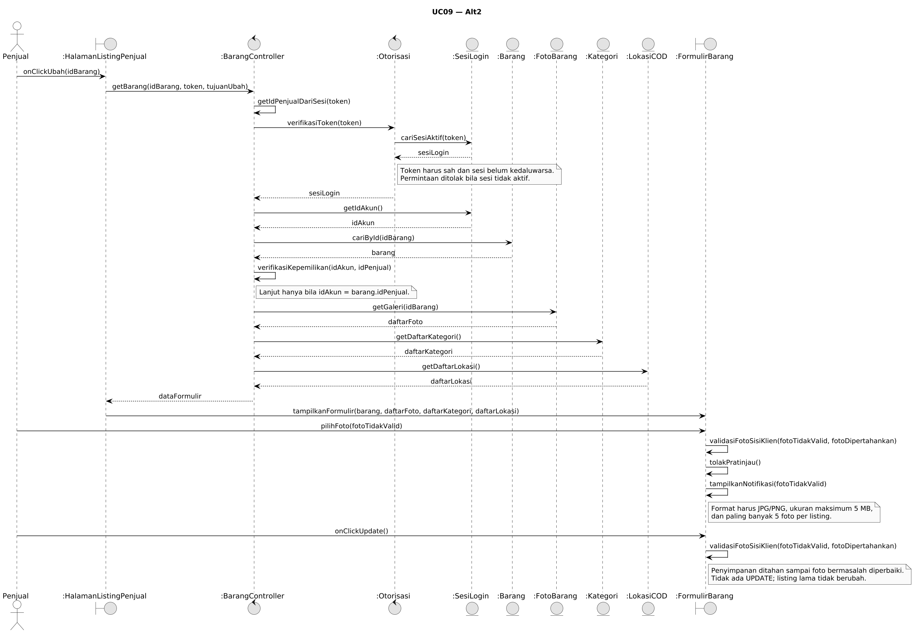

<i>Gambar 3.28. Sequence Diagram UC09 — Alternatif 2</i>

- **Skenario Alternatif 3: Percobaan Pengubahan oleh Akun Bukan Pemilik**

Skenario ini terjadi apabila akun yang bukan pemilik mencoba membuka atau mengirim perubahan listing milik penjual lain. BarangController membandingkan idAkun dari sesi dengan pemilik listing, mendapati keduanya berbeda, dan menolak permintaan tanpa mengubah data listing (KF22).

<i>Gambar 3.29. Sequence Diagram UC09 - Skenario Alternatif 3</i>

### 3.9.3 Diagram Kelas

HalamanListingPenjual berasosiasi dengan BarangController dan FormulirBarang. FormulirBarang berasosiasi dengan BarangController. BarangController bergantung pada SesiLogin, Barang, FotoBarang, Kategori, LokasiCOD, Otorisasi, dan PenyimpananBerkas. Otorisasi bergantung pada SesiLogin. Relasi antar-*entity* pada diagram ini adalah Penjual ke Barang berupa komposisi 1 ke 0..*, Barang ke FotoBarang berupa komposisi 1 ke 1..5, Kategori ke Barang berupa asosiasi 1 ke 0..*, dan LokasiCOD ke Barang berupa asosiasi 1 ke 0..*. Setiap kelas menampilkan atribut bertipe data dan operasi yang dipakai pada UC09, sehingga seluruh operasi yang dipanggil pada *sequence diagram* subbab sebelumnya tercantum pada kelas yang bersangkutan.

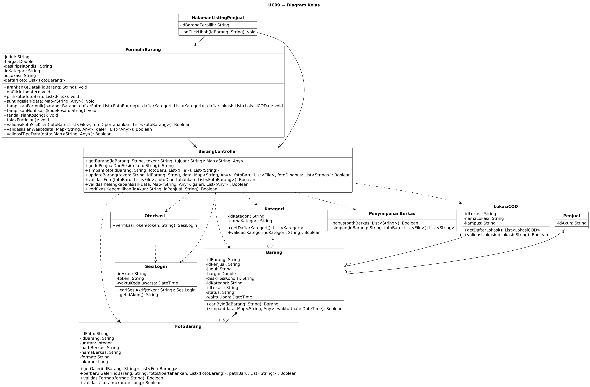

<i>Gambar 3.30. Diagram Kelas UC09</i>

---

## 3.10 Use Case Menghapus Listing

**ID Use Case:** UC10  
**Nama Use Case:** Menghapus Listing

### 3.10.1 Identifikasi Kelas

Realisasi use case penghapusan listing melibatkan antarmuka daftar listing penjual untuk aksi hapus dan dialog konfirmasi, controller barang untuk verifikasi kepemilikan dan penghapusan, modul otorisasi, entitas Barang dan FotoBarang, serta penyimpanan berkas untuk menghapus berkas foto.

Tabel 3.10. Identifikasi Kelas Use Case UC10

| No | Nama Kelas Perancangan | Nama Kelas Analisis Terkait | Peran / Tanggung Jawab dalam Use Case |
| :--- | :--- | :--- | :--- |
| 1 | HalamanListingPenjual | C03 HalamanListingPenjual | Menyediakan aksi "Hapus Listing" dan dialog konfirmasi, lalu memuat ulang daftar listing setelah penghapusan. |
| 2 | BarangController | C14 BarangController | Memverifikasi kepemilikan sebelum konfirmasi dan sebelum penghapusan, lalu menghapus listing beserta fotonya. |
| 3 | Penjual | C25 Penjual | Pemilik listing yang berwenang menghapus listing. |
| 4 | SesiLogin | C28 SesiLogin | Menyediakan idAkun penjual dari sesi aktif. |
| 5 | Barang | C29 Barang | Entitas listing yang dihapus dari sistem. |
| 6 | FotoBarang | C30 FotoBarang | Menyediakan daftar foto listing dan menghapus metadata fotonya. |
| 7 | Otorisasi | C41 Otorisasi (Pendukung) | Memverifikasi token sesi penjual. |
| 8 | PenyimpananBerkas | C45 PenyimpananBerkas (Penyimpanan Data) | Menghapus berkas foto listing dari Supabase Storage. |

### 3.10.2 Sequence Diagram

- **Skenario Normal**

Penjual memilih "Hapus Listing" pada halaman "Listing Saya". BarangController memverifikasi token dan kepemilikan listing, lalu HalamanListingPenjual menampilkan dialog konfirmasi berisi judul listing dan peringatan bahwa penghapusan bersifat permanen. Setelah penjual mengonfirmasi, BarangController mengulang verifikasi kepemilikan, mengambil galeri foto, menghapus FotoBarang dan Barang, lalu menghapus berkas fotonya dari PenyimpananBerkas. Dialog ditutup, notifikasi berhasil ditampilkan, dan daftar listing dimuat ulang sehingga listing tidak lagi muncul di katalog maupun pencarian.

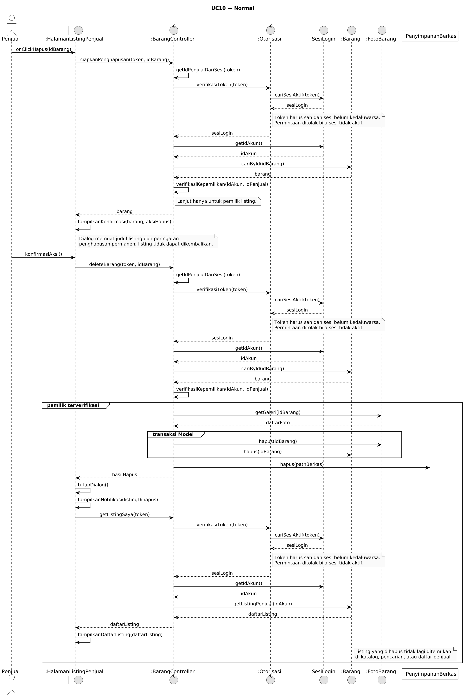

<i>Gambar 3.31. Sequence Diagram UC10 - Skenario Normal</i>

- **Skenario Alternatif 1: Penjual Membatalkan Konfirmasi Penghapusan**

Skenario ini terjadi apabila penjual menekan "Batal" atau menutup dialog konfirmasi. HalamanListingPenjual menutup dialog tanpa mengirim permintaan penghapusan, sehingga listing tetap utuh beserta status semula.

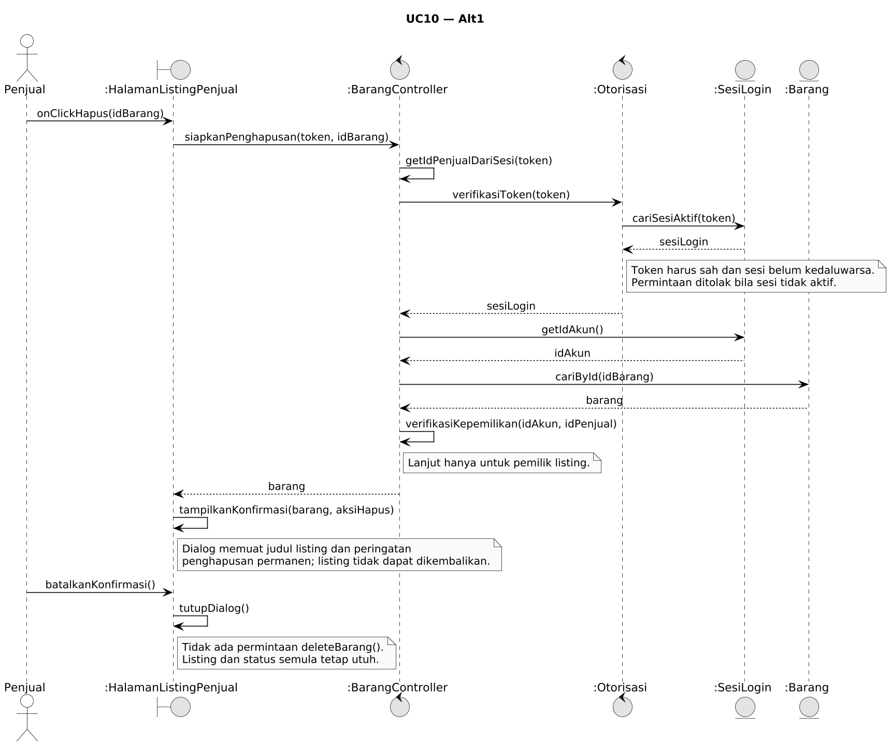

<i>Gambar 3.32. Sequence Diagram UC10 - Skenario Alternatif 1</i>

- **Skenario Alternatif 2: Percobaan Penghapusan oleh Akun Bukan Pemilik**

Skenario ini terjadi apabila akun yang bukan pemilik mengirim permintaan penghapusan listing milik penjual lain. BarangController mendapati idAkun dari sesi berbeda dengan pemilik listing, menolak permintaan sebelum menyentuh data, dan menampilkan pesan bahwa pengguna tidak memiliki izin (KF22).

<i>Gambar 3.33. Sequence Diagram UC10 - Skenario Alternatif 2</i>

### 3.10.3 Diagram Kelas

HalamanListingPenjual berasosiasi dengan BarangController. BarangController bergantung pada SesiLogin, Barang, FotoBarang, Otorisasi, dan PenyimpananBerkas. Otorisasi bergantung pada SesiLogin. Relasi antar-*entity* pada diagram ini adalah Penjual ke Barang berupa komposisi 1 ke 0..* dan Barang ke FotoBarang berupa komposisi 1 ke 1..5. Setiap kelas menampilkan atribut bertipe data dan operasi yang dipakai pada UC10, sehingga seluruh operasi yang dipanggil pada *sequence diagram* subbab sebelumnya tercantum pada kelas yang bersangkutan.

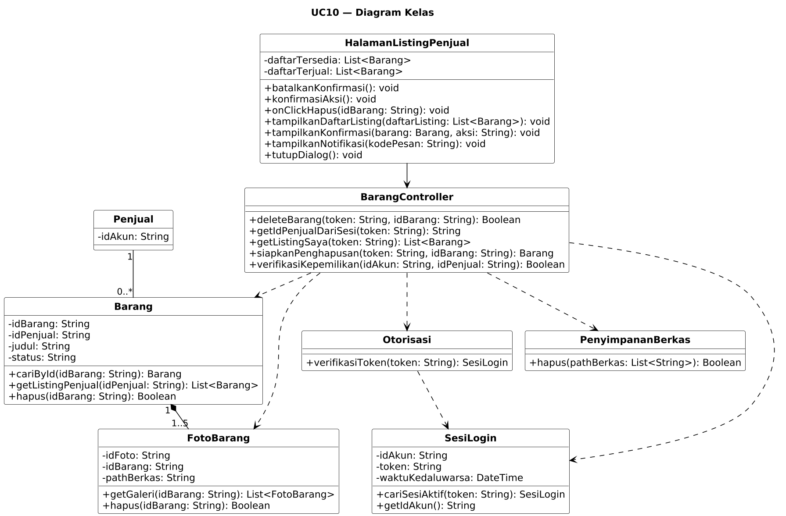

<i>Gambar 3.34. Diagram Kelas UC10</i>

---

## 3.11 Use Case Menandai Listing Terjual

**ID Use Case:** UC11  
**Nama Use Case:** Menandai Listing Terjual

### 3.11.1 Identifikasi Kelas

Realisasi use case penandaan terjual melibatkan antarmuka daftar listing penjual dan kartu produk, controller barang untuk verifikasi kepemilikan dan status asal, modul otorisasi untuk identifikasi penjual, serta entitas Penjual, SesiLogin, dan Barang.

Tabel 3.11. Identifikasi Kelas Use Case UC11

| No | Nama Kelas Perancangan | Nama Kelas Analisis Terkait | Peran / Tanggung Jawab dalam Use Case |
| :--- | :--- | :--- | :--- |
| 1 | HalamanListingPenjual | C03 HalamanListingPenjual | Menyediakan tombol "Tandai Terjual" dan dialog konfirmasi, lalu memindahkan kartu listing ke tab "Terjual". |
| 2 | KartuProduk | C06 KartuProduk | Merender ulang kartu listing dengan label status terbaru. |
| 3 | BarangController | C14 BarangController | Memverifikasi kepemilikan dan status asal "Tersedia", lalu mengubah status listing menjadi "Terjual". |
| 4 | Penjual | C25 Penjual | Pemilik listing yang berwenang menandai listing terjual. |
| 5 | SesiLogin | C28 SesiLogin | Menyediakan idAkun penjual dari sesi aktif. |
| 6 | Barang | C29 Barang | Menyimpan status "Terjual" beserta waktu perubahan sehingga listing tidak lagi tampil pada katalog dan pencarian. |
| 7 | Otorisasi | C41 Otorisasi (Pendukung) | Memverifikasi token sesi penjual. |

### 3.11.2 Sequence Diagram

- **Skenario Normal**

Penjual menekan "Tandai Terjual" pada listing berstatus "Tersedia". BarangController memverifikasi token, kepemilikan, dan status asal listing, lalu HalamanListingPenjual menampilkan dialog konfirmasi. Setelah penjual mengonfirmasi, BarangController mengubah status Barang dari "Tersedia" menjadi "Terjual" beserta waktu perubahannya. Daftar listing dimuat ulang, kartu listing berpindah ke tab riwayat "Terjual", dan listing tidak lagi muncul pada katalog maupun pencarian (KF40, KF42).

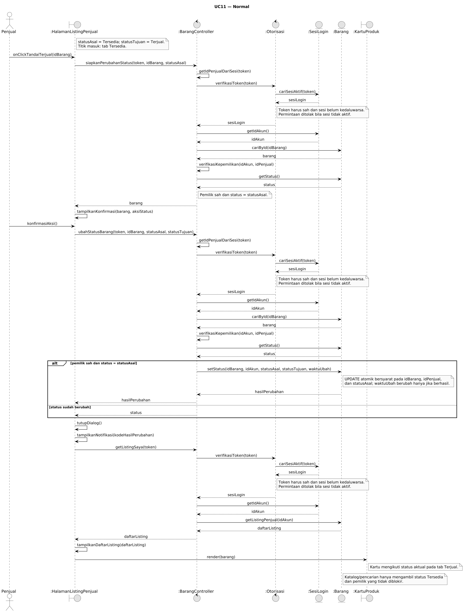

<i>Gambar 3.35. Sequence Diagram UC11 - Skenario Normal</i>

- **Skenario Alternatif 1: Penjual Membatalkan Dialog Konfirmasi**

Skenario ini terjadi apabila penjual menekan "Batal" pada dialog konfirmasi. Dialog ditutup tanpa mengirim perubahan status, sehingga listing tetap berstatus "Tersedia" dan tetap tampil pada katalog.

<i>Gambar 3.36. Sequence Diagram UC11 - Skenario Alternatif 1</i>

- **Skenario Alternatif 2: Listing Sudah Berstatus Terjual**

Skenario ini terjadi apabila listing ternyata sudah berstatus "Terjual", misalnya karena penandaan sudah dilakukan dari perangkat lain. BarangController mendapati status asal tidak lagi "Tersedia", menolak perubahan, menampilkan pesan bahwa listing sudah terjual, dan memuat ulang daftar listing dengan status terkini.

<i>Gambar 3.37. Sequence Diagram UC11 - Skenario Alternatif 2</i>

### 3.11.3 Diagram Kelas

HalamanListingPenjual berasosiasi dengan BarangController. HalamanListingPenjual memiliki relasi komposisi 1 ke 0..* terhadap KartuProduk. BarangController bergantung pada SesiLogin, Barang, dan Otorisasi. Otorisasi bergantung pada SesiLogin. Relasi antar-*entity* pada diagram ini adalah Penjual ke Barang berupa komposisi 1 ke 0..*. Setiap kelas menampilkan atribut bertipe data dan operasi yang dipakai pada UC11, sehingga seluruh operasi yang dipanggil pada *sequence diagram* subbab sebelumnya tercantum pada kelas yang bersangkutan.

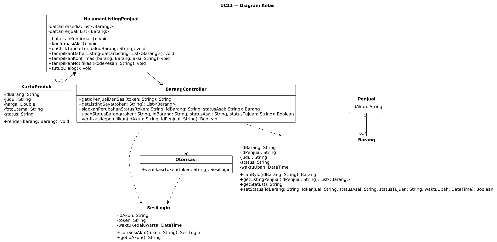

<i>Gambar 3.38. Diagram Kelas UC11</i>

---
## 3.12 Use Case Membatalkan Penandaan Terjual

**ID Use Case:** UC12  
**Nama Use Case:** Membatalkan Penandaan Terjual

### 3.12.1 Identifikasi Kelas

Realisasi use case pembatalan penandaan terjual melibatkan antarmuka daftar listing penjual dan kartu produk, controller barang untuk verifikasi kepemilikan dan status asal, modul otorisasi untuk identifikasi penjual, serta entitas Penjual, SesiLogin, dan Barang.

Tabel 3.12. Identifikasi Kelas Use Case UC12

| No | Nama Kelas Perancangan | Nama Kelas Analisis Terkait | Peran / Tanggung Jawab dalam Use Case |
| :--- | :--- | :--- | :--- |
| 1 | HalamanListingPenjual | C03 HalamanListingPenjual | Menyediakan tombol "Batalkan Penandaan Terjual" pada tab "Terjual" beserta dialog konfirmasi, lalu memindahkan kartu kembali ke tab "Tersedia". |
| 2 | KartuProduk | C06 KartuProduk | Merender ulang kartu listing tanpa label "Terjual". |
| 3 | BarangController | C14 BarangController | Memverifikasi kepemilikan dan status asal "Terjual", lalu mengembalikan status listing menjadi "Tersedia". |
| 4 | Penjual | C25 Penjual | Pemilik listing yang berwenang membatalkan penandaan terjual. |
| 5 | SesiLogin | C28 SesiLogin | Menyediakan idAkun penjual dari sesi aktif. |
| 6 | Barang | C29 Barang | Menyimpan status "Tersedia" beserta waktu perubahan sehingga listing tampil kembali pada katalog dan pencarian. |
| 7 | Otorisasi | C41 Otorisasi (Pendukung) | Memverifikasi token sesi penjual. |

### 3.12.2 Sequence Diagram

- **Skenario Normal**

Penjual menekan "Batalkan Penandaan Terjual" pada tab riwayat "Terjual". BarangController memverifikasi token, kepemilikan, dan status asal listing, lalu HalamanListingPenjual menampilkan dialog konfirmasi. Setelah penjual mengonfirmasi, BarangController mengembalikan status Barang dari "Terjual" menjadi "Tersedia" beserta waktu perubahannya. Daftar listing dimuat ulang, kartu berpindah ke tab "Tersedia", dan listing kembali tampil pada katalog dan pencarian (KF41).

<i>Gambar 3.39. Sequence Diagram UC12 - Skenario Normal</i>

- **Skenario Alternatif 1: Penjual Membatalkan Dialog Konfirmasi**

Skenario ini terjadi apabila penjual menekan "Batal" atau menutup dialog konfirmasi. Dialog ditutup tanpa mengirim perubahan status, sehingga listing tetap berstatus "Terjual" dan tetap tersembunyi dari katalog.

<i>Gambar 3.40. Sequence Diagram UC12 - Skenario Alternatif 1</i>

- **Skenario Alternatif 2: Listing Sudah Kembali Berstatus Tersedia**

Skenario ini terjadi apabila listing ternyata sudah kembali berstatus "Tersedia" karena pembatalan pernah dilakukan sebelumnya. BarangController mendapati status asal tidak lagi "Terjual", menolak permintaan, menampilkan pesan bahwa listing sudah tersedia, dan memuat ulang daftar listing tanpa menggandakan data.

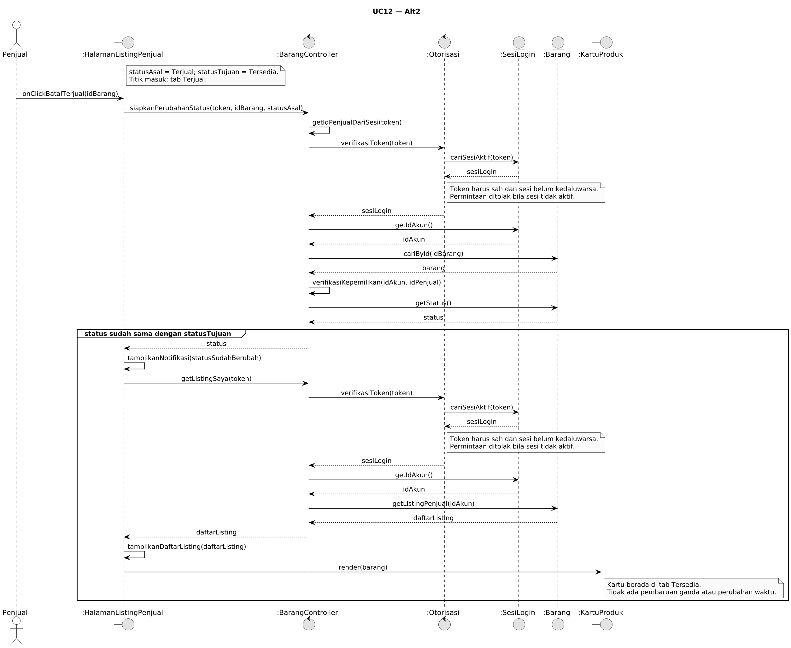

<i>Gambar 3.41. Sequence Diagram UC12 - Skenario Alternatif 2</i>

### 3.12.3 Diagram Kelas

HalamanListingPenjual berasosiasi dengan BarangController. HalamanListingPenjual memiliki relasi komposisi 1 ke 0..* terhadap KartuProduk. BarangController bergantung pada SesiLogin, Barang, dan Otorisasi. Otorisasi bergantung pada SesiLogin. Relasi antar-*entity* pada diagram ini adalah Penjual ke Barang berupa komposisi 1 ke 0..*. Setiap kelas menampilkan atribut bertipe data dan operasi yang dipakai pada UC12, sehingga seluruh operasi yang dipanggil pada *sequence diagram* subbab sebelumnya tercantum pada kelas yang bersangkutan.

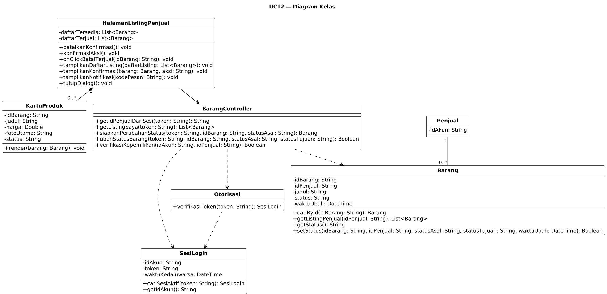

<i>Gambar 3.42. Diagram Kelas UC12</i>

---

## 3.13 Use Case Melihat Katalog Listing

**ID Use Case:** UC13  
**Nama Use Case:** Melihat Katalog Listing

### 3.13.1 Identifikasi Kelas

Realisasi use case melihat katalog melibatkan antarmuka katalog dan kartu produk, controller katalog untuk menyusun permintaan dan paginasi, entitas Barang yang menjalankan kueri listing berstatus "Tersedia", entitas Akun dan Penjual untuk memastikan pemilik listing tidak diblokir, serta FotoBarang untuk foto utama setiap kartu.

Tabel 3.13. Identifikasi Kelas Use Case UC13

| No | Nama Kelas Perancangan | Nama Kelas Analisis Terkait | Peran / Tanggung Jawab dalam Use Case |
| :--- | :--- | :--- | :--- |
| 1 | HalamanKatalog | C05 HalamanKatalog | Menampilkan katalog berhalaman (maksimum 20 listing per halaman), navigasi antarhalaman, dan pesan saat katalog kosong. |
| 2 | KartuProduk | C06 KartuProduk | Merender ringkasan setiap listing (foto utama, judul, harga, kategori, dan lokasi) dan mengarahkan ke halaman detail. |
| 3 | KatalogController | C15 KatalogController | Menyusun permintaan katalog dan menghitung paginasi 20 listing per halaman dengan urutan baku terbaru. |
| 4 | Akun | C23 Akun | Menyediakan syarat bahwa akun pemilik listing tidak diblokir (KF30, KF54). |
| 5 | Penjual | C25 Penjual | Pemilik listing yang tampil pada katalog. |
| 6 | Barang | C29 Barang | Menjalankan kueri listing berstatus "Tersedia" beserta jumlah totalnya. |
| 7 | FotoBarang | C30 FotoBarang | Menyediakan foto utama setiap listing. |

### 3.13.2 Sequence Diagram

- **Skenario Normal**

Pembeli membuka halaman katalog. HalamanKatalog meminta data ke KatalogController, yang menghitung paginasi dan meminta Barang menjalankan kueri katalog. Kueri selalu mensyaratkan status "Tersedia" dan akun pemilik yang tidak diblokir melalui Akun, lalu foto utama setiap listing diambil dari FotoBarang. HalamanKatalog menampilkan maksimum 20 kartu produk beserta navigasi antarhalaman. Saat pembeli berpindah halaman, kriteria yang sama dipakai kembali dan tampilan digulir ke atas (KF28, KF30).

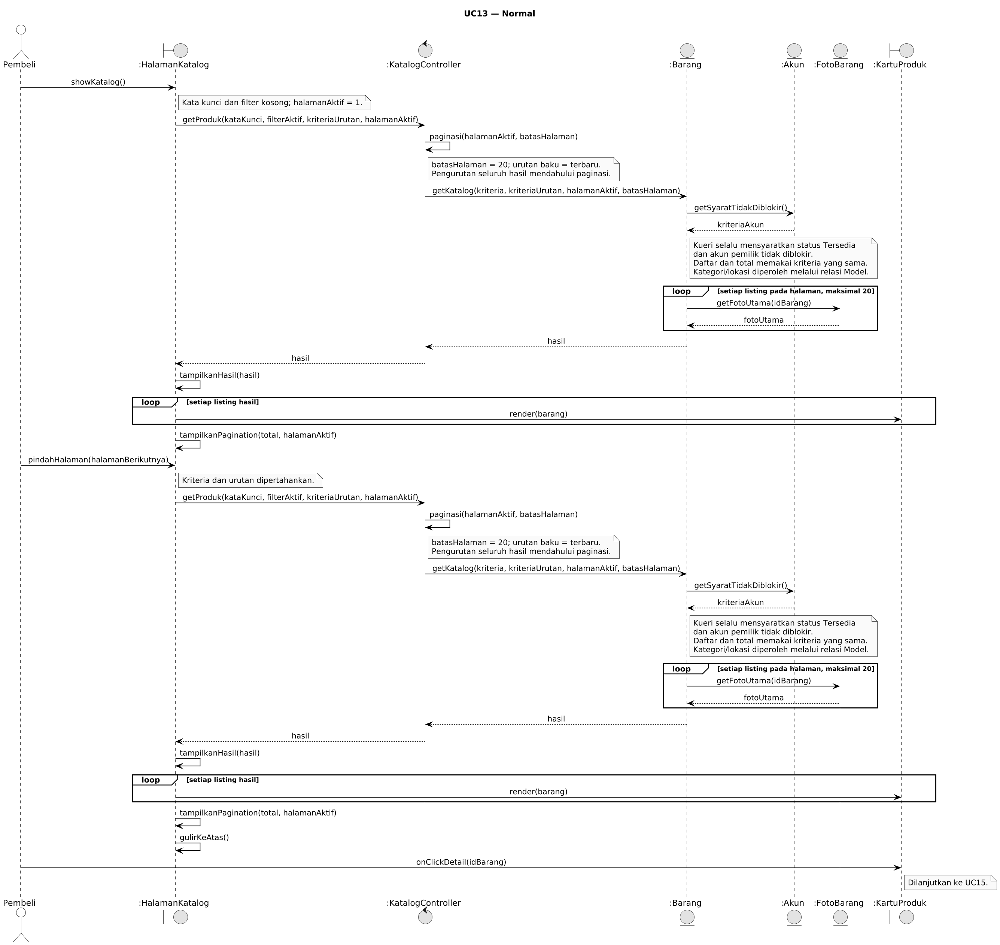

<i>Gambar 3.43. Sequence Diagram UC13 - Skenario Normal</i>

- **Skenario Alternatif 1: Katalog Masih Kosong**

Skenario ini terjadi apabila tidak ada satu pun listing yang memenuhi syarat katalog. HalamanKatalog tidak menampilkan kartu produk maupun navigasi antarhalaman, melainkan pesan bahwa belum ada barang yang tersedia.

<i>Gambar 3.44. Sequence Diagram UC13 - Skenario Alternatif 1</i>

- **Skenario Alternatif 2: Listing Menjadi Tidak Tersedia saat Katalog Dibuka**

Skenario ini terjadi apabila sebuah listing ditandai terjual atau akun pemiliknya diblokir ketika pembeli sedang menelusuri katalog. Saat halaman disegarkan atau berpindah halaman, kueri katalog dijalankan ulang sehingga listing tersebut tidak lagi disertakan dan jumlah total listing diperbarui (KF42, KF54).

<i>Gambar 3.45. Sequence Diagram UC13 — Skenario Alternatif 2</i>

### 3.13.3 Diagram Kelas

HalamanKatalog berasosiasi dengan KatalogController. HalamanKatalog memiliki relasi komposisi 1 ke 0..20 terhadap KartuProduk. KatalogController bergantung pada Barang. Barang bergantung pada Akun. Penjual merupakan turunan (generalisasi) dari Akun. Relasi antar-*entity* pada diagram ini adalah Penjual ke Barang berupa komposisi 1 ke 0..* dan Barang ke FotoBarang berupa komposisi 1 ke 1..5. Setiap kelas menampilkan atribut bertipe data dan operasi yang dipakai pada UC13, sehingga seluruh operasi yang dipanggil pada *sequence diagram* subbab sebelumnya tercantum pada kelas yang bersangkutan.

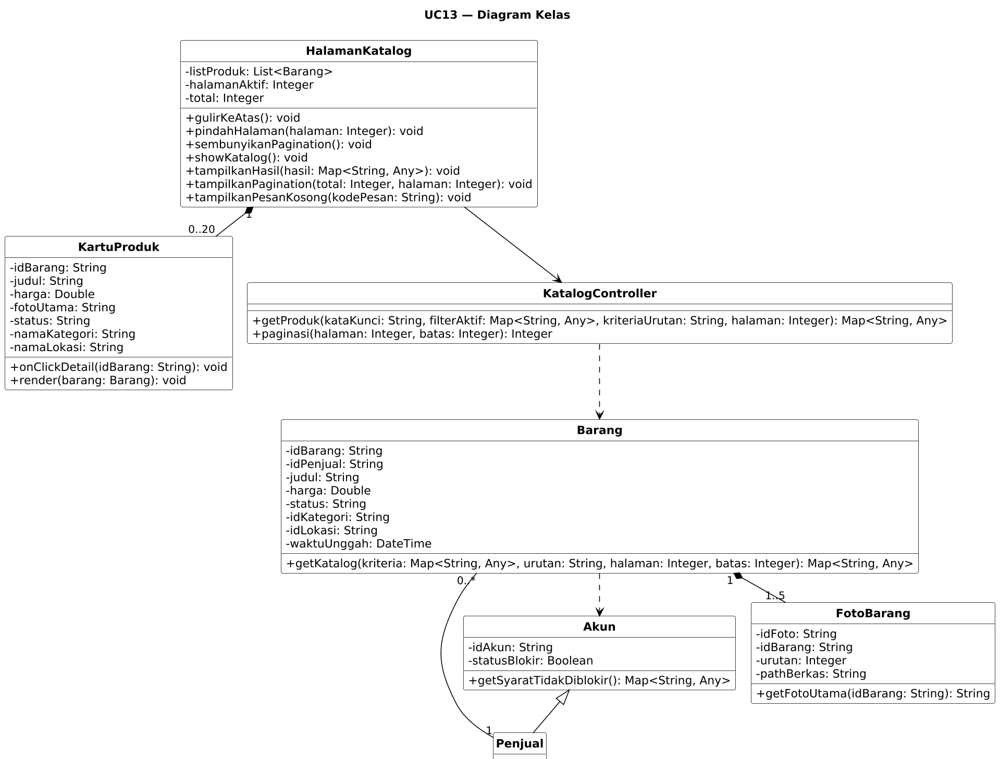

<i>Gambar 3.46. Diagram Kelas UC13</i>

---

## 3.14 Use Case Mencari dan Menyaring Listing

**ID Use Case:** UC14  
**Nama Use Case:** Mencari dan Menyaring Listing

### 3.14.1 Identifikasi Kelas

Realisasi use case pencarian dan penyaringan melibatkan antarmuka katalog untuk menangkap kata kunci, filter, dan urutan, controller katalog yang mengorkestrasi controller pencarian dan controller filter, entitas Barang yang menjalankan kueri, entitas Akun, Penjual, Kategori, dan LokasiCOD sebagai syarat dan acuan filter, serta FotoBarang untuk foto utama hasil pencarian.

Tabel 3.14. Identifikasi Kelas Use Case UC14

| No | Nama Kelas Perancangan | Nama Kelas Analisis Terkait | Peran / Tanggung Jawab dalam Use Case |
| :--- | :--- | :--- | :--- |
| 1 | HalamanKatalog | C05 HalamanKatalog | Menangkap kata kunci, filter, dan kriteria urutan, memvalidasi rentang harga, serta menampilkan hasil, filter aktif, dan pesan barang tidak ditemukan. |
| 2 | KartuProduk | C06 KartuProduk | Merender setiap listing hasil pencarian. |
| 3 | KatalogController | C15 KatalogController | Mengorkestrasi pencarian: meminta kriteria kata kunci dan filter, mengurutkan hasil, dan membagi hasil per halaman. |
| 4 | PencarianController | C16 PencarianController | Menormalisasi kata kunci dan menyusun kriteria kecocokan pada judul atau deskripsi listing. |
| 5 | FilterController | C17 FilterController | Memvalidasi parameter filter dan menyusun kriteria kategori, rentang harga, dan lokasi titik temu. |
| 6 | Akun | C23 Akun | Menyediakan syarat bahwa akun pemilik listing tidak diblokir. |
| 7 | Penjual | C25 Penjual | Pemilik listing yang tampil pada hasil pencarian. |
| 8 | Barang | C29 Barang | Menjalankan kueri dengan seluruh kriteria yang aktif secara bersamaan. |
| 9 | FotoBarang | C30 FotoBarang | Menyediakan foto utama setiap listing hasil pencarian. |
| 10 | Kategori | C31 Kategori | Memvalidasi kategori yang dipilih pada filter. |
| 11 | LokasiCOD | C32 LokasiCOD | Memvalidasi lokasi titik temu yang dipilih pada filter. |

### 3.14.2 Sequence Diagram

- **Skenario Normal**

Pembeli memasukkan kata kunci, memilih filter kategori, rentang harga, atau lokasi, dan memilih kriteria urutan. Setiap perubahan mengembalikan tampilan ke halaman pertama, lalu HalamanKatalog mengirim seluruh kriteria ke KatalogController. KatalogController meminta PencarianController menormalisasi kata kunci dan menyusun kriteria kecocokan, meminta FilterController memvalidasi dan menyusun kriteria filter, lalu mengurutkan dan membagi hasil per halaman. Barang menjalankan kueri dengan seluruh kriteria sekaligus, tetap mensyaratkan status "Tersedia" dan pemilik yang tidak diblokir. HalamanKatalog menampilkan hasil, navigasi antarhalaman, dan filter yang sedang aktif (KF25–KF28).

<i>Gambar 3.47. Sequence Diagram UC14 - Skenario Normal</i>

- **Skenario Alternatif 1: Tidak Ada Barang yang Cocok**

Skenario ini terjadi apabila kombinasi kata kunci dan filter tidak menghasilkan listing apa pun. HalamanKatalog menampilkan pesan "Barang tidak ditemukan" beserta tombol "Hapus Semua Filter". Saat tombol tersebut ditekan, seluruh kriteria dikosongkan dan katalog penuh ditampilkan kembali dari halaman pertama (KF29).

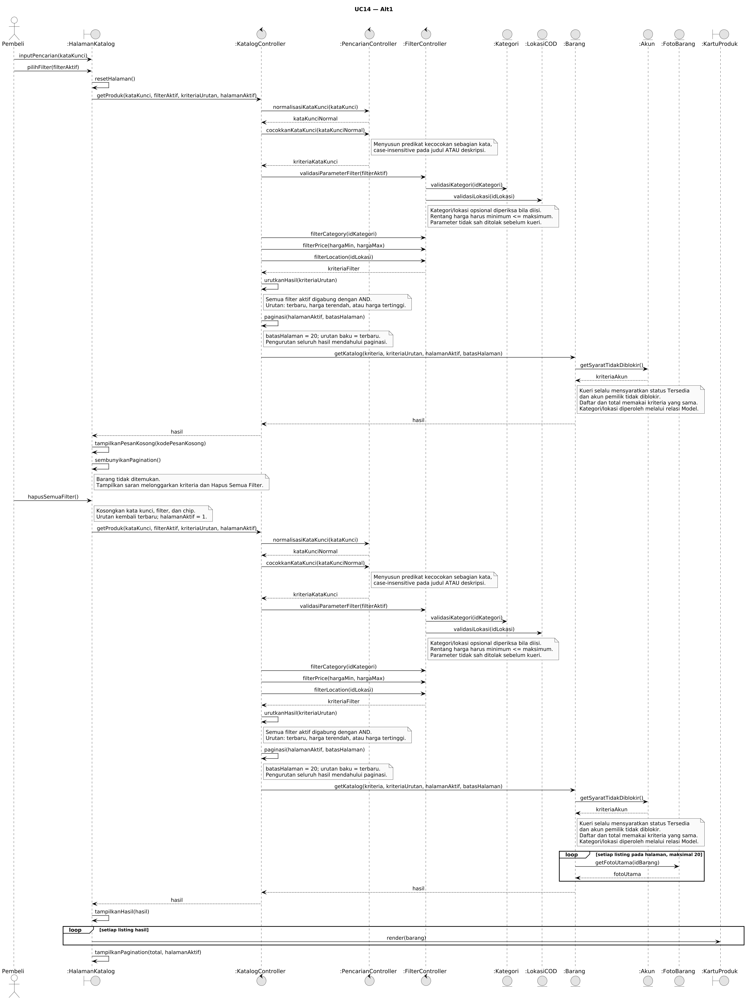

<i>Gambar 3.48. Sequence Diagram UC14 - Skenario Alternatif 1</i>

- **Skenario Alternatif 2: Rentang Harga Tidak Masuk Akal**

Skenario ini terjadi apabila harga minimum lebih besar daripada harga maksimum. HalamanKatalog mendeteksi rentang harga yang tidak sah, menandai kedua kolom harga, dan tidak menerapkan filter sampai rentang diperbaiki. Validasi yang sama diulang di sisi server oleh FilterController.

<i>Gambar 3.49. Sequence Diagram UC14 - Skenario Alternatif 2</i>

### 3.14.3 Diagram Kelas

HalamanKatalog berasosiasi dengan KatalogController. HalamanKatalog memiliki relasi komposisi 1 ke 0..20 terhadap KartuProduk. KatalogController bergantung pada Barang, PencarianController, dan FilterController. FilterController bergantung pada Kategori dan LokasiCOD. Barang bergantung pada Akun. Penjual merupakan turunan (generalisasi) dari Akun. Relasi antar-*entity* pada diagram ini adalah Penjual ke Barang berupa komposisi 1 ke 0..*, Barang ke FotoBarang berupa komposisi 1 ke 1..5, Kategori ke Barang berupa asosiasi 1 ke 0..*, dan LokasiCOD ke Barang berupa asosiasi 1 ke 0..*. Setiap kelas menampilkan atribut bertipe data dan operasi yang dipakai pada UC14, sehingga seluruh operasi yang dipanggil pada *sequence diagram* subbab sebelumnya tercantum pada kelas yang bersangkutan.

<i>Gambar 3.50. Diagram Kelas UC14</i>

---

## 3.15 Use Case Melihat Detail Listing

**ID Use Case:** UC15  
**Nama Use Case:** Melihat Detail Listing

### 3.15.1 Identifikasi Kelas

Realisasi use case melihat detail listing melibatkan antarmuka detail barang, controller barang untuk mengambil detail listing beserta relasinya, modul otorisasi untuk mengenali pemohon, serta entitas Penjual, SesiLogin, Barang, FotoBarang, Kategori, dan LokasiCOD.

Tabel 3.15. Identifikasi Kelas Use Case UC15

| No | Nama Kelas Perancangan | Nama Kelas Analisis Terkait | Peran / Tanggung Jawab dalam Use Case |
| :--- | :--- | :--- | :--- |
| 1 | HalamanDetailBarang | C07 HalamanDetailBarang | Menampilkan galeri foto beserta tampilan penuh (lightbox), informasi listing, identitas penjual, serta tombol aksi sesuai peran pemohon dan status listing. |
| 2 | BarangController | C14 BarangController | Mengambil detail listing beserta foto, kategori, lokasi, dan identitas penjual, serta menentukan apakah pemohon adalah pemilik listing. |
| 3 | Penjual | C25 Penjual | Menyediakan identitas penjual yang ditampilkan pada halaman detail. |
| 4 | SesiLogin | C28 SesiLogin | Menyediakan idAkun pemohon dari sesi aktif. |
| 5 | Barang | C29 Barang | Menyediakan data listing beserta status terkininya. |
| 6 | FotoBarang | C30 FotoBarang | Menyediakan galeri foto listing (hingga 5 foto). |
| 7 | Kategori | C31 Kategori | Menyediakan nama kategori listing. |
| 8 | LokasiCOD | C32 LokasiCOD | Menyediakan nama lokasi titik temu COD listing. |
| 9 | Otorisasi | C41 Otorisasi (Pendukung) | Memverifikasi token sesi pemohon. |

### 3.15.2 Sequence Diagram

- **Skenario Normal**

Pengguna menekan sebuah kartu produk. HalamanDetailBarang meminta detail listing ke BarangController, yang mengambil Barang, memverifikasi token melalui Otorisasi bila pengguna sedang masuk (detail listing tetap dapat dibuka tanpa sesi), galeri FotoBarang, Kategori, LokasiCOD, dan identitas Penjual. HalamanDetailBarang menampilkan seluruh foto, judul, harga, deskripsi kondisi, kategori, lokasi COD, dan identitas penjual, beserta tombol "Hubungi Penjual" dan "Laporkan". Foto dapat dibuka dalam ukuran penuh, dan nama penjual mengarah ke profilnya (KF17).

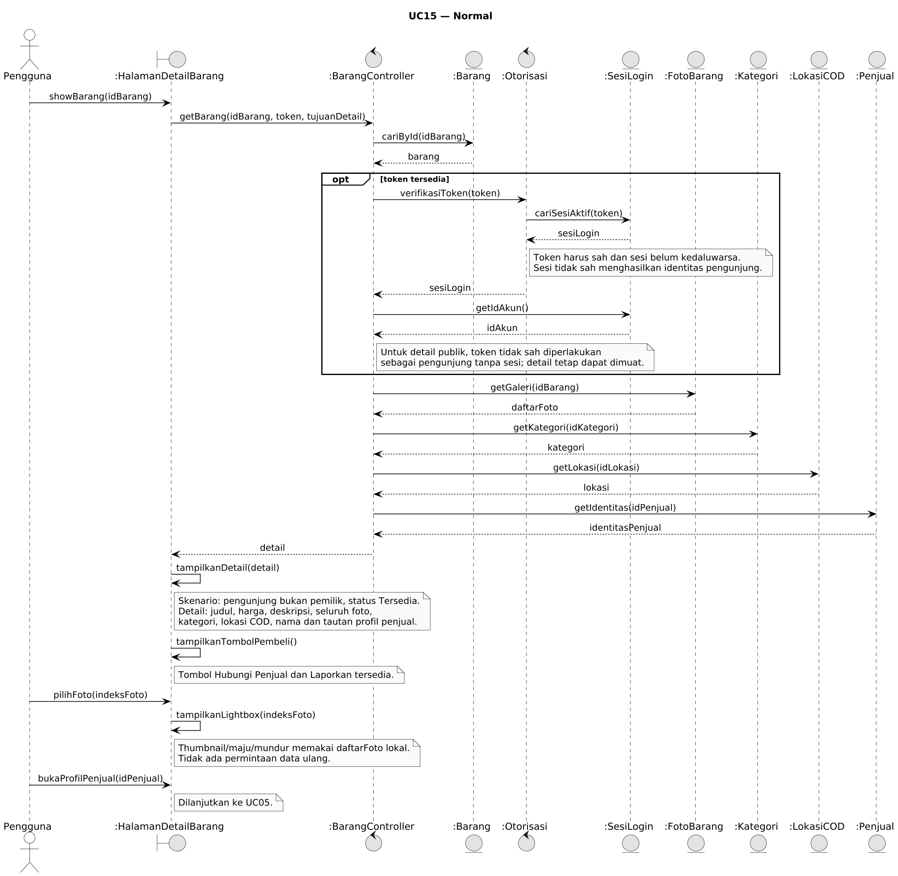

<i>Gambar 3.51. Sequence Diagram UC15 - Skenario Normal</i>

- **Skenario Alternatif 1: Pengguna adalah Pemilik Listing**

Skenario ini terjadi apabila pemohon adalah pemilik listing. Detail yang dikembalikan BarangController memuat idAkun pemohon, dan karena nilainya sama dengan pemilik listing, HalamanDetailBarang menggantikan tombol "Hubungi Penjual" dengan tombol pengelolaan listing, yaitu ubah, hapus, serta tandai atau batalkan penandaan terjual.

<i>Gambar 3.52. Sequence Diagram UC15 - Skenario Alternatif 1</i>

- **Skenario Alternatif 2: Listing Sudah Dihapus atau Tidak Ditemukan**

Skenario ini terjadi apabila listing sudah dihapus atau tidak ditemukan. BarangController tidak menemukan data listing, dan HalamanDetailBarang menampilkan pemberitahuan bahwa listing tidak ditemukan beserta tautan kembali ke katalog.

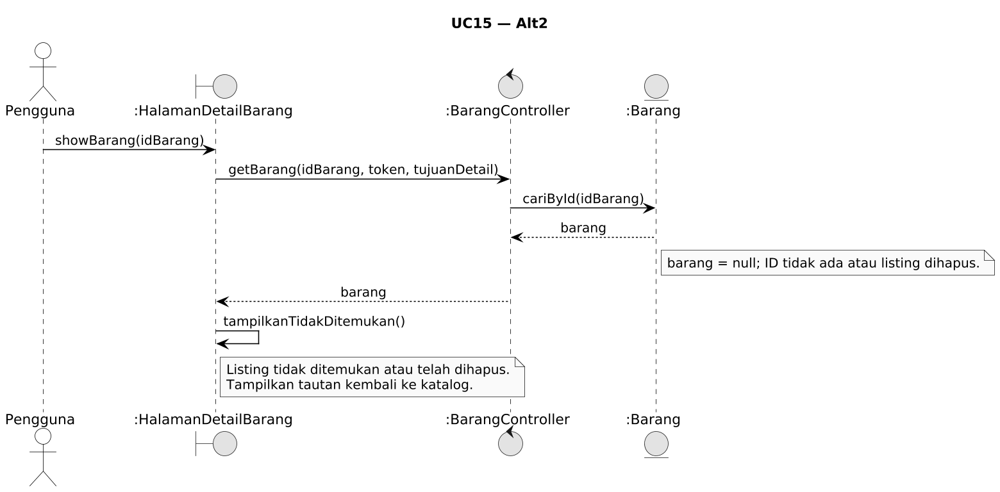

<i>Gambar 3.53. Sequence Diagram UC15 — Skenario Alternatif 2</i>

 
- **Skenario Alternatif 3: Listing Sudah Berstatus Terjual**

Skenario ini terjadi apabila listing sudah berstatus "Terjual". HalamanDetailBarang tetap menampilkan informasi listing sebagai arsip, memberi label "Terjual", dan menonaktifkan tombol "Hubungi Penjual".

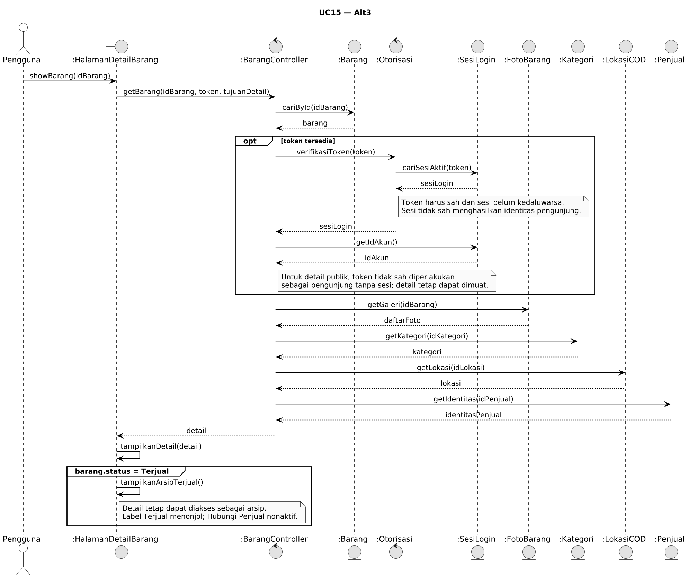

<i>Gambar 3.54. Sequence Diagram UC15 - Skenario Alternatif 3</i>

### 3.15.3 Diagram Kelas

HalamanDetailBarang berasosiasi dengan BarangController. BarangController bergantung pada Penjual, SesiLogin, Barang, FotoBarang, Kategori, LokasiCOD, dan Otorisasi. Otorisasi bergantung pada SesiLogin. Relasi antar-*entity* pada diagram ini adalah Penjual ke Barang berupa komposisi 1 ke 0..*, Barang ke FotoBarang berupa komposisi 1 ke 1..5, Kategori ke Barang berupa asosiasi 1 ke 0..*, dan LokasiCOD ke Barang berupa asosiasi 1 ke 0..*. Setiap kelas menampilkan atribut bertipe data dan operasi yang dipakai pada UC15, sehingga seluruh operasi yang dipanggil pada *sequence diagram* subbab sebelumnya tercantum pada kelas yang bersangkutan.

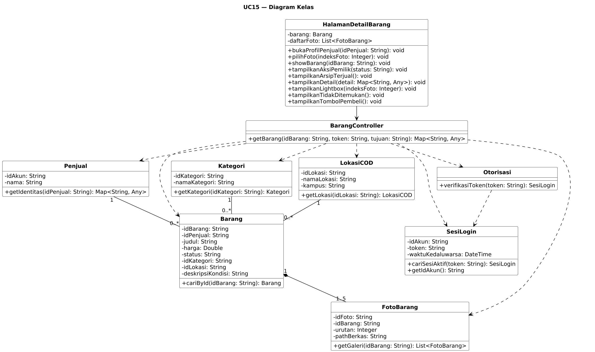

<i>Gambar 3.55. Diagram Kelas UC15</i>

---

## 3.16 Use Case Menghubungi Penjual

**ID Use Case:** UC16  
**Nama Use Case:** Menghubungi Penjual

### 3.16.1 Identifikasi Kelas

Realisasi use case menghubungi penjual melibatkan antarmuka detail barang dan ruang percakapan, controller percakapan untuk memeriksa prasyarat serta mencari atau membuat ruang percakapan, modul otorisasi dan kriptografi sebagai kelas pendukung, serta entitas Akun, Pembeli, Penjual, SesiLogin, Barang, Percakapan, dan Pesan.

Tabel 3.16. Identifikasi Kelas Use Case UC16

| No | Nama Kelas Perancangan | Nama Kelas Analisis Terkait | Peran / Tanggung Jawab dalam Use Case |
| :--- | :--- | :--- | :--- |
| 1 | HalamanDetailBarang | C07 HalamanDetailBarang | Menyediakan tombol "Hubungi Penjual" dan menampilkan pesan galat apabila percakapan tidak dapat dibuka. |
| 2 | HalamanPercakapan | C08 HalamanPercakapan | Menampilkan ruang percakapan, riwayat pesan, dan tautan Kebijakan Privasi, serta menampilkan penolakan akses bagi pihak ketiga. |
| 3 | PercakapanController | C18 PercakapanController | Memverifikasi sesi, memeriksa listing dan status blokir penjual, mencari atau membuat ruang percakapan, memverifikasi peserta, dan mendekripsi riwayat pesan. |
| 4 | Akun | C23 Akun | Menyediakan status blokir akun penjual. |
| 5 | Pembeli | C24 Pembeli | Peran pembeli sebagai pemrakarsa percakapan. |
| 6 | Penjual | C25 Penjual | Peran penjual sebagai lawan bicara beserta identitasnya. |
| 7 | SesiLogin | C28 SesiLogin | Menyediakan idAkun pemohon dari sesi aktif. |
| 8 | Barang | C29 Barang | Listing yang menjadi konteks percakapan. |
| 9 | Percakapan | C33 Percakapan | Menyimpan ruang percakapan beserta daftar pesertanya yang sah. |
| 10 | Pesan | C34 Pesan | Menyediakan riwayat pesan terenkripsi pada ruang percakapan. |
| 11 | Otorisasi | C41 Otorisasi (Pendukung) | Memverifikasi token sesi pemohon. |
| 12 | Kriptografi | C42 Kriptografi (Pendukung) | Mendekripsi riwayat pesan sebelum ditampilkan kepada peserta. |

### 3.16.2 Sequence Diagram

- **Skenario Normal**

Pembeli menekan "Hubungi Penjual" pada halaman detail listing. PercakapanController memverifikasi token melalui Otorisasi, mengambil listing, dan memastikan akun penjual tidak diblokir. Controller kemudian mencari ruang percakapan untuk kombinasi listing, pembeli, dan penjual, lalu membuat ruang baru bila belum ada dan memverifikasi bahwa pemohon adalah peserta sah. Setelah identitas penjual diambil, HalamanPercakapan menampilkan ruang percakapan beserta tautan Kebijakan Privasi, dan pengiriman pesan dilanjutkan pada UC17 (KF31, KF39).

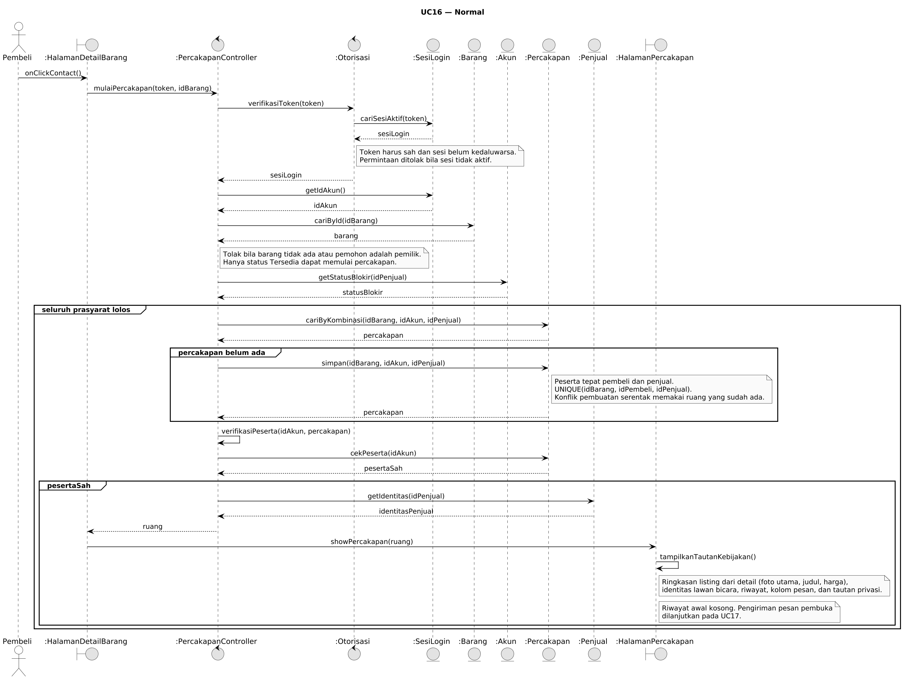

<i>Gambar 3.56. Sequence Diagram UC16 - Skenario Normal</i>

- **Skenario Alternatif 1: Akun Penjual Sedang Diblokir**

Skenario ini terjadi apabila akun penjual sedang diblokir. PercakapanController mendapati status blokir penjual bernilai benar, membatalkan pembukaan ruang percakapan, dan HalamanDetailBarang menampilkan pesan bahwa penjual tidak dapat dihubungi.

<i>Gambar 3.57. Sequence Diagram UC16 — Skenario Alternatif 1</i>

- **Skenario Alternatif 2: Ruang Percakapan untuk Listing Tersebut Sudah Ada**

Skenario ini terjadi apabila ruang percakapan untuk listing tersebut sudah pernah dibuat. PercakapanController tidak membuat ruang baru, melainkan membuka ruang yang ada, mengambil riwayat pesannya, mendekripsi melalui Kriptografi, lalu HalamanPercakapan menampilkan riwayat secara berurutan dan menggulir ke pesan terakhir.

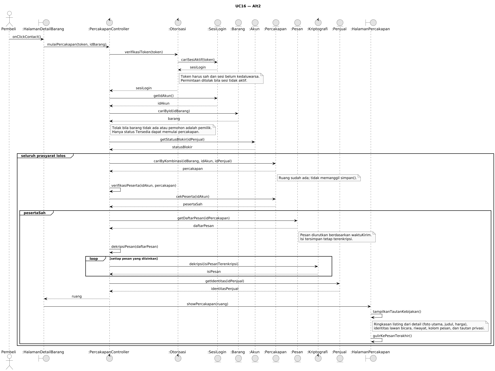

<i>Gambar 3.58. Sequence Diagram UC16 - Skenario Alternatif 2</i>

- **Skenario Alternatif 3: Percobaan Akses Ruang Percakapan oleh Pihak Ketiga**

Skenario ini terjadi apabila akun yang bukan peserta, termasuk admin, mencoba membuka ruang percakapan melalui tautan langsung. PercakapanController mendapati pemohon tidak termasuk peserta sah, menolak permintaan tanpa mengirim isi pesan apa pun, dan HalamanPercakapan menampilkan penolakan akses (KF35).

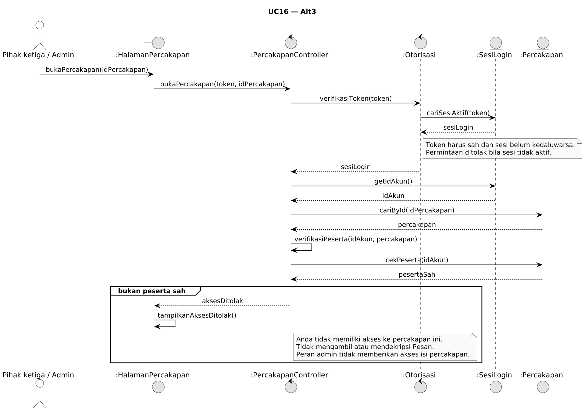

<i>Gambar 3.59. Sequence Diagram UC16 - Skenario Alternatif 3</i>

### 3.16.3 Diagram Kelas

HalamanDetailBarang berasosiasi dengan HalamanPercakapan dan PercakapanController. HalamanPercakapan berasosiasi dengan PercakapanController. PercakapanController bergantung pada Akun, Penjual, SesiLogin, Barang, Percakapan, Pesan, Otorisasi, dan Kriptografi. Otorisasi bergantung pada SesiLogin. Pembeli dan Penjual merupakan turunan (generalisasi) dari Akun. Relasi antar-*entity* pada diagram ini adalah Akun ke SesiLogin berupa asosiasi 1 ke 0..*, Penjual ke Barang berupa komposisi 1 ke 0..*, Pembeli ke Percakapan berupa asosiasi 1 ke 0..*, Penjual ke Percakapan berupa asosiasi 1 ke 0..*, Barang ke Percakapan berupa asosiasi 1 ke 0..*, Percakapan ke Pesan berupa komposisi 1 ke 0..*, dan Akun ke Pesan berupa asosiasi 1 ke 0..*. Setiap kelas menampilkan atribut bertipe data dan operasi yang dipakai pada UC16, sehingga seluruh operasi yang dipanggil pada *sequence diagram* subbab sebelumnya tercantum pada kelas yang bersangkutan.

<i>Gambar 3.60. Diagram Kelas UC16</i>

---

## 3.17 Use Case Mengirim Pesan dalam Percakapan

**ID Use Case:** UC17  
**Nama Use Case:** Mengirim Pesan dalam Percakapan

### 3.17.1 Identifikasi Kelas

Realisasi use case pengiriman pesan melibatkan antarmuka ruang percakapan untuk menangkap teks dan merender pesan, antarmuka panel notifikasi untuk menampilkan penanda pesan belum dibaca, controller percakapan untuk memverifikasi peserta, mengenkripsi, dan menyimpan pesan, controller notifikasi untuk memicu notifikasi bagi penerima, modul otorisasi dan kriptografi sebagai kelas pendukung, entitas Percakapan, Pesan, dan Notifikasi, serta adapter push notifikasi sebagai integrasi eksternal.

Tabel 3.17. Identifikasi Kelas Use Case UC17

| No | Nama Kelas Perancangan | Nama Kelas Analisis Terkait | Peran / Tanggung Jawab dalam Use Case |
| :--- | :--- | :--- | :--- |
| 1 | HalamanPercakapan | C08 HalamanPercakapan | Menampilkan ruang percakapan, menangkap teks pada kolom input, menonaktifkan tombol kirim apabila input kosong, dan merender pesan secara berurutan beserta waktu pengiriman. |
| 2 | PanelNotifikasi | C09 PanelNotifikasi | Memperbarui penanda jumlah pesan belum dibaca pada antarmuka penerima. |
| 3 | PercakapanController | C18 PercakapanController | Memverifikasi bahwa pengirim adalah peserta sah, meminta enkripsi isi pesan, menyimpan pesan, memperbarui waktu percakapan, dan meminta notifikasi bagi penerima. |
| 4 | NotifikasiController | C19 NotifikasiController | Membuat notifikasi pesan baru bagi penerima dan meneruskannya ke adapter push notifikasi. |
| 5 | Akun | C23 Akun | Menyediakan identitas pengirim dan penerima pesan. |
| 6 | SesiLogin | C28 SesiLogin | Menyediakan idAkun pengirim dari sesi aktif untuk dicocokkan dengan peserta percakapan. |
| 7 | Percakapan | C33 Percakapan | Menyimpan ruang percakapan, memeriksa keanggotaan peserta, dan memperbarui waktu pembaruan terakhir. |
| 8 | Pesan | C34 Pesan | Menyimpan isi pesan terenkripsi, pengirim, waktu kirim, dan status baca. |
| 9 | Notifikasi | C35 Notifikasi | Menyimpan pemberitahuan pesan baru untuk penerima beserta status bacanya. |
| 10 | Otorisasi | C41 Otorisasi (Pendukung) | Memverifikasi token sesi dan mengidentifikasi akun pengirim. |
| 11 | Kriptografi | C42 Kriptografi (Pendukung) | Mengenkripsi isi pesan sebelum disimpan ke basis data. |
| 12 | PushNotifikasiAdapter | C44 PushNotifikasiAdapter (Integrasi) | Mengirim notifikasi Web Push ke perangkat penerima, termasuk saat aplikasi tidak dibuka. |

### 3.17.2 Sequence Diagram

- **Skenario Normal**

Pengguna mengetik pesan pada ruang percakapan lalu menekan tombol "Kirim". HalamanPercakapan meneruskan permintaan ke PercakapanController. Controller memverifikasi token melalui Otorisasi dan SesiLogin, memastikan pengirim adalah peserta Percakapan, mengenkripsi isi pesan melalui Kriptografi, lalu menyimpan entitas Pesan dan memperbarui waktu percakapan. Pesan yang tersimpan ditayangkan kepada kedua pihak secara berurutan beserta waktu kirim. PercakapanController kemudian meminta NotifikasiController membuat Notifikasi bagi penerima dan mengirimkannya melalui PushNotifikasiAdapter, sehingga penanda pesan belum dibaca pada PanelNotifikasi penerima bertambah.

<i>Gambar 3.61. Sequence Diagram UC17 - Skenario Normal</i>

- **Skenario Alternatif 1: Percobaan Pengiriman Pesan Kosong**

Skenario ini terjadi apabila pengguna tidak mengetik teks apa pun atau hanya mengetik spasi. HalamanPercakapan mendeteksi bahwa input kosong setelah pemangkasan spasi, menonaktifkan tombol "Kirim" atau mengabaikan aksi kirim, dan tidak mengirim permintaan apa pun ke server.

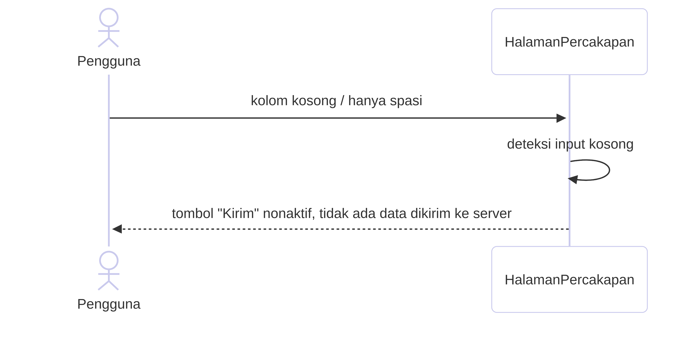

<i>Gambar 3.62. Sequence Diagram UC17 - Skenario Alternatif 1: Percobaan Pengiriman Pesan Kosong</i>

### 3.17.3 Diagram Kelas

HalamanPercakapan berasosiasi dengan PercakapanController. PanelNotifikasi berasosiasi dengan NotifikasiController. PercakapanController bergantung pada SesiLogin, Percakapan, Pesan, Otorisasi, Kriptografi, dan NotifikasiController. NotifikasiController bergantung pada Notifikasi dan PushNotifikasiAdapter. Otorisasi bergantung pada SesiLogin. Relasi antar-*entity* pada diagram ini adalah Akun ke SesiLogin berupa asosiasi 1 ke 0..*, Akun ke Notifikasi berupa asosiasi 1 ke 0..*, Percakapan ke Pesan berupa komposisi 1 ke 0..*, dan Akun ke Pesan berupa asosiasi 1 ke 0..*. Setiap kelas menampilkan atribut bertipe data dan operasi yang dipakai pada UC17, sehingga seluruh operasi yang dipanggil pada *sequence diagram* subbab sebelumnya tercantum pada kelas yang bersangkutan.

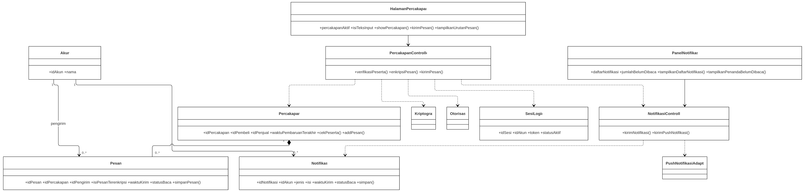

<i>Gambar 3.63. Diagram Kelas Use Case UC17</i>

---

## 3.18 Use Case Melihat Daftar Percakapan

**ID Use Case:** UC18  
**Nama Use Case:** Melihat Daftar Percakapan

### 3.18.1 Identifikasi Kelas

Realisasi use case ini melibatkan antarmuka percakapan untuk menyajikan daftar, controller percakapan untuk mengambil percakapan milik pengguna beserta cuplikan pesan terakhir dan jumlah pesan belum dibaca, modul otorisasi dan kriptografi sebagai kelas pendukung, serta entitas SesiLogin, Percakapan, dan Pesan.

Tabel 3.18. Identifikasi Kelas Use Case UC18

| No | Nama Kelas Perancangan | Nama Kelas Analisis Terkait | Peran / Tanggung Jawab dalam Use Case |
| :--- | :--- | :--- | :--- |
| 1 | HalamanPercakapan | C08 HalamanPercakapan | Menampilkan daftar percakapan beserta identitas lawan bicara, cuplikan pesan terakhir, dan penanda jumlah pesan belum dibaca. |
| 2 | PercakapanController | C18 PercakapanController | Mengambil percakapan milik pengguna, mengurutkannya berdasarkan pesan terbaru, mengambil dan mendekripsi cuplikan pesan terakhir, serta menghitung pesan belum dibaca. |
| 3 | SesiLogin | C28 SesiLogin | Menyediakan idAkun pengguna dari token sesi aktif. |
| 4 | Percakapan | C33 Percakapan | Menyediakan data percakapan milik pengguna, lawan bicara, dan waktu aktivitas terakhir. |
| 5 | Pesan | C34 Pesan | Menyediakan pesan terakhir dan jumlah pesan belum dibaca pada tiap percakapan. |
| 6 | Otorisasi | C41 Otorisasi (Pendukung) | Memverifikasi token sesi dan mengekstrak identitas pengguna. |
| 7 | Kriptografi | C42 Kriptografi (Pendukung) | Mendekripsi isi pesan terakhir agar dapat ditampilkan sebagai cuplikan. |

### 3.18.2 Sequence Diagram

- **Skenario Normal**

Pengguna membuka halaman "Daftar Percakapan" dari menu navigasi. PercakapanController memverifikasi token melalui Otorisasi dan SesiLogin, mengambil seluruh Percakapan yang melibatkan pengguna, mengambil Pesan terakhir tiap percakapan, mendekripsinya melalui Kriptografi, menghitung pesan belum dibaca, lalu mengembalikan daftar yang diurutkan dari yang terbaru. HalamanPercakapan merender daftar tersebut.

<i>Gambar 3.64. Sequence Diagram UC18 - Skenario Normal</i>

### 3.18.3 Diagram Kelas

HalamanPercakapan berasosiasi dengan PercakapanController. PercakapanController bergantung pada SesiLogin, Percakapan, Pesan, Otorisasi, dan Kriptografi. Otorisasi bergantung pada SesiLogin. Relasi antar-*entity* pada diagram ini adalah Percakapan ke Pesan berupa komposisi 1 ke 0..*. Setiap kelas menampilkan atribut bertipe data dan operasi yang dipakai pada UC18, sehingga seluruh operasi yang dipanggil pada *sequence diagram* subbab sebelumnya tercantum pada kelas yang bersangkutan.

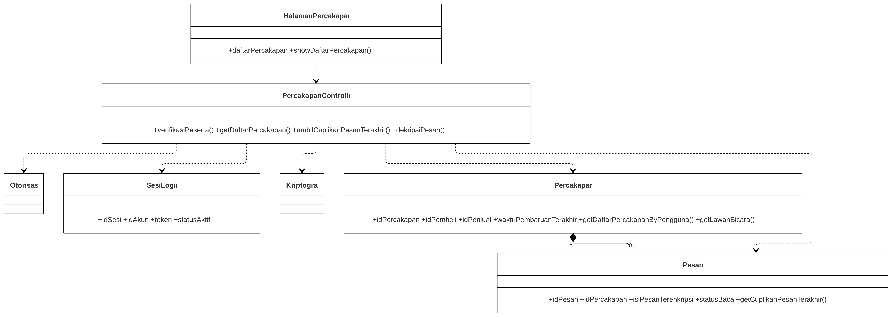

<i>Gambar 3.65. Diagram Kelas Use Case UC18</i>

---

## 3.19 Use Case Mengirimkan Laporan

**ID Use Case:** UC19  
**Nama Use Case:** Mengirimkan Laporan

### 3.19.1 Identifikasi Kelas

Realisasi use case pelaporan melibatkan antarmuka detail barang sebagai salah satu titik masuk, antarmuka formulir laporan untuk menangkap kategori, alasan, dan bukti, controller laporan untuk validasi, penyusunan metadata percakapan tanpa isi pesan, penyimpanan, dan pencatatan log audit, modul otorisasi untuk identifikasi pelapor, entitas Laporan, BuktiLaporan, dan LogAudit, serta layanan penyimpanan berkas untuk bukti tangkapan layar.

Tabel 3.19. Identifikasi Kelas Use Case UC19

| No | Nama Kelas Perancangan | Nama Kelas Analisis Terkait | Peran / Tanggung Jawab dalam Use Case |
| :--- | :--- | :--- | :--- |
| 1 | HalamanDetailBarang | C07 HalamanDetailBarang | Menyediakan tombol "Laporkan" pada detail listing sebagai salah satu titik masuk pelaporan. |
| 2 | FormulirLaporan | C10 FormulirLaporan | Menampilkan formulir sesuai konteks asal, menangkap kategori, alasan, dan bukti, memvalidasi kelengkapan di sisi klien, serta menandai kolom yang kosong. |
| 3 | LaporanController | C20 LaporanController | Memvalidasi data dan bukti di sisi server, menyusun metadata percakapan tanpa isi pesan, mengunggah bukti, menyimpan laporan berstatus "Baru", dan mencatat penerimaan ke log audit. |
| 4 | Akun | C23 Akun | Akun pelapor yang identitasnya dicatat pada laporan. |
| 5 | SesiLogin | C28 SesiLogin | Menyediakan idAkun pelapor dari sesi aktif. |
| 6 | Barang | C29 Barang | Listing yang dapat menjadi objek laporan. |
| 7 | Percakapan | C33 Percakapan | Percakapan yang dapat menjadi objek laporan. Hanya ID percakapan yang dicatat, tanpa isi pesan. |
| 8 | Laporan | C36 Laporan | Menyimpan rincian aduan, objek yang dilaporkan, kategori, alasan, waktu, dan status penanganan "Baru". |
| 9 | BuktiLaporan | C37 BuktiLaporan | Menyimpan metadata berkas bukti tangkapan layar. |
| 10 | LogAudit | C38 LogAudit | Mencatat penerimaan laporan sebagai rekam jejak permanen yang tidak dapat diubah atau dihapus. |
| 11 | Otorisasi | C41 Otorisasi (Pendukung) | Memverifikasi token sesi pelapor. |
| 12 | PenyimpananBerkas | C45 PenyimpananBerkas (Penyimpanan Data) | Menyimpan fisik berkas bukti tangkapan layar pada Supabase Storage. |

### 3.19.2 Sequence Diagram

- **Skenario Normal**

Pengguna menekan "Laporkan" dari halaman detail listing, profil pengguna, ruang percakapan, atau menu bantuan, lalu FormulirLaporan ditampilkan sesuai konteks. Pengguna memilih kategori, mengisi alasan, melampirkan bukti, dan menekan "Kirim Laporan". LaporanController memverifikasi sesi melalui Otorisasi dan SesiLogin, memvalidasi kelengkapan data dan bukti, dan apabila laporan berasal dari percakapan, hanya menyusun ID percakapan, waktu pelaporan, dan identitas pelapor tanpa isi pesan. Laporan disimpan dengan status "Baru", bukti diunggah ke PenyimpananBerkas dan dicatat sebagai BuktiLaporan, penerimaan dicatat ke LogAudit, dan notifikasi "Laporan berhasil dikirim" ditampilkan.

<i>Gambar 3.66. Sequence Diagram UC19 - Skenario Normal</i>

- **Skenario Alternatif 1: Kolom Bukti atau Alasan Dikosongkan**

Skenario ini terjadi apabila pengguna mengosongkan kolom alasan atau tidak melampirkan tangkapan layar. FormulirLaporan mendeteksi kegagalan validasi wajib-isi, membatalkan pengiriman ke server, memberi penanda merah pada kolom terkait, dan menampilkan galat "Alasan dan bukti tangkapan layar wajib diisi".

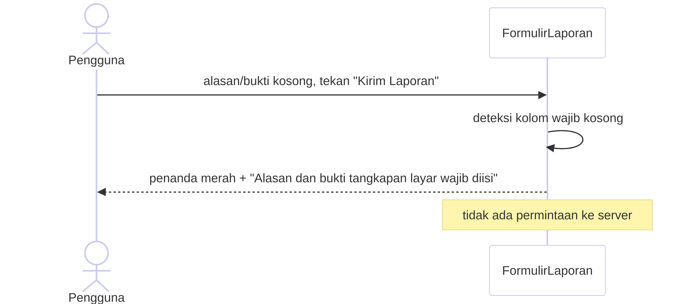

<i>Gambar 3.67. Sequence Diagram UC19 - Skenario Alternatif 1: Kolom Bukti atau Alasan Dikosongkan</i>

### 3.19.3 Diagram Kelas

HalamanDetailBarang berasosiasi dengan FormulirLaporan. FormulirLaporan berasosiasi dengan LaporanController. LaporanController bergantung pada SesiLogin, Barang, Percakapan, Laporan, BuktiLaporan, LogAudit, Otorisasi, dan PenyimpananBerkas. Otorisasi bergantung pada SesiLogin. Relasi antar-*entity* pada diagram ini adalah Akun ke SesiLogin berupa asosiasi 1 ke 0..*, Barang ke Percakapan berupa asosiasi 1 ke 0..*, Akun ke Laporan berupa asosiasi 1 ke 0..*, Laporan ke BuktiLaporan berupa komposisi 1 ke 1..*, Laporan ke Barang berupa asosiasi 0..* ke 0..1, Laporan ke Percakapan berupa asosiasi 0..* ke 0..1, dan Laporan ke LogAudit berupa asosiasi 1 ke 0..*. Setiap kelas menampilkan atribut bertipe data dan operasi yang dipakai pada UC19, sehingga seluruh operasi yang dipanggil pada *sequence diagram* subbab sebelumnya tercantum pada kelas yang bersangkutan.

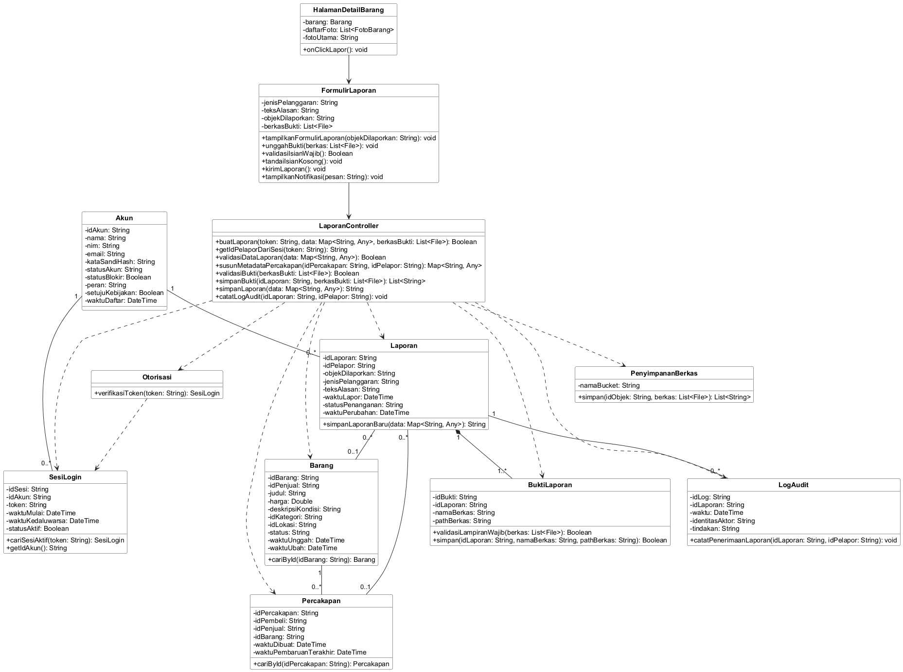

<i>Gambar 3.68. Diagram Kelas Use Case UC19</i>

---

## 3.20 Use Case Melihat dan Menyaring Daftar Laporan

**ID Use Case:** UC20  
**Nama Use Case:** Melihat dan Menyaring Daftar Laporan

### 3.20.1 Identifikasi Kelas

Realisasi use case ini melibatkan antarmuka dasbor admin untuk menampilkan tabel dan filter laporan, controller moderasi untuk memeriksa hak akses admin dan mengambil serta menyaring data laporan, modul otorisasi untuk pemeriksaan token dan peran, serta entitas Admin, SesiLogin, dan Laporan.

Tabel 3.20. Identifikasi Kelas Use Case UC20

| No | Nama Kelas Perancangan | Nama Kelas Analisis Terkait | Peran / Tanggung Jawab dalam Use Case |
| :--- | :--- | :--- | :--- |
| 1 | DasborAdmin | C11 DasborAdmin | Menampilkan tabel laporan (pelapor, objek, kategori, waktu, status), menyediakan filter status, dan menampilkan peringatan "Akses Ditolak" apabila akses ditolak. |
| 2 | ModerasiController | C21 ModerasiController | Memeriksa peran admin, mengambil seluruh laporan, dan menyaring laporan berdasarkan status. |
| 3 | Admin | C26 Admin | Aktor pemilik hak akses moderasi yang perannya diverifikasi. |
| 4 | SesiLogin | C28 SesiLogin | Menyediakan idAkun dan peran dari token sesi aktif. |
| 5 | Laporan | C36 Laporan | Menyediakan data laporan untuk ditampilkan dan disaring menurut status penanganan. |
| 6 | Otorisasi | C41 Otorisasi (Pendukung) | Memverifikasi token dan menolak akses fungsi moderasi oleh akun yang tidak berperan admin. |

### 3.20.2 Sequence Diagram

- **Skenario Normal**

Admin membuka halaman daftar laporan pada dasbor admin. ModerasiController memeriksa token dan peran melalui Otorisasi dan SesiLogin, memastikan akun adalah Admin, lalu mengambil seluruh Laporan dan menampilkannya pada DasborAdmin. Ketika admin memilih status pada filter (misalnya "Baru"), ModerasiController menyaring laporan menurut status tersebut dan tabel diperbarui.

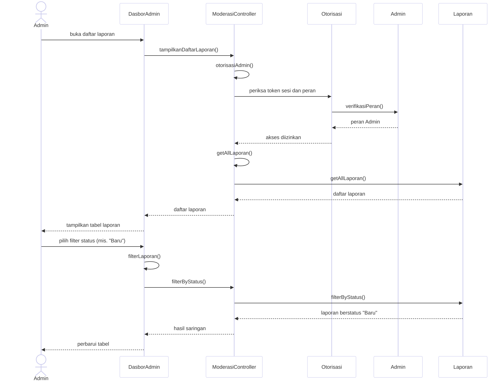

<i>Gambar 3.69. Sequence Diagram UC20 - Skenario Normal</i>

- **Skenario Alternatif 1: Akses oleh Akun Bukan Admin**

Skenario ini terjadi apabila pengguna biasa membuka URL daftar laporan secara langsung. Otorisasi memeriksa peran dari token sesi dan mendeteksi bahwa akun bukan admin. ModerasiController menolak permintaan, lalu pengguna dialihkan ke beranda utama disertai peringatan "Akses Ditolak".

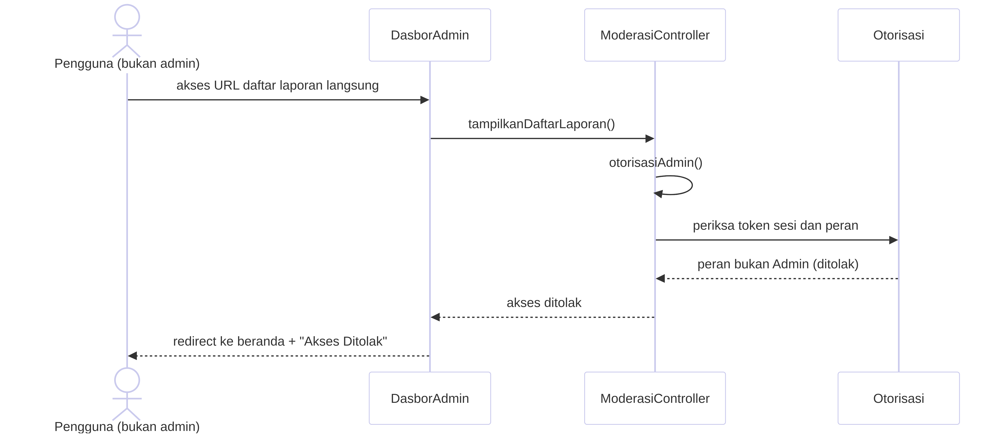

<i>Gambar 3.70. Sequence Diagram UC20 - Skenario Alternatif 1: Akses oleh Akun Bukan Admin</i>

### 3.20.3 Diagram Kelas

DasborAdmin berasosiasi dengan ModerasiController. ModerasiController bergantung pada Otorisasi, SesiLogin, dan Laporan. Otorisasi bergantung pada SesiLogin dan Admin. Setiap kelas menampilkan atribut bertipe data dan operasi yang dipakai pada UC20, sehingga seluruh operasi yang dipanggil pada *sequence diagram* subbab sebelumnya tercantum pada kelas yang bersangkutan.

<i>Gambar 3.71. Diagram Kelas Use Case UC20</i>

---

## 3.21 Use Case Mengubah Status Penanganan Laporan

**ID Use Case:** UC21  
**Nama Use Case:** Mengubah Status Penanganan Laporan

### 3.21.1 Identifikasi Kelas

Realisasi use case ini melibatkan antarmuka dasbor admin untuk meninjau detail dan memilih status baru, controller moderasi untuk memvalidasi dan memperbarui status, modul otorisasi untuk verifikasi admin, entitas Laporan yang statusnya diperbarui, serta LogAudit untuk pencatatan permanen tindak lanjut.

Tabel 3.21. Identifikasi Kelas Use Case UC21

| No | Nama Kelas Perancangan | Nama Kelas Analisis Terkait | Peran / Tanggung Jawab dalam Use Case |
| :--- | :--- | :--- | :--- |
| 1 | DasborAdmin | C11 DasborAdmin | Menampilkan detail laporan dan kendali dropdown status (Baru, Diproses, Selesai), lalu meneruskan perubahan ke controller. |
| 2 | ModerasiController | C21 ModerasiController | Memverifikasi peran admin, memvalidasi status baru, memperbarui Laporan, dan meminta pencatatan ke log audit. |
| 3 | Admin | C26 Admin | Aktor admin yang meninjau laporan dan mengubah statusnya. |
| 4 | SesiLogin | C28 SesiLogin | Menyediakan identitas admin dari token sesi aktif. |
| 5 | Laporan | C36 Laporan | Menyimpan status penanganan beserta stempel waktu perubahan. |
| 6 | LogAudit | C38 LogAudit | Mencatat secara permanen bahwa admin tertentu mengubah status laporan tertentu. Catatan tidak dapat diubah atau dihapus. |
| 7 | Otorisasi | C41 Otorisasi (Pendukung) | Memverifikasi token dan peran admin sebelum perubahan dilakukan. |

### 3.21.2 Sequence Diagram

- **Skenario Normal**

Admin membuka detail laporan, meninjau isinya, memilih status baru pada dropdown, dan menyimpan. ModerasiController memverifikasi peran admin melalui Otorisasi, memvalidasi status baru, lalu memperbarui statusPenanganan dan waktu perubahan pada Laporan. Setelah itu controller mencatat tindak lanjut ke LogAudit yang bersifat hanya-tambah. DasborAdmin menampilkan status terbaru.

<i>Gambar 3.72. Sequence Diagram UC21 - Skenario Normal</i>

### 3.21.3 Diagram Kelas

DasborAdmin berasosiasi dengan ModerasiController. ModerasiController bergantung pada Otorisasi, SesiLogin, Laporan, dan LogAudit. Otorisasi bergantung pada SesiLogin dan Admin. Relasi antar-*entity* pada diagram ini adalah Laporan ke LogAudit berupa asosiasi 1 ke 0..*. Setiap kelas menampilkan atribut bertipe data dan operasi yang dipakai pada UC21, sehingga seluruh operasi yang dipanggil pada *sequence diagram* subbab sebelumnya tercantum pada kelas yang bersangkutan.

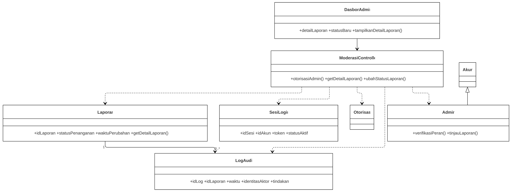

<i>Gambar 3.73. Diagram Kelas Use Case UC21</i>

---

## 3.22 Use Case Menghapus Listing yang Dilaporkan

**ID Use Case:** UC22  
**Nama Use Case:** Menghapus Listing yang Dilaporkan

### 3.22.1 Identifikasi Kelas

Realisasi use case ini melibatkan antarmuka dasbor admin untuk menangkap alasan dan konfirmasi, controller moderasi untuk mengeksekusi penghapusan dan mengorkestrasi notifikasi serta pencatatan, controller notifikasi dan surel adapter untuk memberi tahu pemilik listing, modul otorisasi, serta entitas Barang, Notifikasi, LogAudit, dan LogAdmin.

Tabel 3.22. Identifikasi Kelas Use Case UC22

| No | Nama Kelas Perancangan | Nama Kelas Analisis Terkait | Peran / Tanggung Jawab dalam Use Case |
| :--- | :--- | :--- | :--- |
| 1 | DasborAdmin | C11 DasborAdmin | Menyediakan tombol "Hapus Listing", dialog alasan, dan konfirmasi penghapusan. |
| 2 | ModerasiController | C21 ModerasiController | Memverifikasi admin, menghapus listing, meminta notifikasi kepada pemilik, serta mencatat ke log admin dan log audit. |
| 3 | NotifikasiController | C19 NotifikasiController | Membuat dan mengirim pemberitahuan penghapusan beserta alasan kepada pemilik listing. |
| 4 | Admin | C26 Admin | Aktor pelaku penghapusan yang tercatat pada log admin. |
| 5 | SesiLogin | C28 SesiLogin | Menyediakan identitas admin dari token sesi aktif. |
| 6 | Barang | C29 Barang | Entitas listing yang dihapus dari katalog (beserta foto dan detail terkait). |
| 7 | Notifikasi | C35 Notifikasi | Menyimpan pemberitahuan penghapusan listing dan alasannya bagi pemilik. |
| 8 | LogAudit | C38 LogAudit | Mencatat tindak lanjut penghapusan pada catatan audit yang tidak dapat diubah. |
| 9 | LogAdmin | C39 LogAdmin | Mencatat tindakan "Hapus Listing" beserta pelaku, objek, waktu, dan alasan. |
| 10 | Otorisasi | C41 Otorisasi (Pendukung) | Memverifikasi token dan peran admin. |
| 11 | SurelAdapter | C43 SurelAdapter (Integrasi) | Mengirim surel pemberitahuan penghapusan kepada pemilik listing. |
| 12 | PenyimpananBerkas | C45 PenyimpananBerkas (Penyimpanan Data) | Menghapus berkas foto listing dari Supabase Storage. |
| 13 | Akun | C23 Akun | Menyediakan alamat surel pemilik listing untuk pemberitahuan penghapusan. |
| 14 | FotoBarang | C30 FotoBarang | Menyediakan daftar foto listing agar ikut dihapus bersama listing. |

### 3.22.2 Sequence Diagram

- **Skenario Normal**

Dari halaman detail laporan, admin menekan "Hapus Listing", mengisi alasan pada dialog, lalu mengonfirmasi. ModerasiController memverifikasi peran admin melalui Otorisasi dan SesiLogin, lalu menghapus Barang beserta berkas fotonya dari PenyimpananBerkas. Controller meminta NotifikasiController membuat Notifikasi bagi pemilik dan mengirim surel melalui SurelAdapter, dengan isi yang mencantumkan alasan dari admin. Terakhir, tindakan dicatat ke LogAdmin dan LogAudit.

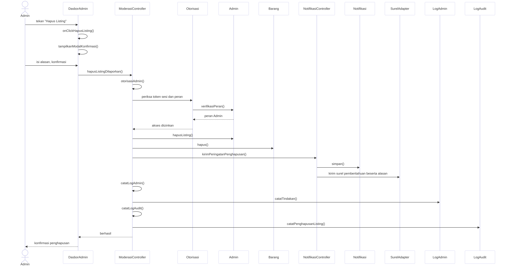

<i>Gambar 3.74. Sequence Diagram UC22 - Skenario Normal</i>

### 3.22.3 Diagram Kelas

DasborAdmin berasosiasi dengan ModerasiController. NotifikasiController bergantung pada Notifikasi dan SurelAdapter. ModerasiController bergantung pada Otorisasi, SesiLogin, LogAudit, LogAdmin, Barang, FotoBarang, Akun, NotifikasiController, dan PenyimpananBerkas. Otorisasi bergantung pada SesiLogin dan Admin. Admin merupakan turunan (generalisasi) dari Akun. Relasi antar-*entity* pada diagram ini adalah Akun ke SesiLogin berupa asosiasi 1 ke 0..*, Akun ke Notifikasi berupa asosiasi 1 ke 0..*, Barang ke FotoBarang berupa komposisi 1 ke 1..5, dan Admin ke LogAdmin berupa asosiasi 1 ke 0..*. Setiap kelas menampilkan atribut bertipe data dan operasi yang dipakai pada UC22, sehingga seluruh operasi yang dipanggil pada *sequence diagram* subbab sebelumnya tercantum pada kelas yang bersangkutan.

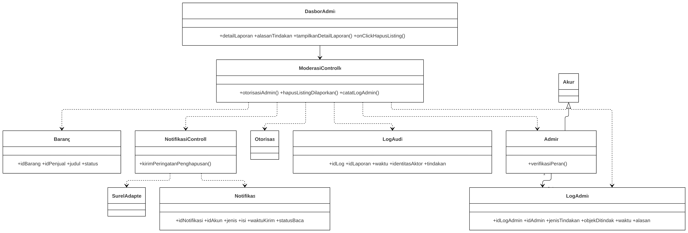

<i>Gambar 3.75. Diagram Kelas Use Case UC22</i>

---

## 3.23 Use Case Memblokir Akun Pengguna

**ID Use Case:** UC23  
**Nama Use Case:** Memblokir Akun Pengguna

### 3.23.1 Identifikasi Kelas

Realisasi use case ini melibatkan antarmuka dasbor admin untuk menangkap alasan dan konfirmasi pemblokiran, controller moderasi untuk mengubah status akun, menonaktifkan listing milik akun tersebut, dan memutus sesi aktif, controller notifikasi dan surel adapter untuk pemberitahuan penangguhan, modul otorisasi, serta entitas Akun, SesiLogin, Barang, Notifikasi, LogAudit, dan LogAdmin.

Tabel 3.23. Identifikasi Kelas Use Case UC23

| No | Nama Kelas Perancangan | Nama Kelas Analisis Terkait | Peran / Tanggung Jawab dalam Use Case |
| :--- | :--- | :--- | :--- |
| 1 | DasborAdmin | C11 DasborAdmin | Menyediakan tombol "Blokir Akun", dialog alasan, konfirmasi, dan status akun terkini. |
| 2 | ModerasiController | C21 ModerasiController | Mengubah status akun menjadi "Diblokir", menonaktifkan seluruh listing milik akun, memutus sesi aktif, meminta notifikasi, dan mencatat log. |
| 3 | NotifikasiController | C19 NotifikasiController | Membuat dan mengirim pemberitahuan penangguhan beserta alasannya kepada pengguna. |
| 4 | Akun | C23 Akun | Entitas yang statusnya berubah dari "Aktif" menjadi "Diblokir". |
| 5 | Admin | C26 Admin | Aktor pelaku pemblokiran yang tercatat pada log admin. |
| 6 | SesiLogin | C28 SesiLogin | Sesi aktif milik akun yang diblokir dinonaktifkan. Menyediakan pula identitas admin pelaku. |
| 7 | Barang | C29 Barang | Seluruh listing milik akun dinonaktifkan sehingga hilang dari katalog dan hasil pencarian. |
| 8 | Notifikasi | C35 Notifikasi | Menyimpan pemberitahuan penangguhan akun. |
| 9 | LogAudit | C38 LogAudit | Mencatat tindakan pemblokiran pada catatan audit permanen. |
| 10 | LogAdmin | C39 LogAdmin | Mencatat tindakan "Blokir Akun" beserta pelaku, objek, waktu, dan alasan. |
| 11 | Otorisasi | C41 Otorisasi (Pendukung) | Memverifikasi token dan peran admin. |
| 12 | SurelAdapter | C43 SurelAdapter (Integrasi) | Mengirim surel pemberitahuan penangguhan beserta alasan. |
| 13 | Penjual | C25 Penjual | Peran penjual dari akun yang diblokir; seluruh listing miliknya dinonaktifkan. |

### 3.23.2 Sequence Diagram

- **Skenario Normal**

Admin menekan "Blokir Akun" dari detail laporan atau profil pengguna, mengisi alasan, lalu mengonfirmasi. ModerasiController memverifikasi peran admin, mengubah status Akun menjadi "Diblokir", menonaktifkan seluruh Barang milik akun tersebut agar hilang dari katalog dan pencarian, dan menonaktifkan SesiLogin aktif akun tersebut. Controller meminta NotifikasiController mengirim pemberitahuan beserta alasan melalui SurelAdapter dan menyimpannya sebagai Notifikasi. Tindakan dicatat ke LogAdmin dan LogAudit. Pada percobaan login berikutnya, AkunController menolak login akun yang berstatus "Diblokir" dengan pesan penangguhan.

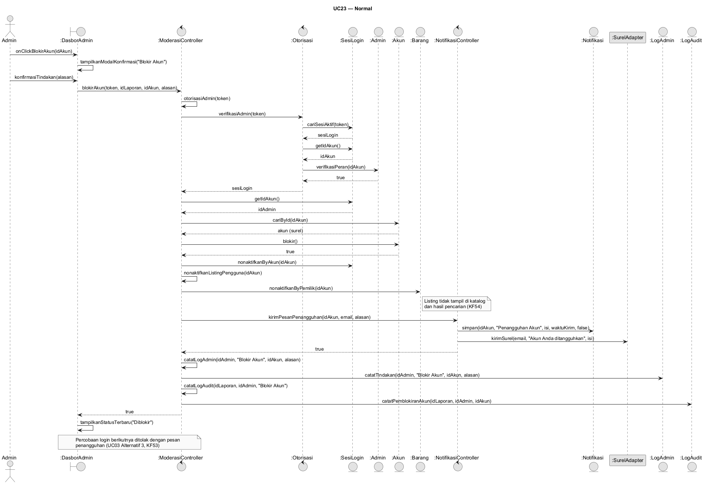

<i>Gambar 3.76. Sequence Diagram UC23 - Skenario Normal</i>

### 3.23.3 Diagram Kelas

DasborAdmin berasosiasi dengan ModerasiController. NotifikasiController bergantung pada Notifikasi dan SurelAdapter. ModerasiController bergantung pada Otorisasi, SesiLogin, LogAudit, LogAdmin, Barang, Akun, dan NotifikasiController. Otorisasi bergantung pada SesiLogin dan Admin. Penjual dan Admin merupakan turunan (generalisasi) dari Akun. Relasi antar-*entity* pada diagram ini adalah Akun ke SesiLogin berupa asosiasi 1 ke 0..*, Akun ke Notifikasi berupa asosiasi 1 ke 0..*, Penjual ke Barang berupa komposisi 1 ke 0..*, dan Admin ke LogAdmin berupa asosiasi 1 ke 0..*. Setiap kelas menampilkan atribut bertipe data dan operasi yang dipakai pada UC23, sehingga seluruh operasi yang dipanggil pada *sequence diagram* subbab sebelumnya tercantum pada kelas yang bersangkutan.

<i>Gambar 3.77. Diagram Kelas Use Case UC23</i>

---

## 3.24 Use Case Membuka Blokir Akun Pengguna

**ID Use Case:** UC24  
**Nama Use Case:** Membuka Blokir Akun Pengguna

### 3.24.1 Identifikasi Kelas

Realisasi use case ini melibatkan antarmuka dasbor admin untuk memicu pembukaan blokir, controller moderasi untuk memulihkan status akun dan visibilitas listing, modul otorisasi, serta entitas Akun, Barang, dan LogAdmin.

Tabel 3.24. Identifikasi Kelas Use Case UC24

| No | Nama Kelas Perancangan | Nama Kelas Analisis Terkait | Peran / Tanggung Jawab dalam Use Case |
| :--- | :--- | :--- | :--- |
| 1 | DasborAdmin | C11 DasborAdmin | Menyediakan tombol "Buka Blokir" pada profil pengguna atau detail laporan beserta dialog konfirmasi. |
| 2 | ModerasiController | C21 ModerasiController | Memverifikasi admin, memulihkan status akun, memulihkan listing ke katalog, dan mencatat ke log admin. |
| 3 | Akun | C23 Akun | Entitas yang status blokirnya dikembalikan menjadi aktif sehingga pengguna dapat login kembali. |
| 4 | Admin | C26 Admin | Aktor pelaku pembukaan blokir yang tercatat pada log admin. |
| 5 | Barang | C29 Barang | Listing milik akun dikembalikan ke status publik sehingga tampil kembali pada katalog dan pencarian. |
| 6 | LogAdmin | C39 LogAdmin | Mencatat tindakan "Buka Blokir" beserta pelaku, objek, dan waktu. |
| 7 | Otorisasi | C41 Otorisasi (Pendukung) | Memverifikasi token dan peran admin. |
| 8 | SesiLogin | C28 SesiLogin | Menyediakan identitas admin dari token sesi aktif. |
| 9 | Penjual | C25 Penjual | Peran penjual dari akun yang dibuka blokirnya; listing miliknya dipulihkan ke katalog. |

### 3.24.2 Sequence Diagram

- **Skenario Normal**

Admin menekan "Buka Blokir" pada akun yang sedang diblokir. ModerasiController memverifikasi peran admin melalui Otorisasi, mengubah status Akun menjadi aktif, memulihkan seluruh Barang milik akun tersebut ke katalog publik, lalu mencatat tindakan ke LogAdmin. DasborAdmin menampilkan status akun terbaru.

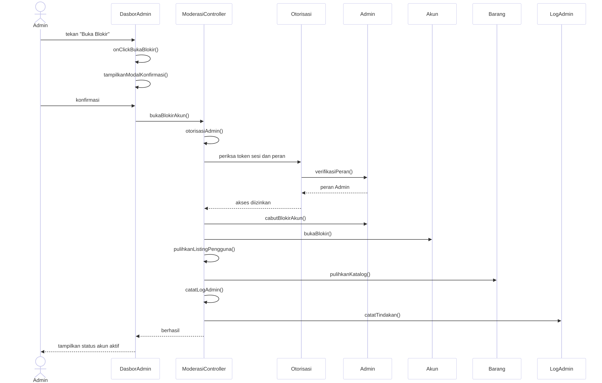

<i>Gambar 3.78. Sequence Diagram UC24 - Skenario Normal</i>

### 3.24.3 Diagram Kelas

DasborAdmin berasosiasi dengan ModerasiController. ModerasiController bergantung pada Otorisasi, SesiLogin, LogAdmin, Barang, dan Akun. Otorisasi bergantung pada SesiLogin dan Admin. Penjual dan Admin merupakan turunan (generalisasi) dari Akun. Relasi antar-*entity* pada diagram ini adalah Akun ke SesiLogin berupa asosiasi 1 ke 0..*, Penjual ke Barang berupa komposisi 1 ke 0..*, dan Admin ke LogAdmin berupa asosiasi 1 ke 0..*. Setiap kelas menampilkan atribut bertipe data dan operasi yang dipakai pada UC24, sehingga seluruh operasi yang dipanggil pada *sequence diagram* subbab sebelumnya tercantum pada kelas yang bersangkutan.

<i>Gambar 3.79. Diagram Kelas Use Case UC24</i>

 

---

# BAB 4: Diagram Kelas Keseluruhan

## 4.1 Diagram Kelas

Diagram kelas perancangan keseluruhan merupakan gabungan dari seluruh diagram kelas per use case pada BAB 3. Setiap kelas hanya digambarkan satu kali, dan atribut serta metodenya merupakan gabungan dari seluruh kemunculannya pada BAB 3. Sebaliknya, setiap atribut dan metode pada diagram kelas per use case selalu tercantum pada Tabel 4.1 dengan penulisan yang sama, karena kedua bagian disusun dari satu model kelas yang sama. Agar tetap terbaca, kotak kelas pada Gambar 4.1 hanya memuat ID dan nama kelas, sedangkan atribut dan metode lengkap setiap kelas disajikan pada Tabel 4.1.

Gambar 4.1 disusun dalam empat kolom sesuai *pattern* MVC pada subbab 2.2:

- **View (C01–C12)**: kelas antarmuka yang berasosiasi searah dengan kelas *Controller*. KatalogView, ProfilView, dan HalamanListingPenjual memiliki relasi komposisi terhadap KartuProduk.
- **Controller (C13–C22)**: kelas pengendali yang bergantung pada kelas *Model*, kelas *Pendukung*, kelas *Integrasi Eksternal*, PenyimpananBerkas, dan pada NotifikasiController bila perlu mengirim pemberitahuan.
- **Pendukung, Integrasi Eksternal, dan Penyimpanan Data (C41–C45)**: kelas baru pada tahap perancangan, yaitu C41 Otorisasi, C42 Kriptografi, C43 SurelAdapter, C44 PushNotifikasiAdapter, dan C45 PenyimpananBerkas. Otorisasi bergantung pada SesiLogin dan Admin untuk memeriksa sesi dan peran.
- **Model (C23–C40)**: kelas data yang saling berelasi melalui asosiasi bermultiplisitas, komposisi, dan generalisasi.

Secara keseluruhan, diagram memuat **45 kelas** dengan **15 asosiasi berarah** dari *View*, **7 komposisi**, **3 generalisasi**, **15 asosiasi antar-*Model***, dan **55 dependensi**, tanpa kelas yang terduplikasi.

<i>Gambar 4.1. Diagram Kelas Perancangan Keseluruhan ITBELI</i>

Kelas perancangan pada Tabel 4.1 mengikuti ketentuan berikut.

1. **Visibilitas.** Atribut bersifat *private* (`-`) dan hanya diakses melalui operasi, sedangkan operasi bersifat *public* (`+`).
2. **Tipe data.** Tipe yang dipakai adalah `String`, `Integer`, `Long`, `Double`, `Boolean`, `Date`, `DateTime`, `File`, `List<T>`, `Map<K, V>`, dan `Any`, serta nama kelas lain bila nilai yang dikembalikan berupa objek kelas tersebut (misalnya `SesiLogin`).
3. **Satu nama, satu tanda tangan.** Implementasi ITBELI memakai JavaScript yang tidak mendukung *overloading*, sehingga setiap nama operasi pada satu kelas hanya memiliki satu daftar parameter dan satu tipe kembalian.
4. **Kelas peran.** C24 Pembeli, C25 Penjual, dan C26 Admin mewarisi seluruh atribut C23 Akun dan hanya menambahkan operasi yang khusus untuk perannya.

Dibandingkan dengan diagram kelas analisis pada subbab 5.3 dokumen SKPL, diagram kelas perancangan memuat penyempurnaan berikut.

1. **Kelas baru C41–C45.** Komponen *Pendukung*, *Integrasi Eksternal*, dan PenyimpananBerkas pada Tabel 2.3 diwujudkan sebagai kelas tersendiri.
2. **Pemeriksaan sesi terpusat.** Setiap *Controller* yang memerlukan *login* memanggil Otorisasi untuk memeriksa token sesi, lalu mengambil identitas akun dari SesiLogin. ModerasiController memakai `verifikasiAdmin()` yang sekaligus memeriksa peran admin (KF56).
3. **Orkestrasi pencarian dan penyaringan.** HalamanKatalog hanya berasosiasi dengan KatalogController, sedangkan KatalogController memanggil PencarianController dan FilterController. Dengan demikian, halaman katalog cukup mengirim satu permintaan untuk kata kunci, filter, pengurutan, dan halaman sekaligus.
4. **Alur pelaporan.** HalamanDetailBarang membuka FormulirLaporan, lalu FormulirLaporan meneruskan laporan ke LaporanController.
5. **Penyeragaman operasi.** Operasi yang sama tetapi bernama berbeda antar-use case disatukan, misalnya `Barang.getByPemilik()` menjadi `Barang.getListingPenjual()`. Pengelompokan listing per status dipindahkan ke `HalamanListingPenjual.kelompokkanBerdasarkanStatus()` karena merupakan urusan tampilan. Operasi peran pada SKPL yang tidak pernah dipanggil pada *sequence diagram*, seperti `lihatProfil()` dan `buatListing()`, tidak dipertahankan.
6. **Penyaringan akun terblokir.** Barang bergantung pada Akun melalui `getSyaratTidakDiblokir()`, sehingga katalog dan hasil pencarian hanya memuat listing milik akun yang tidak diblokir (KF30, KF54).

Tabel 4.1. Daftar Kelas Perancangan Keseluruhan

| ID Kelas | Nama Kelas | Jenis | Atribut | Metode/Operasi |
| :--- | :--- | :--- | :--- | :--- |
| C01 | HalamanOtentikasi | View | - nama: String - nim: String - email: String - kataSandi: String - setujuKebijakan: Boolean - kodeVerifikasi: String - sisaWaktu: Integer - token: String | + tampilkanFormulirPendaftaran(): void + tampilkanKebijakanPrivasi(tautan: String): void + kirimFormulirPendaftaran(nama: String, nim: String, email: String, kataSandi: String, setujuKebijakan: Boolean): void + arahkanKeHalamanVerifikasi(): void + tampilkanFormulirVerifikasi(): void + kirimKodeVerifikasi(email: String, kode: String): void + mintaKirimUlang(email: String): void + resetHitungMundur(): void + tampilkanPesanSukses(pesan: String): void + tampilkanFormulirLogin(): void + kirimFormulirLogin(email: String, kataSandi: String): void + arahkanKeBeranda(): void + tampilkanPesanGalat(pesan: String): void + tampilkanTombolKeluar(): void + kirimPermintaanLogout(token: String): void + hapusTokenLokal(): void + arahkanKeHalamanLogin(): void |
| C02 | HalamanProfil | View | - dataAkun: Akun - daftarKartuProduk: List&lt;KartuProduk&gt; | + muatProfil(): void + tampilkanProfil(data: Akun): void + tampilkanDaftarListing(daftarBarang: List&lt;Barang&gt;): void + bukaPengaturanAkun(): void + tampilkanTautanKebijakan(tautan: String): void |
| C03 | HalamanListingPenjual | View | - daftarTersedia: List&lt;Barang&gt; - daftarTerjual: List&lt;Barang&gt; - tabAktif: String - idBarangTerpilih: String | + muatDaftarListing(): void + tampilkanDaftarListing(daftarListing: List&lt;Barang&gt;): void + kelompokkanBerdasarkanStatus(daftarListing: List&lt;Barang&gt;): void + pilihTab(namaTab: String): void + onClickUbah(idBarang: String): void + onClickHapus(idBarang: String): void + onClickTandaiTerjual(idBarang: String): void + onClickBatalTerjual(idBarang: String): void + tampilkanKonfirmasi(barang: Barang, aksi: String): void + konfirmasiAksi(): void + batalkanKonfirmasi(): void + tutupDialog(): void + tampilkanNotifikasi(kodePesan: String): void |
| C04 | FormulirBarang | View | - judul: String - harga: Double - deskripsiKondisi: String - idKategori: String - idLokasi: String - daftarFoto: List&lt;FotoBarang&gt; - fotoBaru: List&lt;File&gt; | + bukaFormulir(): void + tampilkanFormulir(barang: Barang, daftarFoto: List&lt;FotoBarang&gt;, daftarKategori: List&lt;Kategori&gt;, daftarLokasi: List&lt;LokasiCOD&gt;): void + suntingIsian(data: Map&lt;String, Any&gt;): void + pilihFoto(fotoBaru: List&lt;File&gt;): void + validasiTipeData(data: Map&lt;String, Any&gt;): Boolean + validasiFotoSisiKlien(fotoBaru: List&lt;File&gt;, fotoDipertahankan: List&lt;FotoBarang&gt;): Boolean + validasiIsianWajib(data: Map&lt;String, Any&gt;, galeri: List&lt;Any&gt;): Boolean + tandaiIsianKosong(): void + tolakPratinjau(): void + kirimFormulir(data: Map&lt;String, Any&gt;, fotoBaru: List&lt;File&gt;): void + onClickUpdate(): void + arahkanKeDetail(idBarang: String): void + tampilkanNotifikasi(kodePesan: String): void |
| C05 | HalamanKatalog | View | - listProduk: List&lt;Barang&gt; - halamanAktif: Integer - total: Integer - kataKunci: String - filterAktif: Map&lt;String, Any&gt; - kriteriaUrutan: String | + showKatalog(): void + inputPencarian(kataKunci: String): void + pilihFilter(filterAktif: Map&lt;String, Any&gt;): void + pilihUrutan(kriteriaUrutan: String): void + validasiRentangHarga(hargaMin: Double, hargaMax: Double): Boolean + tandaiRentangHarga(): void + tampilkanFilterAktif(filterAktif: Map&lt;String, Any&gt;): void + hapusSemuaFilter(): void + resetHalaman(): void + tampilkanHasil(hasil: Map&lt;String, Any&gt;): void + pindahHalaman(halaman: Integer): void + gulirKeAtas(): void + tampilkanPagination(total: Integer, halaman: Integer): void + sembunyikanPagination(): void + tampilkanPesanKosong(kodePesan: String): void |
| C06 | KartuProduk | View | - idBarang: String - judul: String - harga: Double - fotoUtama: String - status: String - namaKategori: String - namaLokasi: String | + render(barang: Barang): void + onClickDetail(idBarang: String): void |
| C07 | HalamanDetailBarang | View | - barang: Barang - daftarFoto: List&lt;FotoBarang&gt; - fotoUtama: String | + showBarang(idBarang: String): void + tampilkanDetail(detail: Map&lt;String, Any&gt;): void + pilihFoto(indeksFoto: Integer): void + tampilkanLightbox(indeksFoto: Integer): void + bukaProfilPenjual(idPenjual: String): void + tampilkanAksiPemilik(status: String): void + tampilkanTombolPembeli(): void + tampilkanArsipTerjual(): void + tampilkanTidakDitemukan(): void + onClickContact(): void + arahkanKeKatalog(): void + tampilkanNotifikasi(kodePesan: String): void + onClickLapor(): void |
| C08 | HalamanPercakapan | View | - percakapanAktif: Percakapan - daftarPercakapan: List&lt;Map&lt;String, Any&gt;&gt; - isiTeksInput: String | + bukaPercakapan(idPercakapan: String): void + showPercakapan(ruang: Map&lt;String, Any&gt;): void + gulirKePesanTerakhir(): void + tampilkanAksesDitolak(): void + tampilkanTautanKebijakan(): void + kirimPesan(isi: String): void + validasiInputKosong(isi: String): Boolean + tampilkanUrutanPesan(daftarPesan: List&lt;Map&lt;String, Any&gt;&gt;): void + bukaDaftarPercakapan(): void + showDaftarPercakapan(daftar: List&lt;Map&lt;String, Any&gt;&gt;): void |
| C09 | PanelNotifikasi | View | - daftarNotifikasi: List&lt;Notifikasi&gt; - jumlahBelumDibaca: Integer | + tampilkanDaftarNotifikasi(daftar: List&lt;Notifikasi&gt;): void + tampilkanPenandaBelumDibaca(jumlah: Integer): void |
| C10 | FormulirLaporan | View | - jenisPelanggaran: String - teksAlasan: String - objekDilaporkan: String - berkasBukti: List&lt;File&gt; | + tampilkanFormulirLaporan(objekDilaporkan: String): void + unggahBukti(berkas: List&lt;File&gt;): void + validasiIsianWajib(): Boolean + tandaiIsianKosong(): void + kirimLaporan(): void + tampilkanNotifikasi(pesan: String): void |
| C11 | DasborAdmin | View | - daftarLaporan: List&lt;Laporan&gt; - filterStatus: String - detailLaporan: Laporan - statusBaru: String - alasanTindakan: String | + bukaDaftarLaporan(): void + tampilkanDaftarLaporan(daftar: List&lt;Laporan&gt;): void + filterLaporan(status: String): void + tampilkanAksesDitolak(): void + bukaDetailLaporan(idLaporan: String): void + tampilkanDetailLaporan(laporan: Laporan): void + onClickUbahStatus(idLaporan: String, statusBaru: String): void + onClickHapusListing(idBarang: String): void + onClickBlokirAkun(idAkun: String): void + onClickBukaBlokir(idAkun: String): void + tampilkanModalKonfirmasi(aksi: String): void + konfirmasiTindakan(alasan: String): void + tampilkanStatusTerbaru(pesan: String): void |
| C12 | HalamanDokumenLegal | View | - judul: String - isiDokumen: String | + bukaDokumen(jenis: String): void + tampilkanDokumen(judul: String, isi: String): void + sorotKlausaPrivasi(klausa: String): void |
| C13 | AkunController | Controller | — | + daftarAkun(nama: String, nim: String, email: String, kataSandi: String, setujuKebijakan: Boolean): Boolean + validasiKelengkapanFormulir(nama: String, nim: String, email: String, kataSandi: String, setujuKebijakan: Boolean): Boolean + validasiDomainEmail(email: String): Boolean + cekKeunikanEmail(email: String): Boolean + hashKataSandi(kataSandi: String): String + buatKodeVerifikasi(idAkun: String): String + getTautanDokumenLegal(): String + verifikasiAkun(email: String, kode: String): Boolean + validasiKodeVerifikasi(kode: String): Boolean + cekKedaluwarsaKode(idToken: String): Boolean + hanguskanKodeLama(idAkun: String): void + kirimUlangKode(email: String): Boolean + login(email: String, kataSandi: String): Map&lt;String, Any&gt; + cariAkunByEmail(email: String): Akun + verifikasiKataSandi(kataSandi: String, kataSandiHash: String): Boolean + cekStatusAkun(idAkun: String): String + buatSesiLogin(idAkun: String): SesiLogin + logout(token: String): Boolean + cabutSesi(token: String): void + getProfil(token: String): Map&lt;String, Any&gt; + getIdAkunDariSesi(token: String): String + getDaftarBarangAkun(idAkun: String): List&lt;Barang&gt; |
| C14 | BarangController | Controller | — | + getDataFormulir(): Map&lt;String, Any&gt; + buatBarang(token: String, data: Map&lt;String, Any&gt;, fotoBaru: List&lt;File&gt;): Boolean + getIdPenjualDariSesi(token: String): String + validasiKelengkapanIsian(data: Map&lt;String, Any&gt;, galeri: List&lt;Any&gt;): Boolean + validasiFoto(fotoBaru: List&lt;File&gt;, fotoDipertahankan: List&lt;FotoBarang&gt;): Boolean + simpanFoto(idBarang: String, fotoBaru: List&lt;File&gt;): List&lt;String&gt; + terbitkanKeKatalog(idBarang: String): void + getListingSaya(token: String): List&lt;Barang&gt; + getBarang(idBarang: String, token: String, tujuan: String): Map&lt;String, Any&gt; + updateBarang(token: String, idBarang: String, data: Map&lt;String, Any&gt;, fotoBaru: List&lt;File&gt;, fotoDihapus: List&lt;String&gt;): Boolean + verifikasiKepemilikan(idAkun: String, idPenjual: String): Boolean + siapkanPenghapusan(token: String, idBarang: String): Barang + deleteBarang(token: String, idBarang: String): Boolean + siapkanPerubahanStatus(token: String, idBarang: String, statusAsal: String): Barang + ubahStatusBarang(token: String, idBarang: String, statusAsal: String, statusTujuan: String): Boolean |
| C15 | KatalogController | Controller | — | + getProduk(kataKunci: String, filterAktif: Map&lt;String, Any&gt;, kriteriaUrutan: String, halaman: Integer): Map&lt;String, Any&gt; + paginasi(halaman: Integer, batas: Integer): Integer + urutkanHasil(kriteriaUrutan: String): String |
| C16 | PencarianController | Controller | — | + normalisasiKataKunci(kataKunci: String): String + cocokkanKataKunci(kataKunci: String): Map&lt;String, Any&gt; |
| C17 | FilterController | Controller | — | + validasiParameterFilter(filterAktif: Map&lt;String, Any&gt;): Boolean + filterCategory(idKategori: String): Map&lt;String, Any&gt; + filterPrice(hargaMin: Double, hargaMax: Double): Map&lt;String, Any&gt; + filterLocation(idLokasi: String): Map&lt;String, Any&gt; |
| C18 | PercakapanController | Controller | — | + mulaiPercakapan(token: String, idBarang: String): Map&lt;String, Any&gt; + bukaPercakapan(token: String, idPercakapan: String): Map&lt;String, Any&gt; + verifikasiPeserta(idAkun: String, percakapan: Percakapan): Boolean + dekripsiPesan(daftarPesan: List&lt;Pesan&gt;): List&lt;String&gt; + kirimPesan(token: String, idPercakapan: String, isi: String): Map&lt;String, Any&gt; + enkripsiPesan(isi: String): String + getDaftarPercakapan(token: String): List&lt;Map&lt;String, Any&gt;&gt; + ambilCuplikanPesanTerakhir(idPercakapan: String): String + hitungPesanBelumDibaca(idPercakapan: String, idAkun: String): Integer |
| C19 | NotifikasiController | Controller | — | + kirimEmailVerifikasi(email: String, kode: String): Boolean + kirimNotifikasi(idPenerima: String, jenis: String, isi: String): Boolean + kirimPushNotifikasi(idPenerima: String, isi: String): Boolean + kirimPeringatanPenghapusan(idPemilik: String, email: String, judulBarang: String, alasan: String): Boolean + kirimPesanPenangguhan(idAkun: String, email: String, alasan: String): Boolean |
| C20 | LaporanController | Controller | — | + buatLaporan(token: String, data: Map&lt;String, Any&gt;, berkasBukti: List&lt;File&gt;): Boolean + getIdPelaporDariSesi(token: String): String + validasiDataLaporan(data: Map&lt;String, Any&gt;): Boolean + susunMetadataPercakapan(idPercakapan: String, idPelapor: String): Map&lt;String, Any&gt; + validasiBukti(berkasBukti: List&lt;File&gt;): Boolean + simpanBukti(idLaporan: String, berkasBukti: List&lt;File&gt;): List&lt;String&gt; + simpanLaporan(data: Map&lt;String, Any&gt;): String + catatLogAudit(idLaporan: String, idPelapor: String): void |
| C21 | ModerasiController | Controller | — | + otorisasiAdmin(token: String): String + getAllLaporan(token: String): List&lt;Laporan&gt; + filterByStatus(token: String, status: String): List&lt;Laporan&gt; + getDetailLaporan(token: String, idLaporan: String): Laporan + ubahStatusLaporan(token: String, idLaporan: String, statusBaru: String): Boolean + hapusListingDilaporkan(token: String, idLaporan: String, idBarang: String, alasan: String): Boolean + blokirAkun(token: String, idLaporan: String, idAkun: String, alasan: String): Boolean + nonaktifkanListingPengguna(idAkun: String): Boolean + bukaBlokirAkun(token: String, idAkun: String): Boolean + pulihkanListingPengguna(idAkun: String): Boolean + catatLogAdmin(idAdmin: String, jenisTindakan: String, objekDitindak: String, alasan: String): void + catatLogAudit(idLaporan: String, idAdmin: String, tindakan: String): void |
| C22 | DokumenLegalController | Controller | — | + getDokumen(jenis: String): DokumenLegal + getKlausaPrivasi(): String |
| C23 | Akun | Model | - idAkun: String - nama: String - nim: String - email: String - kataSandiHash: String - statusAkun: String - statusBlokir: Boolean - peran: String - setujuKebijakan: Boolean - waktuDaftar: DateTime | + simpan(nama: String, nim: String, email: String, kataSandiHash: String, statusAkun: String, setujuKebijakan: Boolean): String + cariByEmail(email: String): Akun + cariById(idAkun: String): Akun + perbaruiStatusAkun(status: String): Boolean + getStatusAkun(): String + getDataIdentitas(): Map&lt;String, String&gt; + getSyaratTidakDiblokir(): Map&lt;String, Any&gt; + getStatusBlokir(idAkun: String): Boolean + blokir(): Boolean + bukaBlokir(): Boolean |
| C24 | Pembeli | Model | — (diwarisi dari C23 Akun) | — (memakai metode yang diwarisi dari C23 Akun) |
| C25 | Penjual | Model | — (diwarisi dari C23 Akun) | + getIdentitas(idPenjual: String): Map&lt;String, Any&gt; |
| C26 | Admin | Model | — (diwarisi dari C23 Akun) | + verifikasiPeran(idAkun: String): Boolean |
| C27 | TokenVerifikasi | Model | - idToken: String - idAkun: String - kode: String - waktuBuat: DateTime - waktuKedaluwarsa: DateTime - statusPakai: String | + simpan(idAkun: String, kode: String, waktuBuat: DateTime, waktuKedaluwarsa: DateTime, statusPakai: String): Boolean + cariTokenAktif(idAkun: String): TokenVerifikasi + cocokkanKode(kodeInput: String): Boolean + sudahKedaluwarsa(): Boolean + tandaiTerpakai(): void + tandaiHangus(): void |
| C28 | SesiLogin | Model | - idSesi: String - idAkun: String - token: String - waktuMulai: DateTime - waktuKedaluwarsa: DateTime - statusAktif: Boolean | + buatToken(idAkun: String): String + simpan(idAkun: String, token: String, waktuMulai: DateTime, waktuKedaluwarsa: DateTime): Boolean + cariSesiAktif(token: String): SesiLogin + getIdAkun(): String + nonaktifkan(token: String): void + nonaktifkanByAkun(idAkun: String): void |
| C29 | Barang | Model | - idBarang: String - idPenjual: String - judul: String - harga: Double - deskripsiKondisi: String - idKategori: String - idLokasi: String - status: String - waktuUnggah: DateTime - waktuUbah: DateTime | + simpan(data: Map&lt;String, Any&gt;, waktu: DateTime): String + cariById(idBarang: String): Barang + getListingPenjual(idPenjual: String): List&lt;Barang&gt; + getStatus(): String + setStatus(idBarang: String, idPenjual: String, statusAsal: String, statusTujuan: String, waktuUbah: DateTime): Boolean + getKatalog(kriteria: Map&lt;String, Any&gt;, urutan: String, halaman: Integer, batas: Integer): Map&lt;String, Any&gt; + hapus(idBarang: String): Boolean + nonaktifkanByPemilik(idPenjual: String): Boolean + pulihkanKatalog(idPenjual: String): Boolean |
| C30 | FotoBarang | Model | - idFoto: String - idBarang: String - namaBerkas: String - format: String - ukuran: Long - urutan: Integer - pathBerkas: String | + validasiFormat(format: String): Boolean + validasiUkuran(ukuran: Long): Boolean + simpan(idBarang: String, namaBerkas: String, format: String, ukuran: Long, urutan: Integer, pathBerkas: String): Boolean + getGaleri(idBarang: String): List&lt;FotoBarang&gt; + perbaruiGaleri(idBarang: String, fotoDipertahankan: List&lt;FotoBarang&gt;, pathBaru: List&lt;String&gt;): Boolean + getFotoUtama(idBarang: String): String + hapus(idBarang: String): Boolean |
| C31 | Kategori | Model | - idKategori: String - namaKategori: String | + getDaftarKategori(): List&lt;Kategori&gt; + validasiKategori(idKategori: String): Boolean + getKategori(idKategori: String): Kategori |
| C32 | LokasiCOD | Model | - idLokasi: String - namaLokasi: String - kampus: String | + getDaftarLokasi(): List&lt;LokasiCOD&gt; + validasiLokasi(idLokasi: String): Boolean + getLokasi(idLokasi: String): LokasiCOD |
| C33 | Percakapan | Model | - idPercakapan: String - idPembeli: String - idPenjual: String - idBarang: String - waktuDibuat: DateTime - waktuPembaruanTerakhir: DateTime | + cariById(idPercakapan: String): Percakapan + cariByKombinasi(idBarang: String, idPembeli: String, idPenjual: String): Percakapan + simpan(idBarang: String, idPembeli: String, idPenjual: String): Percakapan + cekPeserta(idAkun: String): Boolean + addPesan(idPengirim: String, isiPesanTerenkripsi: String): Pesan + perbaruiWaktuTerakhir(waktu: DateTime): void + getDaftarPercakapanByPengguna(idAkun: String): List&lt;Percakapan&gt; + getLawanBicara(idAkun: String): Map&lt;String, String&gt; |
| C34 | Pesan | Model | - idPesan: String - idPercakapan: String - idPengirim: String - isiPesanTerenkripsi: String - waktuKirim: DateTime - statusBaca: Boolean | + getDaftarPesan(idPercakapan: String): List&lt;Pesan&gt; + simpanPesan(idPercakapan: String, idPengirim: String, isiPesanTerenkripsi: String): Pesan + getCuplikanPesanTerakhir(idPercakapan: String): Pesan + hitungPesanBelumDibaca(idPercakapan: String, idAkun: String): Integer |
| C35 | Notifikasi | Model | - idNotifikasi: String - idAkun: String - jenis: String - isi: String - waktuKirim: DateTime - statusBaca: Boolean | + simpan(idAkun: String, jenis: String, isi: String, waktuKirim: DateTime, statusBaca: Boolean): Boolean + hitungBelumDibaca(idAkun: String): Integer |
| C36 | Laporan | Model | - idLaporan: String - idPelapor: String - objekDilaporkan: String - jenisPelanggaran: String - teksAlasan: String - waktuLapor: DateTime - statusPenanganan: String - waktuPerubahan: DateTime | + simpanLaporanBaru(data: Map&lt;String, Any&gt;): String + getAllLaporan(): List&lt;Laporan&gt; + filterByStatus(status: String): List&lt;Laporan&gt; + getDetailLaporan(idLaporan: String): Laporan + updateStatusPenanganan(idLaporan: String, statusBaru: String, waktuPerubahan: DateTime): Boolean |
| C37 | BuktiLaporan | Model | - idBukti: String - idLaporan: String - namaBerkas: String - pathBerkas: String | + validasiLampiranWajib(berkas: List&lt;File&gt;): Boolean + simpan(idLaporan: String, namaBerkas: String, pathBerkas: String): Boolean |
| C38 | LogAudit | Model | - idLog: String - idLaporan: String - waktu: DateTime - identitasAktor: String - tindakan: String | + catatPenerimaanLaporan(idLaporan: String, idPelapor: String): void + catatPerubahanStatusLaporan(idLaporan: String, idAdmin: String, statusBaru: String): void + catatPenghapusanListing(idLaporan: String, idAdmin: String, idBarang: String): void + catatPemblokiranAkun(idLaporan: String, idAdmin: String, idAkun: String): void |
| C39 | LogAdmin | Model | - idLogAdmin: String - idAdmin: String - jenisTindakan: String - objekDitindak: String - waktu: DateTime - alasan: String | + catatTindakan(idAdmin: String, jenisTindakan: String, objekDitindak: String, alasan: String): void |
| C40 | DokumenLegal | Model | - idDokumen: String - jenisDokumen: String - judul: String - isi: String - klausaPrivasiPesan: String - versi: String - tanggalBerlaku: Date - statusPublikasi: Boolean - tautan: String | + getVersiTerbaru(jenis: String): DokumenLegal + getTautan(): String + getIsi(): String |
| C41 | Otorisasi | Pendukung | — | + verifikasiToken(token: String): SesiLogin + verifikasiAdmin(token: String): SesiLogin |
| C42 | Kriptografi | Pendukung | - saltRounds: Integer - kunciEnkripsi: String | + hash(teks: String): String + cocokkanHash(teks: String, hash: String): Boolean + enkripsi(teks: String): String + dekripsi(isiPesanTerenkripsi: String): String |
| C43 | SurelAdapter | Integrasi Eksternal | - hostSmtp: String - portSmtp: Integer - alamatPengirim: String | + kirimSurel(tujuan: String, subjek: String, isi: String): Boolean |
| C44 | PushNotifikasiAdapter | Integrasi Eksternal | - kunciPublikVapid: String - kunciPrivatVapid: String | + kirimPush(idPenerima: String, judul: String, isi: String): Boolean |
| C45 | PenyimpananBerkas | Penyimpanan Data | - namaBucket: String | + simpan(idObjek: String, berkas: List&lt;File&gt;): List&lt;String&gt; + hapus(pathBerkas: List&lt;String&gt;): Boolean |

 

---

# BAB 5: Matriks Kerunutan

Matriks kerunutan memetakan setiap kelas perancangan terhadap use case yang direalisasikannya. Pemetaan disusun dengan BAB 6 *Traceability* pada dokumen SKPL sebagai acuan, lalu disesuaikan dengan realisasi use case pada BAB 3. Sebuah kelas dipetakan ke suatu use case jika kelas tersebut tercantum pada tabel identifikasi kelas dan digambarkan pada diagram kelas use case itu di BAB 3. Karena tabel dan diagram tersebut disusun dari model yang sama, keduanya selalu identik.

## 5.1 Matriks Kerunutan Kelas terhadap Use Case

Tabel 5.1. Matriks Kerunutan Kelas terhadap Use Case

| Kelas | Use Case Terkait |
| :--- | :--- |
| C01 - HalamanOtentikasi | UC01 - Mendaftar Akun UC02 - Memverifikasi Surel UC03 - Masuk ke Sistem (Login) UC04 - Keluar dari Sistem (Logout) |
| C02 - HalamanProfil | UC05 - Melihat Profil Akun |
| C03 - HalamanListingPenjual | UC08 - Melihat Daftar Listing Milik Sendiri UC09 - Mengubah Listing UC10 - Menghapus Listing UC11 - Menandai Listing Terjual UC12 - Membatalkan Penandaan Terjual |
| C04 - FormulirBarang | UC07 - Membuat Listing UC09 - Mengubah Listing |
| C05 - HalamanKatalog | UC13 - Melihat Katalog Listing UC14 - Mencari dan Menyaring Listing |
| C06 - KartuProduk | UC05 - Melihat Profil Akun UC08 - Melihat Daftar Listing Milik Sendiri UC11 - Menandai Listing Terjual UC12 - Membatalkan Penandaan Terjual UC13 - Melihat Katalog Listing UC14 - Mencari dan Menyaring Listing |
| C07 - HalamanDetailBarang | UC15 - Melihat Detail Listing UC16 - Menghubungi Penjual UC19 - Mengirimkan Laporan |
| C08 - HalamanPercakapan | UC16 - Menghubungi Penjual UC17 - Mengirim Pesan dalam Percakapan UC18 - Melihat Daftar Percakapan |
| C09 - PanelNotifikasi | UC17 - Mengirim Pesan dalam Percakapan |
| C10 - FormulirLaporan | UC19 - Mengirimkan Laporan |
| C11 - DasborAdmin | UC20 - Melihat dan Menyaring Daftar Laporan UC21 - Mengubah Status Penanganan Laporan UC22 - Menghapus Listing yang Dilaporkan UC23 - Memblokir Akun Pengguna UC24 - Membuka Blokir Akun Pengguna |
| C12 - HalamanDokumenLegal | UC06 - Melihat Kebijakan Privasi dan Ketentuan Penggunaan |
| C13 - AkunController | UC01 - Mendaftar Akun UC02 - Memverifikasi Surel UC03 - Masuk ke Sistem (Login) UC04 - Keluar dari Sistem (Logout) UC05 - Melihat Profil Akun |
| C14 - BarangController | UC07 - Membuat Listing UC08 - Melihat Daftar Listing Milik Sendiri UC09 - Mengubah Listing UC10 - Menghapus Listing UC11 - Menandai Listing Terjual UC12 - Membatalkan Penandaan Terjual UC15 - Melihat Detail Listing |
| C15 - KatalogController | UC13 - Melihat Katalog Listing UC14 - Mencari dan Menyaring Listing |
| C16 - PencarianController | UC14 - Mencari dan Menyaring Listing |
| C17 - FilterController | UC14 - Mencari dan Menyaring Listing |
| C18 - PercakapanController | UC16 - Menghubungi Penjual UC17 - Mengirim Pesan dalam Percakapan UC18 - Melihat Daftar Percakapan |
| C19 - NotifikasiController | UC01 - Mendaftar Akun UC02 - Memverifikasi Surel UC17 - Mengirim Pesan dalam Percakapan UC22 - Menghapus Listing yang Dilaporkan UC23 - Memblokir Akun Pengguna |
| C20 - LaporanController | UC19 - Mengirimkan Laporan |
| C21 - ModerasiController | UC20 - Melihat dan Menyaring Daftar Laporan UC21 - Mengubah Status Penanganan Laporan UC22 - Menghapus Listing yang Dilaporkan UC23 - Memblokir Akun Pengguna UC24 - Membuka Blokir Akun Pengguna |
| C22 - DokumenLegalController | UC06 - Melihat Kebijakan Privasi dan Ketentuan Penggunaan |
| C23 - Akun | UC01 - Mendaftar Akun UC02 - Memverifikasi Surel UC03 - Masuk ke Sistem (Login) UC04 - Keluar dari Sistem (Logout) UC05 - Melihat Profil Akun UC13 - Melihat Katalog Listing UC14 - Mencari dan Menyaring Listing UC16 - Menghubungi Penjual UC17 - Mengirim Pesan dalam Percakapan UC19 - Mengirimkan Laporan UC22 - Menghapus Listing yang Dilaporkan UC23 - Memblokir Akun Pengguna UC24 - Membuka Blokir Akun Pengguna |
| C24 - Pembeli | UC05 - Melihat Profil Akun UC16 - Menghubungi Penjual |
| C25 - Penjual | UC05 - Melihat Profil Akun UC07 - Membuat Listing UC08 - Melihat Daftar Listing Milik Sendiri UC09 - Mengubah Listing UC10 - Menghapus Listing UC11 - Menandai Listing Terjual UC12 - Membatalkan Penandaan Terjual UC13 - Melihat Katalog Listing UC14 - Mencari dan Menyaring Listing UC15 - Melihat Detail Listing UC16 - Menghubungi Penjual UC23 - Memblokir Akun Pengguna UC24 - Membuka Blokir Akun Pengguna |
| C26 - Admin | UC20 - Melihat dan Menyaring Daftar Laporan UC21 - Mengubah Status Penanganan Laporan UC22 - Menghapus Listing yang Dilaporkan UC23 - Memblokir Akun Pengguna UC24 - Membuka Blokir Akun Pengguna |
| C27 - TokenVerifikasi | UC01 - Mendaftar Akun UC02 - Memverifikasi Surel |
| C28 - SesiLogin | UC03 - Masuk ke Sistem (Login) UC04 - Keluar dari Sistem (Logout) UC05 - Melihat Profil Akun UC07 - Membuat Listing UC08 - Melihat Daftar Listing Milik Sendiri UC09 - Mengubah Listing UC10 - Menghapus Listing UC11 - Menandai Listing Terjual UC12 - Membatalkan Penandaan Terjual UC15 - Melihat Detail Listing UC16 - Menghubungi Penjual UC17 - Mengirim Pesan dalam Percakapan UC18 - Melihat Daftar Percakapan UC19 - Mengirimkan Laporan UC20 - Melihat dan Menyaring Daftar Laporan UC21 - Mengubah Status Penanganan Laporan UC22 - Menghapus Listing yang Dilaporkan UC23 - Memblokir Akun Pengguna UC24 - Membuka Blokir Akun Pengguna |
| C29 - Barang | UC05 - Melihat Profil Akun UC07 - Membuat Listing UC08 - Melihat Daftar Listing Milik Sendiri UC09 - Mengubah Listing UC10 - Menghapus Listing UC11 - Menandai Listing Terjual UC12 - Membatalkan Penandaan Terjual UC13 - Melihat Katalog Listing UC14 - Mencari dan Menyaring Listing UC15 - Melihat Detail Listing UC16 - Menghubungi Penjual UC19 - Mengirimkan Laporan UC22 - Menghapus Listing yang Dilaporkan UC23 - Memblokir Akun Pengguna UC24 - Membuka Blokir Akun Pengguna |
| C30 - FotoBarang | UC07 - Membuat Listing UC09 - Mengubah Listing UC10 - Menghapus Listing UC13 - Melihat Katalog Listing UC14 - Mencari dan Menyaring Listing UC15 - Melihat Detail Listing UC22 - Menghapus Listing yang Dilaporkan |
| C31 - Kategori | UC07 - Membuat Listing UC09 - Mengubah Listing UC14 - Mencari dan Menyaring Listing UC15 - Melihat Detail Listing |
| C32 - LokasiCOD | UC07 - Membuat Listing UC09 - Mengubah Listing UC14 - Mencari dan Menyaring Listing UC15 - Melihat Detail Listing |
| C33 - Percakapan | UC16 - Menghubungi Penjual UC17 - Mengirim Pesan dalam Percakapan UC18 - Melihat Daftar Percakapan UC19 - Mengirimkan Laporan |
| C34 - Pesan | UC16 - Menghubungi Penjual UC17 - Mengirim Pesan dalam Percakapan UC18 - Melihat Daftar Percakapan |
| C35 - Notifikasi | UC01 - Mendaftar Akun UC02 - Memverifikasi Surel UC17 - Mengirim Pesan dalam Percakapan UC22 - Menghapus Listing yang Dilaporkan UC23 - Memblokir Akun Pengguna |
| C36 - Laporan | UC19 - Mengirimkan Laporan UC20 - Melihat dan Menyaring Daftar Laporan UC21 - Mengubah Status Penanganan Laporan |
| C37 - BuktiLaporan | UC19 - Mengirimkan Laporan |
| C38 - LogAudit | UC19 - Mengirimkan Laporan UC21 - Mengubah Status Penanganan Laporan UC22 - Menghapus Listing yang Dilaporkan UC23 - Memblokir Akun Pengguna |
| C39 - LogAdmin | UC22 - Menghapus Listing yang Dilaporkan UC23 - Memblokir Akun Pengguna UC24 - Membuka Blokir Akun Pengguna |
| C40 - DokumenLegal | UC01 - Mendaftar Akun UC05 - Melihat Profil Akun UC06 - Melihat Kebijakan Privasi dan Ketentuan Penggunaan |
| C41 - Otorisasi | UC04 - Keluar dari Sistem (Logout) UC05 - Melihat Profil Akun UC07 - Membuat Listing UC08 - Melihat Daftar Listing Milik Sendiri UC09 - Mengubah Listing UC10 - Menghapus Listing UC11 - Menandai Listing Terjual UC12 - Membatalkan Penandaan Terjual UC15 - Melihat Detail Listing UC16 - Menghubungi Penjual UC17 - Mengirim Pesan dalam Percakapan UC18 - Melihat Daftar Percakapan UC19 - Mengirimkan Laporan UC20 - Melihat dan Menyaring Daftar Laporan UC21 - Mengubah Status Penanganan Laporan UC22 - Menghapus Listing yang Dilaporkan UC23 - Memblokir Akun Pengguna UC24 - Membuka Blokir Akun Pengguna |
| C42 - Kriptografi | UC01 - Mendaftar Akun UC03 - Masuk ke Sistem (Login) UC16 - Menghubungi Penjual UC17 - Mengirim Pesan dalam Percakapan UC18 - Melihat Daftar Percakapan |
| C43 - SurelAdapter | UC01 - Mendaftar Akun UC02 - Memverifikasi Surel UC22 - Menghapus Listing yang Dilaporkan UC23 - Memblokir Akun Pengguna |
| C44 - PushNotifikasiAdapter | UC17 - Mengirim Pesan dalam Percakapan |
| C45 - PenyimpananBerkas | UC07 - Membuat Listing UC09 - Mengubah Listing UC10 - Menghapus Listing UC19 - Mengirimkan Laporan UC22 - Menghapus Listing yang Dilaporkan |

## 5.2 Pemeriksaan Balik per Use Case

Tabel 5.2 memeriksa arah sebaliknya, yaitu kelas perancangan yang merealisasikan setiap use case. Setiap use case UC01–UC24 direalisasikan oleh sekurang-kurangnya satu kelas *View*, satu kelas *Controller*, dan satu kelas *Model*, sehingga tidak ada use case yang belum dirancang.

Tabel 5.2. Kelas Perancangan per Use Case

| ID Use Case | Nama Use Case | Kelas Perancangan yang Merealisasikan | Jumlah |
| :--- | :--- | :--- | :---: |
| UC01 | Mendaftar Akun | C01 HalamanOtentikasi, C13 AkunController, C19 NotifikasiController, C23 Akun, C27 TokenVerifikasi, C35 Notifikasi, C40 DokumenLegal, C42 Kriptografi, C43 SurelAdapter | 9 |
| UC02 | Memverifikasi Surel | C01 HalamanOtentikasi, C13 AkunController, C19 NotifikasiController, C23 Akun, C27 TokenVerifikasi, C35 Notifikasi, C43 SurelAdapter | 7 |
| UC03 | Masuk ke Sistem (Login) | C01 HalamanOtentikasi, C13 AkunController, C23 Akun, C28 SesiLogin, C42 Kriptografi | 5 |
| UC04 | Keluar dari Sistem (Logout) | C01 HalamanOtentikasi, C13 AkunController, C23 Akun, C28 SesiLogin, C41 Otorisasi | 5 |
| UC05 | Melihat Profil Akun | C02 HalamanProfil, C06 KartuProduk, C13 AkunController, C23 Akun, C24 Pembeli, C25 Penjual, C28 SesiLogin, C29 Barang, C40 DokumenLegal, C41 Otorisasi | 10 |
| UC06 | Melihat Kebijakan Privasi dan Ketentuan Penggunaan | C12 HalamanDokumenLegal, C22 DokumenLegalController, C40 DokumenLegal | 3 |
| UC07 | Membuat Listing | C04 FormulirBarang, C14 BarangController, C25 Penjual, C28 SesiLogin, C29 Barang, C30 FotoBarang, C31 Kategori, C32 LokasiCOD, C41 Otorisasi, C45 PenyimpananBerkas | 10 |
| UC08 | Melihat Daftar Listing Milik Sendiri | C03 HalamanListingPenjual, C06 KartuProduk, C14 BarangController, C25 Penjual, C28 SesiLogin, C29 Barang, C41 Otorisasi | 7 |
| UC09 | Mengubah Listing | C03 HalamanListingPenjual, C04 FormulirBarang, C14 BarangController, C25 Penjual, C28 SesiLogin, C29 Barang, C30 FotoBarang, C31 Kategori, C32 LokasiCOD, C41 Otorisasi, C45 PenyimpananBerkas | 11 |
| UC10 | Menghapus Listing | C03 HalamanListingPenjual, C14 BarangController, C25 Penjual, C28 SesiLogin, C29 Barang, C30 FotoBarang, C41 Otorisasi, C45 PenyimpananBerkas | 8 |
| UC11 | Menandai Listing Terjual | C03 HalamanListingPenjual, C06 KartuProduk, C14 BarangController, C25 Penjual, C28 SesiLogin, C29 Barang, C41 Otorisasi | 7 |
| UC12 | Membatalkan Penandaan Terjual | C03 HalamanListingPenjual, C06 KartuProduk, C14 BarangController, C25 Penjual, C28 SesiLogin, C29 Barang, C41 Otorisasi | 7 |
| UC13 | Melihat Katalog Listing | C05 HalamanKatalog, C06 KartuProduk, C15 KatalogController, C23 Akun, C25 Penjual, C29 Barang, C30 FotoBarang | 7 |
| UC14 | Mencari dan Menyaring Listing | C05 HalamanKatalog, C06 KartuProduk, C15 KatalogController, C16 PencarianController, C17 FilterController, C23 Akun, C25 Penjual, C29 Barang, C30 FotoBarang, C31 Kategori, C32 LokasiCOD | 11 |
| UC15 | Melihat Detail Listing | C07 HalamanDetailBarang, C14 BarangController, C25 Penjual, C28 SesiLogin, C29 Barang, C30 FotoBarang, C31 Kategori, C32 LokasiCOD, C41 Otorisasi | 9 |
| UC16 | Menghubungi Penjual | C07 HalamanDetailBarang, C08 HalamanPercakapan, C18 PercakapanController, C23 Akun, C24 Pembeli, C25 Penjual, C28 SesiLogin, C29 Barang, C33 Percakapan, C34 Pesan, C41 Otorisasi, C42 Kriptografi | 12 |
| UC17 | Mengirim Pesan dalam Percakapan | C08 HalamanPercakapan, C09 PanelNotifikasi, C18 PercakapanController, C19 NotifikasiController, C23 Akun, C28 SesiLogin, C33 Percakapan, C34 Pesan, C35 Notifikasi, C41 Otorisasi, C42 Kriptografi, C44 PushNotifikasiAdapter | 12 |
| UC18 | Melihat Daftar Percakapan | C08 HalamanPercakapan, C18 PercakapanController, C28 SesiLogin, C33 Percakapan, C34 Pesan, C41 Otorisasi, C42 Kriptografi | 7 |
| UC19 | Mengirimkan Laporan | C07 HalamanDetailBarang, C10 FormulirLaporan, C20 LaporanController, C23 Akun, C28 SesiLogin, C29 Barang, C33 Percakapan, C36 Laporan, C37 BuktiLaporan, C38 LogAudit, C41 Otorisasi, C45 PenyimpananBerkas | 12 |
| UC20 | Melihat dan Menyaring Daftar Laporan | C11 DasborAdmin, C21 ModerasiController, C26 Admin, C28 SesiLogin, C36 Laporan, C41 Otorisasi | 6 |
| UC21 | Mengubah Status Penanganan Laporan | C11 DasborAdmin, C21 ModerasiController, C26 Admin, C28 SesiLogin, C36 Laporan, C38 LogAudit, C41 Otorisasi | 7 |
| UC22 | Menghapus Listing yang Dilaporkan | C11 DasborAdmin, C19 NotifikasiController, C21 ModerasiController, C23 Akun, C26 Admin, C28 SesiLogin, C29 Barang, C30 FotoBarang, C35 Notifikasi, C38 LogAudit, C39 LogAdmin, C41 Otorisasi, C43 SurelAdapter, C45 PenyimpananBerkas | 14 |
| UC23 | Memblokir Akun Pengguna | C11 DasborAdmin, C19 NotifikasiController, C21 ModerasiController, C23 Akun, C25 Penjual, C26 Admin, C28 SesiLogin, C29 Barang, C35 Notifikasi, C38 LogAudit, C39 LogAdmin, C41 Otorisasi, C43 SurelAdapter | 13 |
| UC24 | Membuka Blokir Akun Pengguna | C11 DasborAdmin, C21 ModerasiController, C23 Akun, C25 Penjual, C26 Admin, C28 SesiLogin, C29 Barang, C39 LogAdmin, C41 Otorisasi | 9 |

## 5.3 Penyesuaian terhadap Traceability SKPL

Seluruh pemetaan kelas C01–C40 terhadap use case pada Tabel 6.1 dokumen SKPL tetap berlaku pada Tabel 5.1. Tidak ada kelas yang kehilangan use case. Perbedaannya hanya berupa penambahan keterlibatan kelas pada use case tertentu akibat perancangan yang lebih rinci, serta lima kelas baru C41–C45, sebagaimana dirinci pada Tabel 5.3.

Tabel 5.3. Penyesuaian Matriks Kerunutan terhadap Tabel 6.1 SKPL

| Kelas | Tambahan Use Case | Alasan |
| :--- | :--- | :--- |
| C03 - HalamanListingPenjual | UC09 | Pengubahan listing dimulai dari tombol "Ubah" pada daftar listing penjual (`onClickUbah()`). |
| C06 - KartuProduk | UC11, UC12 | Kartu produk dirender ulang setelah status listing berubah menjadi "Terjual" atau kembali "Tersedia". |
| C23 - Akun | UC13, UC14, UC16, UC22 | Katalog dan pencarian hanya memuat listing milik akun yang tidak diblokir (KF30, KF54), percakapan hanya dapat dibuka bila akun penjual tidak diblokir (KF31), dan surel pemilik listing diperlukan untuk pemberitahuan penghapusan (KF52). |
| C25 - Penjual | UC13, UC14, UC23, UC24 | Listing pada katalog dimiliki penjual melalui komposisi, dan seluruh listing milik akun penjual dinonaktifkan atau dipulihkan saat akun diblokir atau dibuka blokirnya (KF54). |
| C28 - SesiLogin | UC15, UC20, UC21, UC22, UC23, UC24 | Identitas pengguna dan admin diambil dari sesi aktif melalui Otorisasi. Pada UC23, seluruh sesi aktif akun yang diblokir juga dinonaktifkan. |
| C30 - FotoBarang | UC10, UC13, UC14, UC22 | Foto ikut dihapus bersama listing (UC10, UC22), dan foto utama ditampilkan pada kartu produk di katalog dan hasil pencarian (UC13, UC14). |
| C41 - Otorisasi | UC04, UC05, UC07–UC12, UC15–UC24 | Kelas baru. Memeriksa token sesi pada setiap permintaan yang memerlukan *login*, serta peran admin pada UC20–UC24. |
| C42 - Kriptografi | UC01, UC03, UC16, UC17, UC18 | Kelas baru. *Hash* dan pencocokan kata sandi (KF09, KF10), serta enkripsi dan dekripsi isi pesan (KF36). |
| C43 - SurelAdapter | UC01, UC02, UC22, UC23 | Kelas baru. Mengirim kode verifikasi (KF06) dan pemberitahuan tindakan moderasi (KF52) melalui SMTP. |
| C44 - PushNotifikasiAdapter | UC17 | Kelas baru. Mengirim notifikasi pesan baru melalui Web Push, termasuk saat aplikasi tidak dibuka (KF34). |
| C45 - PenyimpananBerkas | UC07, UC09, UC10, UC19, UC22 | Kelas baru. Menyimpan dan menghapus berkas foto listing serta bukti laporan pada Supabase Storage (KF23, KF44). |
