<h1>
IF2150 REKAYASA PERANGKAT LUNAK
<br>
TUGAS 8
<br>
DESKRIPSI PERANCANGAN PERANGKAT LUNAK (DPPL)
</h1>
<br>

## *ITBELI*

### Untuk:  *Mikhael Andrian Yonatan*

Dipersiapkan oleh:

| Informasi | Keterangan |
| --- | --- |
| Kelas | *K01* |
| Kelompok | *G02*  |
| Nama Kelompok | *Indeks A*  |

| NIM | Nama |
|---|---|
| *13525124* | *Sulthan Dhiyazka Suwandi* |
| *13525034* | *Dhanesworo Muhammad Datiputro* |
| *13525115* | *Nazhif Hilmi Kistijantoro* |
| *13525121* | *I Made Adi Kusuma Ardana* |
| *13525106* | *Ghaniyul Amri Caulava* |

---


## Daftar Perubahan

| Revisi | Deskripsi |
| :--- | :--- |
| *A* | *Penyusunan awal DPPL: BAB 1 dan BAB 2 diturunkan dari dokumen SKPL dan APL, serta realisasi use case UC01–UC24 pada BAB 3.* |
| *B* | *Diagram kelas per use case (UC01–UC24) dibangkitkan ulang dari satu model kelas sehingga nama, atribut, dan metode setiap kelas seragam di seluruh use case. Diagram kelas UC17–UC24 dilengkapi visibilitas, tipe data atribut, parameter, dan tipe kembalian operasi. Kelas Otorisasi, Kriptografi, SurelAdapter, PushNotifikasiAdapter, dan PenyimpananBerkas (C41–C45) digambarkan pada setiap use case yang memakainya, dan tabel identifikasi kelas disamakan dengan diagramnya.* |
| *C* | *Sequence diagram UC01–UC08 dan UC17–UC24 diselaraskan sehingga setiap pesan merupakan operasi pada kelas tujuan, termasuk pemanggilan Otorisasi, Kriptografi, SurelAdapter, PushNotifikasiAdapter, dan PenyimpananBerkas.* |
| *D* | *Penyusunan BAB 4 (diagram kelas perancangan keseluruhan dan Tabel 4.1) serta BAB 5 (matriks kerunutan kelas terhadap use case).* |
| *E* | *Tabel identifikasi kelas pada BAB 3 disederhanakan menjadi dua kolom (nama kelas perancangan dan kelas analisis terkait) sesuai templat.* |
| *F* | *Penyusunan BAB 5 (perancangan rinci setiap kelas beserta algoritma/kueri operasi penting) dan BAB 6 (rancangan antarmuka). Matriks kerunutan yang sebelumnya berada pada BAB 5 dipindahkan menjadi BAB 7 dan disesuaikan dengan BAB 3–BAB 5.* |
| *G* | *BAB 6 dilengkapi menjadi 15 rancangan antarmuka (I-01–I-15) yang menutup seluruh kelas boundary C01–C12, masing-masing beserta tabel spesifikasi objek dan reaksi sistemnya, serta ditambah Tabel 6.0 (pemetaan layar terhadap kelas dan use case) dan Tabel 6.16 (rekapitulasi seluruh antarmuka).* |
| *H* | *Gambar rancangan antarmuka I-01 hingga I-15 dibangkitkan dari mockup HTML pada direktori src/mockup/ dengan resolusi acuan 1440 x 1043 piksel, ditambah tiga gambar keadaan khusus, yaitu "Barang tidak ditemukan" pada I-05 (KF29), listing terjual pada I-06 (KF26), dan dialog konfirmasi tindakan moderasi pada I-14.* |

---

<br>

# BAB 1: Pendahuluan

## 1.1 Tujuan Penulisan Dokumen
Dokumen Deskripsi Perancangan Perangkat Lunak (DPPL) ini disusun untuk menjabarkan rancangan perangkat lunak ITBELI yang memenuhi kebutuhan pada dokumen SKPL, meliputi lingkungan implementasi, arsitektur, realisasi setiap use case, diagram kelas perancangan, dan matriks kerunutan, sehingga setiap kelas pada kode program dapat ditelusuri kembali ke use case asalnya. Dokumen ini digunakan oleh pengembang sebagai acuan implementasi kelas dan interaksi antarobjek, oleh perancang sistem dan desainer antarmuka untuk menjaga konsistensi tanggung jawab setiap komponen, oleh tim penguji sebagai dasar penyusunan skenario pengujian, serta oleh manajer proyek dan pemangku kepentingan untuk memastikan seluruh use case telah dirancang sebelum tahap implementasi dimulai.

## 1.2 Lingkup Masalah
**ITBELI** adalah sebuah platform aplikasi marketplace barang preloved (bekas layak pakai) yang dirancang secara eksklusif untuk memfasilitasi transaksi jual-beli antar sivitas akademika Institut Teknologi Bandung (ITB). Sistem ini hadir sebagai solusi terpusat untuk mengatasi ketidakefisienan dan risiko penipuan pada transaksi jual-beli barang bekas mahasiswa yang selama ini tersebar tidak terstruktur di berbagai media sosial. Dengan mewajibkan verifikasi identitas menggunakan surel institusi (@itb.ac.id), perangkat lunak ini menyediakan ekosistem niaga yang aman dan tepercaya, dilengkapi dengan fitur manajemen katalog (listing), pencarian dan penyaringan barang spesifik kebutuhan kampus, ruang percakapan internal yang menjaga privasi negosiasi kesepakatan Cash on Delivery (COD), serta dasbor moderasi administratif untuk menindak tegas pelanggaran guna menjaga kenyamanan seluruh pengguna.

## 1.3 Definisi, Istilah, dan Singkatan
Semua definisi dan singkatan yang digunakan dalam dokumen ini beserta penjelasannya.

Tabel 1.3. Definisi Istilah dan Singkatan

| Singkatan, Akronim, atau Istilah | Penjelasan |
| :--- | :--- |
| *P/L* | *Singkatan dari Perangkat Lunak, yaitu aplikasi yang memberikan perintah kepada komputer untuk menjalankan tugas tertentu.* |
| *DPPL* | *Singkatan dari Deskripsi Perancangan Perangkat Lunak, yaitu dokumen ini, yang menjabarkan rancangan arsitektur, realisasi use case, dan kelas perancangan perangkat lunak sebagai acuan implementasi.* |
| *SKPL* | *Singkatan dari Spesifikasi Kebutuhan Perangkat Lunak, yaitu dokumen Tugas 5 yang memuat kebutuhan fungsional, kebutuhan non-fungsional, pemodelan use case, kelas analisis, dan traceability ITBELI. Dokumen ini menjadi masukan utama DPPL.* |
| *APL* | *Singkatan dari Arsitektur Perangkat Lunak, yaitu dokumen Tugas 6 yang menetapkan pattern arsitektur acuan, komponen penyusun aplikasi, dan model arsitektur ITBELI. Isinya menjadi dasar BAB 2 dokumen ini.* |
| *KF* | *Singkatan dari Kebutuhan Fungsional, yaitu kapabilitas, perilaku, atau aksi spesifik yang harus mampu dilakukan oleh sistem (bagaimana sistem merespons input).* |
| *KNF* | *Singkatan dari Kebutuhan Non-Fungsional, yaitu batasan, kualitas, dan kriteria kinerja sistem (seperti keamanan, keandalan, dan waktu respons) dalam menjalankan fungsi-fungsinya.* |
| *UC* | *Singkatan dari Use Case, yaitu deskripsi interaksi atau skenario langkah demi langkah antara aktor (pengguna) dengan sistem untuk mencapai tujuan tertentu.* |
| *ITBELI* | *Nama dari perangkat lunak (sistem) yang dirancang dan didokumentasikan di dalam dokumen DPPL ini.* |
| *Preloved* | *Istilah untuk barang bekas pakai milik pribadi yang kondisinya masih sangat layak fungsi untuk dijual dan digunakan kembali oleh orang lain.* |
| *Listing* | *Daftar barang dagangan yang dipublikasikan oleh penjual di dalam katalog sistem, mencakup sekumpulan data seperti foto, deskripsi, kondisi, dan harga barang.* |
| *COD* | *Singkatan dari Cash on Delivery, yaitu metode transaksi serah terima barang dan pembayaran secara langsung atau tatap muka di titik temu fisik wilayah kampus yang telah disepakati oleh pembeli dan penjual.* |
| *OTP* | *Singkatan dari One-Time Password, yaitu kode otentikasi berupa karakter numerik/alfanumerik unik yang di-generate oleh sistem dan hanya berlaku satu kali dalam batasan waktu tertentu (contoh: 15 menit) untuk memverifikasi surel pendaftar.* |
| *JWT* | *Singkatan dari JSON Web Token, yaitu standar terbuka untuk mengenkripsi dan membuat token sesi akses (bearer token) yang digunakan untuk memverifikasi hak akses otorisasi pengguna saat mereka masuk (login) ke dalam sistem.* |
| *Bcrypt / Hash* | *Fungsi algoritma kriptografi satu arah yang digunakan untuk mengacak dan menyamarkan kata sandi (password) pengguna sebelum disimpan di basis data, sehingga kerahasiaannya terjaga dan tidak dapat dibaca dalam bentuk teks murni (plain-text).* |
| *Log Audit* | *Catatan rekam jejak digital di dalam basis data sistem yang bersifat permanen, anti-ubah (immutable), dan kronologis untuk melacak kapan dan siapa admin yang melakukan tindakan moderasi tertentu.* |
| *MVC* | *Singkatan dari Model-View-Controller, yaitu pattern arsitektur yang memisahkan penyajian dan interaksi pengguna (View), penanganan permintaan dan aturan bisnis (Controller), serta data sistem beserta aturan integritasnya (Model). MVC menjadi pattern arsitektur acuan ITBELI.* |
| *View* | *Bagian MVC yang menampilkan halaman kepada pengguna dan meneruskan aksi pengguna ke Controller. Pada ITBELI, View berjalan pada peramban dan mewadahi kelas boundary.* |
| *Controller* | *Bagian MVC yang menerima permintaan dari View, memeriksa hak akses, memvalidasi masukan, menjalankan aturan bisnis, lalu memilih tampilan berikutnya. Pada ITBELI, Controller berjalan pada server dan mewadahi kelas control.* |
| *Model* | *Bagian MVC yang merepresentasikan data sistem beserta aturan integritasnya dan merupakan satu-satunya bagian yang mengakses basis data. Pada ITBELI, Model mewadahi kelas entity.* |
| *Komponen* | *Satuan penyusun aplikasi yang memiliki satu tanggung jawab utama, misalnya satu View, satu Controller, atau satu Model. Satu komponen dapat mewadahi lebih dari satu kelas.* |
| *Logical View* | *Salah satu sudut pandang (view) model arsitektur 4+1 yang menggambarkan komponen fungsional sistem beserta hubungan antarkomponennya.* |
| *Kelas Analisis* | *Kelas hasil pemodelan pada tahap analisis (dokumen SKPL) yang dikelompokkan menjadi kelas boundary, control, dan entity.* |
| *Kelas Perancangan* | *Kelas hasil tahap perancangan pada dokumen ini yang telah dilengkapi atribut bertipe data, metode berparameter dan bertipe kembalian, serta visibilitasnya, sehingga dapat langsung diimplementasikan pada kode program.* |
| *Sequence Diagram* | *Diagram UML yang menggambarkan urutan pesan (pemanggilan metode) antarobjek menurut waktu untuk menjalankan satu skenario use case.* |
| *Matriks Kerunutan* | *Tabel yang memetakan kelas perancangan terhadap use case yang direalisasikannya, sehingga setiap kelas dapat ditelusuri ke use case asalnya dan sebaliknya.* |
| *Supabase* | *Layanan cloud yang menyediakan basis data PostgreSQL terkelola (Database) dan penyimpanan berkas (Supabase Storage) yang digunakan oleh ITBELI.* |
| *Adapter* | *Komponen penghubung antara P/L dengan layanan eksternal, yaitu SurelAdapter untuk layanan SMTP dan PushNotifikasiAdapter untuk layanan Web Push, sehingga pergantian penyedia layanan tidak mengubah komponen lain.* |
| *Service Worker* | *Skrip yang dipasang oleh aplikasi web pada peramban dan berjalan terpisah dari halaman, sehingga dapat menerima dan menampilkan notifikasi push walaupun ITBELI sedang tidak dibuka.* |
| *HTTPS/TLS* | *Protokol komunikasi terenkripsi antara peramban dan server (HTTPS) serta antara server dan layanan eksternal (TLS), yang juga menyediakan secure context bagi Service Worker.* |

## 1.4 Aturan Penomoran
Aturan penomoran (ID) pada dokumen ini mengikuti pola yang telah digunakan pada dokumen SKPL (Tugas 5) dan APL (Tugas 6), sehingga setiap ID yang dirujuk pada dokumen ini memiliki arti yang sama dengan ID pada kedua dokumen tersebut. Setiap ID terdiri atas awalan huruf yang menunjukkan jenis artefak dan diikuti dua digit angka urut yang dimulai dari 01 (XX = 01, 02, 03, dst.).

Tabel 1.4. Aturan Penomoran

| Hal/Bagian | Penomoran | Keterangan |
| :--- | :--- | :--- |
| *Kebutuhan Fungsional* | *KFXX* | *KF = Kebutuhan Fungsional. Mengacu pada Tabel 3.1 dokumen SKPL (KF01–KF56) dan dirujuk pada BAB 2 dan BAB 3 dokumen ini.* |
| *Kebutuhan Non-Fungsional* | *KNFXX* | *KNF = Kebutuhan Non-Fungsional. Mengacu pada Tabel 3.2 dokumen SKPL (KNF01–KNF04) dan dirujuk pada BAB 2 dokumen ini.* |
| *Aktor* | *AXX* | *A = Aktor. Mengacu pada subbab 4.1 dokumen SKPL (A01–A03) dan muncul sebagai aktor pada sequence diagram di BAB 3.* |
| *Use Case* | *UCXX* | *UC = Use Case. Mengacu pada subbab 4.2 dokumen SKPL (UC01–UC24). Digunakan pada BAB 3 (satu subbab per use case, yaitu UC01 pada subbab 3.1 hingga UC24 pada subbab 3.24) dan BAB 7.* |
| *Kelas* | *CXX* | *C = Class. Digunakan pada BAB 3 hingga BAB 7. Kelas perancangan yang mewadahi kelas analisis SKPL memakai ID kelas analisis tersebut (C01–C12 untuk kelas pada komponen View, C13–C22 untuk kelas pada komponen Controller, dan C23–C40 untuk kelas pada komponen Model). Kelas yang baru muncul pada tahap perancangan, misalnya kelas pada komponen Pendukung dan Integrasi Eksternal, diberi ID lanjutan mulai dari C41.* |
| *Layar Antarmuka* | *IXX* | *I = Interface. Digunakan pada BAB 6 (I-01–I-15). Setiap layar memetakan sekurang-kurangnya satu kelas boundary C01–C12, sebagaimana dirangkum pada Tabel 6.0.* |
| *Objek Antarmuka* | *IXX-Onn* | *O = Objek. Menandai objek antarmuka pada suatu layar, misalnya I04-O08 adalah objek kedelapan pada layar I-04. Digunakan pada tabel spesifikasi objek di BAB 6.* |

## 1.5 Referensi
Berikut adalah referensi yang dirujuk dalam penyusunan dokumen ini.

1. Tim Pengajar IF2150, *Materi Perkuliahan (Slide) IF2150 Rekayasa Perangkat Lunak*, Sekolah Teknik Elektro dan Informatika, Institut Teknologi Bandung, Tahun Ajaran 2026/2027.
2. Kelompok G02 K01, *Spesifikasi Kebutuhan Perangkat Lunak (SKPL) ITBELI*, Tugas 5 IF2150 Rekayasa Perangkat Lunak, Institut Teknologi Bandung, 2026.
3. Kelompok G02 K01, *Arsitektur Perangkat Lunak (APL) ITBELI*, Tugas 6 IF2150 Rekayasa Perangkat Lunak, Institut Teknologi Bandung, 2026.
4. I. Sommerville, *Software Engineering 10th Edition: Chapter 6 Architectural Design (Slides)*. https://software-engineering-book.com/slides/
5. M. Fowler, *Model View Controller*, Catalog of Patterns of Enterprise Application Architecture. https://martinfowler.com/eaaCatalog/modelViewController.html
6. Wikipedia, *Entity-control-boundary*. https://en.wikipedia.org/wiki/Entity-control-boundary
7. Wikipedia, *4+1 architectural view model*. https://en.wikipedia.org/wiki/4%2B1_architectural_view_model
8. Visual Paradigm, *Mastering UML: A Complete Guide to Use Case and Class Diagrams for Software Design*. https://www.visual-paradigm.com/guide/mastering-uml-a-complete-guide-to-use-case-and-class-diagrams-for-software-design/
9. Visual Paradigm, *What is Sequence Diagram?*. https://www.visual-paradigm.com/guide/uml-unified-modeling-language/what-is-sequence-diagram/

## 1.6 Deskripsi Umum Dokumen (Ikhtisar)
Dokumen ini terdiri atas tujuh bab. BAB 1 menjelaskan tujuan penulisan, lingkup masalah, definisi istilah, aturan penomoran, referensi, dan ikhtisar dokumen. BAB 2 membahas perancangan arsitektur ITBELI, yang meliputi rancangan lingkungan implementasi, pattern arsitektur MVC sebagai acuan, identifikasi komponen penyusun aplikasi, dan model arsitektur dalam bentuk *logical view*. BAB 3 membahas realisasi setiap use case (UC01–UC24) melalui identifikasi kelas perancangan, *sequence diagram* untuk skenario normal dan seluruh skenario alternatif, serta diagram kelas per use case. BAB 4 menyajikan diagram kelas perancangan keseluruhan beserta daftar atribut dan metode setiap kelas. BAB 5 merinci setiap kelas perancangan yang mencakup visibilitas, tipe atribut, operasi, dan algoritma/kueri pada operasi penting. BAB 6 menyajikan rancangan antarmuka pengguna beserta spesifikasi objek dan reaksi sistemnya. BAB 7 menyajikan matriks kerunutan yang memetakan setiap kelas perancangan terhadap use case terkait.

<br>

---

# BAB 2: Perancangan Arsitektur

## 2.1 Rancangan Lingkungan Implementasi

Lingkungan implementasi ITBELI mengikuti lingkungan operasi pada subbab 2.5 dokumen SKPL dan subbab 1.4 dokumen APL, dengan rincian pada Tabel 2.1.

Tabel 2.1. Rancangan Lingkungan Implementasi

| Aspek | Rancangan | Keterangan |
| :--- | :--- | :--- |
| *Operating System* (Pengembangan dan Server) | Windows 10/11, macOS, atau distribusi Linux 64-bit (misalnya Ubuntu 22.04 LTS atau lebih baru). | Node.js tersedia lintas platform, sehingga server dapat dikembangkan dan dijalankan pada sistem operasi milik setiap anggota tim. |
| *Operating System* (Klien) | Windows 10/11, macOS, Linux, ChromeOS, dan Android 10 atau lebih baru. | Klien menjalankan peramban berbasis Chromium versi stabil terbaru, sedangkan iOS dan iPadOS tidak didukung karena seluruh perambannya memakai mesin WebKit. |
| DBMS | PostgreSQL terkelola pada Supabase. | Menyimpan data seluruh komponen *Model* dan hanya diakses dari server melalui koneksi TLS. |
| Bahasa Pemrograman | JavaScript pada *runtime* Node.js 22.x LTS; HTML5, CSS3, dan JavaScript pada peramban; SQL. | JavaScript pada Node.js dipakai untuk *Controller*, *Model*, *Pendukung*, dan *Integrasi Eksternal*, HTML5, CSS3, dan JavaScript untuk *View*, serta SQL untuk skema basis data. |
| *Development Tools* | Visual Studio Code, Git dan GitHub, npm, mkcert, Supabase Dashboard, Chrome DevTools, serta PlantUML, draw.io, dan StarUML. | Dipakai untuk penulisan kode, *version control*, pengelolaan pustaka, pembuatan sertifikat HTTPS lokal, pengelolaan basis data, pengujian pada peramban, dan penyusunan diagram. |
| *Filing System* | Sistem berkas OS server untuk kode program dan Supabase Storage untuk berkas unggahan pengguna. | Foto listing dan bukti laporan disimpan pada Supabase Storage, sedangkan *Model* Barang dan Laporan hanya menyimpan lokasi berkasnya. |

## 2.2 Style/Pattern Arsitektur Acuan

ITBELI memakai *pattern* **MVC (*Model-View-Controller*)** sebagai acuan arsitektur, yang diterapkan di atas *style* **klien-server** sesuai subbab 2.5 dokumen SKPL. *Style* klien-server menentukan tempat setiap bagian dijalankan, yaitu peramban pengguna sebagai klien dan server web ITBELI sebagai server. *Pattern* MVC menentukan pembagian tanggung jawab antarkomponen serta komponen mana yang boleh berhubungan dengan komponen lain. Penetapan ini mengikuti BAB 1 dokumen APL.

### 2.2.1 Peran Setiap Bagian MVC

MVC memisahkan penyajian dan interaksi pengguna dari data sistem ke dalam tiga bagian yang saling terhubung [4]. Pada aplikasi web, permintaan dari peramban diterima oleh *Controller*, yang kemudian memakai *Model* dan memilih *View* untuk menyusun tanggapan [5].

1. ***Model*** merepresentasikan data ITBELI, seperti akun, listing, percakapan, laporan, dan *log*, beserta aturan integritasnya, misalnya status listing yang hanya bernilai "Tersedia" atau "Terjual" dan *log* audit yang hanya dapat ditambah. *Model* adalah satu-satunya bagian yang membaca dan menulis Database. ITBELI memiliki 9 komponen *Model* yang mewadahi kelas *entity* C23–C40.
2. ***View*** menyajikan halaman kepada pengguna, menangkap aksi pengguna, lalu meneruskannya ke *Controller*. *View* boleh melakukan validasi awal di sisi klien, misalnya menandai isian yang belum lengkap (KF18), tetapi validasi ini hanya untuk kenyamanan pengguna. ITBELI memiliki 12 komponen *View* yang mewadahi kelas *boundary* C01–C12.
3. ***Controller*** menerima permintaan dari *View*, memeriksa sesi dan hak akses melalui Otorisasi, memvalidasi masukan, menjalankan aturan bisnis, meminta *Model* membaca atau mengubah data, lalu memilih tampilan berikutnya beserta datanya. ITBELI memiliki 10 komponen *Controller* yang mewadahi kelas *control* C13–C22.

Selain ketiga bagian tersebut, terdapat komponen *Pendukung* (Otorisasi dan Kriptografi), *Integrasi Eksternal* (SurelAdapter dan PushNotifikasiAdapter), serta *Penyimpanan Data* (Database dan PenyimpananBerkas). Komponen-komponen ini bukan bagian keempat MVC, melainkan alat bantu yang dipanggil oleh *Controller*, kecuali Database yang hanya diakses oleh *Model*.

Agar pemisahan tersebut terjaga saat implementasi, ITBELI menetapkan aturan ketergantungan berikut.

1. *View* tidak pernah mengakses *Model*, Database, maupun PenyimpananBerkas secara langsung. Seluruh permintaan data dari *View* melewati *Controller*.
2. *Controller* tidak menyusun tampilan, melainkan hanya memilih *View* yang ditampilkan dan menyerahkan data yang dibutuhkan.
3. *Model* tidak bergantung pada *View* maupun *Controller*, sehingga dapat diuji dan dipakai ulang tanpa antarmuka.
4. Aturan bisnis dan hak akses ditegakkan di *Controller*. Validasi yang dilakukan di *View* selalu diulang di *Controller*.
5. Komponen *Pendukung*, *Integrasi Eksternal*, dan PenyimpananBerkas hanya dipanggil oleh *Controller*, sedangkan Database hanya diakses oleh *Model*. Otorisasi memang membaca data sesi dan peran dari *Model* Otentikasi dan Akun, tetapi hal ini tidak melanggar aturan karena Otorisasi sendiri tetap hanya dipanggil oleh *Controller*.

### 2.2.2 Alasan Pemilihan

1. **Meneruskan struktur *boundary–control–entity* pada SKPL.** Diagram kelas keseluruhan pada subbab 5.3 dokumen SKPL tersusun atas kelas *boundary* (C01–C12), *control* (C13–C22), dan *entity* (C23–C40), dengan 15 asosiasi *boundary–control* dan 33 dependensi *control–entity/control*, tanpa relasi langsung antara *boundary* dan *entity*. Aturan hubungan ini sama dengan MVC [6], sehingga setiap kelas analisis dapat dipetakan langsung ke *View*, *Controller*, atau *Model* tanpa mengubah rancangan, dan keterlacakan dari KF hingga kode program tetap terjaga.
2. **Satu data ditampilkan dengan banyak cara kepada tiga jenis pengguna.** Data listing pada *Model* Barang ditampilkan pada KatalogView dan DetailBarangView bagi pembeli, pada ProfilView dan ListingPenjualView bagi penjual, serta menjadi objek laporan pada DasborAdminView bagi admin. Kondisi ketika data yang sama dilihat dan diolah dengan banyak cara merupakan situasi utama penggunaan MVC [4].
3. **Aturan bisnis dan hak akses ditegakkan di satu tempat yang tidak dapat dilewati pengguna.** Banyak KF ITBELI berbentuk penolakan, misalnya surel di luar domain @itb.ac.id (KF05), *login* akun yang diblokir (KF53), perubahan listing oleh bukan pemilik (KF22), berkas foto yang melanggar ketentuan (KF24), akses percakapan oleh pihak luar (KF35), dan akses moderasi oleh bukan admin (KF56). Kode di peramban dapat diubah penggunanya, sehingga MVC menempatkan aturan tersebut di *Controller* yang berjalan di server.
4. **Privasi percakapan dan keamanan data dijamin oleh struktur.** *Controller* melakukan *hash* kata sandi dan enkripsi pesan melalui Kriptografi sebelum data diserahkan ke *Model* (KF09, KF36), sehingga Database hanya menyimpan nilai *hash* dan teks terenkripsi (KNF03). ModerasiController sebagai satu-satunya *Controller* yang melayani DasborAdminView tidak bergantung pada *Model* Percakapan, sehingga tidak ada jalur dari tampilan admin menuju isi pesan (KF35, KF38).
5. **Alur proses bisnis berbentuk permintaan dan tanggapan.** Seluruh skenario use case pada SKPL mengikuti pola aktor beraksi, lalu sistem memvalidasi, menyimpan atau mengambil data, dan menampilkan hasilnya. Pola ini sama dengan siklus *View* → *Controller* → *Model* → *Controller* → *View*. Efek samping seperti pengiriman kode verifikasi (KF06), notifikasi pesan baru (KF34), dan pencatatan *log* (KF48, KF55) cukup dipicu oleh *Controller* yang menangani aksi tersebut.
6. **Mendukung kebutuhan non-fungsional.** Tampilan dapat diperbaiki berulang kali berdasarkan uji coba pengguna tanpa menyentuh logika bisnis (KNF01). Pencatatan aktivitas berpusat pada *Model* LogAktivitas sehingga penelusuran masalah lebih mudah (KNF02). Sesi *login* disimpan sebagai data pada *Model* Otentikasi, bukan di memori server, sehingga *Controller* tidak menyimpan keadaan antarpermintaan dan kapasitas server dapat ditambah ketika jumlah pengguna bertambah (KNF04).
7. **Sesuai dengan keterbatasan tim dan rencana pengembangan lanjutan.** MVC memungkinkan anggota tim mengerjakan *View* dan *Controller*/*Model* suatu fitur secara paralel selama format data yang dipertukarkan sudah disepakati. Aplikasi *mobile* pada *roadmap* Tugas 1 juga cukup ditambahkan sebagai *View* baru yang memanggil *Controller* yang sama.

Kelemahan MVC adalah bertambahnya jumlah kode untuk alur yang sederhana [4], misalnya UC06 yang hanya melibatkan DokumenLegalView, DokumenLegalController, dan *Model* DokumenLegal. Tambahan ini diterima demi keseragaman alur, sedangkan fungsi yang dipakai berulang oleh beberapa *Controller* dipisahkan ke komponen *Pendukung* dan *Integrasi Eksternal* agar *Controller* tidak membengkak. *Pattern* lain juga telah dipertimbangkan. *Client-server* tidak mengatur susunan komponen di dalam server, sehingga hanya dipakai sebagai *style* penempatan. *Layered architecture* membatasi setiap lapisan hanya melayani lapisan tepat di atasnya, padahal *Controller* ITBELI juga memilih tampilan dan satu *Model* ditampilkan oleh banyak *View*. *Repository* tidak menjelaskan alur interaksi pengguna yang menjadi inti ITBELI. *Pipe and filter* cocok untuk pemrosesan data bertahap, bukan untuk sistem interaktif.

### 2.2.3 Penerapan MVC pada ITBELI

<p align="center">
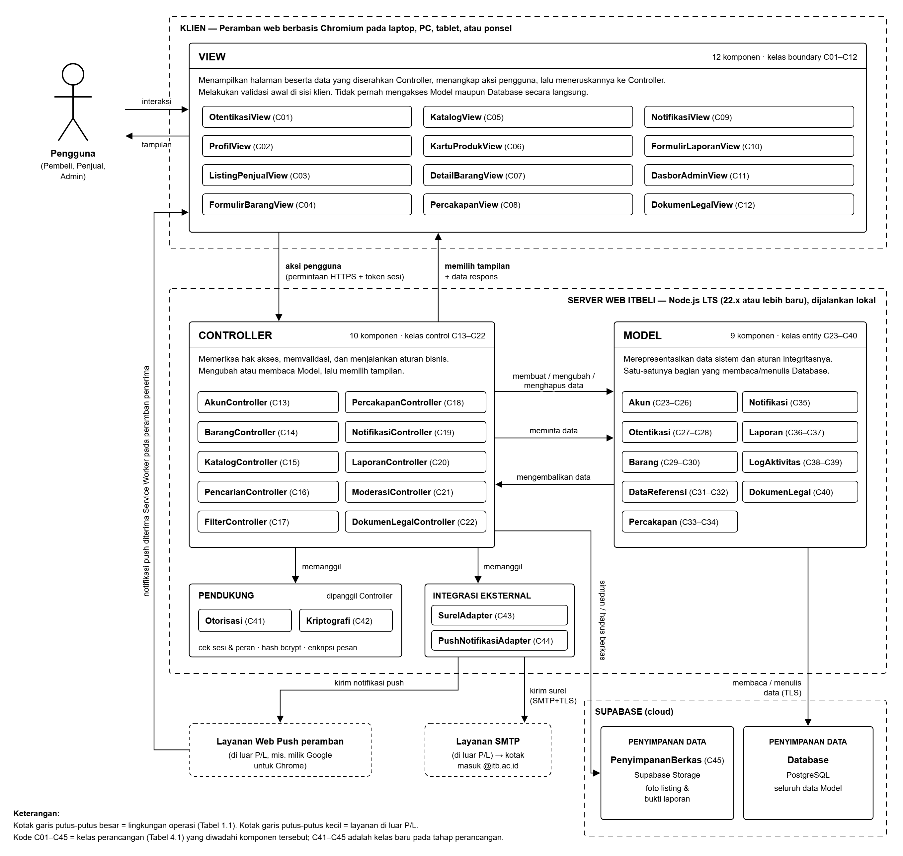
</p>
<p align="center">
<i>Gambar 2.1. Penerapan Pola MVC pada ITBELI</i>
</p>

Gambar 2.1 menempatkan seluruh komponen pada Tabel 2.3 ke dalam bagian MVC dengan nama yang sama, sekaligus menunjukkan lingkungan tempat setiap bagian dijalankan. Kotak *View* berisi 12 komponen yang berjalan pada peramban (zona Klien). Kotak *Controller* dan *Model* berada pada zona Server Web ITBELI bersama komponen *Pendukung* dan *Integrasi Eksternal*, sedangkan komponen *Penyimpanan Data* berada pada Supabase. Layanan Web Push dan layanan SMTP digambarkan dengan kotak bergaris putus-putus karena berada di luar P/L ITBELI. Kode kelas di samping nama komponen (misalnya C01) menunjukkan kelas perancangan pada Tabel 4.1 yang diwadahi komponen tersebut. Kode C01–C40 sama dengan kelas analisis SKPL, sedangkan C41–C45 adalah kelas baru pada tahap perancangan.

## 2.3 Identifikasi Komponen / Modul / Subsistem

Komponen ITBELI diambil dari Tabel 2.1 dokumen APL dan dikelompokkan berdasarkan lapisan MVC yang ditetapkan pada subbab 2.2. Kelas *boundary* (C01–C12) menjadi komponen *View*, kelas *control* (C13–C22) menjadi komponen *Controller*, dan kelas *entity* (C23–C40) dikelompokkan berdasarkan data yang dikelolanya menjadi komponen *Model*, sehingga satu komponen *Model* dapat mewadahi lebih dari satu kelas. Selain itu, terdapat tiga kelompok komponen di luar lapisan MVC, yaitu *Pendukung* (fungsi bantu yang dipakai bersama oleh beberapa *Controller*), *Integrasi Eksternal* (penghubung ke layanan surel SMTP dan layanan Web Push), dan *Penyimpanan Data* (basis data dan penyimpanan berkas pada Supabase). Komponen *Pendukung*, *Integrasi Eksternal*, dan PenyimpananBerkas tidak memiliki padanan kelas analisis pada SKPL, sehingga kelasnya diberi ID lanjutan C41–C45 sesuai aturan penomoran pada subbab 1.4.

Tabel 2.3. Identifikasi Komponen/Modul/Subsistem

| Nama Komponen/Modul/Subsistem | Jenis | Penjelasan |
| :--- | :--- | :--- |
| **Lapisan *View*** | | |
| OtentikasiView | *View* | Menampilkan formulir pendaftaran beserta kebijakan privasi dan kendali persetujuannya, formulir kode verifikasi beserta hitung mundur dan tombol kirim ulang, formulir *login*, serta tombol keluar. Seluruh aksi diteruskan ke AkunController. Mewadahi kelas C01 HalamanOtentikasi. |
| ProfilView | *View* | Menampilkan nama, NIM, surel, dan daftar listing milik akun (melalui KartuProdukView), menu pengaturan akun, serta tautan Kebijakan Privasi. Aksi diteruskan ke AkunController. Mewadahi kelas C02 HalamanProfil. |
| ListingPenjualView | *View* | Menampilkan seluruh listing milik penjual yang dikelompokkan per status ("Tersedia" dan "Terjual") beserta tombol ubah, hapus, tandai terjual, dan batalkan penandaan terjual. Aksi diteruskan ke BarangController, sedangkan tombol ubah membuka FormulirBarangView. Mewadahi kelas C03 HalamanListingPenjual. |
| FormulirBarangView | *View* | Menampilkan formulir pembuatan dan pengubahan listing (judul, harga, deskripsi kondisi, kategori, lokasi titik temu COD, dan foto), melakukan validasi awal di sisi klien, dan menandai isian yang belum lengkap sebelum diteruskan ke BarangController. Mewadahi kelas C04 FormulirBarang. |
| KatalogView | *View* | Menampilkan katalog listing berhalaman (maksimum 20 listing per halaman), kolom pencarian, pilihan filter dan pengurutan, serta pesan barang tidak ditemukan. Seluruh aksi (kata kunci, filter, pengurutan, dan perpindahan halaman) diteruskan ke KatalogController dalam satu permintaan. Mewadahi kelas C05 HalamanKatalog. |
| KartuProdukView | *View* | Menampilkan ringkasan satu listing (foto utama, judul, harga, dan status). Dipakai bersama oleh KatalogView, ProfilView, dan ListingPenjualView. Mewadahi kelas C06 KartuProduk. |
| DetailBarangView | *View* | Menampilkan seluruh foto, judul, harga, deskripsi kondisi, kategori, lokasi titik temu COD, dan identitas penjual sebuah listing, beserta tombol "Hubungi Penjual" dan aksi pelaporan. Data listing diambil melalui BarangController, tombol "Hubungi Penjual" diteruskan ke PercakapanController lalu membuka PercakapanView, dan aksi pelaporan membuka FormulirLaporanView. Mewadahi kelas C07 HalamanDetailBarang. |
| PercakapanView | *View* | Menampilkan daftar percakapan beserta cuplikan pesan terakhir dan penanda pesan belum dibaca, ruang percakapan berisi pesan yang berurutan beserta waktu pengiriman, kolom pengiriman pesan, serta tautan Kebijakan Privasi. Aksi diteruskan ke PercakapanController. Mewadahi kelas C08 HalamanPercakapan. |
| NotifikasiView | *View* | Menampilkan daftar pemberitahuan serta penanda jumlah pesan atau notifikasi yang belum dibaca, lalu meneruskan penandaan sudah dibaca ke NotifikasiController. Mewadahi kelas C09 PanelNotifikasi. |
| FormulirLaporanView | *View* | Menampilkan formulir pelaporan berisi pilihan kategori laporan (penipuan, konten tidak pantas, atau *bug*), isian alasan, dan unggahan bukti tangkapan layar, lalu meneruskannya ke LaporanController. Mewadahi kelas C10 FormulirLaporan. |
| DasborAdminView | *View* | Menampilkan daftar laporan beserta penyaring status, detail laporan, serta tombol ubah status, hapus listing, blokir akun, dan buka blokir akun lengkap dengan isian alasan dan konfirmasi. Aksi diteruskan ke ModerasiController. Mewadahi kelas C11 DasborAdmin. |
| DokumenLegalView | *View* | Menampilkan isi Kebijakan Privasi dan Ketentuan Penggunaan, termasuk menyoroti pernyataan bahwa isi percakapan pribadi tidak dapat diakses oleh admin maupun pengembang. Aksi diteruskan ke DokumenLegalController. Mewadahi kelas C12 HalamanDokumenLegal. |
| **Lapisan *Controller*** | | |
| AkunController | *Controller* | Memproses pendaftaran akun (validasi domain @itb.ac.id, keunikan surel, dan persetujuan kebijakan), pembuatan, pengiriman ulang, dan pencocokan kode verifikasi, *login* (pencocokan kata sandi dan pemeriksaan status akun), *logout*, serta pengambilan data profil. Mewadahi kelas C13 AkunController. |
| BarangController | *Controller* | Memproses pembuatan, pengubahan, dan penghapusan listing, validasi isian dan foto, verifikasi kepemilikan listing, perubahan status "Tersedia"/"Terjual", pengambilan daftar listing milik penjual, serta pengambilan detail listing. Mewadahi kelas C14 BarangController. |
| KatalogController | *Controller* | Mengambil listing berstatus "Tersedia" milik akun yang tidak diblokir, membaginya menjadi halaman berisi maksimum 20 listing, dan mengurutkannya sesuai kriteria terbaru, harga terendah, atau harga tertinggi. Memanggil PencarianController dan FilterController untuk menyusun kriteria, lalu meminta *Model* Barang menjalankan kueri. Mewadahi kelas C15 KatalogController. |
| PencarianController | *Controller* | Menormalisasi kata kunci dan menyusun kriteria kecocokannya terhadap judul serta deskripsi listing. Dipanggil oleh KatalogController. Mewadahi kelas C16 PencarianController. |
| FilterController | *Controller* | Memvalidasi parameter filter dan menyusun kriteria penyaringan berdasarkan kategori, rentang harga minimum–maksimum, dan lokasi titik temu COD. Dipanggil oleh KatalogController. Mewadahi kelas C17 FilterController. |
| PercakapanController | *Controller* | Membuka ruang percakapan antara pembeli dan penjual sebuah listing, memastikan hanya kedua peserta yang dapat mengaksesnya, mengenkripsi dan mendekripsi pesan melalui Kriptografi, menyimpan pesan, serta menyusun daftar percakapan beserta cuplikan pesan terakhir dan jumlah pesan belum dibaca. Meminta NotifikasiController mengirim notifikasi pesan baru. Mewadahi kelas C18 PercakapanController. |
| NotifikasiController | *Controller* | Membuat dan mengirim pemberitahuan kepada pengguna, yaitu kode verifikasi dan pemberitahuan tindakan moderasi melalui SurelAdapter, notifikasi pesan baru melalui PushNotifikasiAdapter, serta notifikasi di dalam aplikasi. Juga memperbarui status baca notifikasi. Mewadahi kelas C19 NotifikasiController. |
| LaporanController | *Controller* | Memproses pembuatan laporan, meliputi validasi data dan berkas bukti, penyusunan metadata percakapan tanpa isi pesan, penyimpanan laporan berstatus "Baru" beserta buktinya, serta pencatatan penerimaan laporan ke *log* audit. Mewadahi kelas C20 LaporanController. |
| ModerasiController | *Controller* | Memproses fungsi moderasi khusus admin, meliputi penampilan dan penyaringan laporan, perubahan status penanganan, penghapusan listing yang dilaporkan, pemblokiran dan pembukaan blokir akun (termasuk menonaktifkan dan memulihkan listing milik akun tersebut), serta pencatatan tindakan ke *log* admin dan *log* audit. Berkas foto listing yang dihapus ikut dihapus dari PenyimpananBerkas. Mewadahi kelas C21 ModerasiController. |
| DokumenLegalController | *Controller* | Mengambil versi terbaru dokumen Kebijakan Privasi dan Ketentuan Penggunaan beserta klausul privasi percakapan. Mewadahi kelas C22 DokumenLegalController. |
| **Lapisan *Model*** | | |
| Akun | *Model* | Merepresentasikan data akun pengguna (identitas, *hash* kata sandi, status verifikasi, status blokir, dan peran) beserta peran Pembeli, Penjual, dan Admin, serta metode untuk mengakses dan mengubahnya. Mewadahi kelas C23 Akun, C24 Pembeli, C25 Penjual, dan C26 Admin. |
| Otentikasi | *Model* | Merepresentasikan kode verifikasi surel yang berlaku 15 menit dan sesi *login* bertoken yang berlaku paling lama 24 jam, serta metode untuk membuat, mencocokkan, dan menonaktifkannya. Mewadahi kelas C27 TokenVerifikasi dan C28 SesiLogin. |
| Barang | *Model* | Merepresentasikan data listing (judul, harga, deskripsi kondisi, kategori, lokasi titik temu COD, status, dan pemilik) beserta metadata fotonya (maksimum 5 foto per listing), serta metode untuk mengakses dan mengubahnya. Mewadahi kelas C29 Barang dan C30 FotoBarang. |
| DataReferensi | *Model* | Merepresentasikan daftar kategori barang tetap dan daftar titik temu COD yang menjadi pilihan pada formulir listing dan filter katalog. Mewadahi kelas C31 Kategori dan C32 LokasiCOD. |
| Percakapan | *Model* | Merepresentasikan ruang percakapan antara pembeli dan penjual untuk satu listing beserta pesan terenkripsi di dalamnya dan status bacanya, serta metode untuk mengakses dan mengubahnya. Mewadahi kelas C33 Percakapan dan C34 Pesan. |
| Notifikasi | *Model* | Merepresentasikan pemberitahuan kepada pengguna beserta status sudah atau belum dibaca. Mewadahi kelas C35 Notifikasi. |
| Laporan | *Model* | Merepresentasikan laporan pengguna (pelapor, objek yang dilaporkan, kategori, alasan, dan status penanganan) beserta metadata berkas buktinya, serta metode untuk mengakses dan mengubahnya. Mewadahi kelas C36 Laporan dan C37 BuktiLaporan. |
| LogAktivitas | *Model* | Merepresentasikan *log* audit atas penerimaan dan tindak lanjut laporan yang hanya dapat ditambah, tidak dapat diubah maupun dihapus, serta *log* admin atas setiap tindakan moderasi beserta pelaku, objek, waktu, dan alasannya. Mewadahi kelas C38 LogAudit dan C39 LogAdmin. |
| DokumenLegal | *Model* | Merepresentasikan dokumen Kebijakan Privasi dan Ketentuan Penggunaan beserta versi, status publikasi, dan tautannya. Mewadahi kelas C40 DokumenLegal. |
| **Di luar lapisan MVC** | | |
| Otorisasi | *Pendukung* | Memeriksa token sesi pada setiap permintaan yang memerlukan *login*, mengidentifikasi akun yang sedang masuk sebagai dasar verifikasi kepemilikan dan keanggotaan percakapan, serta menolak akses ke fungsi moderasi oleh akun yang tidak berperan admin. Data sesi dibaca dari *Model* Otentikasi dan peran admin diperiksa melalui *Model* Akun. Dipakai bersama oleh AkunController, BarangController, PercakapanController, LaporanController, dan ModerasiController. Diwujudkan sebagai kelas C41 Otorisasi. |
| Kriptografi | *Pendukung* | Menyediakan fungsi *hash* dan pencocokan kata sandi dengan bcrypt untuk AkunController, serta enkripsi dan dekripsi isi pesan untuk PercakapanController, sehingga kata sandi dan isi pesan tidak pernah tersimpan dalam bentuk teks biasa. Diwujudkan sebagai kelas C42 Kriptografi. |
| SurelAdapter | *Integrasi Eksternal* | Mengirim surel melalui layanan SMTP dengan TLS, yaitu kode verifikasi ke alamat surel @itb.ac.id pendaftar serta pemberitahuan tindakan moderasi beserta alasannya kepada pengguna yang bersangkutan. Dipanggil oleh NotifikasiController. Diwujudkan sebagai kelas C43 SurelAdapter. |
| PushNotifikasiAdapter | *Integrasi Eksternal* | Mengirim notifikasi pesan baru melalui layanan Web Push milik peramban sehingga notifikasi muncul di perangkat penerima, termasuk saat ITBELI sedang tidak dibuka. Notifikasi ditampilkan oleh *Service Worker* ITBELI pada peramban penerima. Dipanggil oleh NotifikasiController. Diwujudkan sebagai kelas C44 PushNotifikasiAdapter. |
| Database | *Penyimpanan Data* | Basis data PostgreSQL pada Supabase yang menyimpan seluruh data *Model* secara persisten dan terpusat sehingga data konsisten bagi seluruh perangkat. Hanya diakses oleh komponen *Model*. |
| PenyimpananBerkas | *Penyimpanan Data* | Supabase Storage yang menyimpan berkas foto listing dan berkas bukti tangkapan layar laporan, sedangkan lokasi berkasnya dicatat pada *Model* Barang dan Laporan. Diakses oleh BarangController, LaporanController, dan ModerasiController. Diwujudkan sebagai kelas C45 PenyimpananBerkas yang membungkus akses ke Supabase Storage. |

Seluruh 40 kelas analisis pada SKPL tercakup oleh 31 komponen *View*, *Controller*, dan *Model* di atas, sehingga seluruh use case UC01–UC24 dapat dijalankan oleh komponen-komponen tersebut. Nama komponen pada Tabel 2.3 menjadi acuan pengelompokan kelas perancangan pada BAB 3 hingga BAB 5. Alur antarkomponen pada tabel ini telah diselaraskan dengan realisasi use case pada BAB 3, misalnya KatalogView yang cukup memanggil KatalogController dan DetailBarangView yang membuka FormulirLaporanView.

## 2.4 Model Arsitektur Perangkat Lunak

Model arsitektur ITBELI diambil dari BAB 3 dokumen APL, lalu diselaraskan dengan hasil perancangan kelas pada BAB 3 dan BAB 4 dokumen ini, dan digambarkan dengan satu *view*, yaitu ***logical view*** [7]. *View* lain tidak digambarkan karena belum memberi informasi tambahan yang berarti. *Physical view* hanya akan mengulang Gambar 2.1 yang sudah menunjukkan tempat setiap bagian dijalankan (peramban, server Node.js, dan Supabase). *Process view* kurang dibutuhkan karena hampir seluruh alur ITBELI berbentuk permintaan dan tanggapan, dan urutan interaksinya sudah dirinci per use case melalui *sequence diagram* pada BAB 3. *Development view* baru dapat digambarkan secara akurat setelah struktur kode program disusun pada tahap implementasi.

### 2.4.1 Logical View

*Logical view* dipilih karena menunjukkan seluruh komponen pada Tabel 2.3 beserta hubungan fungsionalnya, sehingga setiap komponen terlihat memiliki batas tanggung jawab yang jelas dan berhubungan dengan komponen lain sesuai rancangan pada SKPL. *View* ini digambarkan dalam bentuk *block diagram*, bukan diagram kelas, karena yang perlu ditunjukkan adalah interaksi antarkomponen yang masing-masing dapat mewadahi lebih dari satu kelas.

<p align="center">
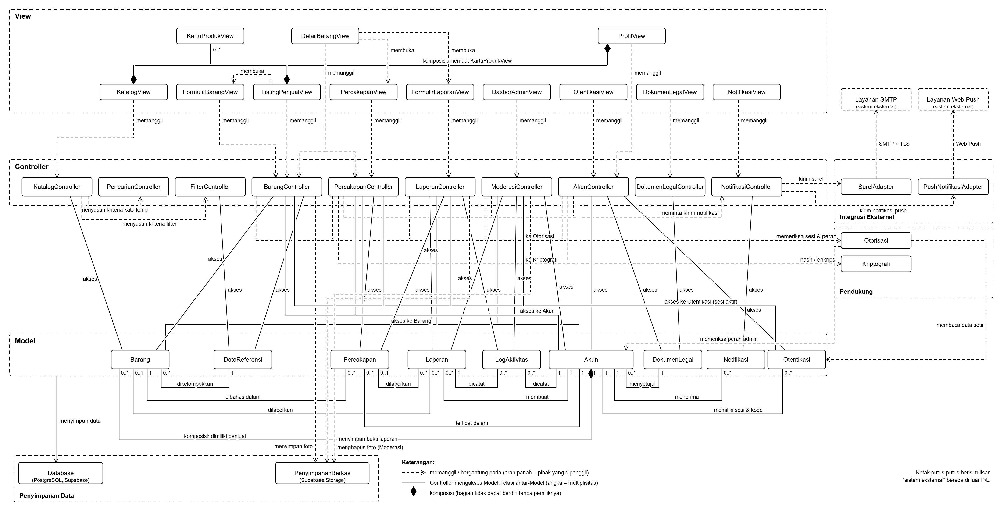
</p>
<p align="center">
<i>Gambar 2.2. Logical View ITBELI</i>
</p>

Gambar 2.2 membagi komponen ke dalam tiga lajur, yaitu *View*, *Controller*, dan *Model*. Komponen *Pendukung* dan *Integrasi Eksternal* berada di sebelah kanan, sedangkan komponen *Penyimpanan Data* berada di bagian bawah. Garis putus-putus berpanah berarti "memanggil" atau "bergantung pada", garis tegas berlabel "akses" berarti *Controller* mengakses *Model*, dan garis tegas di bawah lajur *Model* adalah relasi antar-*Model* beserta multiplisitasnya. Seluruh hubungan diturunkan dari relasi kelas perancangan pada Gambar 4.1 dengan memetakan setiap kelas ke komponen yang mewadahinya pada Tabel 2.3.

1. ***View***. Terdapat 12 hubungan "memanggil" dari *View* ke *Controller*. KatalogView cukup memanggil KatalogController, sedangkan DetailBarangView memanggil BarangController untuk data listing dan PercakapanController untuk tombol "Hubungi Penjual". Tiga hubungan "membuka" menggambarkan perpindahan halaman, yaitu ListingPenjualView ke FormulirBarangView, serta DetailBarangView ke PercakapanView dan FormulirLaporanView. KatalogView, ProfilView, dan ListingPenjualView memuat KartuProdukView melalui komposisi.
2. ***Controller***. KatalogController memanggil PencarianController dan FilterController untuk menyusun kriteria kata kunci dan filter. AkunController, PercakapanController, dan ModerasiController meminta NotifikasiController mengirim pemberitahuan melalui SurelAdapter dan PushNotifikasiAdapter. Lima *controller* yang memerlukan *login* memanggil Otorisasi, yang kemudian membaca data sesi pada Otentikasi dan memeriksa peran admin pada Akun.
3. ***Controller* → *Model***. Akses ke Barang, Akun, dan Otentikasi yang dilakukan beberapa *controller* digambarkan sebagai jalur bersama (bus) berlabel "akses ke Barang", "akses ke Akun", dan "akses ke Otentikasi (sesi aktif)". Setiap *controller* yang terhubung ke jalur tersebut mengakses *Model* yang dituju.
4. ***Model***. Terdapat 12 relasi antar-*Model*, misalnya komposisi Akun–Barang dan asosiasi Barang–Percakapan, dan seluruh *Model* menyimpan datanya pada Database.

Dibandingkan dengan Logical View pada dokumen APL, Gambar 2.2 memuat penyesuaian hasil perancangan berikut. Hubungan langsung KatalogView ke PencarianController dan FilterController, DetailBarangView ke LaporanController, serta PencarianController dan FilterController ke Barang dihapus. Sebaliknya, ditambahkan hubungan "membuka" antar-*View*, pemanggilan PencarianController dan FilterController oleh KatalogController, akses beberapa *controller* ke Otentikasi, Akun, Barang, dan Percakapan, penghapusan berkas oleh ModerasiController, serta pemeriksaan peran admin oleh Otorisasi.

Seluruh hubungan tersebut mematuhi aturan ketergantungan pada subbab 2.2.1. Salah satu akibatnya, ModerasiController tidak mengakses *Model* Percakapan, sehingga tidak ada jalur dari DasborAdminView menuju isi pesan (KF35).

<br>

---


# BAB 3: Realisasi Use Case

Bab ini mendeskripsikan realisasi use case ITBELI ke dalam perancangan perangkat lunak untuk use case UC01 sampai dengan UC24. Setiap subbab use case memuat identifikasi kelas perancangan yang terlibat, *sequence diagram* untuk skenario normal dan seluruh skenario alternatif berdasarkan dokumen SKPL, serta diagram kelas perancangan yang memuat spesifikasi lengkap atribut dan operasi. Seluruh diagram kelas per use case diturunkan dari satu model kelas yang sama dengan BAB 4, sehingga setiap kelas memakai nama, atribut, dan metode yang konsisten di semua use case.

---

## 3.1 Use Case Mendaftar Akun

**ID Use Case:** UC01  
**Nama Use Case:** Mendaftar Akun

### 3.1.1 Identifikasi Kelas

Realisasi use case pendaftaran akun melibatkan kelas *boundary* untuk menyajikan formulir dan menangkap masukan, kelas *control* untuk menegakkan aturan bisnis (validasi domain @itb.ac.id, keunikan surel, *hashing* kata sandi, serta pemicuan verifikasi surel), kelas *entity* untuk persistensi data, serta kelas *pendukung* dan *integrasi eksternal*.

Tabel 3.1. Identifikasi Kelas Use Case UC01

| No | Nama Kelas Perancangan | Nama Kelas Analisis Terkait |
| :--- | :--- | :--- |
| 1 | HalamanOtentikasi | C01 HalamanOtentikasi |
| 2 | AkunController | C13 AkunController |
| 3 | NotifikasiController | C19 NotifikasiController |
| 4 | Akun | C23 Akun |
| 5 | TokenVerifikasi | C27 TokenVerifikasi |
| 6 | Notifikasi | C35 Notifikasi |
| 7 | DokumenLegal | C40 DokumenLegal |
| 8 | Kriptografi | C42 Kriptografi (Pendukung) |
| 9 | SurelAdapter | C43 SurelAdapter (Integrasi) |

### 3.1.2 Sequence Diagram

- **Skenario Normal**

Alur pendaftaran normal diawali saat calon pengguna membuka halaman pendaftaran akun, mengisi identitas lengkap dengan surel berdomain @itb.ac.id, menyetujui ketentuan privasi, dan menekan tombol daftar. Sistem melakukan validasi, mengenkripsi kata sandi, menyimpan akun baru berstatus "Belum Terverifikasi", membangkitkan token verifikasi, serta mengirimkan kode ke surel pengguna.

<p align="center">
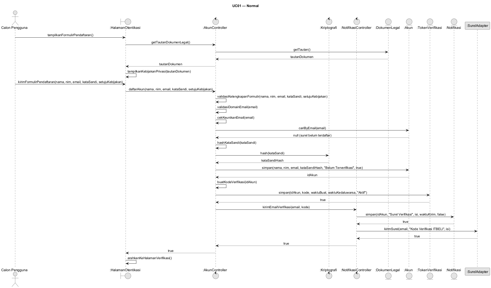
</p>
<p align="center">
<i>Gambar 3.1. Sequence Diagram UC01 - Skenario Normal</i>
</p>

- **Skenario Alternatif 1: Domain Email Tidak Valid**

Skenario ini terjadi apabila calon pengguna memasukkan alamat surel yang tidak berakhiran domain institusi resmi (@itb.ac.id), seperti @gmail.com atau @yahoo.com. AkunController mendeteksi ketidaksesuaian domain, membatalkan penyimpanan, dan HalamanOtentikasi menampilkan pesan galat validasi institusi.

<p align="center">
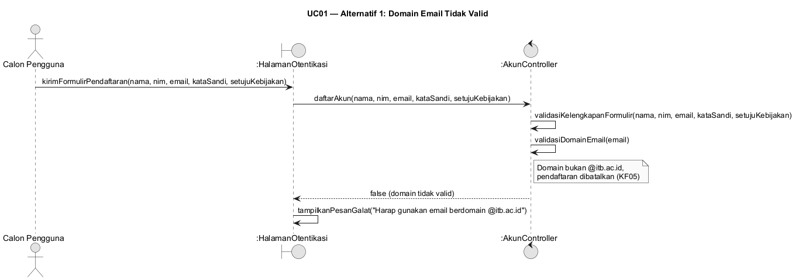
</p>
<p align="center">
<i>Gambar 3.2. Sequence Diagram UC01 - Skenario Alternatif 1: Domain Email Tidak Valid</i>
</p>

- **Skenario Alternatif 2: Email Sudah Terdaftar**

Skenario ini terjadi apabila calon pengguna mendaftar dengan surel yang telah tersimpan sebelumnya pada basis data ITBELI. Pengecekan keunikan surel oleh AkunController menghasilkan status terdaftar, sehingga proses pembuatan akun digagalkan dan sistem menyarankan pengguna untuk masuk atau menggunakan alamat lain.

<p align="center">
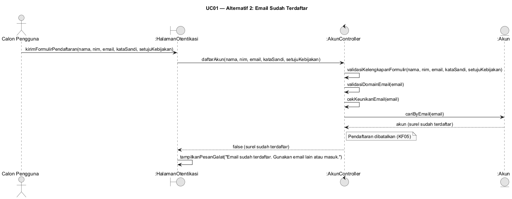
</p>
<p align="center">
<i>Gambar 3.3. Sequence Diagram UC01 - Skenario Alternatif 2: Email Sudah Terdaftar</i>
</p>

### 3.1.3 Diagram Kelas

HalamanOtentikasi berasosiasi dengan AkunController. AkunController bergantung pada Akun, TokenVerifikasi, DokumenLegal, NotifikasiController, dan Kriptografi. NotifikasiController bergantung pada Notifikasi dan SurelAdapter. Relasi antar-*entity* pada diagram ini adalah Akun ke TokenVerifikasi berupa asosiasi 1 ke 0..*, Akun ke Notifikasi berupa asosiasi 1 ke 0..*, dan Akun ke DokumenLegal berupa asosiasi 0..* ke 1. Setiap kelas menampilkan atribut bertipe data dan operasi yang dipakai pada UC01, sehingga seluruh operasi yang dipanggil pada *sequence diagram* subbab sebelumnya tercantum pada kelas yang bersangkutan.

<p align="center">
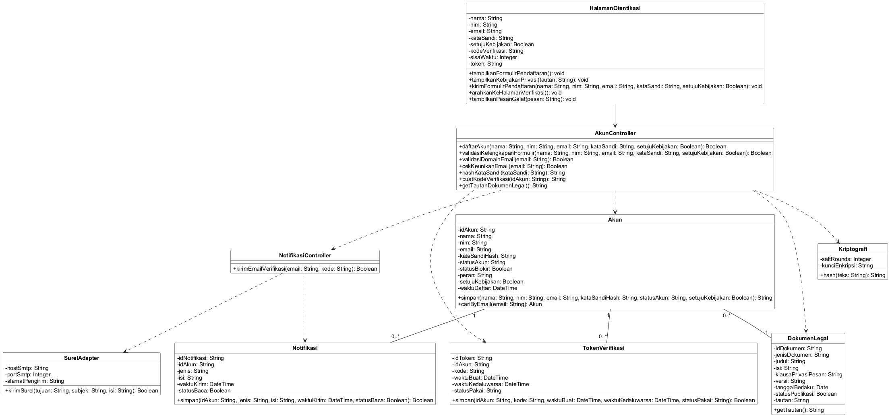
</p>
<p align="center">
<i>Gambar 3.4. Diagram Kelas Use Case UC01</i>
</p>

---

## 3.2 Use Case Memverifikasi Surel

**ID Use Case:** UC02  
**Nama Use Case:** Memverifikasi Surel

### 3.2.1 Identifikasi Kelas

Realisasi use case verifikasi surel melibatkan antarmuka verifikasi untuk menerima kode masukan dan menampilkan hitung mundur waktu kedaluwarsa, kelas pengendali untuk memverifikasi keabsahan kode dan memperbarui status akun, serta entitas token verifikasi dan surel adapter untuk kebutuhan pengiriman ulang kode.

Tabel 3.2. Identifikasi Kelas Use Case UC02

| No | Nama Kelas Perancangan | Nama Kelas Analisis Terkait |
| :--- | :--- | :--- |
| 1 | HalamanOtentikasi | C01 HalamanOtentikasi |
| 2 | AkunController | C13 AkunController |
| 3 | NotifikasiController | C19 NotifikasiController |
| 4 | Akun | C23 Akun |
| 5 | TokenVerifikasi | C27 TokenVerifikasi |
| 6 | Notifikasi | C35 Notifikasi |
| 7 | SurelAdapter | C43 SurelAdapter (Integrasi) |

### 3.2.2 Sequence Diagram

- **Skenario Normal**

Pada skenario normal, pengguna menyalin kode verifikasi dari surel, memasukkannya ke antarmuka, lalu menekan tombol verifikasi. Sistem mencocokkan kode dengan data token, memastikan waktu belum melampaui 15 menit, mengubah status token menjadi terpakai, memperbarui status akun menjadi "Terverifikasi", dan mengarahkan pengguna ke halaman beranda/login.

<p align="center">
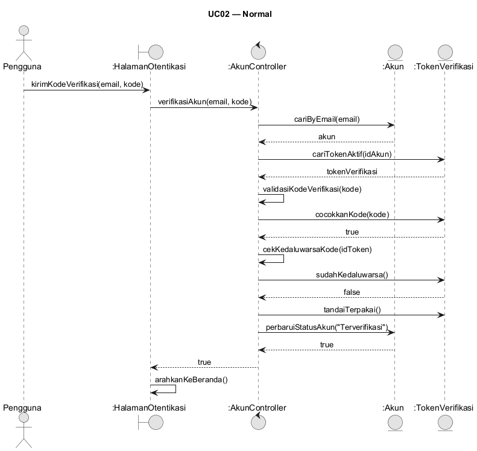
</p>
<p align="center">
<i>Gambar 3.5. Sequence Diagram UC02 - Skenario Normal</i>
</p>

- **Skenario Alternatif 1: Kode Tidak Valid / Kedaluwarsa**

Skenario ini terjadi jika kode yang dimasukkan salah atau waktu penginputan telah melewati batas toleransi 15 menit. Sistem menolak pembaruan status akun dan menampilkan pesan galat yang menginstruksikan pengguna untuk meminta kode verifikasi baru.

<p align="center">
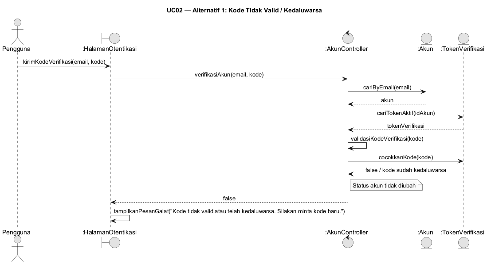
</p>
<p align="center">
<i>Gambar 3.6. Sequence Diagram UC02 - Skenario Alternatif 1: Kode Tidak Valid / Kedaluwarsa</i>
</p>

- **Skenario Alternatif 2: Meminta Pengiriman Ulang Kode**

Skenario ini terjadi saat pengguna menekan tombol "Kirim Ulang Kode". Sistem menandai token lama sebagai hangus (*invalidated*), membangkitkan kode baru dengan batas waktu 15 menit baru, menyimpannya ke basis data, mengirimkannya melalui SurelAdapter, dan me-reset hitung mundur di layar antarmuka.

<p align="center">
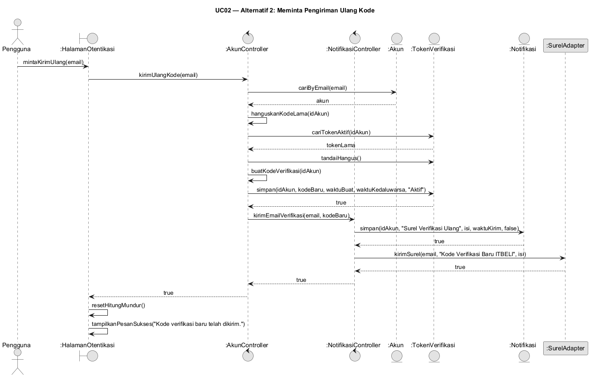
</p>
<p align="center">
<i>Gambar 3.7. Sequence Diagram UC02 - Skenario Alternatif 2: Meminta Pengiriman Ulang Kode</i>
</p>

### 3.2.3 Diagram Kelas

HalamanOtentikasi berasosiasi dengan AkunController. AkunController bergantung pada Akun, TokenVerifikasi, dan NotifikasiController. NotifikasiController bergantung pada Notifikasi dan SurelAdapter. Relasi antar-*entity* pada diagram ini adalah Akun ke TokenVerifikasi berupa asosiasi 1 ke 0..* dan Akun ke Notifikasi berupa asosiasi 1 ke 0..*. Setiap kelas menampilkan atribut bertipe data dan operasi yang dipakai pada UC02, sehingga seluruh operasi yang dipanggil pada *sequence diagram* subbab sebelumnya tercantum pada kelas yang bersangkutan.

<p align="center">

</p>
<p align="center">
<i>Gambar 3.8. Diagram Kelas Use Case UC02</i>
</p>

---

## 3.3 Use Case Masuk ke Sistem (Login)

**ID Use Case:** UC03  
**Nama Use Case:** Masuk ke Sistem (Login)

### 3.3.1 Identifikasi Kelas

Realisasi use case login melibatkan antarmuka autentikasi untuk menerima kredensial, controller untuk memverifikasi kecocokan hash sandi dan memeriksa status keaktifan akun, modul kriptografi untuk verifikasi bcrypt, serta entitas sesi untuk pembentukan token akses (JWT).

Tabel 3.3. Identifikasi Kelas Use Case UC03

| No | Nama Kelas Perancangan | Nama Kelas Analisis Terkait |
| :--- | :--- | :--- |
| 1 | HalamanOtentikasi | C01 HalamanOtentikasi |
| 2 | AkunController | C13 AkunController |
| 3 | Akun | C23 Akun |
| 4 | SesiLogin | C28 SesiLogin |
| 5 | Kriptografi | C42 Kriptografi (Pendukung) |

### 3.3.2 Sequence Diagram

- **Skenario Normal**

Pada skenario normal, pengguna memasukkan surel dan kata sandi yang valid. AkunController mengambil data akun, memverifikasi hash melalui Kriptografi, memastikan status akun adalah "Terverifikasi" dan tidak terblokir, membangkitkan token sesi 24 jam melalui SesiLogin, serta mengarahkan pengguna ke beranda aplikasi.

<p align="center">
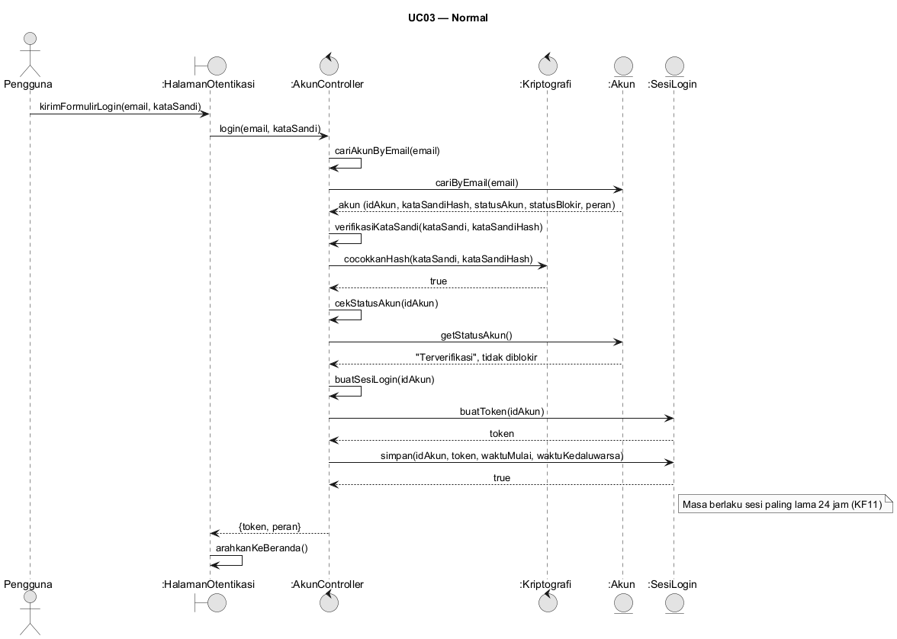
</p>
<p align="center">
<i>Gambar 3.9. Sequence Diagram UC03 - Skenario Normal</i>
</p>

- **Skenario Alternatif 1: Kredensial Tidak Sesuai**

Skenario ini terjadi saat surel tidak ditemukan pada sistem atau kata sandi yang dimasukkan tidak cocok dengan nilai hash yang tersimpan. Sistem menolak pembentukan sesi dan memunculkan pesan galat kredensial salah.

<p align="center">
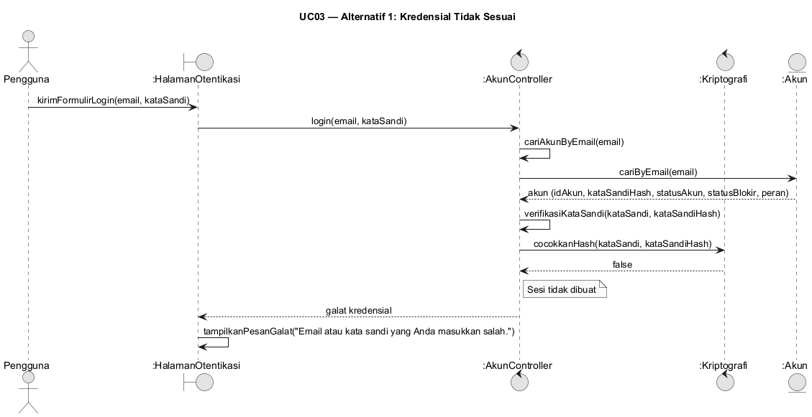
</p>
<p align="center">
<i>Gambar 3.10. Sequence Diagram UC03 - Skenario Alternatif 1: Kredensial Tidak Sesuai</i>
</p>

- **Skenario Alternatif 2: Akun Belum Terverifikasi**

Skenario ini terjadi ketika kredensial pengguna cocok, namun atribut status akun masih bernilai "Belum Terverifikasi". Sistem menahan pembuatan sesi login dan menampilkan pesan peringatan beserta tombol pintasan untuk verifikasi/kirim ulang kode.

<p align="center">
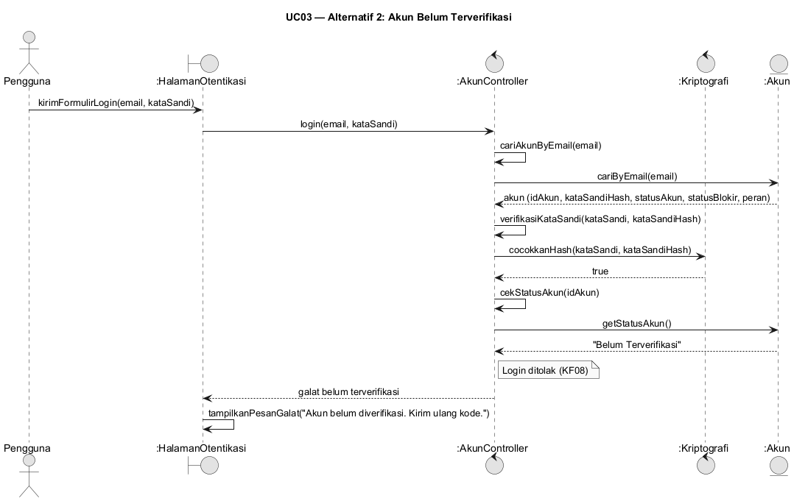
</p>
<p align="center">
<i>Gambar 3.11. Sequence Diagram UC03 - Skenario Alternatif 2: Akun Belum Terverifikasi</i>
</p>

- **Skenario Alternatif 3: Akun Sedang Diblokir**

Skenario ini terjadi jika kredensial cocok dan akun terverifikasi, namun nilai atribut statusBlokir bernilai true (telah ditangguhkan oleh admin). Sistem membatalkan sesi masuk dan menampilkan pesan penangguhan resmi.

<p align="center">
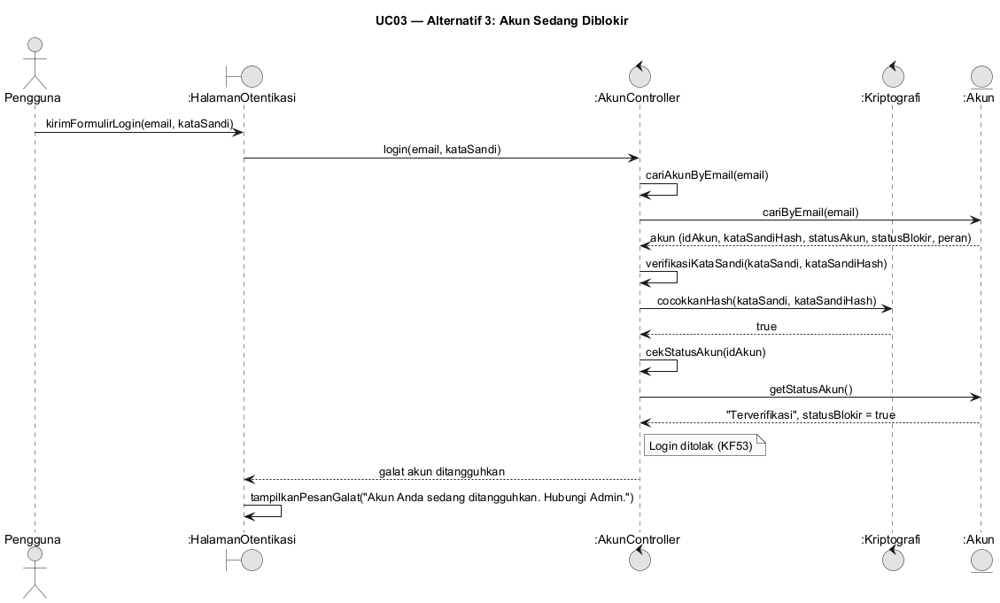
</p>
<p align="center">
<i>Gambar 3.12. Sequence Diagram UC03 - Skenario Alternatif 3: Akun Sedang Diblokir</i>
</p>

### 3.3.3 Diagram Kelas

HalamanOtentikasi berasosiasi dengan AkunController. AkunController bergantung pada Akun, SesiLogin, dan Kriptografi. Relasi antar-*entity* pada diagram ini adalah Akun ke SesiLogin berupa asosiasi 1 ke 0..*. Setiap kelas menampilkan atribut bertipe data dan operasi yang dipakai pada UC03, sehingga seluruh operasi yang dipanggil pada *sequence diagram* subbab sebelumnya tercantum pada kelas yang bersangkutan.

<p align="center">
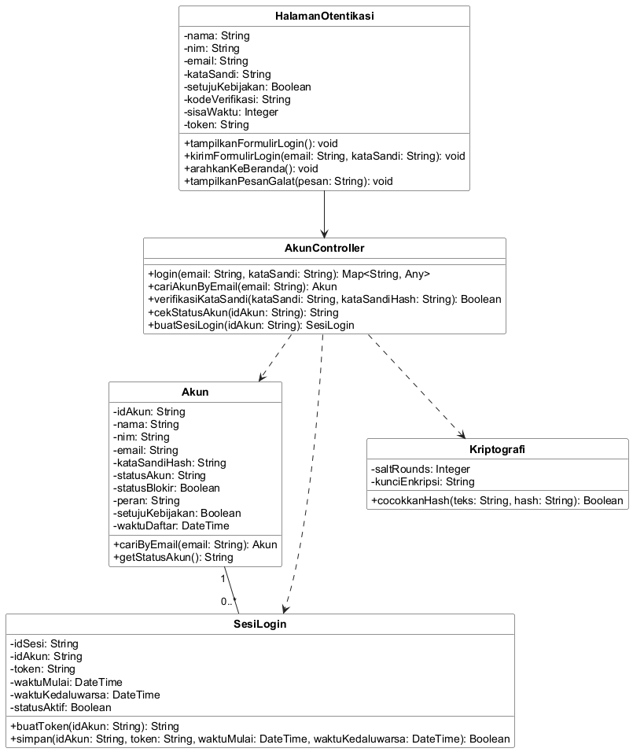
</p>
<p align="center">
<i>Gambar 3.13. Diagram Kelas Use Case UC03</i>
</p>

---

## 3.4 Use Case Keluar dari Sistem (Logout)

**ID Use Case:** UC04  
**Nama Use Case:** Keluar dari Sistem (Logout)

### 3.4.1 Identifikasi Kelas

Realisasi use case logout melibatkan komponen antarmuka yang menyediakan tombol keluar, controller untuk memproses pencabutan otorisasi, modul otorisasi untuk validasi token, serta entitas sesi login untuk menonaktifkan token secara permanen.

Tabel 3.4. Identifikasi Kelas Use Case UC04

| No | Nama Kelas Perancangan | Nama Kelas Analisis Terkait |
| :--- | :--- | :--- |
| 1 | HalamanOtentikasi | C01 HalamanOtentikasi |
| 2 | AkunController | C13 AkunController |
| 3 | Akun | C23 Akun |
| 4 | SesiLogin | C28 SesiLogin |
| 5 | Otorisasi | C41 Otorisasi (Pendukung) |

### 3.4.2 Sequence Diagram

- **Skenario Normal**

Pengguna yang sedang masuk mengklik menu profil dan memilih "Keluar". Permintaan diteruskan ke AkunController yang memvalidasi token melalui Otorisasi dan mencabut sesi di entitas SesiLogin. Setelah berhasil, token pada penyimpanan lokal peramban dihapus dan tampilan dialihkan ke halaman login.

<p align="center">
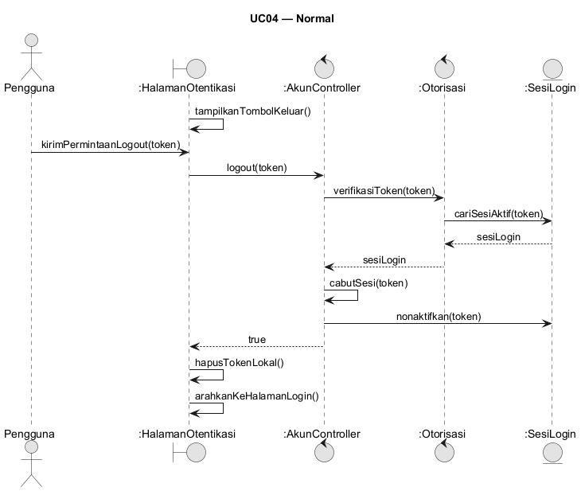
</p>
<p align="center">
<i>Gambar 3.14. Sequence Diagram UC04 - Skenario Normal</i>
</p>

### 3.4.3 Diagram Kelas

HalamanOtentikasi berasosiasi dengan AkunController. AkunController bergantung pada SesiLogin dan Otorisasi. Otorisasi bergantung pada SesiLogin. Relasi antar-*entity* pada diagram ini adalah Akun ke SesiLogin berupa asosiasi 1 ke 0..*. Setiap kelas menampilkan atribut bertipe data dan operasi yang dipakai pada UC04, sehingga seluruh operasi yang dipanggil pada *sequence diagram* subbab sebelumnya tercantum pada kelas yang bersangkutan.

<p align="center">
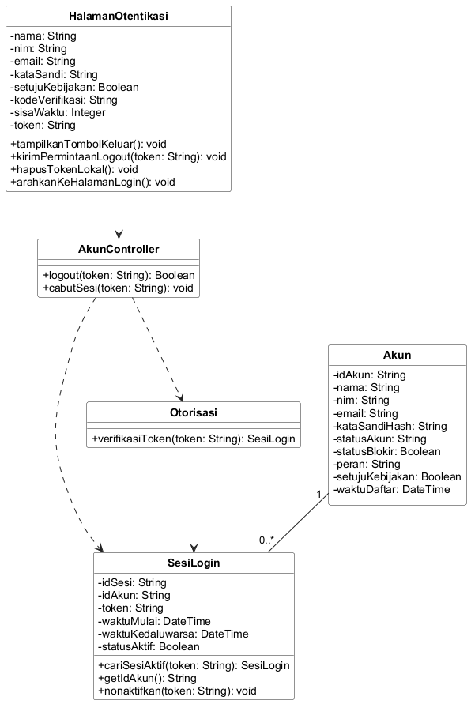
</p>
<p align="center">
<i>Gambar 3.15. Diagram Kelas Use Case UC04</i>
</p>

---

## 3.5 Use Case Melihat Profil Akun

**ID Use Case:** UC05  
**Nama Use Case:** Melihat Profil Akun

### 3.5.1 Identifikasi Kelas

Realisasi use case melihat profil melibatkan antarmuka profil akun dan komponen kartu produk, controller akun untuk menghimpun data identitas dan daftar listing milik pengguna, modul otorisasi untuk mengekstrak identitas dari token sesi, serta entitas Akun, Barang, dan DokumenLegal.

Tabel 3.5. Identifikasi Kelas Use Case UC05

| No | Nama Kelas Perancangan | Nama Kelas Analisis Terkait |
| :--- | :--- | :--- |
| 1 | HalamanProfil | C02 HalamanProfil |
| 2 | KartuProduk | C06 KartuProduk |
| 3 | AkunController | C13 AkunController |
| 4 | Akun | C23 Akun |
| 5 | Pembeli | C24 Pembeli |
| 6 | Penjual | C25 Penjual |
| 7 | SesiLogin | C28 SesiLogin |
| 8 | Barang | C29 Barang |
| 9 | DokumenLegal | C40 DokumenLegal |
| 10 | Otorisasi | C41 Otorisasi (Pendukung) |

### 3.5.2 Sequence Diagram

- **Skenario Normal**

Pengguna membuka menu profil. Sistem mengekstrak idAkun dari token sesi melalui Otorisasi, mengambil data identitas dari Akun, mengambil daftar listing dari entitas Barang, dan merender tampilan profil beserta kartu produk. Ketika pengguna membuka pengaturan akun, sistem menyediakan tautan dokumen kebijakan privasi.

<p align="center">
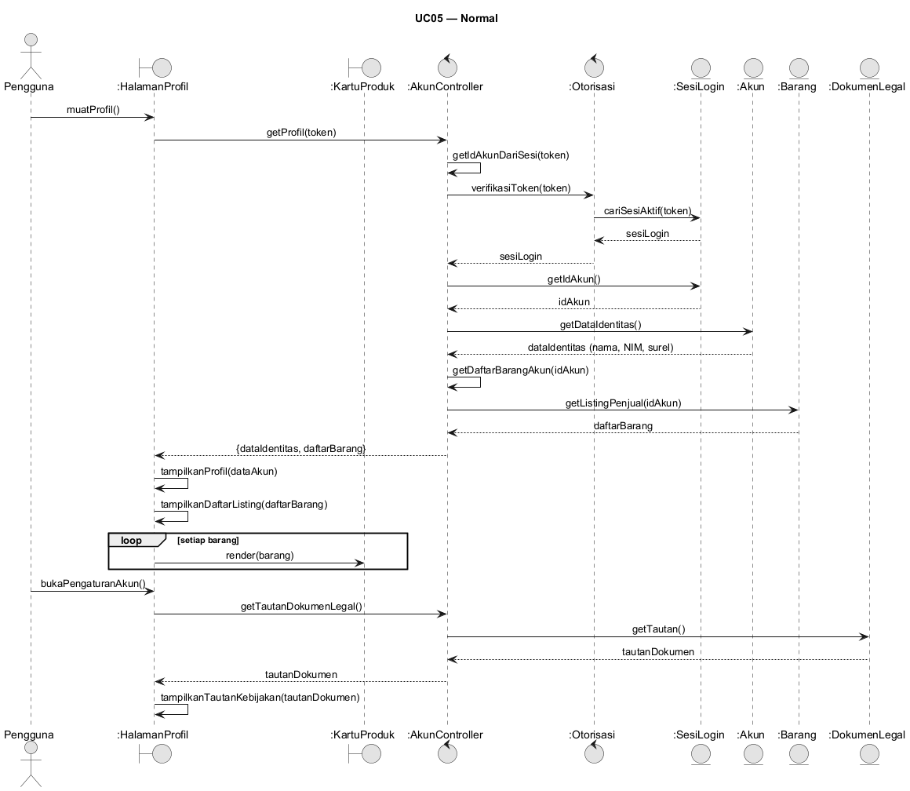
</p>
<p align="center">
<i>Gambar 3.16. Sequence Diagram UC05 - Skenario Normal</i>
</p>

### 3.5.3 Diagram Kelas

HalamanProfil berasosiasi dengan AkunController. HalamanProfil memiliki relasi komposisi 1 ke 0..* terhadap KartuProduk. AkunController bergantung pada Akun, SesiLogin, Barang, DokumenLegal, dan Otorisasi. Otorisasi bergantung pada SesiLogin. Pembeli dan Penjual merupakan turunan (generalisasi) dari Akun. Relasi antar-*entity* pada diagram ini adalah Akun ke SesiLogin berupa asosiasi 1 ke 0..*, Akun ke DokumenLegal berupa asosiasi 0..* ke 1, dan Penjual ke Barang berupa komposisi 1 ke 0..*. Setiap kelas menampilkan atribut bertipe data dan operasi yang dipakai pada UC05, sehingga seluruh operasi yang dipanggil pada *sequence diagram* subbab sebelumnya tercantum pada kelas yang bersangkutan.

<p align="center">

</p>
<p align="center">
<i>Gambar 3.17. Diagram Kelas Use Case UC05</i>
</p>

---

## 3.6 Use Case Melihat Kebijakan Privasi dan Ketentuan Penggunaan

**ID Use Case:** UC06  
**Nama Use Case:** Melihat Kebijakan Privasi dan Ketentuan Penggunaan

### 3.6.1 Identifikasi Kelas

Realisasi use case dokumen legal melibatkan antarmuka pembaca naskah hukum, controller pengambil dokumen legal yang sedang berlaku, serta entitas DokumenLegal yang menyimpan teks statis dan klausul penjaminan kerahasiaan percakapan pribadi.

Tabel 3.6. Identifikasi Kelas Use Case UC06

| No | Nama Kelas Perancangan | Nama Kelas Analisis Terkait |
| :--- | :--- | :--- |
| 1 | HalamanDokumenLegal | C12 HalamanDokumenLegal |
| 2 | DokumenLegalController | C22 DokumenLegalController |
| 3 | DokumenLegal | C40 DokumenLegal |

### 3.6.2 Sequence Diagram

- **Skenario Normal**

Pengguna mengklik tautan dokumen hukum dari formulir pendaftaran, profil, atau ruang percakapan. DokumenLegalController mengambil naskah versi terbaru beserta klausul spesifik yang menyatakan bahwa isi percakapan pribadi dienkripsi dan tidak dapat diakses admin maupun pengembang sistem. HalamanDokumenLegal merender teks dan menyoroti klausul tersebut.

<p align="center">
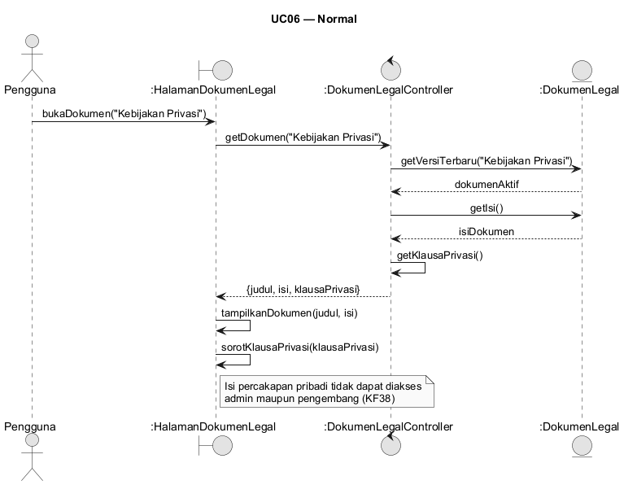
</p>
<p align="center">
<i>Gambar 3.18. Sequence Diagram UC06 - Skenario Normal</i>
</p>

### 3.6.3 Diagram Kelas

HalamanDokumenLegal berasosiasi dengan DokumenLegalController. DokumenLegalController bergantung pada DokumenLegal. Setiap kelas menampilkan atribut bertipe data dan operasi yang dipakai pada UC06, sehingga seluruh operasi yang dipanggil pada *sequence diagram* subbab sebelumnya tercantum pada kelas yang bersangkutan.

<p align="center">

</p>
<p align="center">
<i>Gambar 3.19. Diagram Kelas Use Case UC06</i>
</p>

---

## 3.7 Use Case Membuat Listing

**ID Use Case:** UC07  
**Nama Use Case:** Membuat Listing

### 3.7.1 Identifikasi Kelas

Realisasi use case pembuatan listing melibatkan antarmuka formulir barang (dengan validasi berkas dan isian di sisi klien), controller barang untuk validasi ganda di sisi server dan orkestrasinya, modul otorisasi untuk identifikasi penjual, entitas data referensi (Kategori dan LokasiCOD), entitas utama Barang dan FotoBarang, serta layanan penyimpanan berkas (Supabase Storage).

Tabel 3.7. Identifikasi Kelas Use Case UC07

| No | Nama Kelas Perancangan | Nama Kelas Analisis Terkait |
| :--- | :--- | :--- |
| 1 | FormulirBarang | C04 FormulirBarang |
| 2 | BarangController | C14 BarangController |
| 3 | Penjual | C25 Penjual |
| 4 | SesiLogin | C28 SesiLogin |
| 5 | Barang | C29 Barang |
| 6 | FotoBarang | C30 FotoBarang |
| 7 | Kategori | C31 Kategori |
| 8 | LokasiCOD | C32 LokasiCOD |
| 9 | Otorisasi | C41 Otorisasi (Pendukung) |
| 10 | PenyimpananBerkas | C45 PenyimpananBerkas (Penyimpanan Data) |

### 3.7.2 Sequence Diagram

- **Skenario Normal**

Penjual mengisi formulir produk, mengunggah foto yang memenuhi syarat (maksimum 5 foto JPG/PNG, ≤ 5 MB), lalu menekan tombol simpan. Sistem melakukan verifikasi token, validasi ganda kelengkapan formulir dan foto di sisi server, mengunggah berkas ke Supabase Storage, menyimpan entitas Barang dengan status "Tersedia", menyimpan rujukan FotoBarang, dan menerbitkannya ke katalog utama.

<p align="center">
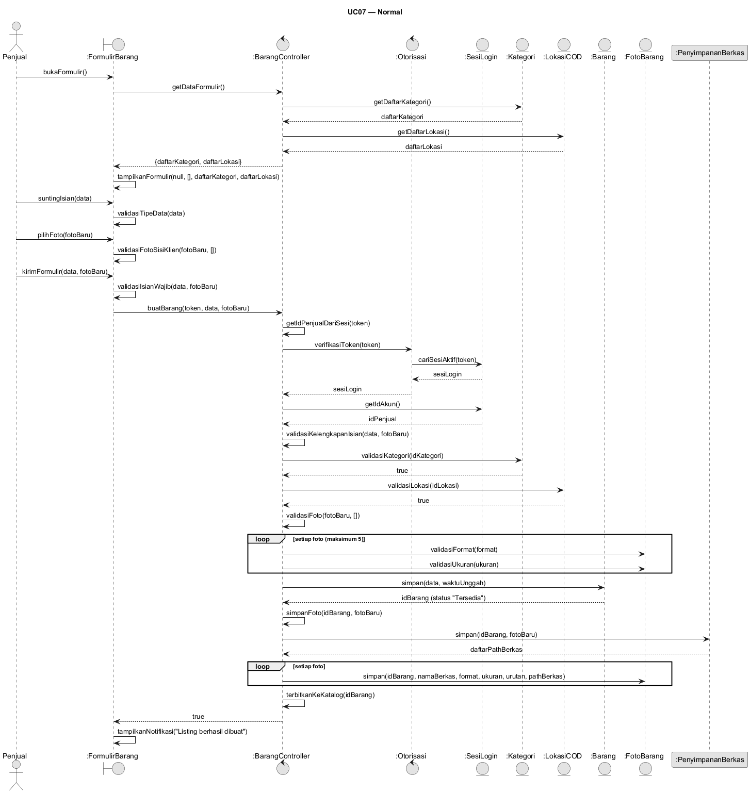
</p>
<p align="center">
<i>Gambar 3.20. Sequence Diagram UC07 - Skenario Normal</i>
</p>

- **Skenario Alternatif 1: Isian Formulir Tidak Lengkap**

Skenario ini terjadi apabila penjual mengosongkan kolom wajib (misalnya judul, harga, atau tidak memilih kategori). FormulirBarang mendeteksi kegagalan pada validasi wajib-isi di sisi klien, membatalkan pengiriman ke backend, dan memberi penanda visual merah pada kolom yang terlewat.

<p align="center">
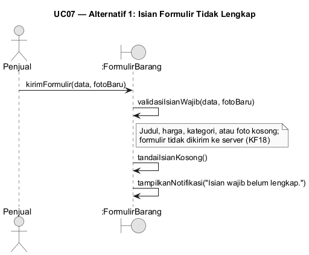
</p>
<p align="center">
<i>Gambar 3.21. Sequence Diagram UC07 - Skenario Alternatif 1: Isian Formulir Tidak Lengkap</i>
</p>

- **Skenario Alternatif 2: Pelanggaran Syarat Unggahan Foto**

Skenario ini terjadi ketika penjual mencoba mengunggah foto berformat di luar JPG/PNG (misal .pdf atau .heic), berkas berukuran lebih dari 5 MB, atau mencoba mengunggah lebih dari 5 foto. FormulirBarang memblokir pratinjau berkas dan menampilkan pesan galat spesifikasi berkas.

<p align="center">
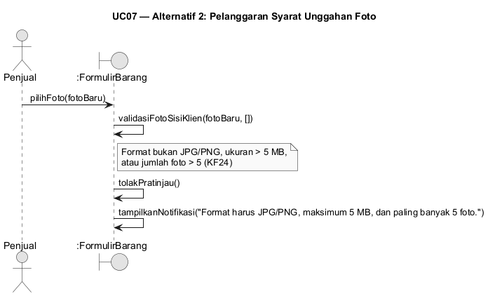
</p>
<p align="center">
<i>Gambar 3.22. Sequence Diagram UC07 - Skenario Alternatif 2: Pelanggaran Syarat Unggahan Foto</i>
</p>

### 3.7.3 Diagram Kelas

FormulirBarang berasosiasi dengan BarangController. BarangController bergantung pada SesiLogin, Barang, FotoBarang, Kategori, LokasiCOD, Otorisasi, dan PenyimpananBerkas. Otorisasi bergantung pada SesiLogin. Relasi antar-*entity* pada diagram ini adalah Penjual ke Barang berupa komposisi 1 ke 0..*, Barang ke FotoBarang berupa komposisi 1 ke 1..5, Kategori ke Barang berupa asosiasi 1 ke 0..*, dan LokasiCOD ke Barang berupa asosiasi 1 ke 0..*. Setiap kelas menampilkan atribut bertipe data dan operasi yang dipakai pada UC07, sehingga seluruh operasi yang dipanggil pada *sequence diagram* subbab sebelumnya tercantum pada kelas yang bersangkutan.

<p align="center">

</p>
<p align="center">
<i>Gambar 3.23. Diagram Kelas Use Case UC07</i>
</p>

---

## 3.8 Use Case Melihat Daftar Listing Milik Sendiri

**ID Use Case:** UC08  
**Nama Use Case:** Melihat Daftar Listing Milik Sendiri

### 3.8.1 Identifikasi Kelas

Realisasi use case ini melibatkan antarmuka dasbor listing penjual dan komponen kartu produk, controller barang untuk mengambil dan mengelompokkan data berdasarkan status, modul otorisasi untuk mengekstrak identitas penjual dari token sesi, serta entitas Penjual, SesiLogin, dan Barang.

Tabel 3.8. Identifikasi Kelas Use Case UC08

| No | Nama Kelas Perancangan | Nama Kelas Analisis Terkait |
| :--- | :--- | :--- |
| 1 | HalamanListingPenjual | C03 HalamanListingPenjual |
| 2 | KartuProduk | C06 KartuProduk |
| 3 | BarangController | C14 BarangController |
| 4 | Penjual | C25 Penjual |
| 5 | SesiLogin | C28 SesiLogin |
| 6 | Barang | C29 Barang |
| 7 | Otorisasi | C41 Otorisasi (Pendukung) |

### 3.8.2 Sequence Diagram

- **Skenario Normal**

Penjual membuka menu "Listing Saya". Sistem memvalidasi token sesi, mengambil seluruh data listing milik idPenjual dari entitas Barang, mengelompokkan barang ke dalam daftar "Tersedia" dan riwayat "Terjual", lalu merender HalamanListingPenjual dengan tab aktif yang menampilkan kartu produk untuk masing-masing item.

<p align="center">
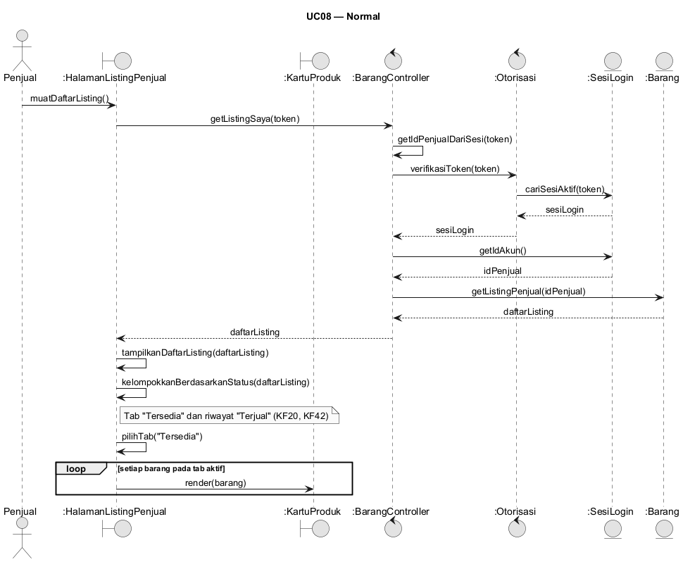
</p>
<p align="center">
<i>Gambar 3.24. Sequence Diagram UC08 - Skenario Normal</i>
</p>

### 3.8.3 Diagram Kelas

HalamanListingPenjual berasosiasi dengan BarangController. HalamanListingPenjual memiliki relasi komposisi 1 ke 0..* terhadap KartuProduk. BarangController bergantung pada SesiLogin, Barang, dan Otorisasi. Otorisasi bergantung pada SesiLogin. Relasi antar-*entity* pada diagram ini adalah Penjual ke Barang berupa komposisi 1 ke 0..*. Setiap kelas menampilkan atribut bertipe data dan operasi yang dipakai pada UC08, sehingga seluruh operasi yang dipanggil pada *sequence diagram* subbab sebelumnya tercantum pada kelas yang bersangkutan.

<p align="center">
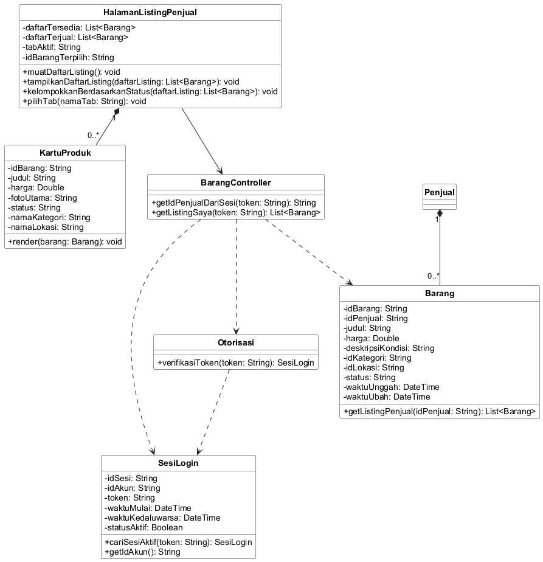
</p>
<p align="center">
<i>Gambar 3.25. Diagram Kelas Use Case UC08</i>
</p>

<br>

---

## 3.9 Use Case Mengubah Listing

**ID Use Case:** UC09  
**Nama Use Case:** Mengubah Listing

### 3.9.1 Identifikasi Kelas

Realisasi use case pengubahan listing melibatkan antarmuka daftar listing penjual sebagai titik masuk, formulir barang untuk menyunting isian dan galeri foto beserta validasi sisi klien, controller barang untuk verifikasi kepemilikan dan validasi ulang di sisi server, modul otorisasi untuk identifikasi penjual, entitas Barang, FotoBarang, Kategori, dan LokasiCOD, serta penyimpanan berkas untuk foto baru maupun foto yang dibuang.

Tabel 3.9. Identifikasi Kelas Use Case UC09

| No | Nama Kelas Perancangan | Nama Kelas Analisis Terkait |
| :--- | :--- | :--- |
| 1 | HalamanListingPenjual | C03 HalamanListingPenjual |
| 2 | FormulirBarang | C04 FormulirBarang |
| 3 | BarangController | C14 BarangController |
| 4 | Penjual | C25 Penjual |
| 5 | SesiLogin | C28 SesiLogin |
| 6 | Barang | C29 Barang |
| 7 | FotoBarang | C30 FotoBarang |
| 8 | Kategori | C31 Kategori |
| 9 | LokasiCOD | C32 LokasiCOD |
| 10 | Otorisasi | C41 Otorisasi (Pendukung) |
| 11 | PenyimpananBerkas | C45 PenyimpananBerkas (Penyimpanan Data) |

### 3.9.2 Sequence Diagram

- **Skenario Normal**

Penjual menekan "Ubah Listing" pada halaman "Listing Saya". BarangController memverifikasi token melalui Otorisasi, mencocokkan idAkun dari sesi dengan pemilik listing, lalu mengirim data listing, galeri foto, daftar kategori, dan daftar lokasi untuk ditampilkan pada FormulirBarang. Penjual menyunting isian dan mengganti sebagian foto, sementara FormulirBarang memvalidasi tipe data dan ketentuan foto di sisi klien. Saat "Simpan Perubahan" ditekan, BarangController mengulang verifikasi kepemilikan serta validasi isian dan foto, mengunggah foto baru ke PenyimpananBerkas, menghapus berkas foto yang dibuang, memperbarui galeri FotoBarang, dan menyimpan perubahan Barang. Penjual kemudian diarahkan ke halaman detail listing.

<p align="center">
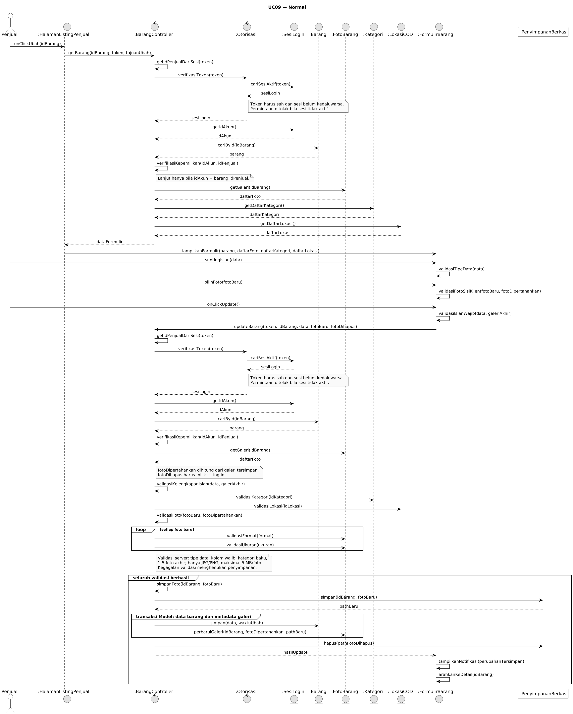
</p>
<p align="center">
<i>Gambar 3.26. Sequence Diagram UC09 - Skenario Normal</i>
</p>

- **Skenario Alternatif 1:  Kolom Wajib Dikosongkan saat Pengubahan**

Skenario ini terjadi apabila penjual mengosongkan kolom wajib, misalnya harga atau kategori, lalu menekan "Simpan Perubahan". FormulirBarang mendeteksi isian wajib yang kosong, menandai kolom tersebut, dan tidak mengirim perubahan, sehingga listing tetap pada versi lamanya (KF18). Setelah kolom dilengkapi dan disimpan ulang, penyimpanan berjalan seperti skenario normal.

<p align="center">
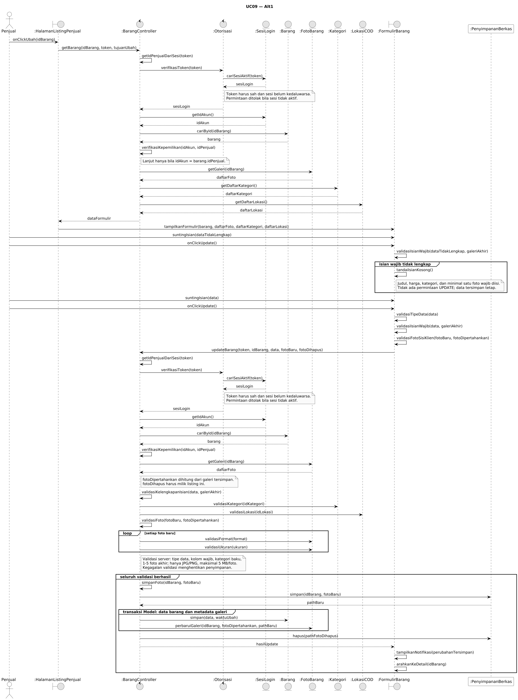
</p>
<p align="center">
<i>Gambar 3.27. Sequence Diagram UC09 — Skenario Alternatif 1</i>
</p>

- **Skenario Alternatif 2: Pelanggaran Syarat Unggahan Foto saat Pengubahan**

Skenario ini terjadi apabila penjual menambahkan foto berformat selain JPG/PNG, berukuran lebih dari 5 MB, atau membuat jumlah foto melebihi 5. FormulirBarang menolak pratinjau berkas tersebut dan menampilkan pesan ketentuan yang dilanggar. Penyimpanan tidak dijalankan sampai berkas diperbaiki (KF24).

<p align="center">

</p>
<p align="center">
<i>Gambar 3.28. Sequence Diagram UC09 — Alternatif 2</i>
</p>

- **Skenario Alternatif 3: Percobaan Pengubahan oleh Akun Bukan Pemilik**

Skenario ini terjadi apabila akun yang bukan pemilik mencoba membuka atau mengirim perubahan listing milik penjual lain. BarangController membandingkan idAkun dari sesi dengan pemilik listing, mendapati keduanya berbeda, dan menolak permintaan tanpa mengubah data listing (KF22).

<p align="center">
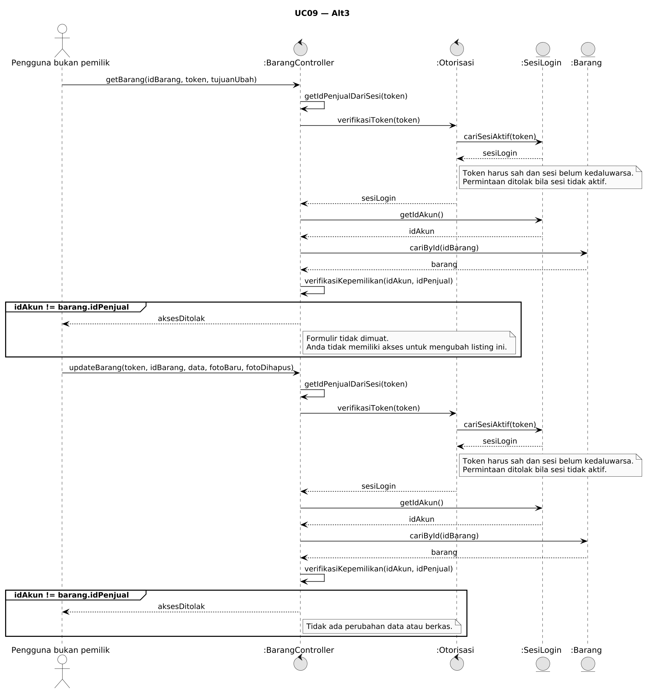
</p>
<p align="center">
<i>Gambar 3.29. Sequence Diagram UC09 - Skenario Alternatif 3</i>
</p>

### 3.9.3 Diagram Kelas

HalamanListingPenjual berasosiasi dengan BarangController dan FormulirBarang. FormulirBarang berasosiasi dengan BarangController. BarangController bergantung pada SesiLogin, Barang, FotoBarang, Kategori, LokasiCOD, Otorisasi, dan PenyimpananBerkas. Otorisasi bergantung pada SesiLogin. Relasi antar-*entity* pada diagram ini adalah Penjual ke Barang berupa komposisi 1 ke 0..*, Barang ke FotoBarang berupa komposisi 1 ke 1..5, Kategori ke Barang berupa asosiasi 1 ke 0..*, dan LokasiCOD ke Barang berupa asosiasi 1 ke 0..*. Setiap kelas menampilkan atribut bertipe data dan operasi yang dipakai pada UC09, sehingga seluruh operasi yang dipanggil pada *sequence diagram* subbab sebelumnya tercantum pada kelas yang bersangkutan.

<p align="center">
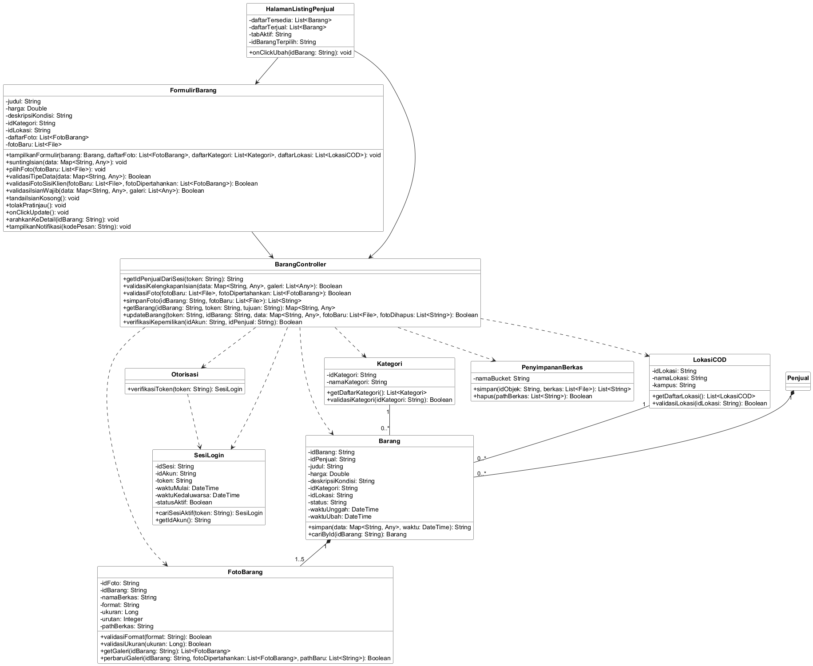
</p>
<p align="center">
<i>Gambar 3.30. Diagram Kelas UC09</i>
</p>

---

## 3.10 Use Case Menghapus Listing

**ID Use Case:** UC10  
**Nama Use Case:** Menghapus Listing

### 3.10.1 Identifikasi Kelas

Realisasi use case penghapusan listing melibatkan antarmuka daftar listing penjual untuk aksi hapus dan dialog konfirmasi, controller barang untuk verifikasi kepemilikan dan penghapusan, modul otorisasi, entitas Barang dan FotoBarang, serta penyimpanan berkas untuk menghapus berkas foto.

Tabel 3.10. Identifikasi Kelas Use Case UC10

| No | Nama Kelas Perancangan | Nama Kelas Analisis Terkait |
| :--- | :--- | :--- |
| 1 | HalamanListingPenjual | C03 HalamanListingPenjual |
| 2 | BarangController | C14 BarangController |
| 3 | Penjual | C25 Penjual |
| 4 | SesiLogin | C28 SesiLogin |
| 5 | Barang | C29 Barang |
| 6 | FotoBarang | C30 FotoBarang |
| 7 | Otorisasi | C41 Otorisasi (Pendukung) |
| 8 | PenyimpananBerkas | C45 PenyimpananBerkas (Penyimpanan Data) |

### 3.10.2 Sequence Diagram

- **Skenario Normal**

Penjual memilih "Hapus Listing" pada halaman "Listing Saya". BarangController memverifikasi token dan kepemilikan listing, lalu HalamanListingPenjual menampilkan dialog konfirmasi berisi judul listing dan peringatan bahwa penghapusan bersifat permanen. Setelah penjual mengonfirmasi, BarangController mengulang verifikasi kepemilikan, mengambil galeri foto, menghapus FotoBarang dan Barang, lalu menghapus berkas fotonya dari PenyimpananBerkas. Dialog ditutup, notifikasi berhasil ditampilkan, dan daftar listing dimuat ulang sehingga listing tidak lagi muncul di katalog maupun pencarian.

<p align="center">

</p>
<p align="center">
<i>Gambar 3.31. Sequence Diagram UC10 - Skenario Normal</i>
</p>

- **Skenario Alternatif 1: Penjual Membatalkan Konfirmasi Penghapusan**

Skenario ini terjadi apabila penjual menekan "Batal" atau menutup dialog konfirmasi. HalamanListingPenjual menutup dialog tanpa mengirim permintaan penghapusan, sehingga listing tetap utuh beserta status semula.

<p align="center">

</p>
<p align="center">
<i>Gambar 3.32. Sequence Diagram UC10 - Skenario Alternatif 1</i>
</p>

- **Skenario Alternatif 2: Percobaan Penghapusan oleh Akun Bukan Pemilik**

Skenario ini terjadi apabila akun yang bukan pemilik mengirim permintaan penghapusan listing milik penjual lain. BarangController mendapati idAkun dari sesi berbeda dengan pemilik listing, menolak permintaan sebelum menyentuh data, dan menampilkan pesan bahwa pengguna tidak memiliki izin (KF22).

<p align="center">
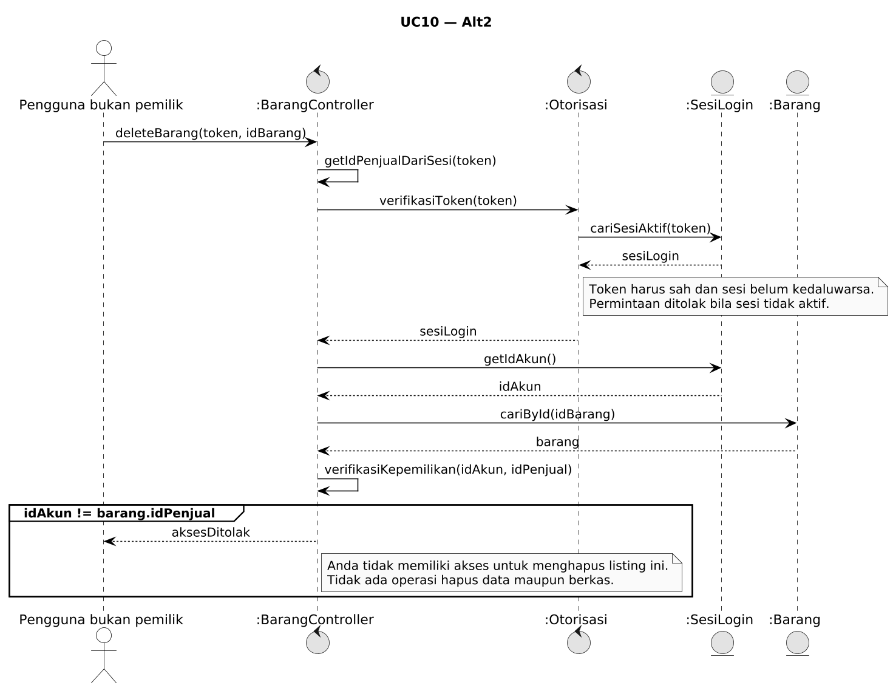
</p>
<p align="center">
<i>Gambar 3.33. Sequence Diagram UC10 - Skenario Alternatif 2</i>
</p>

### 3.10.3 Diagram Kelas

HalamanListingPenjual berasosiasi dengan BarangController. BarangController bergantung pada SesiLogin, Barang, FotoBarang, Otorisasi, dan PenyimpananBerkas. Otorisasi bergantung pada SesiLogin. Relasi antar-*entity* pada diagram ini adalah Penjual ke Barang berupa komposisi 1 ke 0..* dan Barang ke FotoBarang berupa komposisi 1 ke 1..5. Setiap kelas menampilkan atribut bertipe data dan operasi yang dipakai pada UC10, sehingga seluruh operasi yang dipanggil pada *sequence diagram* subbab sebelumnya tercantum pada kelas yang bersangkutan.

<p align="center">
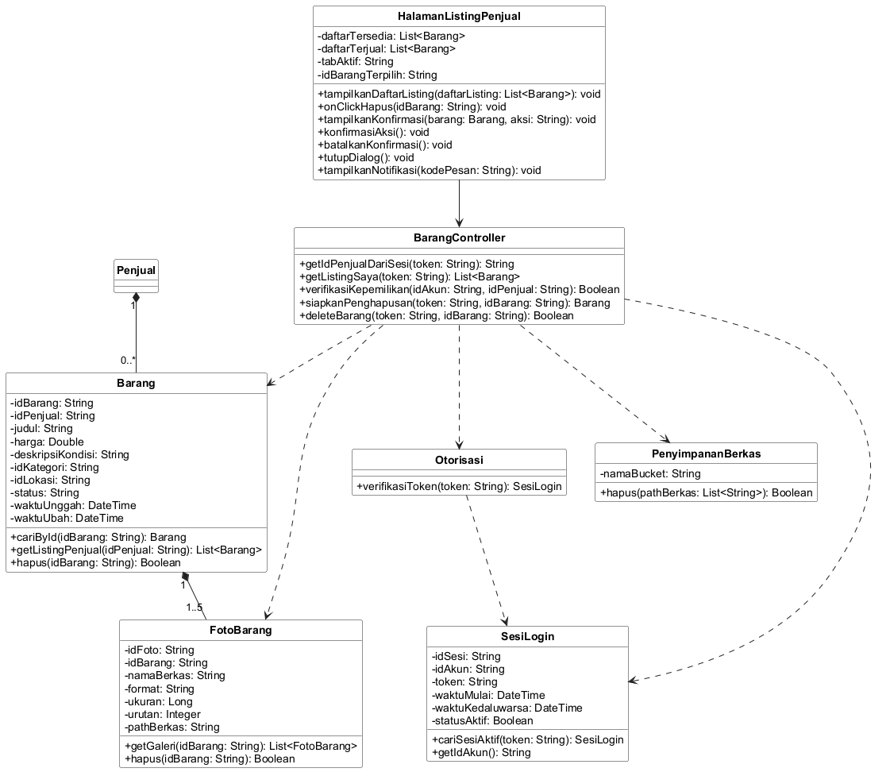
</p>
<p align="center">
<i>Gambar 3.34. Diagram Kelas UC10</i>
</p>

---

## 3.11 Use Case Menandai Listing Terjual

**ID Use Case:** UC11  
**Nama Use Case:** Menandai Listing Terjual

### 3.11.1 Identifikasi Kelas

Realisasi use case penandaan terjual melibatkan antarmuka daftar listing penjual dan kartu produk, controller barang untuk verifikasi kepemilikan dan status asal, modul otorisasi untuk identifikasi penjual, serta entitas Penjual, SesiLogin, dan Barang.

Tabel 3.11. Identifikasi Kelas Use Case UC11

| No | Nama Kelas Perancangan | Nama Kelas Analisis Terkait |
| :--- | :--- | :--- |
| 1 | HalamanListingPenjual | C03 HalamanListingPenjual |
| 2 | KartuProduk | C06 KartuProduk |
| 3 | BarangController | C14 BarangController |
| 4 | Penjual | C25 Penjual |
| 5 | SesiLogin | C28 SesiLogin |
| 6 | Barang | C29 Barang |
| 7 | Otorisasi | C41 Otorisasi (Pendukung) |

### 3.11.2 Sequence Diagram

- **Skenario Normal**

Penjual menekan "Tandai Terjual" pada listing berstatus "Tersedia". BarangController memverifikasi token, kepemilikan, dan status asal listing, lalu HalamanListingPenjual menampilkan dialog konfirmasi. Setelah penjual mengonfirmasi, BarangController mengubah status Barang dari "Tersedia" menjadi "Terjual" beserta waktu perubahannya. Daftar listing dimuat ulang, kartu listing berpindah ke tab riwayat "Terjual", dan listing tidak lagi muncul pada katalog maupun pencarian (KF40, KF42).

<p align="center">

</p>
<p align="center">
<i>Gambar 3.35. Sequence Diagram UC11 - Skenario Normal</i>
</p>

- **Skenario Alternatif 1: Penjual Membatalkan Dialog Konfirmasi**

Skenario ini terjadi apabila penjual menekan "Batal" pada dialog konfirmasi. Dialog ditutup tanpa mengirim perubahan status, sehingga listing tetap berstatus "Tersedia" dan tetap tampil pada katalog.

<p align="center">

</p>
<p align="center">
<i>Gambar 3.36. Sequence Diagram UC11 - Skenario Alternatif 1</i>
</p>

- **Skenario Alternatif 2: Listing Sudah Berstatus Terjual**

Skenario ini terjadi apabila listing ternyata sudah berstatus "Terjual", misalnya karena penandaan sudah dilakukan dari perangkat lain. BarangController mendapati status asal tidak lagi "Tersedia", menolak perubahan, menampilkan pesan bahwa listing sudah terjual, dan memuat ulang daftar listing dengan status terkini.

<p align="center">
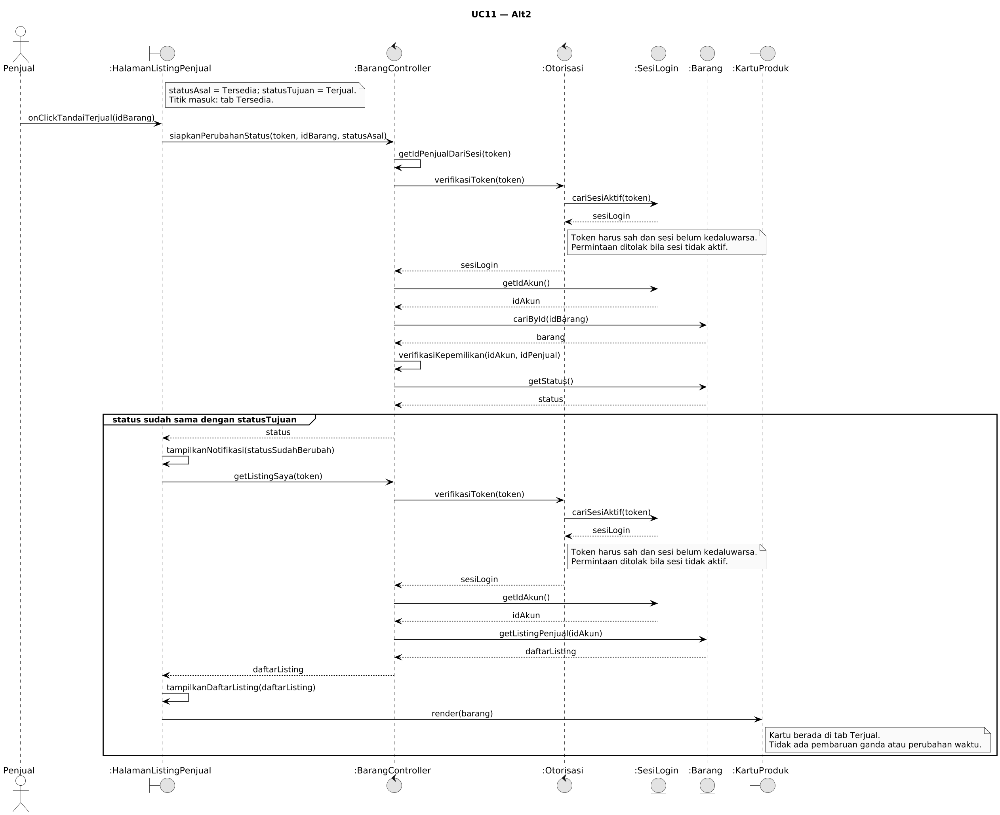
</p>
<p align="center">
<i>Gambar 3.37. Sequence Diagram UC11 - Skenario Alternatif 2</i>
</p>

### 3.11.3 Diagram Kelas

HalamanListingPenjual berasosiasi dengan BarangController. HalamanListingPenjual memiliki relasi komposisi 1 ke 0..* terhadap KartuProduk. BarangController bergantung pada SesiLogin, Barang, dan Otorisasi. Otorisasi bergantung pada SesiLogin. Relasi antar-*entity* pada diagram ini adalah Penjual ke Barang berupa komposisi 1 ke 0..*. Setiap kelas menampilkan atribut bertipe data dan operasi yang dipakai pada UC11, sehingga seluruh operasi yang dipanggil pada *sequence diagram* subbab sebelumnya tercantum pada kelas yang bersangkutan.

<p align="center">
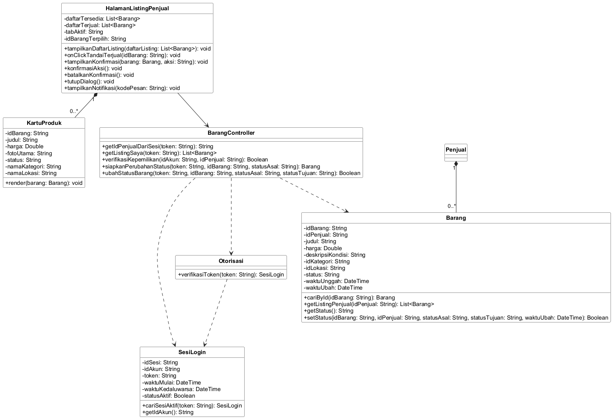
</p>
<p align="center">
<i>Gambar 3.38. Diagram Kelas UC11</i>
</p>

---
## 3.12 Use Case Membatalkan Penandaan Terjual

**ID Use Case:** UC12  
**Nama Use Case:** Membatalkan Penandaan Terjual

### 3.12.1 Identifikasi Kelas

Realisasi use case pembatalan penandaan terjual melibatkan antarmuka daftar listing penjual dan kartu produk, controller barang untuk verifikasi kepemilikan dan status asal, modul otorisasi untuk identifikasi penjual, serta entitas Penjual, SesiLogin, dan Barang.

Tabel 3.12. Identifikasi Kelas Use Case UC12

| No | Nama Kelas Perancangan | Nama Kelas Analisis Terkait |
| :--- | :--- | :--- |
| 1 | HalamanListingPenjual | C03 HalamanListingPenjual |
| 2 | KartuProduk | C06 KartuProduk |
| 3 | BarangController | C14 BarangController |
| 4 | Penjual | C25 Penjual |
| 5 | SesiLogin | C28 SesiLogin |
| 6 | Barang | C29 Barang |
| 7 | Otorisasi | C41 Otorisasi (Pendukung) |

### 3.12.2 Sequence Diagram

- **Skenario Normal**

Penjual menekan "Batalkan Penandaan Terjual" pada tab riwayat "Terjual". BarangController memverifikasi token, kepemilikan, dan status asal listing, lalu HalamanListingPenjual menampilkan dialog konfirmasi. Setelah penjual mengonfirmasi, BarangController mengembalikan status Barang dari "Terjual" menjadi "Tersedia" beserta waktu perubahannya. Daftar listing dimuat ulang, kartu berpindah ke tab "Tersedia", dan listing kembali tampil pada katalog dan pencarian (KF41).

<p align="center">

</p>
<p align="center">
<i>Gambar 3.39. Sequence Diagram UC12 - Skenario Normal</i>
</p>

- **Skenario Alternatif 1: Penjual Membatalkan Dialog Konfirmasi**

Skenario ini terjadi apabila penjual menekan "Batal" atau menutup dialog konfirmasi. Dialog ditutup tanpa mengirim perubahan status, sehingga listing tetap berstatus "Terjual" dan tetap tersembunyi dari katalog.

<p align="center">
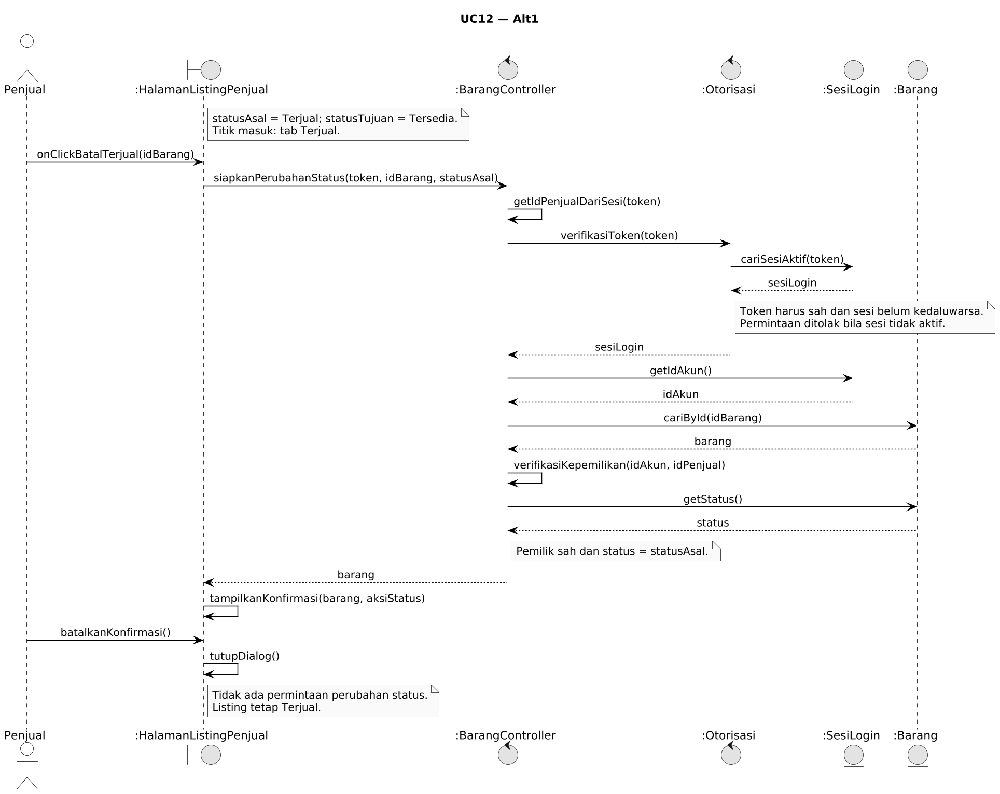
</p>
<p align="center">
<i>Gambar 3.40. Sequence Diagram UC12 - Skenario Alternatif 1</i>
</p>

- **Skenario Alternatif 2: Listing Sudah Kembali Berstatus Tersedia**

Skenario ini terjadi apabila listing ternyata sudah kembali berstatus "Tersedia" karena pembatalan pernah dilakukan sebelumnya. BarangController mendapati status asal tidak lagi "Terjual", menolak permintaan, menampilkan pesan bahwa listing sudah tersedia, dan memuat ulang daftar listing tanpa menggandakan data.

<p align="center">

</p>
<p align="center">
<i>Gambar 3.41. Sequence Diagram UC12 - Skenario Alternatif 2</i>
</p>


### 3.12.3 Diagram Kelas

HalamanListingPenjual berasosiasi dengan BarangController. HalamanListingPenjual memiliki relasi komposisi 1 ke 0..* terhadap KartuProduk. BarangController bergantung pada SesiLogin, Barang, dan Otorisasi. Otorisasi bergantung pada SesiLogin. Relasi antar-*entity* pada diagram ini adalah Penjual ke Barang berupa komposisi 1 ke 0..*. Setiap kelas menampilkan atribut bertipe data dan operasi yang dipakai pada UC12, sehingga seluruh operasi yang dipanggil pada *sequence diagram* subbab sebelumnya tercantum pada kelas yang bersangkutan.

<p align="center">
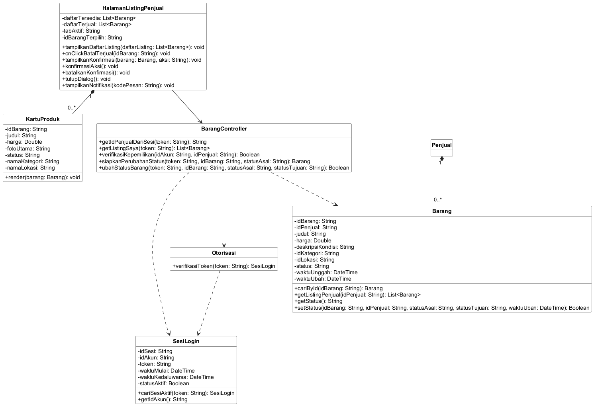
</p>
<p align="center">
<i>Gambar 3.42. Diagram Kelas UC12</i>
</p>

---

## 3.13 Use Case Melihat Katalog Listing

**ID Use Case:** UC13  
**Nama Use Case:** Melihat Katalog Listing

### 3.13.1 Identifikasi Kelas

Realisasi use case melihat katalog melibatkan antarmuka katalog dan kartu produk, controller katalog untuk menyusun permintaan dan paginasi, entitas Barang yang menjalankan kueri listing berstatus "Tersedia", entitas Akun dan Penjual untuk memastikan pemilik listing tidak diblokir, serta FotoBarang untuk foto utama setiap kartu.

Tabel 3.13. Identifikasi Kelas Use Case UC13

| No | Nama Kelas Perancangan | Nama Kelas Analisis Terkait |
| :--- | :--- | :--- |
| 1 | HalamanKatalog | C05 HalamanKatalog |
| 2 | KartuProduk | C06 KartuProduk |
| 3 | KatalogController | C15 KatalogController |
| 4 | Akun | C23 Akun |
| 5 | Penjual | C25 Penjual |
| 6 | Barang | C29 Barang |
| 7 | FotoBarang | C30 FotoBarang |

### 3.13.2 Sequence Diagram

- **Skenario Normal**

Pembeli membuka halaman katalog. HalamanKatalog meminta data ke KatalogController, yang menghitung paginasi dan meminta Barang menjalankan kueri katalog. Kueri selalu mensyaratkan status "Tersedia" dan akun pemilik yang tidak diblokir melalui Akun, lalu foto utama setiap listing diambil dari FotoBarang. HalamanKatalog menampilkan maksimum 20 kartu produk beserta navigasi antarhalaman. Saat pembeli berpindah halaman, kriteria yang sama dipakai kembali dan tampilan digulir ke atas (KF28, KF30).

<p align="center">

</p>
<p align="center">
<i>Gambar 3.43. Sequence Diagram UC13 - Skenario Normal</i>
</p>

- **Skenario Alternatif 1: Katalog Masih Kosong**

Skenario ini terjadi apabila tidak ada satu pun listing yang memenuhi syarat katalog. HalamanKatalog tidak menampilkan kartu produk maupun navigasi antarhalaman, melainkan pesan bahwa belum ada barang yang tersedia.

<p align="center">
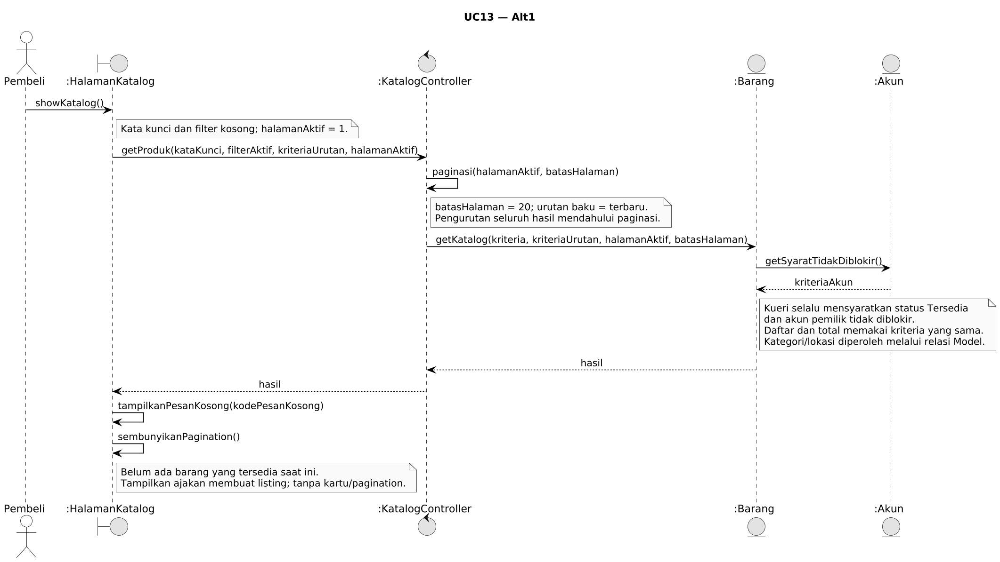
</p>
<p align="center">
<i>Gambar 3.44. Sequence Diagram UC13 - Skenario Alternatif 1</i>
</p>

- **Skenario Alternatif 2: Listing Menjadi Tidak Tersedia saat Katalog Dibuka**

Skenario ini terjadi apabila sebuah listing ditandai terjual atau akun pemiliknya diblokir ketika pembeli sedang menelusuri katalog. Saat halaman disegarkan atau berpindah halaman, kueri katalog dijalankan ulang sehingga listing tersebut tidak lagi disertakan dan jumlah total listing diperbarui (KF42, KF54).

<p align="center">
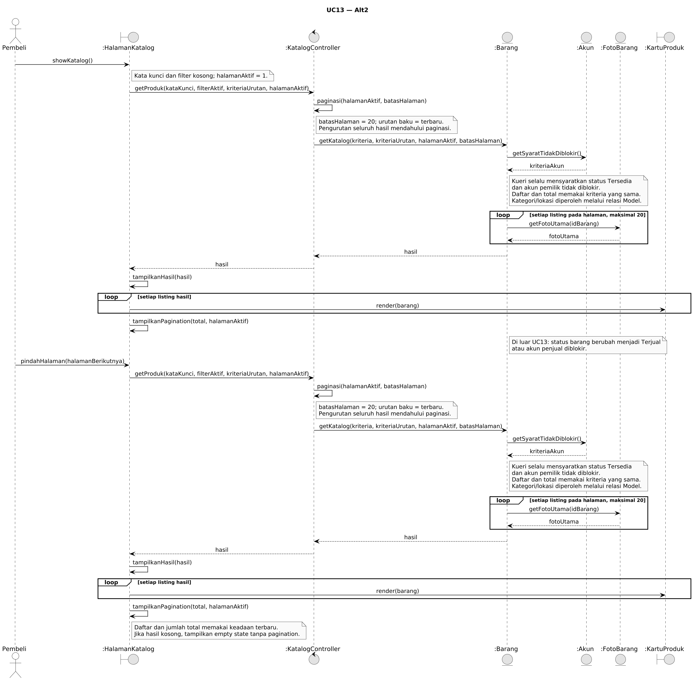
</p>
<p align="center">
<i>Gambar 3.45. Sequence Diagram UC13 — Skenario Alternatif 2</i>
</p>

### 3.13.3 Diagram Kelas

HalamanKatalog berasosiasi dengan KatalogController. HalamanKatalog memiliki relasi komposisi 1 ke 0..20 terhadap KartuProduk. KatalogController bergantung pada Barang. Barang bergantung pada Akun. Penjual merupakan turunan (generalisasi) dari Akun. Relasi antar-*entity* pada diagram ini adalah Penjual ke Barang berupa komposisi 1 ke 0..* dan Barang ke FotoBarang berupa komposisi 1 ke 1..5. Setiap kelas menampilkan atribut bertipe data dan operasi yang dipakai pada UC13, sehingga seluruh operasi yang dipanggil pada *sequence diagram* subbab sebelumnya tercantum pada kelas yang bersangkutan.

<p align="center">
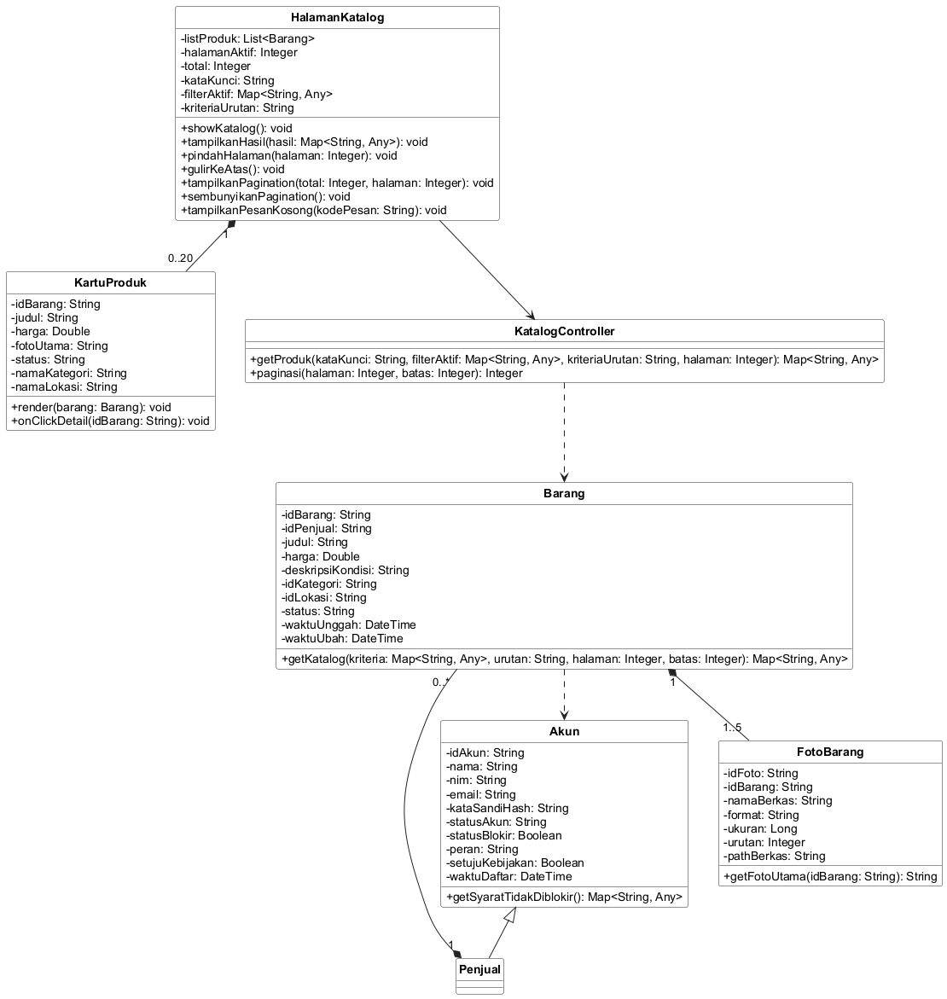
</p>
<p align="center">
<i>Gambar 3.46. Diagram Kelas UC13</i>
</p>

---

## 3.14 Use Case Mencari dan Menyaring Listing

**ID Use Case:** UC14  
**Nama Use Case:** Mencari dan Menyaring Listing

### 3.14.1 Identifikasi Kelas

Realisasi use case pencarian dan penyaringan melibatkan antarmuka katalog untuk menangkap kata kunci, filter, dan urutan, controller katalog yang mengorkestrasi controller pencarian dan controller filter, entitas Barang yang menjalankan kueri, entitas Akun, Penjual, Kategori, dan LokasiCOD sebagai syarat dan acuan filter, serta FotoBarang untuk foto utama hasil pencarian.

Tabel 3.14. Identifikasi Kelas Use Case UC14

| No | Nama Kelas Perancangan | Nama Kelas Analisis Terkait |
| :--- | :--- | :--- |
| 1 | HalamanKatalog | C05 HalamanKatalog |
| 2 | KartuProduk | C06 KartuProduk |
| 3 | KatalogController | C15 KatalogController |
| 4 | PencarianController | C16 PencarianController |
| 5 | FilterController | C17 FilterController |
| 6 | Akun | C23 Akun |
| 7 | Penjual | C25 Penjual |
| 8 | Barang | C29 Barang |
| 9 | FotoBarang | C30 FotoBarang |
| 10 | Kategori | C31 Kategori |
| 11 | LokasiCOD | C32 LokasiCOD |

### 3.14.2 Sequence Diagram

- **Skenario Normal**

Pembeli memasukkan kata kunci, memilih filter kategori, rentang harga, atau lokasi, dan memilih kriteria urutan. Setiap perubahan mengembalikan tampilan ke halaman pertama, lalu HalamanKatalog mengirim seluruh kriteria ke KatalogController. KatalogController meminta PencarianController menormalisasi kata kunci dan menyusun kriteria kecocokan, meminta FilterController memvalidasi dan menyusun kriteria filter, lalu mengurutkan dan membagi hasil per halaman. Barang menjalankan kueri dengan seluruh kriteria sekaligus, tetap mensyaratkan status "Tersedia" dan pemilik yang tidak diblokir. HalamanKatalog menampilkan hasil, navigasi antarhalaman, dan filter yang sedang aktif (KF25–KF28).

<p align="center">
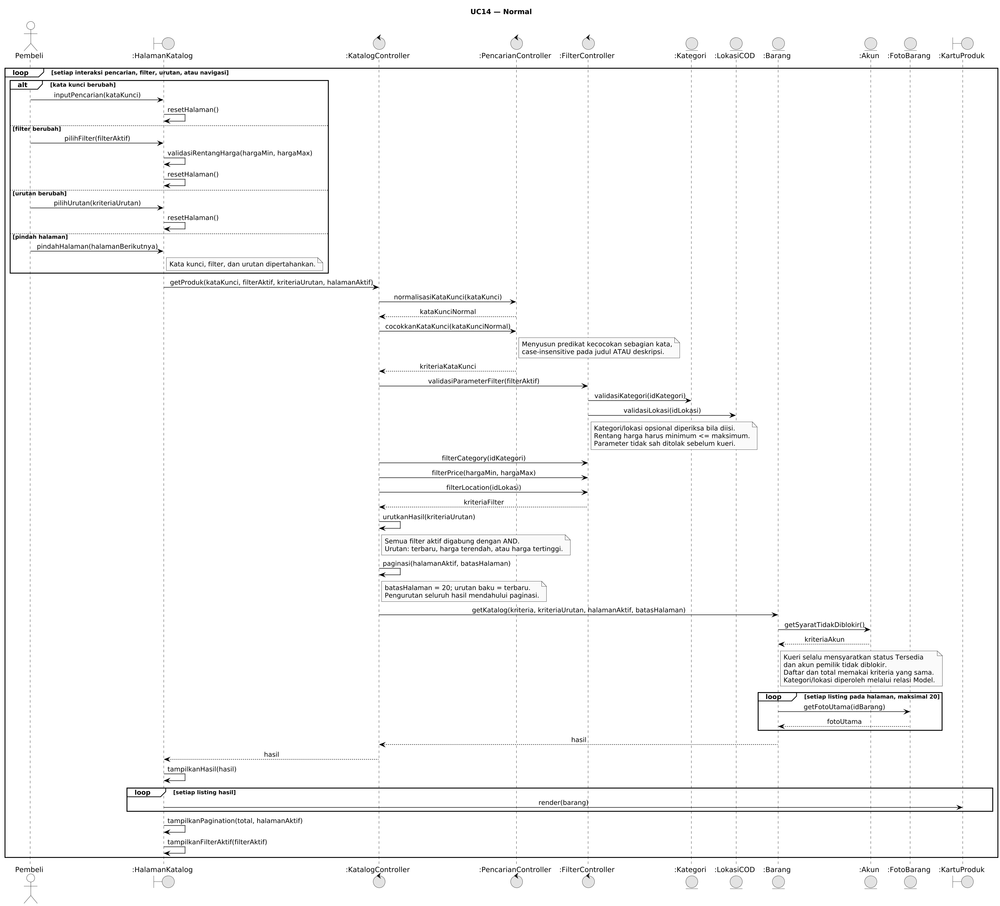
</p>
<p align="center">
<i>Gambar 3.47. Sequence Diagram UC14 - Skenario Normal</i>
</p>

- **Skenario Alternatif 1: Tidak Ada Barang yang Cocok**

Skenario ini terjadi apabila kombinasi kata kunci dan filter tidak menghasilkan listing apa pun. HalamanKatalog menampilkan pesan "Barang tidak ditemukan" beserta tombol "Hapus Semua Filter". Saat tombol tersebut ditekan, seluruh kriteria dikosongkan dan katalog penuh ditampilkan kembali dari halaman pertama (KF29).

<p align="center">

</p>
<p align="center">
<i>Gambar 3.48. Sequence Diagram UC14 - Skenario Alternatif 1</i>
</p>

- **Skenario Alternatif 2: Rentang Harga Tidak Masuk Akal**

Skenario ini terjadi apabila harga minimum lebih besar daripada harga maksimum. HalamanKatalog mendeteksi rentang harga yang tidak sah, menandai kedua kolom harga, dan tidak menerapkan filter sampai rentang diperbaiki. Validasi yang sama diulang di sisi server oleh FilterController.

<p align="center">
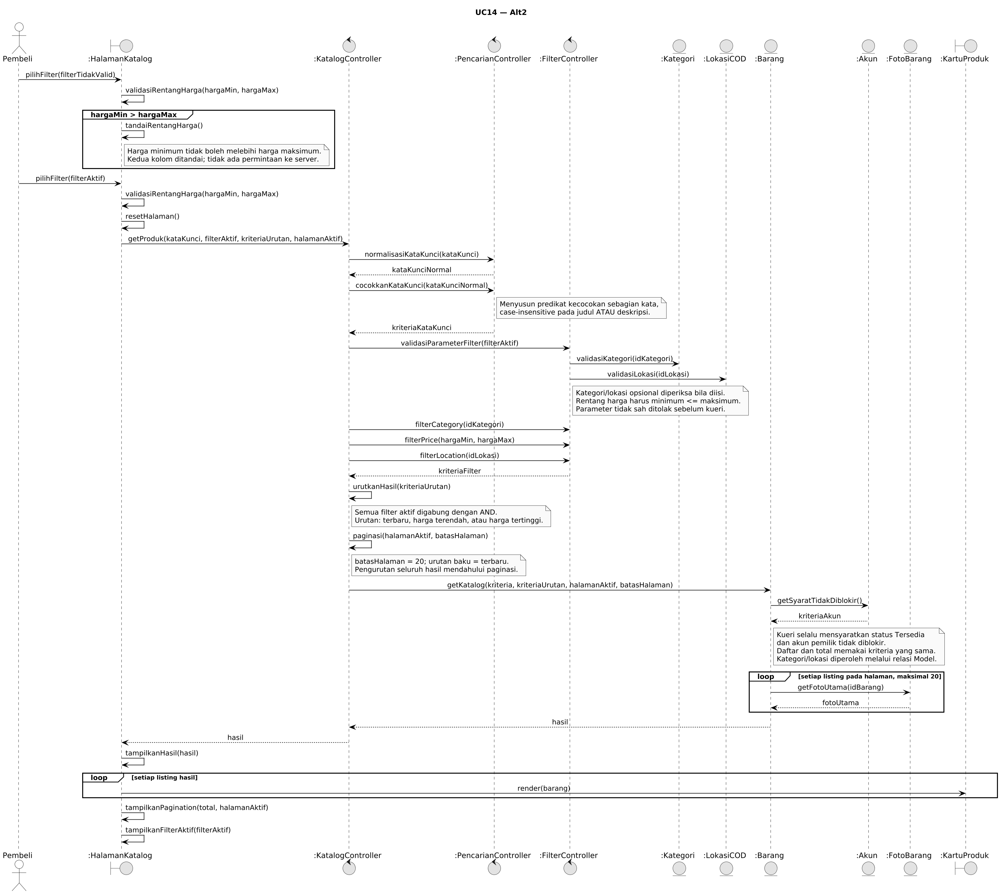
</p>
<p align="center">
<i>Gambar 3.49. Sequence Diagram UC14 - Skenario Alternatif 2</i>
</p>

### 3.14.3 Diagram Kelas

HalamanKatalog berasosiasi dengan KatalogController. HalamanKatalog memiliki relasi komposisi 1 ke 0..20 terhadap KartuProduk. KatalogController bergantung pada Barang, PencarianController, dan FilterController. FilterController bergantung pada Kategori dan LokasiCOD. Barang bergantung pada Akun. Penjual merupakan turunan (generalisasi) dari Akun. Relasi antar-*entity* pada diagram ini adalah Penjual ke Barang berupa komposisi 1 ke 0..*, Barang ke FotoBarang berupa komposisi 1 ke 1..5, Kategori ke Barang berupa asosiasi 1 ke 0..*, dan LokasiCOD ke Barang berupa asosiasi 1 ke 0..*. Setiap kelas menampilkan atribut bertipe data dan operasi yang dipakai pada UC14, sehingga seluruh operasi yang dipanggil pada *sequence diagram* subbab sebelumnya tercantum pada kelas yang bersangkutan.

<p align="center">
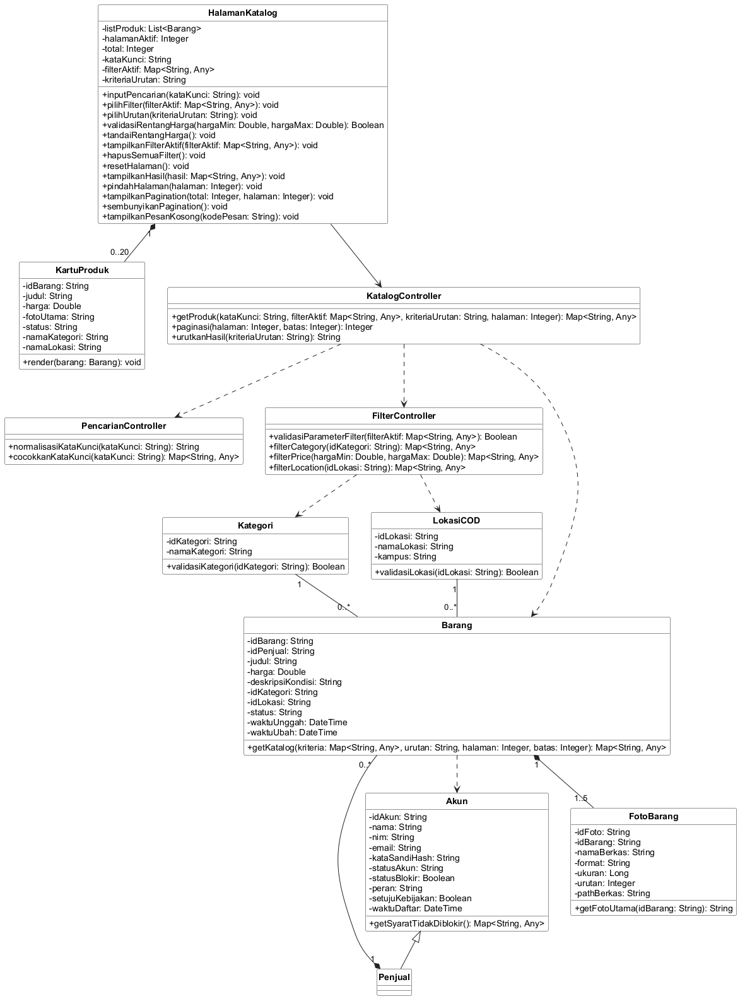
</p>
<p align="center">
<i>Gambar 3.50. Diagram Kelas UC14</i>
</p>

---

## 3.15 Use Case Melihat Detail Listing

**ID Use Case:** UC15  
**Nama Use Case:** Melihat Detail Listing

### 3.15.1 Identifikasi Kelas

Realisasi use case melihat detail listing melibatkan antarmuka detail barang, controller barang untuk mengambil detail listing beserta relasinya, modul otorisasi untuk mengenali pemohon, serta entitas Penjual, SesiLogin, Barang, FotoBarang, Kategori, dan LokasiCOD.

Tabel 3.15. Identifikasi Kelas Use Case UC15

| No | Nama Kelas Perancangan | Nama Kelas Analisis Terkait |
| :--- | :--- | :--- |
| 1 | HalamanDetailBarang | C07 HalamanDetailBarang |
| 2 | BarangController | C14 BarangController |
| 3 | Penjual | C25 Penjual |
| 4 | SesiLogin | C28 SesiLogin |
| 5 | Barang | C29 Barang |
| 6 | FotoBarang | C30 FotoBarang |
| 7 | Kategori | C31 Kategori |
| 8 | LokasiCOD | C32 LokasiCOD |
| 9 | Otorisasi | C41 Otorisasi (Pendukung) |

### 3.15.2 Sequence Diagram

- **Skenario Normal**

Pengguna menekan sebuah kartu produk. HalamanDetailBarang meminta detail listing ke BarangController, yang mengambil Barang, memverifikasi token melalui Otorisasi bila pengguna sedang masuk (detail listing tetap dapat dibuka tanpa sesi), galeri FotoBarang, Kategori, LokasiCOD, dan identitas Penjual. HalamanDetailBarang menampilkan seluruh foto, judul, harga, deskripsi kondisi, kategori, lokasi COD, dan identitas penjual, beserta tombol "Hubungi Penjual" dan "Laporkan". Foto dapat dibuka dalam ukuran penuh, dan nama penjual mengarah ke profilnya (KF17).

<p align="center">

</p>
<p align="center">
<i>Gambar 3.51. Sequence Diagram UC15 - Skenario Normal</i>
</p>

- **Skenario Alternatif 1: Pengguna adalah Pemilik Listing**

Skenario ini terjadi apabila pemohon adalah pemilik listing. Detail yang dikembalikan BarangController memuat idAkun pemohon, dan karena nilainya sama dengan pemilik listing, HalamanDetailBarang menggantikan tombol "Hubungi Penjual" dengan tombol pengelolaan listing, yaitu ubah, hapus, serta tandai atau batalkan penandaan terjual.

<p align="center">
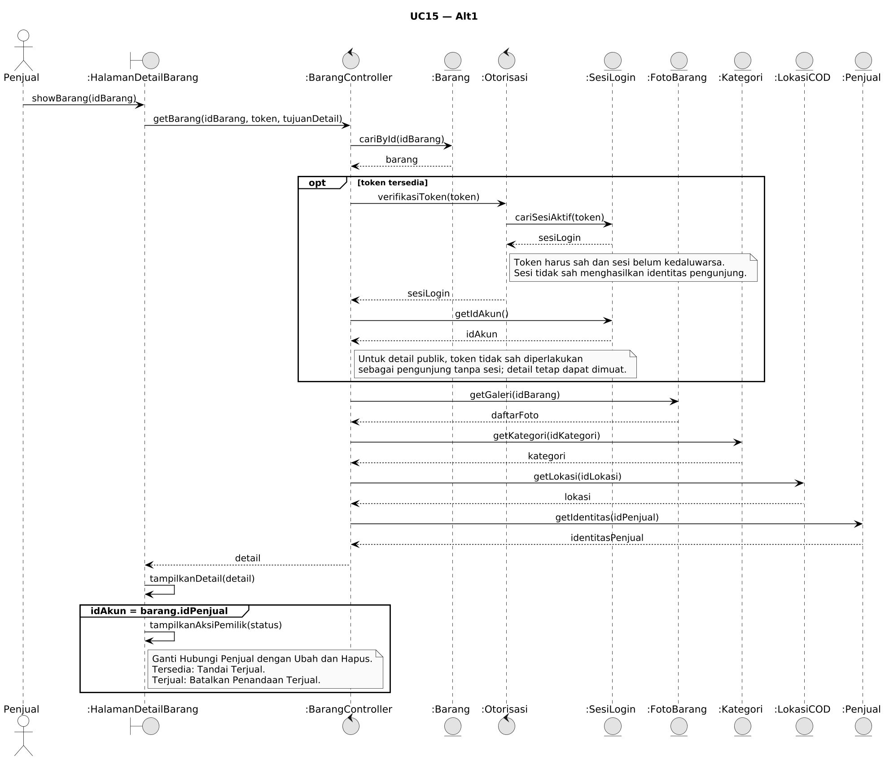
</p>
<p align="center">
<i>Gambar 3.52. Sequence Diagram UC15 - Skenario Alternatif 1</i>
</p>

- **Skenario Alternatif 2: Listing Sudah Dihapus atau Tidak Ditemukan**

Skenario ini terjadi apabila listing sudah dihapus atau tidak ditemukan. BarangController tidak menemukan data listing, dan HalamanDetailBarang menampilkan pemberitahuan bahwa listing tidak ditemukan beserta tautan kembali ke katalog.

<p align="center">

</p>
<p align="center">
<i>Gambar 3.53. Sequence Diagram UC15 — Skenario Alternatif 2</i>
</p>
 
- **Skenario Alternatif 3: Listing Sudah Berstatus Terjual**

Skenario ini terjadi apabila listing sudah berstatus "Terjual". HalamanDetailBarang tetap menampilkan informasi listing sebagai arsip, memberi label "Terjual", dan menonaktifkan tombol "Hubungi Penjual".

<p align="center">

</p>
<p align="center">
<i>Gambar 3.54. Sequence Diagram UC15 - Skenario Alternatif 3</i>
</p>

### 3.15.3 Diagram Kelas

HalamanDetailBarang berasosiasi dengan BarangController. BarangController bergantung pada Penjual, SesiLogin, Barang, FotoBarang, Kategori, LokasiCOD, dan Otorisasi. Otorisasi bergantung pada SesiLogin. Relasi antar-*entity* pada diagram ini adalah Penjual ke Barang berupa komposisi 1 ke 0..*, Barang ke FotoBarang berupa komposisi 1 ke 1..5, Kategori ke Barang berupa asosiasi 1 ke 0..*, dan LokasiCOD ke Barang berupa asosiasi 1 ke 0..*. Setiap kelas menampilkan atribut bertipe data dan operasi yang dipakai pada UC15, sehingga seluruh operasi yang dipanggil pada *sequence diagram* subbab sebelumnya tercantum pada kelas yang bersangkutan.

<p align="center">
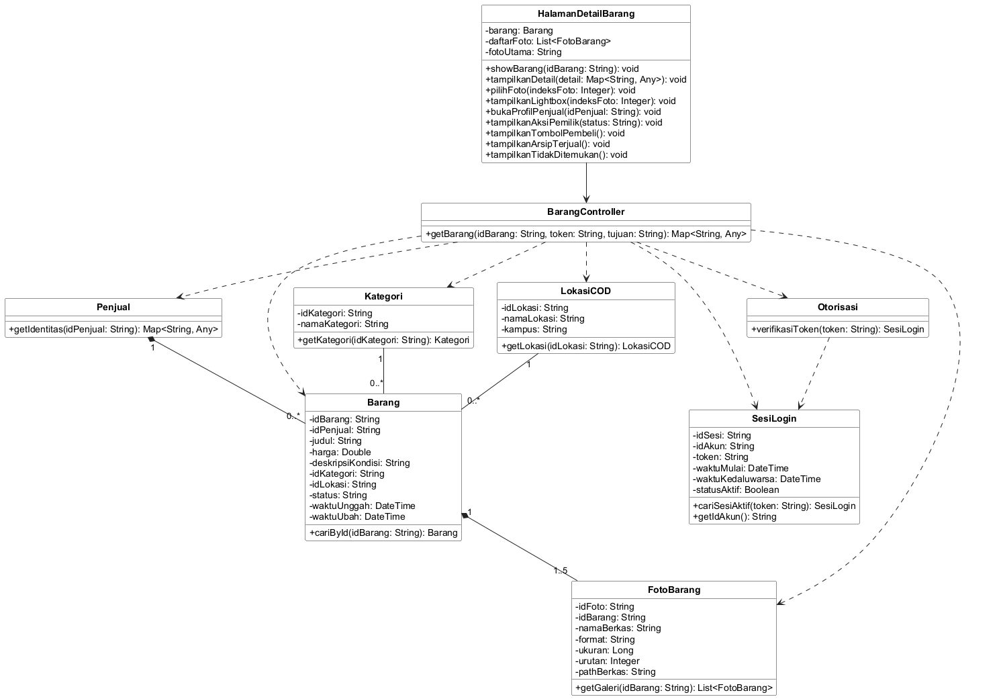
</p>
<p align="center">
<i>Gambar 3.55. Diagram Kelas UC15</i>
</p>

---

## 3.16 Use Case Menghubungi Penjual

**ID Use Case:** UC16  
**Nama Use Case:** Menghubungi Penjual

### 3.16.1 Identifikasi Kelas

Realisasi use case menghubungi penjual melibatkan antarmuka detail barang dan ruang percakapan, controller percakapan untuk memeriksa prasyarat serta mencari atau membuat ruang percakapan, modul otorisasi dan kriptografi sebagai kelas pendukung, serta entitas Akun, Pembeli, Penjual, SesiLogin, Barang, Percakapan, dan Pesan.

Tabel 3.16. Identifikasi Kelas Use Case UC16

| No | Nama Kelas Perancangan | Nama Kelas Analisis Terkait |
| :--- | :--- | :--- |
| 1 | HalamanDetailBarang | C07 HalamanDetailBarang |
| 2 | HalamanPercakapan | C08 HalamanPercakapan |
| 3 | PercakapanController | C18 PercakapanController |
| 4 | Akun | C23 Akun |
| 5 | Pembeli | C24 Pembeli |
| 6 | Penjual | C25 Penjual |
| 7 | SesiLogin | C28 SesiLogin |
| 8 | Barang | C29 Barang |
| 9 | Percakapan | C33 Percakapan |
| 10 | Pesan | C34 Pesan |
| 11 | Otorisasi | C41 Otorisasi (Pendukung) |
| 12 | Kriptografi | C42 Kriptografi (Pendukung) |

### 3.16.2 Sequence Diagram

- **Skenario Normal**

Pembeli menekan "Hubungi Penjual" pada halaman detail listing. PercakapanController memverifikasi token melalui Otorisasi, mengambil listing, dan memastikan akun penjual tidak diblokir. Controller kemudian mencari ruang percakapan untuk kombinasi listing, pembeli, dan penjual, lalu membuat ruang baru bila belum ada dan memverifikasi bahwa pemohon adalah peserta sah. Setelah identitas penjual diambil, HalamanPercakapan menampilkan ruang percakapan beserta tautan Kebijakan Privasi, dan pengiriman pesan dilanjutkan pada UC17 (KF31, KF39).

<p align="center">

</p>
<p align="center">
<i>Gambar 3.56. Sequence Diagram UC16 - Skenario Normal</i>
</p>

- **Skenario Alternatif 1: Akun Penjual Sedang Diblokir**

Skenario ini terjadi apabila akun penjual sedang diblokir. PercakapanController mendapati status blokir penjual bernilai benar, membatalkan pembukaan ruang percakapan, dan HalamanDetailBarang menampilkan pesan bahwa penjual tidak dapat dihubungi.

<p align="center">
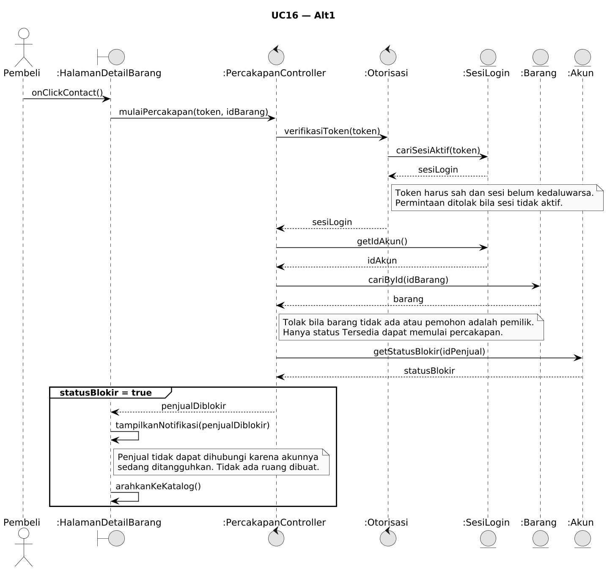
</p>
<p align="center">
<i>Gambar 3.57. Sequence Diagram UC16 — Skenario Alternatif 1</i>
</p>

- **Skenario Alternatif 2: Ruang Percakapan untuk Listing Tersebut Sudah Ada**

Skenario ini terjadi apabila ruang percakapan untuk listing tersebut sudah pernah dibuat. PercakapanController tidak membuat ruang baru, melainkan membuka ruang yang ada, mengambil riwayat pesannya, mendekripsi melalui Kriptografi, lalu HalamanPercakapan menampilkan riwayat secara berurutan dan menggulir ke pesan terakhir.

<p align="center">

</p>
<p align="center">
<i>Gambar 3.58. Sequence Diagram UC16 - Skenario Alternatif 2</i>
</p>

- **Skenario Alternatif 3: Percobaan Akses Ruang Percakapan oleh Pihak Ketiga**

Skenario ini terjadi apabila akun yang bukan peserta, termasuk admin, mencoba membuka ruang percakapan melalui tautan langsung. PercakapanController mendapati pemohon tidak termasuk peserta sah, menolak permintaan tanpa mengirim isi pesan apa pun, dan HalamanPercakapan menampilkan penolakan akses (KF35).

<p align="center">

</p>
<p align="center">
<i>Gambar 3.59. Sequence Diagram UC16 - Skenario Alternatif 3</i>
</p>

### 3.16.3 Diagram Kelas

HalamanDetailBarang berasosiasi dengan HalamanPercakapan dan PercakapanController. HalamanPercakapan berasosiasi dengan PercakapanController. PercakapanController bergantung pada Akun, Penjual, SesiLogin, Barang, Percakapan, Pesan, Otorisasi, dan Kriptografi. Otorisasi bergantung pada SesiLogin. Pembeli dan Penjual merupakan turunan (generalisasi) dari Akun. Relasi antar-*entity* pada diagram ini adalah Akun ke SesiLogin berupa asosiasi 1 ke 0..*, Penjual ke Barang berupa komposisi 1 ke 0..*, Pembeli ke Percakapan berupa asosiasi 1 ke 0..*, Penjual ke Percakapan berupa asosiasi 1 ke 0..*, Barang ke Percakapan berupa asosiasi 1 ke 0..*, Percakapan ke Pesan berupa komposisi 1 ke 0..*, dan Akun ke Pesan berupa asosiasi 1 ke 0..*. Setiap kelas menampilkan atribut bertipe data dan operasi yang dipakai pada UC16, sehingga seluruh operasi yang dipanggil pada *sequence diagram* subbab sebelumnya tercantum pada kelas yang bersangkutan.

<p align="center">
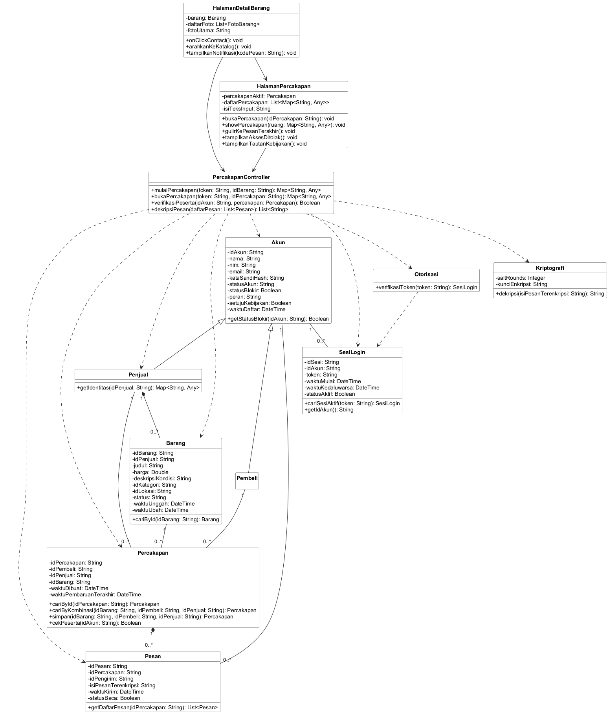
</p>
<p align="center">
<i>Gambar 3.60. Diagram Kelas UC16</i>
</p>

---

## 3.17 Use Case Mengirim Pesan dalam Percakapan

**ID Use Case:** UC17  
**Nama Use Case:** Mengirim Pesan dalam Percakapan

### 3.17.1 Identifikasi Kelas

Realisasi use case pengiriman pesan melibatkan antarmuka ruang percakapan untuk menangkap teks dan merender pesan, antarmuka panel notifikasi untuk menampilkan penanda pesan belum dibaca, controller percakapan untuk memverifikasi peserta, mengenkripsi, dan menyimpan pesan, controller notifikasi untuk memicu notifikasi bagi penerima, modul otorisasi dan kriptografi sebagai kelas pendukung, entitas Percakapan, Pesan, dan Notifikasi, serta adapter push notifikasi sebagai integrasi eksternal.

Tabel 3.17. Identifikasi Kelas Use Case UC17

| No | Nama Kelas Perancangan | Nama Kelas Analisis Terkait |
| :--- | :--- | :--- |
| 1 | HalamanPercakapan | C08 HalamanPercakapan |
| 2 | PanelNotifikasi | C09 PanelNotifikasi |
| 3 | PercakapanController | C18 PercakapanController |
| 4 | NotifikasiController | C19 NotifikasiController |
| 5 | Akun | C23 Akun |
| 6 | SesiLogin | C28 SesiLogin |
| 7 | Percakapan | C33 Percakapan |
| 8 | Pesan | C34 Pesan |
| 9 | Notifikasi | C35 Notifikasi |
| 10 | Otorisasi | C41 Otorisasi (Pendukung) |
| 11 | Kriptografi | C42 Kriptografi (Pendukung) |
| 12 | PushNotifikasiAdapter | C44 PushNotifikasiAdapter (Integrasi) |

### 3.17.2 Sequence Diagram

- **Skenario Normal**

Pengguna mengetik pesan pada ruang percakapan lalu menekan tombol "Kirim". HalamanPercakapan meneruskan permintaan ke PercakapanController. Controller memverifikasi token melalui Otorisasi dan SesiLogin, memastikan pengirim adalah peserta Percakapan, mengenkripsi isi pesan melalui Kriptografi, lalu menyimpan entitas Pesan dan memperbarui waktu percakapan. Pesan yang tersimpan ditayangkan kepada kedua pihak secara berurutan beserta waktu kirim. PercakapanController kemudian meminta NotifikasiController membuat Notifikasi bagi penerima dan mengirimkannya melalui PushNotifikasiAdapter, sehingga penanda pesan belum dibaca pada PanelNotifikasi penerima bertambah.

<p align="center">
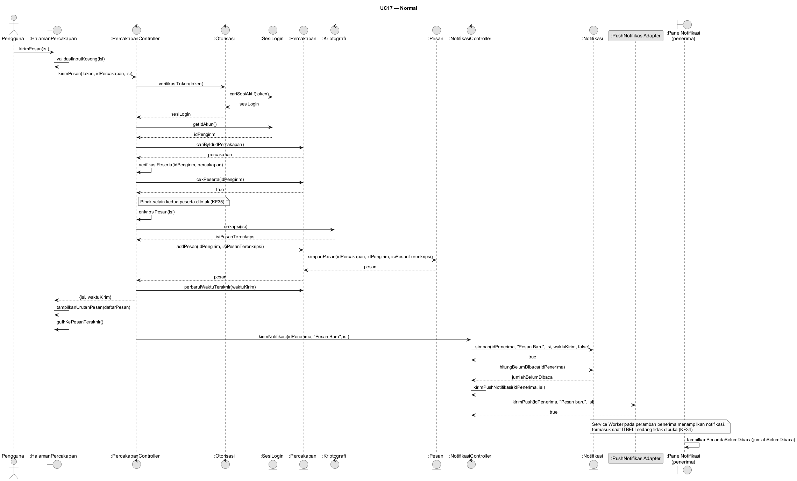
</p>
<p align="center">
<i>Gambar 3.61. Sequence Diagram UC17 - Skenario Normal</i>
</p>

- **Skenario Alternatif 1: Percobaan Pengiriman Pesan Kosong**

Skenario ini terjadi apabila pengguna tidak mengetik teks apa pun atau hanya mengetik spasi. HalamanPercakapan mendeteksi bahwa input kosong setelah pemangkasan spasi, menonaktifkan tombol "Kirim" atau mengabaikan aksi kirim, dan tidak mengirim permintaan apa pun ke server.

<p align="center">
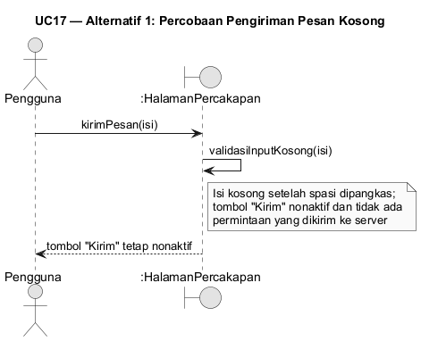
</p>
<p align="center">
<i>Gambar 3.62. Sequence Diagram UC17 - Skenario Alternatif 1: Percobaan Pengiriman Pesan Kosong</i>
</p>

### 3.17.3 Diagram Kelas

HalamanPercakapan berasosiasi dengan PercakapanController. PanelNotifikasi berasosiasi dengan NotifikasiController. PercakapanController bergantung pada SesiLogin, Percakapan, Pesan, Otorisasi, Kriptografi, dan NotifikasiController. NotifikasiController bergantung pada Notifikasi dan PushNotifikasiAdapter. Otorisasi bergantung pada SesiLogin. Relasi antar-*entity* pada diagram ini adalah Akun ke SesiLogin berupa asosiasi 1 ke 0..*, Akun ke Notifikasi berupa asosiasi 1 ke 0..*, Percakapan ke Pesan berupa komposisi 1 ke 0..*, dan Akun ke Pesan berupa asosiasi 1 ke 0..*. Setiap kelas menampilkan atribut bertipe data dan operasi yang dipakai pada UC17, sehingga seluruh operasi yang dipanggil pada *sequence diagram* subbab sebelumnya tercantum pada kelas yang bersangkutan.

<p align="center">
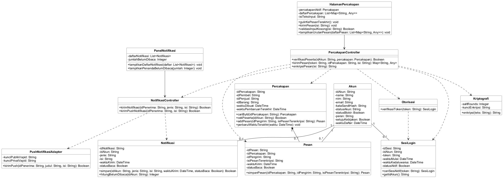
</p>
<p align="center">
<i>Gambar 3.63. Diagram Kelas Use Case UC17</i>
</p>

---

## 3.18 Use Case Melihat Daftar Percakapan

**ID Use Case:** UC18  
**Nama Use Case:** Melihat Daftar Percakapan

### 3.18.1 Identifikasi Kelas

Realisasi use case ini melibatkan antarmuka percakapan untuk menyajikan daftar, controller percakapan untuk mengambil percakapan milik pengguna beserta cuplikan pesan terakhir dan jumlah pesan belum dibaca, modul otorisasi dan kriptografi sebagai kelas pendukung, serta entitas SesiLogin, Percakapan, dan Pesan.

Tabel 3.18. Identifikasi Kelas Use Case UC18

| No | Nama Kelas Perancangan | Nama Kelas Analisis Terkait |
| :--- | :--- | :--- |
| 1 | HalamanPercakapan | C08 HalamanPercakapan |
| 2 | PercakapanController | C18 PercakapanController |
| 3 | SesiLogin | C28 SesiLogin |
| 4 | Percakapan | C33 Percakapan |
| 5 | Pesan | C34 Pesan |
| 6 | Otorisasi | C41 Otorisasi (Pendukung) |
| 7 | Kriptografi | C42 Kriptografi (Pendukung) |

### 3.18.2 Sequence Diagram

- **Skenario Normal**

Pengguna membuka halaman "Daftar Percakapan" dari menu navigasi. PercakapanController memverifikasi token melalui Otorisasi dan SesiLogin, mengambil seluruh Percakapan yang melibatkan pengguna, mengambil Pesan terakhir tiap percakapan, mendekripsinya melalui Kriptografi, menghitung pesan belum dibaca, lalu mengembalikan daftar yang diurutkan dari yang terbaru. HalamanPercakapan merender daftar tersebut.

<p align="center">
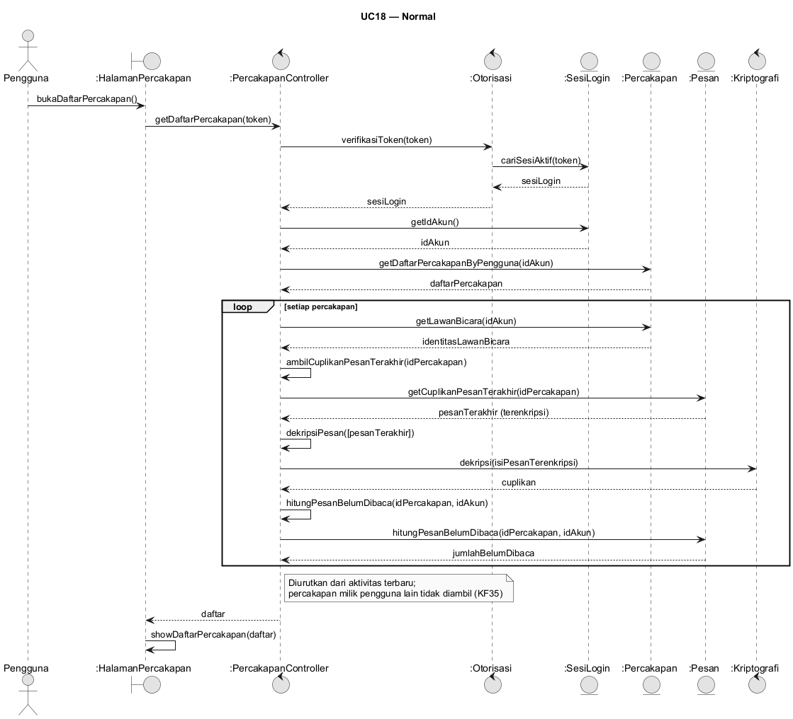
</p>
<p align="center">
<i>Gambar 3.64. Sequence Diagram UC18 - Skenario Normal</i>
</p>

### 3.18.3 Diagram Kelas

HalamanPercakapan berasosiasi dengan PercakapanController. PercakapanController bergantung pada SesiLogin, Percakapan, Pesan, Otorisasi, dan Kriptografi. Otorisasi bergantung pada SesiLogin. Relasi antar-*entity* pada diagram ini adalah Percakapan ke Pesan berupa komposisi 1 ke 0..*. Setiap kelas menampilkan atribut bertipe data dan operasi yang dipakai pada UC18, sehingga seluruh operasi yang dipanggil pada *sequence diagram* subbab sebelumnya tercantum pada kelas yang bersangkutan.

<p align="center">
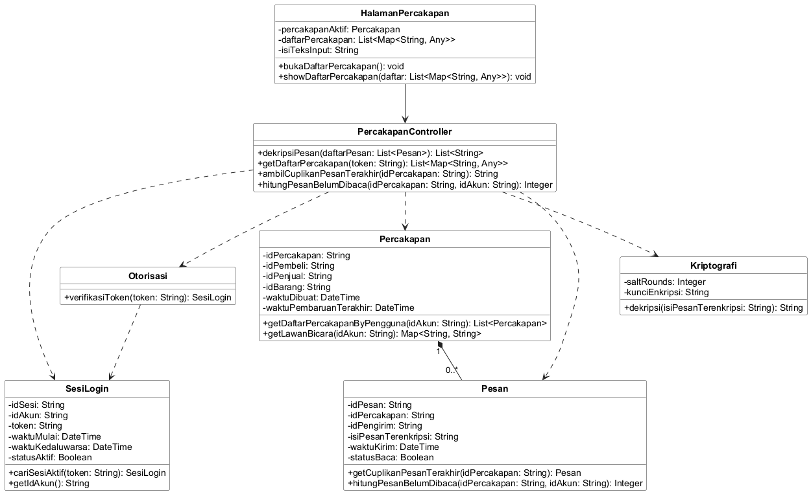
</p>
<p align="center">
<i>Gambar 3.65. Diagram Kelas Use Case UC18</i>
</p>

---

## 3.19 Use Case Mengirimkan Laporan

**ID Use Case:** UC19  
**Nama Use Case:** Mengirimkan Laporan

### 3.19.1 Identifikasi Kelas

Realisasi use case pelaporan melibatkan antarmuka detail barang sebagai salah satu titik masuk, antarmuka formulir laporan untuk menangkap kategori, alasan, dan bukti, controller laporan untuk validasi, penyusunan metadata percakapan tanpa isi pesan, penyimpanan, dan pencatatan log audit, modul otorisasi untuk identifikasi pelapor, entitas Laporan, BuktiLaporan, dan LogAudit, serta layanan penyimpanan berkas untuk bukti tangkapan layar.

Tabel 3.19. Identifikasi Kelas Use Case UC19

| No | Nama Kelas Perancangan | Nama Kelas Analisis Terkait |
| :--- | :--- | :--- |
| 1 | HalamanDetailBarang | C07 HalamanDetailBarang |
| 2 | FormulirLaporan | C10 FormulirLaporan |
| 3 | LaporanController | C20 LaporanController |
| 4 | Akun | C23 Akun |
| 5 | SesiLogin | C28 SesiLogin |
| 6 | Barang | C29 Barang |
| 7 | Percakapan | C33 Percakapan |
| 8 | Laporan | C36 Laporan |
| 9 | BuktiLaporan | C37 BuktiLaporan |
| 10 | LogAudit | C38 LogAudit |
| 11 | Otorisasi | C41 Otorisasi (Pendukung) |
| 12 | PenyimpananBerkas | C45 PenyimpananBerkas (Penyimpanan Data) |

### 3.19.2 Sequence Diagram

- **Skenario Normal**

Pengguna menekan "Laporkan" dari halaman detail listing, profil pengguna, ruang percakapan, atau menu bantuan, lalu FormulirLaporan ditampilkan sesuai konteks. Pengguna memilih kategori, mengisi alasan, melampirkan bukti, dan menekan "Kirim Laporan". LaporanController memverifikasi sesi melalui Otorisasi dan SesiLogin, memvalidasi kelengkapan data dan bukti, dan apabila laporan berasal dari percakapan, hanya menyusun ID percakapan, waktu pelaporan, dan identitas pelapor tanpa isi pesan. Laporan disimpan dengan status "Baru", bukti diunggah ke PenyimpananBerkas dan dicatat sebagai BuktiLaporan, penerimaan dicatat ke LogAudit, dan notifikasi "Laporan berhasil dikirim" ditampilkan.

<p align="center">
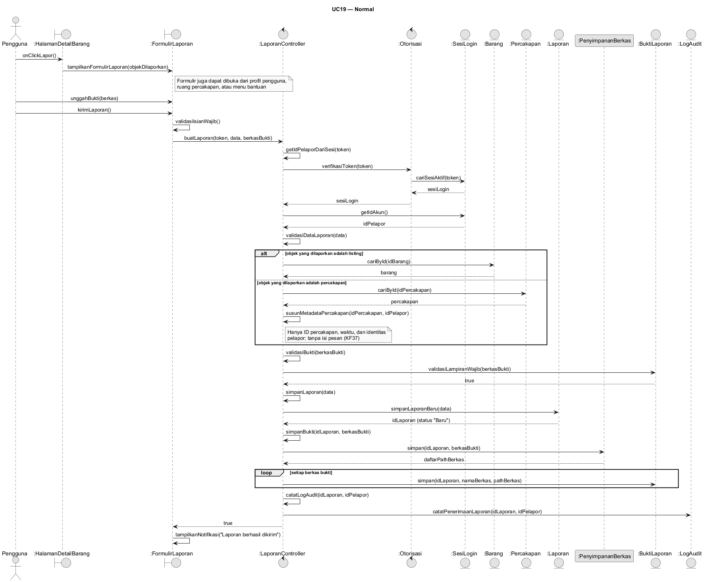
</p>
<p align="center">
<i>Gambar 3.66. Sequence Diagram UC19 - Skenario Normal</i>
</p>

- **Skenario Alternatif 1: Kolom Bukti atau Alasan Dikosongkan**

Skenario ini terjadi apabila pengguna mengosongkan kolom alasan atau tidak melampirkan tangkapan layar. FormulirLaporan mendeteksi kegagalan validasi wajib-isi, membatalkan pengiriman ke server, memberi penanda merah pada kolom terkait, dan menampilkan galat "Alasan dan bukti tangkapan layar wajib diisi".

<p align="center">
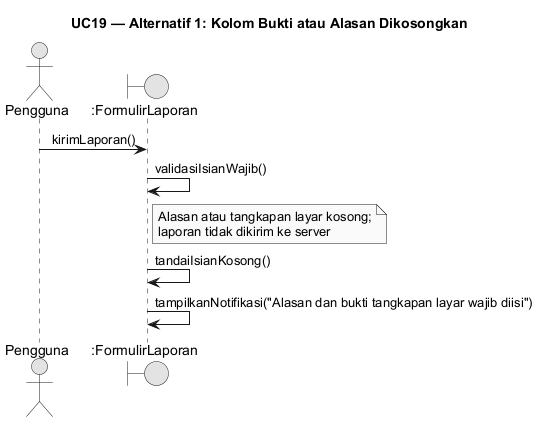
</p>
<p align="center">
<i>Gambar 3.67. Sequence Diagram UC19 - Skenario Alternatif 1: Kolom Bukti atau Alasan Dikosongkan</i>
</p>

### 3.19.3 Diagram Kelas

HalamanDetailBarang berasosiasi dengan FormulirLaporan. FormulirLaporan berasosiasi dengan LaporanController. LaporanController bergantung pada SesiLogin, Barang, Percakapan, Laporan, BuktiLaporan, LogAudit, Otorisasi, dan PenyimpananBerkas. Otorisasi bergantung pada SesiLogin. Relasi antar-*entity* pada diagram ini adalah Akun ke SesiLogin berupa asosiasi 1 ke 0..*, Barang ke Percakapan berupa asosiasi 1 ke 0..*, Akun ke Laporan berupa asosiasi 1 ke 0..*, Laporan ke BuktiLaporan berupa komposisi 1 ke 1..*, Laporan ke Barang berupa asosiasi 0..* ke 0..1, Laporan ke Percakapan berupa asosiasi 0..* ke 0..1, dan Laporan ke LogAudit berupa asosiasi 1 ke 0..*. Setiap kelas menampilkan atribut bertipe data dan operasi yang dipakai pada UC19, sehingga seluruh operasi yang dipanggil pada *sequence diagram* subbab sebelumnya tercantum pada kelas yang bersangkutan.

<p align="center">

</p>
<p align="center">
<i>Gambar 3.68. Diagram Kelas Use Case UC19</i>
</p>

---

## 3.20 Use Case Melihat dan Menyaring Daftar Laporan

**ID Use Case:** UC20  
**Nama Use Case:** Melihat dan Menyaring Daftar Laporan

### 3.20.1 Identifikasi Kelas

Realisasi use case ini melibatkan antarmuka dasbor admin untuk menampilkan tabel dan filter laporan, controller moderasi untuk memeriksa hak akses admin dan mengambil serta menyaring data laporan, modul otorisasi untuk pemeriksaan token dan peran, serta entitas Admin, SesiLogin, dan Laporan.

Tabel 3.20. Identifikasi Kelas Use Case UC20

| No | Nama Kelas Perancangan | Nama Kelas Analisis Terkait |
| :--- | :--- | :--- |
| 1 | DasborAdmin | C11 DasborAdmin |
| 2 | ModerasiController | C21 ModerasiController |
| 3 | Admin | C26 Admin |
| 4 | SesiLogin | C28 SesiLogin |
| 5 | Laporan | C36 Laporan |
| 6 | Otorisasi | C41 Otorisasi (Pendukung) |

### 3.20.2 Sequence Diagram

- **Skenario Normal**

Admin membuka halaman daftar laporan pada dasbor admin. ModerasiController memeriksa token dan peran melalui Otorisasi dan SesiLogin, memastikan akun adalah Admin, lalu mengambil seluruh Laporan dan menampilkannya pada DasborAdmin. Ketika admin memilih status pada filter (misalnya "Baru"), ModerasiController menyaring laporan menurut status tersebut dan tabel diperbarui.

<p align="center">

</p>
<p align="center">
<i>Gambar 3.69. Sequence Diagram UC20 - Skenario Normal</i>
</p>

- **Skenario Alternatif 1: Akses oleh Akun Bukan Admin**

Skenario ini terjadi apabila pengguna biasa membuka URL daftar laporan secara langsung. Otorisasi memeriksa peran dari token sesi dan mendeteksi bahwa akun bukan admin. ModerasiController menolak permintaan, lalu pengguna dialihkan ke beranda utama disertai peringatan "Akses Ditolak".

<p align="center">

</p>
<p align="center">
<i>Gambar 3.70. Sequence Diagram UC20 - Skenario Alternatif 1: Akses oleh Akun Bukan Admin</i>
</p>

### 3.20.3 Diagram Kelas

DasborAdmin berasosiasi dengan ModerasiController. ModerasiController bergantung pada Otorisasi, SesiLogin, dan Laporan. Otorisasi bergantung pada SesiLogin dan Admin. Setiap kelas menampilkan atribut bertipe data dan operasi yang dipakai pada UC20, sehingga seluruh operasi yang dipanggil pada *sequence diagram* subbab sebelumnya tercantum pada kelas yang bersangkutan.

<p align="center">

</p>
<p align="center">
<i>Gambar 3.71. Diagram Kelas Use Case UC20</i>
</p>

---

## 3.21 Use Case Mengubah Status Penanganan Laporan

**ID Use Case:** UC21  
**Nama Use Case:** Mengubah Status Penanganan Laporan

### 3.21.1 Identifikasi Kelas

Realisasi use case ini melibatkan antarmuka dasbor admin untuk meninjau detail dan memilih status baru, controller moderasi untuk memvalidasi dan memperbarui status, modul otorisasi untuk verifikasi admin, entitas Laporan yang statusnya diperbarui, serta LogAudit untuk pencatatan permanen tindak lanjut.

Tabel 3.21. Identifikasi Kelas Use Case UC21

| No | Nama Kelas Perancangan | Nama Kelas Analisis Terkait |
| :--- | :--- | :--- |
| 1 | DasborAdmin | C11 DasborAdmin |
| 2 | ModerasiController | C21 ModerasiController |
| 3 | Admin | C26 Admin |
| 4 | SesiLogin | C28 SesiLogin |
| 5 | Laporan | C36 Laporan |
| 6 | LogAudit | C38 LogAudit |
| 7 | Otorisasi | C41 Otorisasi (Pendukung) |

### 3.21.2 Sequence Diagram

- **Skenario Normal**

Admin membuka detail laporan, meninjau isinya, memilih status baru pada dropdown, dan menyimpan. ModerasiController memverifikasi peran admin melalui Otorisasi, memvalidasi status baru, lalu memperbarui statusPenanganan dan waktu perubahan pada Laporan. Setelah itu controller mencatat tindak lanjut ke LogAudit yang bersifat hanya-tambah. DasborAdmin menampilkan status terbaru.

<p align="center">

</p>
<p align="center">
<i>Gambar 3.72. Sequence Diagram UC21 - Skenario Normal</i>
</p>

### 3.21.3 Diagram Kelas

DasborAdmin berasosiasi dengan ModerasiController. ModerasiController bergantung pada Otorisasi, SesiLogin, Laporan, dan LogAudit. Otorisasi bergantung pada SesiLogin dan Admin. Relasi antar-*entity* pada diagram ini adalah Laporan ke LogAudit berupa asosiasi 1 ke 0..*. Setiap kelas menampilkan atribut bertipe data dan operasi yang dipakai pada UC21, sehingga seluruh operasi yang dipanggil pada *sequence diagram* subbab sebelumnya tercantum pada kelas yang bersangkutan.

<p align="center">

</p>
<p align="center">
<i>Gambar 3.73. Diagram Kelas Use Case UC21</i>
</p>

---

## 3.22 Use Case Menghapus Listing yang Dilaporkan

**ID Use Case:** UC22  
**Nama Use Case:** Menghapus Listing yang Dilaporkan

### 3.22.1 Identifikasi Kelas

Realisasi use case ini melibatkan antarmuka dasbor admin untuk menangkap alasan dan konfirmasi, controller moderasi untuk mengeksekusi penghapusan dan mengorkestrasi notifikasi serta pencatatan, controller notifikasi dan surel adapter untuk memberi tahu pemilik listing, modul otorisasi, serta entitas Barang, Notifikasi, LogAudit, dan LogAdmin.

Tabel 3.22. Identifikasi Kelas Use Case UC22

| No | Nama Kelas Perancangan | Nama Kelas Analisis Terkait |
| :--- | :--- | :--- |
| 1 | DasborAdmin | C11 DasborAdmin |
| 2 | ModerasiController | C21 ModerasiController |
| 3 | NotifikasiController | C19 NotifikasiController |
| 4 | Admin | C26 Admin |
| 5 | SesiLogin | C28 SesiLogin |
| 6 | Barang | C29 Barang |
| 7 | Notifikasi | C35 Notifikasi |
| 8 | LogAudit | C38 LogAudit |
| 9 | LogAdmin | C39 LogAdmin |
| 10 | Otorisasi | C41 Otorisasi (Pendukung) |
| 11 | SurelAdapter | C43 SurelAdapter (Integrasi) |
| 12 | PenyimpananBerkas | C45 PenyimpananBerkas (Penyimpanan Data) |
| 13 | Akun | C23 Akun |
| 14 | FotoBarang | C30 FotoBarang |

### 3.22.2 Sequence Diagram

- **Skenario Normal**

Dari halaman detail laporan, admin menekan "Hapus Listing", mengisi alasan pada dialog, lalu mengonfirmasi. ModerasiController memverifikasi peran admin melalui Otorisasi dan SesiLogin, lalu menghapus Barang beserta berkas fotonya dari PenyimpananBerkas. Controller meminta NotifikasiController membuat Notifikasi bagi pemilik dan mengirim surel melalui SurelAdapter, dengan isi yang mencantumkan alasan dari admin. Terakhir, tindakan dicatat ke LogAdmin dan LogAudit.

<p align="center">

</p>
<p align="center">
<i>Gambar 3.74. Sequence Diagram UC22 - Skenario Normal</i>
</p>

### 3.22.3 Diagram Kelas

DasborAdmin berasosiasi dengan ModerasiController. NotifikasiController bergantung pada Notifikasi dan SurelAdapter. ModerasiController bergantung pada Otorisasi, SesiLogin, LogAudit, LogAdmin, Barang, FotoBarang, Akun, NotifikasiController, dan PenyimpananBerkas. Otorisasi bergantung pada SesiLogin dan Admin. Admin merupakan turunan (generalisasi) dari Akun. Relasi antar-*entity* pada diagram ini adalah Akun ke SesiLogin berupa asosiasi 1 ke 0..*, Akun ke Notifikasi berupa asosiasi 1 ke 0..*, Barang ke FotoBarang berupa komposisi 1 ke 1..5, dan Admin ke LogAdmin berupa asosiasi 1 ke 0..*. Setiap kelas menampilkan atribut bertipe data dan operasi yang dipakai pada UC22, sehingga seluruh operasi yang dipanggil pada *sequence diagram* subbab sebelumnya tercantum pada kelas yang bersangkutan.

<p align="center">

</p>
<p align="center">
<i>Gambar 3.75. Diagram Kelas Use Case UC22</i>
</p>

---

## 3.23 Use Case Memblokir Akun Pengguna

**ID Use Case:** UC23  
**Nama Use Case:** Memblokir Akun Pengguna

### 3.23.1 Identifikasi Kelas

Realisasi use case ini melibatkan antarmuka dasbor admin untuk menangkap alasan dan konfirmasi pemblokiran, controller moderasi untuk mengubah status akun, menonaktifkan listing milik akun tersebut, dan memutus sesi aktif, controller notifikasi dan surel adapter untuk pemberitahuan penangguhan, modul otorisasi, serta entitas Akun, SesiLogin, Barang, Notifikasi, LogAudit, dan LogAdmin.

Tabel 3.23. Identifikasi Kelas Use Case UC23

| No | Nama Kelas Perancangan | Nama Kelas Analisis Terkait |
| :--- | :--- | :--- |
| 1 | DasborAdmin | C11 DasborAdmin |
| 2 | ModerasiController | C21 ModerasiController |
| 3 | NotifikasiController | C19 NotifikasiController |
| 4 | Akun | C23 Akun |
| 5 | Admin | C26 Admin |
| 6 | SesiLogin | C28 SesiLogin |
| 7 | Barang | C29 Barang |
| 8 | Notifikasi | C35 Notifikasi |
| 9 | LogAudit | C38 LogAudit |
| 10 | LogAdmin | C39 LogAdmin |
| 11 | Otorisasi | C41 Otorisasi (Pendukung) |
| 12 | SurelAdapter | C43 SurelAdapter (Integrasi) |
| 13 | Penjual | C25 Penjual |

### 3.23.2 Sequence Diagram

- **Skenario Normal**

Admin menekan "Blokir Akun" dari detail laporan atau profil pengguna, mengisi alasan, lalu mengonfirmasi. ModerasiController memverifikasi peran admin, mengubah status Akun menjadi "Diblokir", menonaktifkan seluruh Barang milik akun tersebut agar hilang dari katalog dan pencarian, dan menonaktifkan SesiLogin aktif akun tersebut. Controller meminta NotifikasiController mengirim pemberitahuan beserta alasan melalui SurelAdapter dan menyimpannya sebagai Notifikasi. Tindakan dicatat ke LogAdmin dan LogAudit. Pada percobaan login berikutnya, AkunController menolak login akun yang berstatus "Diblokir" dengan pesan penangguhan.

<p align="center">

</p>
<p align="center">
<i>Gambar 3.76. Sequence Diagram UC23 - Skenario Normal</i>
</p>

### 3.23.3 Diagram Kelas

DasborAdmin berasosiasi dengan ModerasiController. NotifikasiController bergantung pada Notifikasi dan SurelAdapter. ModerasiController bergantung pada Otorisasi, SesiLogin, LogAudit, LogAdmin, Barang, Akun, dan NotifikasiController. Otorisasi bergantung pada SesiLogin dan Admin. Penjual dan Admin merupakan turunan (generalisasi) dari Akun. Relasi antar-*entity* pada diagram ini adalah Akun ke SesiLogin berupa asosiasi 1 ke 0..*, Akun ke Notifikasi berupa asosiasi 1 ke 0..*, Penjual ke Barang berupa komposisi 1 ke 0..*, dan Admin ke LogAdmin berupa asosiasi 1 ke 0..*. Setiap kelas menampilkan atribut bertipe data dan operasi yang dipakai pada UC23, sehingga seluruh operasi yang dipanggil pada *sequence diagram* subbab sebelumnya tercantum pada kelas yang bersangkutan.

<p align="center">

</p>
<p align="center">
<i>Gambar 3.77. Diagram Kelas Use Case UC23</i>
</p>

---

## 3.24 Use Case Membuka Blokir Akun Pengguna

**ID Use Case:** UC24  
**Nama Use Case:** Membuka Blokir Akun Pengguna

### 3.24.1 Identifikasi Kelas

Realisasi use case ini melibatkan antarmuka dasbor admin untuk memicu pembukaan blokir, controller moderasi untuk memulihkan status akun dan visibilitas listing, modul otorisasi, serta entitas Akun, Barang, dan LogAdmin.

Tabel 3.24. Identifikasi Kelas Use Case UC24

| No | Nama Kelas Perancangan | Nama Kelas Analisis Terkait |
| :--- | :--- | :--- |
| 1 | DasborAdmin | C11 DasborAdmin |
| 2 | ModerasiController | C21 ModerasiController |
| 3 | Akun | C23 Akun |
| 4 | Admin | C26 Admin |
| 5 | Barang | C29 Barang |
| 6 | LogAdmin | C39 LogAdmin |
| 7 | Otorisasi | C41 Otorisasi (Pendukung) |
| 8 | SesiLogin | C28 SesiLogin |
| 9 | Penjual | C25 Penjual |

### 3.24.2 Sequence Diagram

- **Skenario Normal**

Admin menekan "Buka Blokir" pada akun yang sedang diblokir. ModerasiController memverifikasi peran admin melalui Otorisasi, mengubah status Akun menjadi aktif, memulihkan seluruh Barang milik akun tersebut ke katalog publik, lalu mencatat tindakan ke LogAdmin. DasborAdmin menampilkan status akun terbaru.

<p align="center">

</p>
<p align="center">
<i>Gambar 3.78. Sequence Diagram UC24 - Skenario Normal</i>
</p>

### 3.24.3 Diagram Kelas

DasborAdmin berasosiasi dengan ModerasiController. ModerasiController bergantung pada Otorisasi, SesiLogin, LogAdmin, Barang, dan Akun. Otorisasi bergantung pada SesiLogin dan Admin. Penjual dan Admin merupakan turunan (generalisasi) dari Akun. Relasi antar-*entity* pada diagram ini adalah Akun ke SesiLogin berupa asosiasi 1 ke 0..*, Penjual ke Barang berupa komposisi 1 ke 0..*, dan Admin ke LogAdmin berupa asosiasi 1 ke 0..*. Setiap kelas menampilkan atribut bertipe data dan operasi yang dipakai pada UC24, sehingga seluruh operasi yang dipanggil pada *sequence diagram* subbab sebelumnya tercantum pada kelas yang bersangkutan.

<p align="center">

</p>
<p align="center">
<i>Gambar 3.79. Diagram Kelas Use Case UC24</i>
</p>

<br>

---

# BAB 4: Diagram Kelas Keseluruhan

## 4.1 Diagram Kelas

Diagram kelas perancangan keseluruhan merupakan gabungan dari seluruh diagram kelas per use case pada BAB 3. Setiap kelas hanya digambarkan satu kali, dan atribut serta metodenya merupakan gabungan dari seluruh kemunculannya pada BAB 3. Sebaliknya, setiap atribut dan metode pada diagram kelas per use case selalu tercantum pada Tabel 4.1 dengan penulisan yang sama, karena kedua bagian disusun dari satu model kelas yang sama. Agar tetap terbaca, kotak kelas pada Gambar 4.1 hanya memuat ID dan nama kelas, sedangkan atribut dan metode lengkap setiap kelas disajikan pada Tabel 4.1.

Gambar 4.1 disusun dalam empat kolom sesuai *pattern* MVC pada subbab 2.2:

- **View (C01–C12)**: kelas antarmuka yang berasosiasi searah dengan kelas *Controller*. KatalogView, ProfilView, dan HalamanListingPenjual memiliki relasi komposisi terhadap KartuProduk.
- **Controller (C13–C22)**: kelas pengendali yang bergantung pada kelas *Model*, kelas *Pendukung*, kelas *Integrasi Eksternal*, PenyimpananBerkas, dan pada NotifikasiController bila perlu mengirim pemberitahuan.
- **Pendukung, Integrasi Eksternal, dan Penyimpanan Data (C41–C45)**: kelas baru pada tahap perancangan, yaitu C41 Otorisasi, C42 Kriptografi, C43 SurelAdapter, C44 PushNotifikasiAdapter, dan C45 PenyimpananBerkas. Otorisasi bergantung pada SesiLogin dan Admin untuk memeriksa sesi dan peran.
- **Model (C23–C40)**: kelas data yang saling berelasi melalui asosiasi bermultiplisitas, komposisi, dan generalisasi.

Secara keseluruhan, diagram memuat **45 kelas** dengan **15 asosiasi berarah** dari *View*, **7 komposisi**, **3 generalisasi**, **15 asosiasi antar-*Model***, dan **55 dependensi**, tanpa kelas yang terduplikasi.

<p align="center">

</p>
<p align="center">
<i>Gambar 4.1. Diagram Kelas Perancangan Keseluruhan ITBELI</i>
</p>

Kelas perancangan pada Tabel 4.1 mengikuti ketentuan berikut.

1. **Visibilitas.** Atribut bersifat *private* (`-`) dan hanya diakses melalui operasi, sedangkan operasi bersifat *public* (`+`).
2. **Tipe data.** Tipe yang dipakai adalah `String`, `Integer`, `Long`, `Double`, `Boolean`, `Date`, `DateTime`, `File`, `List<T>`, `Map<K, V>`, dan `Any`, serta nama kelas lain bila nilai yang dikembalikan berupa objek kelas tersebut (misalnya `SesiLogin`).
3. **Satu nama, satu tanda tangan.** Implementasi ITBELI memakai JavaScript yang tidak mendukung *overloading*, sehingga setiap nama operasi pada satu kelas hanya memiliki satu daftar parameter dan satu tipe kembalian.
4. **Kelas peran.** C24 Pembeli, C25 Penjual, dan C26 Admin mewarisi seluruh atribut C23 Akun dan hanya menambahkan operasi yang khusus untuk perannya.

Dibandingkan dengan diagram kelas analisis pada subbab 5.3 dokumen SKPL, diagram kelas perancangan memuat penyempurnaan berikut.

1. **Kelas baru C41–C45.** Komponen *Pendukung*, *Integrasi Eksternal*, dan PenyimpananBerkas pada Tabel 2.3 diwujudkan sebagai kelas tersendiri.
2. **Pemeriksaan sesi terpusat.** Setiap *Controller* yang memerlukan *login* memanggil Otorisasi untuk memeriksa token sesi, lalu mengambil identitas akun dari SesiLogin. ModerasiController memakai `verifikasiAdmin()` yang sekaligus memeriksa peran admin (KF56).
3. **Orkestrasi pencarian dan penyaringan.** HalamanKatalog hanya berasosiasi dengan KatalogController, sedangkan KatalogController memanggil PencarianController dan FilterController. Dengan demikian, halaman katalog cukup mengirim satu permintaan untuk kata kunci, filter, pengurutan, dan halaman sekaligus.
4. **Alur pelaporan.** HalamanDetailBarang membuka FormulirLaporan, lalu FormulirLaporan meneruskan laporan ke LaporanController.
5. **Penyeragaman operasi.** Operasi yang sama tetapi bernama berbeda antar-use case disatukan, misalnya `Barang.getByPemilik()` menjadi `Barang.getListingPenjual()`. Pengelompokan listing per status dipindahkan ke `HalamanListingPenjual.kelompokkanBerdasarkanStatus()` karena merupakan urusan tampilan. Operasi peran pada SKPL yang tidak pernah dipanggil pada *sequence diagram*, seperti `lihatProfil()` dan `buatListing()`, tidak dipertahankan.
6. **Penyaringan akun terblokir.** Barang bergantung pada Akun melalui `getSyaratTidakDiblokir()`, sehingga katalog dan hasil pencarian hanya memuat listing milik akun yang tidak diblokir (KF30, KF54).

Tabel 4.1. Daftar Kelas Perancangan Keseluruhan

| ID Kelas | Nama Kelas | Jenis | Atribut | Metode/Operasi |
| :--- | :--- | :--- | :--- | :--- |
| C01 | HalamanOtentikasi | View | - nama: String<br>- nim: String<br>- email: String<br>- kataSandi: String<br>- setujuKebijakan: Boolean<br>- kodeVerifikasi: String<br>- sisaWaktu: Integer<br>- token: String | + tampilkanFormulirPendaftaran(): void<br>+ tampilkanKebijakanPrivasi(tautan: String): void<br>+ kirimFormulirPendaftaran(nama: String, nim: String, email: String, kataSandi: String, setujuKebijakan: Boolean): void<br>+ arahkanKeHalamanVerifikasi(): void<br>+ tampilkanFormulirVerifikasi(): void<br>+ kirimKodeVerifikasi(email: String, kode: String): void<br>+ mintaKirimUlang(email: String): void<br>+ resetHitungMundur(): void<br>+ tampilkanPesanSukses(pesan: String): void<br>+ tampilkanFormulirLogin(): void<br>+ kirimFormulirLogin(email: String, kataSandi: String): void<br>+ arahkanKeBeranda(): void<br>+ tampilkanPesanGalat(pesan: String): void<br>+ tampilkanTombolKeluar(): void<br>+ kirimPermintaanLogout(token: String): void<br>+ hapusTokenLokal(): void<br>+ arahkanKeHalamanLogin(): void |
| C02 | HalamanProfil | View | - dataAkun: Akun<br>- daftarKartuProduk: List&lt;KartuProduk&gt; | + muatProfil(): void<br>+ tampilkanProfil(data: Akun): void<br>+ tampilkanDaftarListing(daftarBarang: List&lt;Barang&gt;): void<br>+ bukaPengaturanAkun(): void<br>+ tampilkanTautanKebijakan(tautan: String): void |
| C03 | HalamanListingPenjual | View | - daftarTersedia: List&lt;Barang&gt;<br>- daftarTerjual: List&lt;Barang&gt;<br>- tabAktif: String<br>- idBarangTerpilih: String | + muatDaftarListing(): void<br>+ tampilkanDaftarListing(daftarListing: List&lt;Barang&gt;): void<br>+ kelompokkanBerdasarkanStatus(daftarListing: List&lt;Barang&gt;): void<br>+ pilihTab(namaTab: String): void<br>+ onClickUbah(idBarang: String): void<br>+ onClickHapus(idBarang: String): void<br>+ onClickTandaiTerjual(idBarang: String): void<br>+ onClickBatalTerjual(idBarang: String): void<br>+ tampilkanKonfirmasi(barang: Barang, aksi: String): void<br>+ konfirmasiAksi(): void<br>+ batalkanKonfirmasi(): void<br>+ tutupDialog(): void<br>+ tampilkanNotifikasi(kodePesan: String): void |
| C04 | FormulirBarang | View | - judul: String<br>- harga: Double<br>- deskripsiKondisi: String<br>- idKategori: String<br>- idLokasi: String<br>- daftarFoto: List&lt;FotoBarang&gt;<br>- fotoBaru: List&lt;File&gt; | + bukaFormulir(): void<br>+ tampilkanFormulir(barang: Barang, daftarFoto: List&lt;FotoBarang&gt;, daftarKategori: List&lt;Kategori&gt;, daftarLokasi: List&lt;LokasiCOD&gt;): void<br>+ suntingIsian(data: Map&lt;String, Any&gt;): void<br>+ pilihFoto(fotoBaru: List&lt;File&gt;): void<br>+ validasiTipeData(data: Map&lt;String, Any&gt;): Boolean<br>+ validasiFotoSisiKlien(fotoBaru: List&lt;File&gt;, fotoDipertahankan: List&lt;FotoBarang&gt;): Boolean<br>+ validasiIsianWajib(data: Map&lt;String, Any&gt;, galeri: List&lt;Any&gt;): Boolean<br>+ tandaiIsianKosong(): void<br>+ tolakPratinjau(): void<br>+ kirimFormulir(data: Map&lt;String, Any&gt;, fotoBaru: List&lt;File&gt;): void<br>+ onClickUpdate(): void<br>+ arahkanKeDetail(idBarang: String): void<br>+ tampilkanNotifikasi(kodePesan: String): void |
| C05 | HalamanKatalog | View | - listProduk: List&lt;Barang&gt;<br>- halamanAktif: Integer<br>- total: Integer<br>- kataKunci: String<br>- filterAktif: Map&lt;String, Any&gt;<br>- kriteriaUrutan: String | + showKatalog(): void<br>+ inputPencarian(kataKunci: String): void<br>+ pilihFilter(filterAktif: Map&lt;String, Any&gt;): void<br>+ pilihUrutan(kriteriaUrutan: String): void<br>+ validasiRentangHarga(hargaMin: Double, hargaMax: Double): Boolean<br>+ tandaiRentangHarga(): void<br>+ tampilkanFilterAktif(filterAktif: Map&lt;String, Any&gt;): void<br>+ hapusSemuaFilter(): void<br>+ resetHalaman(): void<br>+ tampilkanHasil(hasil: Map&lt;String, Any&gt;): void<br>+ pindahHalaman(halaman: Integer): void<br>+ gulirKeAtas(): void<br>+ tampilkanPagination(total: Integer, halaman: Integer): void<br>+ sembunyikanPagination(): void<br>+ tampilkanPesanKosong(kodePesan: String): void |
| C06 | KartuProduk | View | - idBarang: String<br>- judul: String<br>- harga: Double<br>- fotoUtama: String<br>- status: String<br>- namaKategori: String<br>- namaLokasi: String | + render(barang: Barang): void<br>+ onClickDetail(idBarang: String): void |
| C07 | HalamanDetailBarang | View | - barang: Barang<br>- daftarFoto: List&lt;FotoBarang&gt;<br>- fotoUtama: String | + showBarang(idBarang: String): void<br>+ tampilkanDetail(detail: Map&lt;String, Any&gt;): void<br>+ pilihFoto(indeksFoto: Integer): void<br>+ tampilkanLightbox(indeksFoto: Integer): void<br>+ bukaProfilPenjual(idPenjual: String): void<br>+ tampilkanAksiPemilik(status: String): void<br>+ tampilkanTombolPembeli(): void<br>+ tampilkanArsipTerjual(): void<br>+ tampilkanTidakDitemukan(): void<br>+ onClickContact(): void<br>+ arahkanKeKatalog(): void<br>+ tampilkanNotifikasi(kodePesan: String): void<br>+ onClickLapor(): void |
| C08 | HalamanPercakapan | View | - percakapanAktif: Percakapan<br>- daftarPercakapan: List&lt;Map&lt;String, Any&gt;&gt;<br>- isiTeksInput: String | + bukaPercakapan(idPercakapan: String): void<br>+ showPercakapan(ruang: Map&lt;String, Any&gt;): void<br>+ gulirKePesanTerakhir(): void<br>+ tampilkanAksesDitolak(): void<br>+ tampilkanTautanKebijakan(): void<br>+ kirimPesan(isi: String): void<br>+ validasiInputKosong(isi: String): Boolean<br>+ tampilkanUrutanPesan(daftarPesan: List&lt;Map&lt;String, Any&gt;&gt;): void<br>+ bukaDaftarPercakapan(): void<br>+ showDaftarPercakapan(daftar: List&lt;Map&lt;String, Any&gt;&gt;): void |
| C09 | PanelNotifikasi | View | - daftarNotifikasi: List&lt;Notifikasi&gt;<br>- jumlahBelumDibaca: Integer | + tampilkanDaftarNotifikasi(daftar: List&lt;Notifikasi&gt;): void<br>+ tampilkanPenandaBelumDibaca(jumlah: Integer): void |
| C10 | FormulirLaporan | View | - jenisPelanggaran: String<br>- teksAlasan: String<br>- objekDilaporkan: String<br>- berkasBukti: List&lt;File&gt; | + tampilkanFormulirLaporan(objekDilaporkan: String): void<br>+ unggahBukti(berkas: List&lt;File&gt;): void<br>+ validasiIsianWajib(): Boolean<br>+ tandaiIsianKosong(): void<br>+ kirimLaporan(): void<br>+ tampilkanNotifikasi(pesan: String): void |
| C11 | DasborAdmin | View | - daftarLaporan: List&lt;Laporan&gt;<br>- filterStatus: String<br>- detailLaporan: Laporan<br>- statusBaru: String<br>- alasanTindakan: String | + bukaDaftarLaporan(): void<br>+ tampilkanDaftarLaporan(daftar: List&lt;Laporan&gt;): void<br>+ filterLaporan(status: String): void<br>+ tampilkanAksesDitolak(): void<br>+ bukaDetailLaporan(idLaporan: String): void<br>+ tampilkanDetailLaporan(laporan: Laporan): void<br>+ onClickUbahStatus(idLaporan: String, statusBaru: String): void<br>+ onClickHapusListing(idBarang: String): void<br>+ onClickBlokirAkun(idAkun: String): void<br>+ onClickBukaBlokir(idAkun: String): void<br>+ tampilkanModalKonfirmasi(aksi: String): void<br>+ konfirmasiTindakan(alasan: String): void<br>+ tampilkanStatusTerbaru(pesan: String): void |
| C12 | HalamanDokumenLegal | View | - judul: String<br>- isiDokumen: String | + bukaDokumen(jenis: String): void<br>+ tampilkanDokumen(judul: String, isi: String): void<br>+ sorotKlausaPrivasi(klausa: String): void |
| C13 | AkunController | Controller | — | + daftarAkun(nama: String, nim: String, email: String, kataSandi: String, setujuKebijakan: Boolean): Boolean<br>+ validasiKelengkapanFormulir(nama: String, nim: String, email: String, kataSandi: String, setujuKebijakan: Boolean): Boolean<br>+ validasiDomainEmail(email: String): Boolean<br>+ cekKeunikanEmail(email: String): Boolean<br>+ hashKataSandi(kataSandi: String): String<br>+ buatKodeVerifikasi(idAkun: String): String<br>+ getTautanDokumenLegal(): String<br>+ verifikasiAkun(email: String, kode: String): Boolean<br>+ validasiKodeVerifikasi(kode: String): Boolean<br>+ cekKedaluwarsaKode(idToken: String): Boolean<br>+ hanguskanKodeLama(idAkun: String): void<br>+ kirimUlangKode(email: String): Boolean<br>+ login(email: String, kataSandi: String): Map&lt;String, Any&gt;<br>+ cariAkunByEmail(email: String): Akun<br>+ verifikasiKataSandi(kataSandi: String, kataSandiHash: String): Boolean<br>+ cekStatusAkun(idAkun: String): String<br>+ buatSesiLogin(idAkun: String): SesiLogin<br>+ logout(token: String): Boolean<br>+ cabutSesi(token: String): void<br>+ getProfil(token: String): Map&lt;String, Any&gt;<br>+ getIdAkunDariSesi(token: String): String<br>+ getDaftarBarangAkun(idAkun: String): List&lt;Barang&gt; |
| C14 | BarangController | Controller | — | + getDataFormulir(): Map&lt;String, Any&gt;<br>+ buatBarang(token: String, data: Map&lt;String, Any&gt;, fotoBaru: List&lt;File&gt;): Boolean<br>+ getIdPenjualDariSesi(token: String): String<br>+ validasiKelengkapanIsian(data: Map&lt;String, Any&gt;, galeri: List&lt;Any&gt;): Boolean<br>+ validasiFoto(fotoBaru: List&lt;File&gt;, fotoDipertahankan: List&lt;FotoBarang&gt;): Boolean<br>+ simpanFoto(idBarang: String, fotoBaru: List&lt;File&gt;): List&lt;String&gt;<br>+ terbitkanKeKatalog(idBarang: String): void<br>+ getListingSaya(token: String): List&lt;Barang&gt;<br>+ getBarang(idBarang: String, token: String, tujuan: String): Map&lt;String, Any&gt;<br>+ updateBarang(token: String, idBarang: String, data: Map&lt;String, Any&gt;, fotoBaru: List&lt;File&gt;, fotoDihapus: List&lt;String&gt;): Boolean<br>+ verifikasiKepemilikan(idAkun: String, idPenjual: String): Boolean<br>+ siapkanPenghapusan(token: String, idBarang: String): Barang<br>+ deleteBarang(token: String, idBarang: String): Boolean<br>+ siapkanPerubahanStatus(token: String, idBarang: String, statusAsal: String): Barang<br>+ ubahStatusBarang(token: String, idBarang: String, statusAsal: String, statusTujuan: String): Boolean |
| C15 | KatalogController | Controller | — | + getProduk(kataKunci: String, filterAktif: Map&lt;String, Any&gt;, kriteriaUrutan: String, halaman: Integer): Map&lt;String, Any&gt;<br>+ paginasi(halaman: Integer, batas: Integer): Integer<br>+ urutkanHasil(kriteriaUrutan: String): String |
| C16 | PencarianController | Controller | — | + normalisasiKataKunci(kataKunci: String): String<br>+ cocokkanKataKunci(kataKunci: String): Map&lt;String, Any&gt; |
| C17 | FilterController | Controller | — | + validasiParameterFilter(filterAktif: Map&lt;String, Any&gt;): Boolean<br>+ filterCategory(idKategori: String): Map&lt;String, Any&gt;<br>+ filterPrice(hargaMin: Double, hargaMax: Double): Map&lt;String, Any&gt;<br>+ filterLocation(idLokasi: String): Map&lt;String, Any&gt; |
| C18 | PercakapanController | Controller | — | + mulaiPercakapan(token: String, idBarang: String): Map&lt;String, Any&gt;<br>+ bukaPercakapan(token: String, idPercakapan: String): Map&lt;String, Any&gt;<br>+ verifikasiPeserta(idAkun: String, percakapan: Percakapan): Boolean<br>+ dekripsiPesan(daftarPesan: List&lt;Pesan&gt;): List&lt;String&gt;<br>+ kirimPesan(token: String, idPercakapan: String, isi: String): Map&lt;String, Any&gt;<br>+ enkripsiPesan(isi: String): String<br>+ getDaftarPercakapan(token: String): List&lt;Map&lt;String, Any&gt;&gt;<br>+ ambilCuplikanPesanTerakhir(idPercakapan: String): String<br>+ hitungPesanBelumDibaca(idPercakapan: String, idAkun: String): Integer |
| C19 | NotifikasiController | Controller | — | + kirimEmailVerifikasi(email: String, kode: String): Boolean<br>+ kirimNotifikasi(idPenerima: String, jenis: String, isi: String): Boolean<br>+ kirimPushNotifikasi(idPenerima: String, isi: String): Boolean<br>+ kirimPeringatanPenghapusan(idPemilik: String, email: String, judulBarang: String, alasan: String): Boolean<br>+ kirimPesanPenangguhan(idAkun: String, email: String, alasan: String): Boolean |
| C20 | LaporanController | Controller | — | + buatLaporan(token: String, data: Map&lt;String, Any&gt;, berkasBukti: List&lt;File&gt;): Boolean<br>+ getIdPelaporDariSesi(token: String): String<br>+ validasiDataLaporan(data: Map&lt;String, Any&gt;): Boolean<br>+ susunMetadataPercakapan(idPercakapan: String, idPelapor: String): Map&lt;String, Any&gt;<br>+ validasiBukti(berkasBukti: List&lt;File&gt;): Boolean<br>+ simpanBukti(idLaporan: String, berkasBukti: List&lt;File&gt;): List&lt;String&gt;<br>+ simpanLaporan(data: Map&lt;String, Any&gt;): String<br>+ catatLogAudit(idLaporan: String, idPelapor: String): void |
| C21 | ModerasiController | Controller | — | + otorisasiAdmin(token: String): String<br>+ getAllLaporan(token: String): List&lt;Laporan&gt;<br>+ filterByStatus(token: String, status: String): List&lt;Laporan&gt;<br>+ getDetailLaporan(token: String, idLaporan: String): Laporan<br>+ ubahStatusLaporan(token: String, idLaporan: String, statusBaru: String): Boolean<br>+ hapusListingDilaporkan(token: String, idLaporan: String, idBarang: String, alasan: String): Boolean<br>+ blokirAkun(token: String, idLaporan: String, idAkun: String, alasan: String): Boolean<br>+ nonaktifkanListingPengguna(idAkun: String): Boolean<br>+ bukaBlokirAkun(token: String, idAkun: String): Boolean<br>+ pulihkanListingPengguna(idAkun: String): Boolean<br>+ catatLogAdmin(idAdmin: String, jenisTindakan: String, objekDitindak: String, alasan: String): void<br>+ catatLogAudit(idLaporan: String, idAdmin: String, tindakan: String): void |
| C22 | DokumenLegalController | Controller | — | + getDokumen(jenis: String): DokumenLegal<br>+ getKlausaPrivasi(): String |
| C23 | Akun | Model | - idAkun: String<br>- nama: String<br>- nim: String<br>- email: String<br>- kataSandiHash: String<br>- statusAkun: String<br>- statusBlokir: Boolean<br>- peran: String<br>- setujuKebijakan: Boolean<br>- waktuDaftar: DateTime | + simpan(nama: String, nim: String, email: String, kataSandiHash: String, statusAkun: String, setujuKebijakan: Boolean): String<br>+ cariByEmail(email: String): Akun<br>+ cariById(idAkun: String): Akun<br>+ perbaruiStatusAkun(status: String): Boolean<br>+ getStatusAkun(): String<br>+ getDataIdentitas(): Map&lt;String, String&gt;<br>+ getSyaratTidakDiblokir(): Map&lt;String, Any&gt;<br>+ getStatusBlokir(idAkun: String): Boolean<br>+ blokir(): Boolean<br>+ bukaBlokir(): Boolean |
| C24 | Pembeli | Model | — (diwarisi dari C23 Akun) | — (memakai metode yang diwarisi dari C23 Akun) |
| C25 | Penjual | Model | — (diwarisi dari C23 Akun) | + getIdentitas(idPenjual: String): Map&lt;String, Any&gt; |
| C26 | Admin | Model | — (diwarisi dari C23 Akun) | + verifikasiPeran(idAkun: String): Boolean |
| C27 | TokenVerifikasi | Model | - idToken: String<br>- idAkun: String<br>- kode: String<br>- waktuBuat: DateTime<br>- waktuKedaluwarsa: DateTime<br>- statusPakai: String | + simpan(idAkun: String, kode: String, waktuBuat: DateTime, waktuKedaluwarsa: DateTime, statusPakai: String): Boolean<br>+ cariTokenAktif(idAkun: String): TokenVerifikasi<br>+ cocokkanKode(kodeInput: String): Boolean<br>+ sudahKedaluwarsa(): Boolean<br>+ tandaiTerpakai(): void<br>+ tandaiHangus(): void |
| C28 | SesiLogin | Model | - idSesi: String<br>- idAkun: String<br>- token: String<br>- waktuMulai: DateTime<br>- waktuKedaluwarsa: DateTime<br>- statusAktif: Boolean | + buatToken(idAkun: String): String<br>+ simpan(idAkun: String, token: String, waktuMulai: DateTime, waktuKedaluwarsa: DateTime): Boolean<br>+ cariSesiAktif(token: String): SesiLogin<br>+ getIdAkun(): String<br>+ nonaktifkan(token: String): void<br>+ nonaktifkanByAkun(idAkun: String): void |
| C29 | Barang | Model | - idBarang: String<br>- idPenjual: String<br>- judul: String<br>- harga: Double<br>- deskripsiKondisi: String<br>- idKategori: String<br>- idLokasi: String<br>- status: String<br>- waktuUnggah: DateTime<br>- waktuUbah: DateTime | + simpan(data: Map&lt;String, Any&gt;, waktu: DateTime): String<br>+ cariById(idBarang: String): Barang<br>+ getListingPenjual(idPenjual: String): List&lt;Barang&gt;<br>+ getStatus(): String<br>+ setStatus(idBarang: String, idPenjual: String, statusAsal: String, statusTujuan: String, waktuUbah: DateTime): Boolean<br>+ getKatalog(kriteria: Map&lt;String, Any&gt;, urutan: String, halaman: Integer, batas: Integer): Map&lt;String, Any&gt;<br>+ hapus(idBarang: String): Boolean<br>+ nonaktifkanByPemilik(idPenjual: String): Boolean<br>+ pulihkanKatalog(idPenjual: String): Boolean |
| C30 | FotoBarang | Model | - idFoto: String<br>- idBarang: String<br>- namaBerkas: String<br>- format: String<br>- ukuran: Long<br>- urutan: Integer<br>- pathBerkas: String | + validasiFormat(format: String): Boolean<br>+ validasiUkuran(ukuran: Long): Boolean<br>+ simpan(idBarang: String, namaBerkas: String, format: String, ukuran: Long, urutan: Integer, pathBerkas: String): Boolean<br>+ getGaleri(idBarang: String): List&lt;FotoBarang&gt;<br>+ perbaruiGaleri(idBarang: String, fotoDipertahankan: List&lt;FotoBarang&gt;, pathBaru: List&lt;String&gt;): Boolean<br>+ getFotoUtama(idBarang: String): String<br>+ hapus(idBarang: String): Boolean |
| C31 | Kategori | Model | - idKategori: String<br>- namaKategori: String | + getDaftarKategori(): List&lt;Kategori&gt;<br>+ validasiKategori(idKategori: String): Boolean<br>+ getKategori(idKategori: String): Kategori |
| C32 | LokasiCOD | Model | - idLokasi: String<br>- namaLokasi: String<br>- kampus: String | + getDaftarLokasi(): List&lt;LokasiCOD&gt;<br>+ validasiLokasi(idLokasi: String): Boolean<br>+ getLokasi(idLokasi: String): LokasiCOD |
| C33 | Percakapan | Model | - idPercakapan: String<br>- idPembeli: String<br>- idPenjual: String<br>- idBarang: String<br>- waktuDibuat: DateTime<br>- waktuPembaruanTerakhir: DateTime | + cariById(idPercakapan: String): Percakapan<br>+ cariByKombinasi(idBarang: String, idPembeli: String, idPenjual: String): Percakapan<br>+ simpan(idBarang: String, idPembeli: String, idPenjual: String): Percakapan<br>+ cekPeserta(idAkun: String): Boolean<br>+ addPesan(idPengirim: String, isiPesanTerenkripsi: String): Pesan<br>+ perbaruiWaktuTerakhir(waktu: DateTime): void<br>+ getDaftarPercakapanByPengguna(idAkun: String): List&lt;Percakapan&gt;<br>+ getLawanBicara(idAkun: String): Map&lt;String, String&gt; |
| C34 | Pesan | Model | - idPesan: String<br>- idPercakapan: String<br>- idPengirim: String<br>- isiPesanTerenkripsi: String<br>- waktuKirim: DateTime<br>- statusBaca: Boolean | + getDaftarPesan(idPercakapan: String): List&lt;Pesan&gt;<br>+ simpanPesan(idPercakapan: String, idPengirim: String, isiPesanTerenkripsi: String): Pesan<br>+ getCuplikanPesanTerakhir(idPercakapan: String): Pesan<br>+ hitungPesanBelumDibaca(idPercakapan: String, idAkun: String): Integer |
| C35 | Notifikasi | Model | - idNotifikasi: String<br>- idAkun: String<br>- jenis: String<br>- isi: String<br>- waktuKirim: DateTime<br>- statusBaca: Boolean | + simpan(idAkun: String, jenis: String, isi: String, waktuKirim: DateTime, statusBaca: Boolean): Boolean<br>+ hitungBelumDibaca(idAkun: String): Integer |
| C36 | Laporan | Model | - idLaporan: String<br>- idPelapor: String<br>- objekDilaporkan: String<br>- jenisPelanggaran: String<br>- teksAlasan: String<br>- waktuLapor: DateTime<br>- statusPenanganan: String<br>- waktuPerubahan: DateTime | + simpanLaporanBaru(data: Map&lt;String, Any&gt;): String<br>+ getAllLaporan(): List&lt;Laporan&gt;<br>+ filterByStatus(status: String): List&lt;Laporan&gt;<br>+ getDetailLaporan(idLaporan: String): Laporan<br>+ updateStatusPenanganan(idLaporan: String, statusBaru: String, waktuPerubahan: DateTime): Boolean |
| C37 | BuktiLaporan | Model | - idBukti: String<br>- idLaporan: String<br>- namaBerkas: String<br>- pathBerkas: String | + validasiLampiranWajib(berkas: List&lt;File&gt;): Boolean<br>+ simpan(idLaporan: String, namaBerkas: String, pathBerkas: String): Boolean |
| C38 | LogAudit | Model | - idLog: String<br>- idLaporan: String<br>- waktu: DateTime<br>- identitasAktor: String<br>- tindakan: String | + catatPenerimaanLaporan(idLaporan: String, idPelapor: String): void<br>+ catatPerubahanStatusLaporan(idLaporan: String, idAdmin: String, statusBaru: String): void<br>+ catatPenghapusanListing(idLaporan: String, idAdmin: String, idBarang: String): void<br>+ catatPemblokiranAkun(idLaporan: String, idAdmin: String, idAkun: String): void |
| C39 | LogAdmin | Model | - idLogAdmin: String<br>- idAdmin: String<br>- jenisTindakan: String<br>- objekDitindak: String<br>- waktu: DateTime<br>- alasan: String | + catatTindakan(idAdmin: String, jenisTindakan: String, objekDitindak: String, alasan: String): void |
| C40 | DokumenLegal | Model | - idDokumen: String<br>- jenisDokumen: String<br>- judul: String<br>- isi: String<br>- klausaPrivasiPesan: String<br>- versi: String<br>- tanggalBerlaku: Date<br>- statusPublikasi: Boolean<br>- tautan: String | + getVersiTerbaru(jenis: String): DokumenLegal<br>+ getTautan(): String<br>+ getIsi(): String |
| C41 | Otorisasi | Pendukung | — | + verifikasiToken(token: String): SesiLogin<br>+ verifikasiAdmin(token: String): SesiLogin |
| C42 | Kriptografi | Pendukung | - saltRounds: Integer<br>- kunciEnkripsi: String | + hash(teks: String): String<br>+ cocokkanHash(teks: String, hash: String): Boolean<br>+ enkripsi(teks: String): String<br>+ dekripsi(isiPesanTerenkripsi: String): String |
| C43 | SurelAdapter | Integrasi Eksternal | - hostSmtp: String<br>- portSmtp: Integer<br>- alamatPengirim: String | + kirimSurel(tujuan: String, subjek: String, isi: String): Boolean |
| C44 | PushNotifikasiAdapter | Integrasi Eksternal | - kunciPublikVapid: String<br>- kunciPrivatVapid: String | + kirimPush(idPenerima: String, judul: String, isi: String): Boolean |
| C45 | PenyimpananBerkas | Penyimpanan Data | - namaBucket: String | + simpan(idObjek: String, berkas: List&lt;File&gt;): List&lt;String&gt;<br>+ hapus(pathBerkas: List&lt;String&gt;): Boolean |

<br>

---

# BAB 5: Perancangan Rinci Kelas

Bagian ini diisi dengan daftar seluruh kelas dalam tabel berikut:

Tabel 5.1. Daftar Kelas Perancangan dan Kelas Analisis Terkait

| No | Nama Kelas Perancangan | Nama Kelas Analisis Terkait |
| :--- | :--- | :--- |
| 1 | C01 HalamanOtentikasi | C01 HalamanOtentikasi |
| 2 | C02 HalamanProfil | C02 HalamanProfil |
| 3 | C03 HalamanListingPenjual | C03 HalamanListingPenjual |
| 4 | C04 FormulirBarang | C04 FormulirBarang |
| 5 | C05 HalamanKatalog | C05 HalamanKatalog |
| 6 | C06 KartuProduk | C06 KartuProduk |
| 7 | C07 HalamanDetailBarang | C07 HalamanDetailBarang |
| 8 | C08 HalamanPercakapan | C08 HalamanPercakapan |
| 9 | C09 PanelNotifikasi | C09 PanelNotifikasi |
| 10 | C10 FormulirLaporan | C10 FormulirLaporan |
| 11 | C11 DasborAdmin | C11 DasborAdmin |
| 12 | C12 HalamanDokumenLegal | C12 HalamanDokumenLegal |
| 13 | C13 AkunController | C13 AkunController |
| 14 | C14 BarangController | C14 BarangController |
| 15 | C15 KatalogController | C15 KatalogController |
| 16 | C16 PencarianController | C16 PencarianController |
| 17 | C17 FilterController | C17 FilterController |
| 18 | C18 PercakapanController | C18 PercakapanController |
| 19 | C19 NotifikasiController | C19 NotifikasiController |
| 20 | C20 LaporanController | C20 LaporanController |
| 21 | C21 ModerasiController | C21 ModerasiController |
| 22 | C22 DokumenLegalController | C22 DokumenLegalController |
| 23 | C23 Akun | C23 Akun |
| 24 | C24 Pembeli | C24 Pembeli |
| 25 | C25 Penjual | C25 Penjual |
| 26 | C26 Admin | C26 Admin |
| 27 | C27 TokenVerifikasi | C27 TokenVerifikasi |
| 28 | C28 SesiLogin | C28 SesiLogin |
| 29 | C29 Barang | C29 Barang |
| 30 | C30 FotoBarang | C30 FotoBarang |
| 31 | C31 Kategori | C31 Kategori |
| 32 | C32 LokasiCOD | C32 LokasiCOD |
| 33 | C33 Percakapan | C33 Percakapan |
| 34 | C34 Pesan | C34 Pesan |
| 35 | C35 Notifikasi | C35 Notifikasi |
| 36 | C36 Laporan | C36 Laporan |
| 37 | C37 BuktiLaporan | C37 BuktiLaporan |
| 38 | C38 LogAudit | C38 LogAudit |
| 39 | C39 LogAdmin | C39 LogAdmin |
| 40 | C40 DokumenLegal | C40 DokumenLegal |
| 41 | C41 Otorisasi | - |
| 42 | C42 Kriptografi | - |
| 43 | C43 SurelAdapter | - |
| 44 | C44 PushNotifikasiAdapter | - |
| 45 | C45 PenyimpananBerkas | - |

Untuk **setiap kelas**, identifikasi operasi berdasarkan tanggung jawab kelas beserta *visibility*-nya, serta atribut beserta *visibility* dan tipenya. Buat subbab tersendiri untuk setiap kelas.

## 5.1 Kelas HalamanOtentikasi

**Nama Kelas:** HalamanOtentikasi  
**ID Kelas:** C01

Tabel 5.1.1. Operasi Kelas HalamanOtentikasi

| Nama Operasi | Visibility (private, public) | Keterangan |
| :--- | :--- | :--- |
| `tampilkanFormulirPendaftaran(): void` | public | Menampilkan formulir pendaftaran berisi isian nama, NIM, surel, kata sandi, dan kendali persetujuan kebijakan (KF01, KF13). |
| `tampilkanKebijakanPrivasi(tautan: String): void` | public | Menampilkan tautan Kebijakan Privasi dan Ketentuan Penggunaan yang diperoleh dari `AkunController.getTautanDokumenLegal()` pada formulir pendaftaran. |
| `kirimFormulirPendaftaran(nama: String, nim: String, email: String, kataSandi: String, setujuKebijakan: Boolean): void` | public | Menangkap isian formulir pendaftaran dan meneruskannya ke `AkunController.daftarAkun()`. |
| `arahkanKeHalamanVerifikasi(): void` | public | Mengarahkan pengguna ke formulir kode verifikasi setelah pendaftaran berhasil. |
| `tampilkanFormulirVerifikasi(): void` | public | Menampilkan isian kode verifikasi, hitung mundur 15 menit, dan tombol kirim ulang kode. |
| `kirimKodeVerifikasi(email: String, kode: String): void` | public | Meneruskan kode verifikasi yang dimasukkan pengguna ke `AkunController.verifikasiAkun()`. |
| `mintaKirimUlang(email: String): void` | public | Meneruskan permintaan pengiriman ulang kode ke `AkunController.kirimUlangKode()`. |
| `resetHitungMundur(): void` | public | Mengatur ulang hitung mundur menjadi 15 menit setelah kode baru berhasil dikirim. |
| `tampilkanPesanSukses(pesan: String): void` | public | Menampilkan pesan keberhasilan, misalnya "Kode verifikasi baru telah dikirim." |
| `tampilkanFormulirLogin(): void` | public | Menampilkan formulir *login* berisi isian surel dan kata sandi. |
| `kirimFormulirLogin(email: String, kataSandi: String): void` | public | Meneruskan surel dan kata sandi ke `AkunController.login()`. |
| `arahkanKeBeranda(): void` | public | Mengarahkan pengguna ke beranda setelah *login* atau verifikasi surel berhasil. |
| `tampilkanPesanGalat(pesan: String): void` | public | Menampilkan pesan kegagalan, misalnya domain surel tidak valid, surel sudah terdaftar, kredensial salah, akun belum terverifikasi, atau akun diblokir. |
| `tampilkanTombolKeluar(): void` | public | Menampilkan tombol "Keluar" bagi pengguna yang sedang masuk. |
| `kirimPermintaanLogout(token: String): void` | public | Meneruskan permintaan *logout* beserta token sesi ke `AkunController.logout()`. |
| `hapusTokenLokal(): void` | public | Menghapus token sesi dari penyimpanan lokal peramban setelah *logout* berhasil. |
| `arahkanKeHalamanLogin(): void` | public | Mengarahkan pengguna ke halaman *login* setelah *logout*. |

Tabel 5.1.2. Atribut Kelas HalamanOtentikasi

| Nama Atribut | Visibility (private, public) | Tipe |
| :--- | :--- | :--- |
| nama | private | `String` |
| nim | private | `String` |
| email | private | `String` |
| kataSandi | private | `String` |
| setujuKebijakan | private | `Boolean` |
| kodeVerifikasi | private | `String` |
| sisaWaktu | private | `Integer` |
| token | private | `String` |

## 5.2 Kelas HalamanProfil

**Nama Kelas:** HalamanProfil  
**ID Kelas:** C02

Tabel 5.2.1. Operasi Kelas HalamanProfil

| Nama Operasi | Visibility (private, public) | Keterangan |
| :--- | :--- | :--- |
| `muatProfil(): void` | public | Meminta data profil akun yang sedang masuk ke `AkunController.getProfil(token)`. |
| `tampilkanProfil(data: Akun): void` | public | Menampilkan nama, NIM, dan surel akun (KF04). |
| `tampilkanDaftarListing(daftarBarang: List<Barang>): void` | public | Menampilkan daftar listing milik akun dengan memanggil `KartuProduk.render()` untuk setiap barang. |
| `bukaPengaturanAkun(): void` | public | Membuka menu pengaturan akun dan meminta tautan dokumen legal ke `AkunController.getTautanDokumenLegal()`. |
| `tampilkanTautanKebijakan(tautan: String): void` | public | Menampilkan tautan Kebijakan Privasi pada menu pengaturan akun. |

Tabel 5.2.2. Atribut Kelas HalamanProfil

| Nama Atribut | Visibility (private, public) | Tipe |
| :--- | :--- | :--- |
| dataAkun | private | `Akun` |
| daftarKartuProduk | private | `List<KartuProduk>` |

## 5.3 Kelas HalamanListingPenjual

**Nama Kelas:** HalamanListingPenjual  
**ID Kelas:** C03

Tabel 5.3.1. Operasi Kelas HalamanListingPenjual

| Nama Operasi | Visibility (private, public) | Keterangan |
| :--- | :--- | :--- |
| `muatDaftarListing(): void` | public | Meminta seluruh listing milik penjual yang sedang masuk ke `BarangController.getListingSaya(token)`. |
| `tampilkanDaftarListing(daftarListing: List<Barang>): void` | public | Mengelompokkan listing berdasarkan status, lalu menampilkan kartu produk pada tab yang aktif (KF20). |
| `kelompokkanBerdasarkanStatus(daftarListing: List<Barang>): void` | public | Memisahkan listing ke dalam `daftarTersedia` dan `daftarTerjual` sesuai status masing-masing. |
| `pilihTab(namaTab: String): void` | public | Mengganti tab aktif antara "Tersedia" dan "Terjual". |
| `onClickUbah(idBarang: String): void` | public | Meminta data listing untuk diubah ke `BarangController.getBarang(idBarang, token, "ubah")`, lalu membuka FormulirBarang dengan data tersebut. |
| `onClickHapus(idBarang: String): void` | public | Meminta pemeriksaan kepemilikan ke `BarangController.siapkanPenghapusan()` sebelum menampilkan dialog konfirmasi hapus. |
| `onClickTandaiTerjual(idBarang: String): void` | public | Meminta pemeriksaan kepemilikan dan status asal ke `BarangController.siapkanPerubahanStatus(token, idBarang, "Tersedia")`. |
| `onClickBatalTerjual(idBarang: String): void` | public | Meminta pemeriksaan kepemilikan dan status asal ke `BarangController.siapkanPerubahanStatus(token, idBarang, "Terjual")`. |
| `tampilkanKonfirmasi(barang: Barang, aksi: String): void` | public | Menampilkan dialog konfirmasi berisi judul listing dan dampak aksi, misalnya peringatan bahwa penghapusan bersifat permanen. |
| `konfirmasiAksi(): void` | public | Meneruskan aksi yang dikonfirmasi ke `BarangController.deleteBarang()` atau `BarangController.ubahStatusBarang()`. |
| `batalkanKonfirmasi(): void` | public | Menutup dialog tanpa mengirim permintaan apa pun, sehingga listing tetap seperti semula. |
| `tutupDialog(): void` | public | Menutup dialog konfirmasi setelah aksi selesai diproses. |
| `tampilkanNotifikasi(kodePesan: String): void` | public | Menampilkan notifikasi hasil aksi, misalnya listing berhasil dihapus, listing sudah terjual, atau akses ditolak. |

Tabel 5.3.2. Atribut Kelas HalamanListingPenjual

| Nama Atribut | Visibility (private, public) | Tipe |
| :--- | :--- | :--- |
| daftarTersedia | private | `List<Barang>` |
| daftarTerjual | private | `List<Barang>` |
| tabAktif | private | `String` |
| idBarangTerpilih | private | `String` |

## 5.4 Kelas FormulirBarang

**Nama Kelas:** FormulirBarang  
**ID Kelas:** C04

Tabel 5.4.1. Operasi Kelas FormulirBarang

| Nama Operasi | Visibility (private, public) | Keterangan |
| :--- | :--- | :--- |
| `bukaFormulir(): void` | public | Meminta daftar kategori dan lokasi COD ke `BarangController.getDataFormulir()` untuk formulir listing baru. |
| `tampilkanFormulir(barang: Barang, daftarFoto: List<FotoBarang>, daftarKategori: List<Kategori>, daftarLokasi: List<LokasiCOD>): void` | public | Menampilkan formulir listing. Isian kosong untuk pembuatan listing (`barang` bernilai `null`) dan terisi data lama untuk pengubahan listing (KF15, KF19). |
| `suntingIsian(data: Map<String, Any>): void` | public | Menyimpan perubahan isian judul, harga, deskripsi kondisi, kategori, dan lokasi COD ke atribut formulir. |
| `pilihFoto(fotoBaru: List<File>): void` | public | Menerima berkas foto yang dipilih penjual untuk divalidasi dan ditampilkan sebagai pratinjau. |
| `validasiTipeData(data: Map<String, Any>): Boolean` | public | Memeriksa tipe data isian di sisi klien, misalnya harga harus berupa angka positif. |
| `validasiFotoSisiKlien(fotoBaru: List<File>, fotoDipertahankan: List<FotoBarang>): Boolean` | public | Memeriksa bahwa setiap foto berformat JPG/PNG, berukuran maksimum 5 MB, dan jumlah foto akhir tidak melebihi 5 (KF23, KF24). |
| `validasiIsianWajib(data: Map<String, Any>, galeri: List<Any>): Boolean` | public | Memeriksa bahwa judul, harga, kategori, dan minimal satu foto sudah diisi sebelum formulir dikirim (KF18). |
| `tandaiIsianKosong(): void` | public | Memberi penanda merah pada isian wajib yang belum diisi. |
| `tolakPratinjau(): void` | public | Menolak pratinjau berkas yang melanggar ketentuan foto dan menampilkan ketentuan yang dilanggar. |
| `kirimFormulir(data: Map<String, Any>, fotoBaru: List<File>): void` | public | Mengirim data listing baru ke `BarangController.buatBarang()` setelah lolos validasi sisi klien. |
| `onClickUpdate(): void` | public | Memvalidasi isian, lalu mengirim perubahan listing ke `BarangController.updateBarang()`. |
| `arahkanKeDetail(idBarang: String): void` | public | Mengarahkan penjual ke halaman detail listing setelah perubahan tersimpan. |
| `tampilkanNotifikasi(kodePesan: String): void` | public | Menampilkan notifikasi hasil penyimpanan, misalnya "Listing berhasil dibuat". |

Tabel 5.4.2. Atribut Kelas FormulirBarang

| Nama Atribut | Visibility (private, public) | Tipe |
| :--- | :--- | :--- |
| judul | private | `String` |
| harga | private | `Double` |
| deskripsiKondisi | private | `String` |
| idKategori | private | `String` |
| idLokasi | private | `String` |
| daftarFoto | private | `List<FotoBarang>` |
| fotoBaru | private | `List<File>` |

## 5.5 Kelas HalamanKatalog

**Nama Kelas:** HalamanKatalog  
**ID Kelas:** C05

Tabel 5.5.1. Operasi Kelas HalamanKatalog

| Nama Operasi | Visibility (private, public) | Keterangan |
| :--- | :--- | :--- |
| `showKatalog(): void` | public | Memuat halaman pertama katalog tanpa kata kunci dan filter melalui `KatalogController.getProduk()`. |
| `inputPencarian(kataKunci: String): void` | public | Menyimpan kata kunci, mengembalikan tampilan ke halaman pertama, lalu meminta hasil ke `KatalogController.getProduk()`. |
| `pilihFilter(filterAktif: Map<String, Any>): void` | public | Menyimpan filter kategori, rentang harga, dan lokasi COD, lalu meminta hasil baru dari halaman pertama bila rentang harga sah. |
| `pilihUrutan(kriteriaUrutan: String): void` | public | Menyimpan kriteria urutan (terbaru, harga terendah, atau harga tertinggi), lalu meminta hasil baru dari halaman pertama. |
| `validasiRentangHarga(hargaMin: Double, hargaMax: Double): Boolean` | public | Memeriksa bahwa harga minimum tidak lebih besar daripada harga maksimum. |
| `tandaiRentangHarga(): void` | public | Menandai kedua kolom harga ketika rentang harga tidak sah. |
| `tampilkanFilterAktif(filterAktif: Map<String, Any>): void` | public | Menampilkan filter yang sedang diterapkan. |
| `hapusSemuaFilter(): void` | public | Mengosongkan kata kunci dan seluruh filter, lalu menampilkan katalog penuh dari halaman pertama. |
| `resetHalaman(): void` | public | Mengembalikan `halamanAktif` ke halaman pertama setiap kali kata kunci, filter, atau urutan berubah. |
| `tampilkanHasil(hasil: Map<String, Any>): void` | public | Menampilkan maksimum 20 kartu produk dengan memanggil `KartuProduk.render()` dan menyimpan jumlah total listing (KF28). |
| `pindahHalaman(halaman: Integer): void` | public | Meminta halaman lain dengan kata kunci, filter, dan urutan yang sama. |
| `gulirKeAtas(): void` | public | Menggulir tampilan ke bagian atas setelah berpindah halaman. |
| `tampilkanPagination(total: Integer, halaman: Integer): void` | public | Menampilkan navigasi antarhalaman berdasarkan jumlah total listing dan halaman aktif. |
| `sembunyikanPagination(): void` | public | Menyembunyikan navigasi antarhalaman ketika tidak ada listing yang ditampilkan. |
| `tampilkanPesanKosong(kodePesan: String): void` | public | Menampilkan pesan "Belum ada barang yang tersedia" atau "Barang tidak ditemukan" beserta tombol "Hapus Semua Filter" (KF29). |

Tabel 5.5.2. Atribut Kelas HalamanKatalog

| Nama Atribut | Visibility (private, public) | Tipe |
| :--- | :--- | :--- |
| listProduk | private | `List<Barang>` |
| halamanAktif | private | `Integer` |
| total | private | `Integer` |
| kataKunci | private | `String` |
| filterAktif | private | `Map<String, Any>` |
| kriteriaUrutan | private | `String` |

## 5.6 Kelas KartuProduk

**Nama Kelas:** KartuProduk  
**ID Kelas:** C06

Tabel 5.6.1. Operasi Kelas KartuProduk

| Nama Operasi | Visibility (private, public) | Keterangan |
| :--- | :--- | :--- |
| `render(barang: Barang): void` | public | Mengisi atribut kartu dari data barang, lalu menampilkan foto utama, judul, harga, status, kategori, dan lokasi COD. |
| `onClickDetail(idBarang: String): void` | public | Membuka HalamanDetailBarang untuk listing yang dipilih melalui `HalamanDetailBarang.showBarang(idBarang)`. |

Tabel 5.6.2. Atribut Kelas KartuProduk

| Nama Atribut | Visibility (private, public) | Tipe |
| :--- | :--- | :--- |
| idBarang | private | `String` |
| judul | private | `String` |
| harga | private | `Double` |
| fotoUtama | private | `String` |
| status | private | `String` |
| namaKategori | private | `String` |
| namaLokasi | private | `String` |

## 5.7 Kelas HalamanDetailBarang

**Nama Kelas:** HalamanDetailBarang  
**ID Kelas:** C07

Tabel 5.7.1. Operasi Kelas HalamanDetailBarang

| Nama Operasi | Visibility (private, public) | Keterangan |
| :--- | :--- | :--- |
| `showBarang(idBarang: String): void` | public | Meminta detail listing ke `BarangController.getBarang(idBarang, token, "detail")`, lalu menentukan tampilan sesuai hasilnya (Algo-001). |
| `tampilkanDetail(detail: Map<String, Any>): void` | public | Menampilkan seluruh foto, judul, harga, deskripsi kondisi, kategori, lokasi COD, dan identitas penjual (KF17). |
| `pilihFoto(indeksFoto: Integer): void` | public | Memilih foto pada galeri untuk dibuka dalam ukuran penuh. |
| `tampilkanLightbox(indeksFoto: Integer): void` | public | Menampilkan foto dalam ukuran penuh beserta navigasi maju dan mundur dari `daftarFoto` tanpa meminta data ulang. |
| `bukaProfilPenjual(idPenjual: String): void` | public | Membuka halaman profil penjual (UC05). |
| `tampilkanAksiPemilik(status: String): void` | public | Menampilkan tombol ubah, hapus, serta tandai atau batalkan penandaan terjual sesuai status listing bila pemohon adalah pemilik listing. |
| `tampilkanTombolPembeli(): void` | public | Menampilkan tombol "Hubungi Penjual" dan "Laporkan" bagi pengguna yang bukan pemilik listing. |
| `tampilkanArsipTerjual(): void` | public | Memberi label "Terjual" dan menonaktifkan tombol "Hubungi Penjual" bila listing sudah terjual. |
| `tampilkanTidakDitemukan(): void` | public | Menampilkan pemberitahuan bahwa listing tidak ditemukan. |
| `onClickContact(): void` | public | Meminta ruang percakapan ke `PercakapanController.mulaiPercakapan(token, idBarang)`, lalu membuka HalamanPercakapan (UC16). |
| `arahkanKeKatalog(): void` | public | Mengarahkan pengguna kembali ke HalamanKatalog. |
| `tampilkanNotifikasi(kodePesan: String): void` | public | Menampilkan notifikasi, misalnya penjual tidak dapat dihubungi karena akunnya diblokir. |
| `onClickLapor(): void` | public | Membuka FormulirLaporan dengan listing ini sebagai objek yang dilaporkan (UC19). |

Tabel 5.7.2. Atribut Kelas HalamanDetailBarang

| Nama Atribut | Visibility (private, public) | Tipe |
| :--- | :--- | :--- |
| barang | private | `Barang` |
| daftarFoto | private | `List<FotoBarang>` |
| fotoUtama | private | `String` |

### 5.7.1 Algoritma/Query: showBarang

Algoritma ini menentukan tombol yang ditampilkan sesuai skenario UC15, yaitu pengunjung biasa, pemilik listing, listing terjual, atau listing yang tidak ditemukan.

**Nama Kelas:** HalamanDetailBarang  
**Nama Operasi:** `showBarang(idBarang: String): void`  
**ID Algoritma:** Algo-001

```text
token ← token sesi pada penyimpanan lokal peramban (kosong bila belum login)
detail ← BarangController.getBarang(idBarang, token, "detail")

IF detail = null THEN                                     // listing dihapus atau tidak ada
    tampilkanTidakDitemukan()
    RETURN
END IF

barang ← detail["barang"]
daftarFoto ← detail["daftarFoto"]
fotoUtama ← daftarFoto[0].pathBerkas                      // foto dengan urutan pertama
tampilkanDetail(detail)

IF detail["idAkunPemohon"] ≠ null AND detail["idAkunPemohon"] = barang.idPenjual THEN
    tampilkanAksiPemilik(barang.status)                   // pemohon adalah pemilik listing
ELSE IF barang.status = "Terjual" THEN
    tampilkanArsipTerjual()                               // tombol Hubungi Penjual dinonaktifkan
ELSE
    tampilkanTombolPembeli()                              // tombol Hubungi Penjual dan Laporkan
END IF
```

## 5.8 Kelas HalamanPercakapan

**Nama Kelas:** HalamanPercakapan  
**ID Kelas:** C08

Tabel 5.8.1. Operasi Kelas HalamanPercakapan

| Nama Operasi | Visibility (private, public) | Keterangan |
| :--- | :--- | :--- |
| `bukaPercakapan(idPercakapan: String): void` | public | Meminta isi ruang percakapan ke `PercakapanController.bukaPercakapan(token, idPercakapan)`. |
| `showPercakapan(ruang: Map<String, Any>): void` | public | Menampilkan ruang percakapan berisi identitas lawan bicara, riwayat pesan, kolom pengiriman pesan, dan tautan Kebijakan Privasi. |
| `gulirKePesanTerakhir(): void` | public | Menggulir ruang percakapan ke pesan paling akhir. |
| `tampilkanAksesDitolak(): void` | public | Menampilkan penolakan akses bila pemohon bukan peserta percakapan, tanpa menampilkan isi pesan apa pun (KF35). |
| `tampilkanTautanKebijakan(): void` | public | Menampilkan tautan Kebijakan Privasi pada ruang percakapan (KF39). |
| `kirimPesan(isi: String): void` | public | Mengirim pesan ke `PercakapanController.kirimPesan(token, idPercakapan, isi)` bila isi pesan tidak kosong. |
| `validasiInputKosong(isi: String): Boolean` | public | Memeriksa apakah isi pesan kosong atau hanya berisi spasi setelah dipangkas, sehingga pesan kosong tidak dikirim ke server. |
| `tampilkanUrutanPesan(daftarPesan: List<Map<String, Any>>): void` | public | Menampilkan pesan secara berurutan berdasarkan waktu kirim beserta waktu pengirimannya. |
| `bukaDaftarPercakapan(): void` | public | Meminta daftar percakapan milik pengguna ke `PercakapanController.getDaftarPercakapan(token)`. |
| `showDaftarPercakapan(daftar: List<Map<String, Any>>): void` | public | Menampilkan daftar percakapan beserta lawan bicara, cuplikan pesan terakhir, dan penanda jumlah pesan belum dibaca. |

Tabel 5.8.2. Atribut Kelas HalamanPercakapan

| Nama Atribut | Visibility (private, public) | Tipe |
| :--- | :--- | :--- |
| percakapanAktif | private | `Percakapan` |
| daftarPercakapan | private | `List<Map<String, Any>>` |
| isiTeksInput | private | `String` |

## 5.9 Kelas PanelNotifikasi

**Nama Kelas:** PanelNotifikasi  
**ID Kelas:** C09

Tabel 5.9.1. Operasi Kelas PanelNotifikasi

| Nama Operasi | Visibility (private, public) | Keterangan |
| :--- | :--- | :--- |
| `tampilkanDaftarNotifikasi(daftar: List<Notifikasi>): void` | public | Menampilkan daftar pemberitahuan kepada pengguna, misalnya pesan baru dan tindakan moderasi. |
| `tampilkanPenandaBelumDibaca(jumlah: Integer): void` | public | Menampilkan penanda jumlah pesan atau notifikasi yang belum dibaca. |

Tabel 5.9.2. Atribut Kelas PanelNotifikasi

| Nama Atribut | Visibility (private, public) | Tipe |
| :--- | :--- | :--- |
| daftarNotifikasi | private | `List<Notifikasi>` |
| jumlahBelumDibaca | private | `Integer` |

## 5.10 Kelas FormulirLaporan

**Nama Kelas:** FormulirLaporan  
**ID Kelas:** C10

Tabel 5.10.1. Operasi Kelas FormulirLaporan

| Nama Operasi | Visibility (private, public) | Keterangan |
| :--- | :--- | :--- |
| `tampilkanFormulirLaporan(objekDilaporkan: String): void` | public | Menampilkan formulir laporan sesuai konteks objek yang dilaporkan, berisi pilihan kategori pelanggaran, isian alasan, dan unggahan bukti. |
| `unggahBukti(berkas: List<File>): void` | public | Menerima berkas bukti tangkapan layar yang dilampirkan pengguna. |
| `validasiIsianWajib(): Boolean` | public | Memeriksa bahwa kategori pelanggaran, alasan, dan minimal satu bukti tangkapan layar sudah diisi. |
| `tandaiIsianKosong(): void` | public | Memberi penanda merah pada isian yang kosong dan menampilkan galat "Alasan dan bukti tangkapan layar wajib diisi". |
| `kirimLaporan(): void` | public | Mengirim laporan beserta bukti ke `LaporanController.buatLaporan(token, data, berkasBukti)` setelah lolos validasi. |
| `tampilkanNotifikasi(pesan: String): void` | public | Menampilkan notifikasi hasil pengiriman, misalnya "Laporan berhasil dikirim". |

Tabel 5.10.2. Atribut Kelas FormulirLaporan

| Nama Atribut | Visibility (private, public) | Tipe |
| :--- | :--- | :--- |
| jenisPelanggaran | private | `String` |
| teksAlasan | private | `String` |
| objekDilaporkan | private | `String` |
| berkasBukti | private | `List<File>` |

## 5.11 Kelas DasborAdmin

**Nama Kelas:** DasborAdmin  
**ID Kelas:** C11

Tabel 5.11.1. Operasi Kelas DasborAdmin

| Nama Operasi | Visibility (private, public) | Keterangan |
| :--- | :--- | :--- |
| `bukaDaftarLaporan(): void` | public | Meminta seluruh laporan ke `ModerasiController.getAllLaporan(token)`. |
| `tampilkanDaftarLaporan(daftar: List<Laporan>): void` | public | Menampilkan tabel laporan beserta status penanganannya. |
| `filterLaporan(status: String): void` | public | Meminta laporan dengan status tertentu ke `ModerasiController.filterByStatus(token, status)`. |
| `tampilkanAksesDitolak(): void` | public | Menampilkan peringatan "Akses Ditolak" dan mengalihkan pengguna bukan admin ke beranda. |
| `bukaDetailLaporan(idLaporan: String): void` | public | Meminta detail laporan ke `ModerasiController.getDetailLaporan(token, idLaporan)`. |
| `tampilkanDetailLaporan(laporan: Laporan): void` | public | Menampilkan detail laporan beserta tombol ubah status, hapus listing, blokir akun, dan buka blokir akun. |
| `onClickUbahStatus(idLaporan: String, statusBaru: String): void` | public | Mengirim status penanganan baru ke `ModerasiController.ubahStatusLaporan()`. |
| `onClickHapusListing(idBarang: String): void` | public | Menyiapkan tindakan hapus listing dan menampilkan dialog konfirmasi beserta isian alasan. |
| `onClickBlokirAkun(idAkun: String): void` | public | Menyiapkan tindakan blokir akun dan menampilkan dialog konfirmasi beserta isian alasan. |
| `onClickBukaBlokir(idAkun: String): void` | public | Menyiapkan tindakan buka blokir akun dan menampilkan dialog konfirmasi. |
| `tampilkanModalKonfirmasi(aksi: String): void` | public | Menampilkan dialog konfirmasi sesuai tindakan moderasi yang dipilih. |
| `konfirmasiTindakan(alasan: String): void` | public | Meneruskan tindakan yang dikonfirmasi ke `ModerasiController.hapusListingDilaporkan()`, `blokirAkun()`, atau `bukaBlokirAkun()`. |
| `tampilkanStatusTerbaru(pesan: String): void` | public | Menampilkan status laporan atau status akun terbaru setelah tindakan berhasil. |

Tabel 5.11.2. Atribut Kelas DasborAdmin

| Nama Atribut | Visibility (private, public) | Tipe |
| :--- | :--- | :--- |
| daftarLaporan | private | `List<Laporan>` |
| filterStatus | private | `String` |
| detailLaporan | private | `Laporan` |
| statusBaru | private | `String` |
| alasanTindakan | private | `String` |

## 5.12 Kelas HalamanDokumenLegal

**Nama Kelas:** HalamanDokumenLegal  
**ID Kelas:** C12

Tabel 5.12.1. Operasi Kelas HalamanDokumenLegal

| Nama Operasi | Visibility (private, public) | Keterangan |
| :--- | :--- | :--- |
| `bukaDokumen(jenis: String): void` | public | Meminta dokumen versi terbaru ke `DokumenLegalController.getDokumen(jenis)` beserta klausul privasi percakapan. |
| `tampilkanDokumen(judul: String, isi: String): void` | public | Menampilkan judul dan isi lengkap Kebijakan Privasi atau Ketentuan Penggunaan. |
| `sorotKlausaPrivasi(klausa: String): void` | public | Menyoroti klausul bahwa isi percakapan pribadi tidak dapat diakses oleh admin maupun pengembang. |

Tabel 5.12.2. Atribut Kelas HalamanDokumenLegal

| Nama Atribut | Visibility (private, public) | Tipe |
| :--- | :--- | :--- |
| judul | private | `String` |
| isiDokumen | private | `String` |

## 5.13 Kelas AkunController

**Nama Kelas:** AkunController  
**ID Kelas:** C13

Tabel 5.13.1. Operasi Kelas AkunController

| Nama Operasi | Visibility (private, public) | Keterangan |
| :--- | :--- | :--- |
| `daftarAkun(nama: String, nim: String, email: String, kataSandi: String, setujuKebijakan: Boolean): Boolean` | public | Memproses pendaftaran akun baru, mulai dari validasi hingga pengiriman kode verifikasi (Algo-002). |
| `validasiKelengkapanFormulir(nama: String, nim: String, email: String, kataSandi: String, setujuKebijakan: Boolean): Boolean` | public | Memeriksa bahwa seluruh isian terisi dan kebijakan privasi telah disetujui (KF14). |
| `validasiDomainEmail(email: String): Boolean` | public | Memeriksa bahwa alamat surel berakhiran @itb.ac.id (KF05). |
| `cekKeunikanEmail(email: String): Boolean` | public | Memeriksa melalui `Akun.cariByEmail()` bahwa surel belum dipakai akun lain (KF05). |
| `hashKataSandi(kataSandi: String): String` | public | Menghasilkan nilai *hash* bcrypt kata sandi melalui `Kriptografi.hash()` (KF09). |
| `buatKodeVerifikasi(idAkun: String): String` | public | Membangkitkan kode verifikasi berbatas waktu 15 menit dan menyimpannya ke TokenVerifikasi (KF06, Algo-003). |
| `getTautanDokumenLegal(): String` | public | Mengambil tautan Kebijakan Privasi dan Ketentuan Penggunaan melalui `DokumenLegal.getTautan()` (KF13). |
| `verifikasiAkun(email: String, kode: String): Boolean` | public | Mencocokkan kode verifikasi dan mengubah status akun menjadi "Terverifikasi" (KF07, Algo-004). |
| `validasiKodeVerifikasi(kode: String): Boolean` | public | Mencocokkan kode masukan dengan token aktif melalui `TokenVerifikasi.cocokkanKode()`. Bernilai `true` bila cocok. |
| `cekKedaluwarsaKode(idToken: String): Boolean` | public | Memeriksa melalui `TokenVerifikasi.sudahKedaluwarsa()` apakah kode telah melewati 15 menit. Bernilai `true` bila sudah kedaluwarsa. |
| `hanguskanKodeLama(idAkun: String): void` | public | Menandai token verifikasi aktif milik akun sebagai hangus sebelum kode baru dibuat. |
| `kirimUlangKode(email: String): Boolean` | public | Menghanguskan kode lama, membangkitkan kode baru, lalu mengirimkannya ke surel pengguna (Algo-005). |
| `login(email: String, kataSandi: String): Map<String, Any>` | public | Memproses *login*, meliputi pencocokan kredensial, pemeriksaan status akun, dan pembuatan sesi (Algo-006). |
| `cariAkunByEmail(email: String): Akun` | public | Mengambil akun berdasarkan surel melalui `Akun.cariByEmail()`. |
| `verifikasiKataSandi(kataSandi: String, kataSandiHash: String): Boolean` | public | Membandingkan kata sandi masukan dengan *hash* tersimpan melalui `Kriptografi.cocokkanHash()` (KF10). |
| `cekStatusAkun(idAkun: String): String` | public | Mengambil status akun, yaitu "Belum Terverifikasi", "Terverifikasi", atau "Diblokir". |
| `buatSesiLogin(idAkun: String): SesiLogin` | public | Membuat token sesi melalui `SesiLogin.buatToken()` dan menyimpannya dengan masa berlaku 24 jam (KF11). |
| `logout(token: String): Boolean` | public | Memverifikasi token melalui Otorisasi, lalu mencabut sesi yang sedang aktif (KF12). |
| `cabutSesi(token: String): void` | public | Menonaktifkan sesi *login* melalui `SesiLogin.nonaktifkan(token)`. |
| `getProfil(token: String): Map<String, Any>` | public | Mengambil data identitas akun dan daftar listing milik akun yang sedang masuk (KF04). |
| `getIdAkunDariSesi(token: String): String` | public | Memverifikasi token melalui `Otorisasi.verifikasiToken()` dan mengembalikan ID akun pemilik sesi. |
| `getDaftarBarangAkun(idAkun: String): List<Barang>` | public | Mengambil daftar listing milik akun melalui `Barang.getListingPenjual()`. |

Tabel 5.13.2. Atribut Kelas AkunController

| Nama Atribut | Visibility (private, public) | Tipe |
| :--- | :--- | :--- |
| - | - | - |

AkunController tidak memiliki atribut. Seluruh data yang dibutuhkan diterima melalui parameter operasi atau dibaca dari kelas *Model*, sehingga *Controller* tidak menyimpan keadaan antarpermintaan (subbab 2.2.2).

### 5.13.1 Algoritma/Query: daftarAkun

**Nama Kelas:** AkunController  
**Nama Operasi:** `daftarAkun(nama: String, nim: String, email: String, kataSandi: String, setujuKebijakan: Boolean): Boolean`  
**ID Algoritma:** Algo-002

```text
IF NOT validasiKelengkapanFormulir(nama, nim, email, kataSandi, setujuKebijakan) THEN
    RETURN false                                          // isian kosong atau kebijakan tidak disetujui (KF14)
END IF

IF NOT validasiDomainEmail(email) THEN
    RETURN false                                          // surel bukan @itb.ac.id (KF05)
END IF

IF NOT cekKeunikanEmail(email) THEN
    RETURN false                                          // surel sudah terdaftar (KF05)
END IF

kataSandiHash ← hashKataSandi(kataSandi)                  // bcrypt, kata sandi asli tidak disimpan (KF09)
idAkun ← Akun.simpan(nama, nim, email, kataSandiHash, "Belum Terverifikasi", setujuKebijakan)  // KF02
kode ← buatKodeVerifikasi(idAkun)                         // Algo-003
RETURN NotifikasiController.kirimEmailVerifikasi(email, kode)  // KF06
```

### 5.13.2 Algoritma/Query: buatKodeVerifikasi

**Nama Kelas:** AkunController  
**Nama Operasi:** `buatKodeVerifikasi(idAkun: String): String`  
**ID Algoritma:** Algo-003

```text
kode ← string 6 digit angka acak
waktuBuat ← waktu sekarang
waktuKedaluwarsa ← waktuBuat + 15 menit                   // KF06
TokenVerifikasi.simpan(idAkun, kode, waktuBuat, waktuKedaluwarsa, "Aktif")
RETURN kode
```

### 5.13.3 Algoritma/Query: verifikasiAkun

**Nama Kelas:** AkunController  
**Nama Operasi:** `verifikasiAkun(email: String, kode: String): Boolean`  
**ID Algoritma:** Algo-004

```text
akun ← Akun.cariByEmail(email)
IF akun = null THEN
    RETURN false
END IF

tokenVerifikasi ← TokenVerifikasi.cariTokenAktif(akun.idAkun)
IF tokenVerifikasi = null THEN
    RETURN false                                          // tidak ada kode aktif, pengguna perlu meminta kode baru
END IF

IF NOT validasiKodeVerifikasi(kode) THEN
    RETURN false                                          // kode salah
END IF

IF cekKedaluwarsaKode(tokenVerifikasi.idToken) THEN
    RETURN false                                          // kode melewati 15 menit
END IF

tokenVerifikasi.tandaiTerpakai()                          // kode tidak dapat dipakai ulang
akun.perbaruiStatusAkun("Terverifikasi")                  // KF07
RETURN true
```

### 5.13.4 Algoritma/Query: kirimUlangKode

**Nama Kelas:** AkunController  
**Nama Operasi:** `kirimUlangKode(email: String): Boolean`  
**ID Algoritma:** Algo-005

```text
akun ← Akun.cariByEmail(email)
IF akun = null THEN
    RETURN false
END IF

hanguskanKodeLama(akun.idAkun)                            // TokenVerifikasi.cariTokenAktif() lalu tandaiHangus()
kodeBaru ← buatKodeVerifikasi(akun.idAkun)                // Algo-003, batas waktu 15 menit yang baru
RETURN NotifikasiController.kirimEmailVerifikasi(email, kodeBaru)
```

### 5.13.5 Algoritma/Query: login

**Nama Kelas:** AkunController  
**Nama Operasi:** `login(email: String, kataSandi: String): Map<String, Any>`  
**ID Algoritma:** Algo-006

```text
akun ← cariAkunByEmail(email)
IF akun = null THEN
    RETURN {berhasil: false, kodePesan: "KREDENSIAL_SALAH"}
END IF

IF NOT verifikasiKataSandi(kataSandi, akun.kataSandiHash) THEN
    RETURN {berhasil: false, kodePesan: "KREDENSIAL_SALAH"}  // KF10
END IF

status ← cekStatusAkun(akun.idAkun)
IF status = "Belum Terverifikasi" THEN
    RETURN {berhasil: false, kodePesan: "BELUM_TERVERIFIKASI"}  // disertai opsi kirim ulang kode (KF08)
ELSE IF status = "Diblokir" THEN
    RETURN {berhasil: false, kodePesan: "AKUN_DIBLOKIR"}  // pesan penangguhan
END IF

sesi ← buatSesiLogin(akun.idAkun)                         // token baru, berlaku paling lama 24 jam (KF11)
RETURN {berhasil: true, token: sesi.token, peran: akun.peran}
```

## 5.14 Kelas BarangController

**Nama Kelas:** BarangController  
**ID Kelas:** C14

Tabel 5.14.1. Operasi Kelas BarangController

| Nama Operasi | Visibility (private, public) | Keterangan |
| :--- | :--- | :--- |
| `getDataFormulir(): Map<String, Any>` | public | Mengambil daftar kategori dan daftar lokasi COD untuk formulir listing baru (KF15, KF19). |
| `buatBarang(token: String, data: Map<String, Any>, fotoBaru: List<File>): Boolean` | public | Memvalidasi ulang isian dan foto di sisi server, menyimpan listing berstatus "Tersedia" beserta fotonya, lalu menerbitkannya ke katalog (KF16, Algo-008). |
| `getIdPenjualDariSesi(token: String): String` | public | Memverifikasi token melalui `Otorisasi.verifikasiToken()` dan mengembalikan ID akun pemilik sesi melalui `SesiLogin.getIdAkun()`. |
| `validasiKelengkapanIsian(data: Map<String, Any>, galeri: List<Any>): Boolean` | public | Memeriksa bahwa judul, harga, kategori, dan minimal satu foto sudah diisi (KF18). |
| `validasiFoto(fotoBaru: List<File>, fotoDipertahankan: List<FotoBarang>): Boolean` | public | Memeriksa jumlah, format, dan ukuran foto listing (KF23, KF24, Algo-007). |
| `simpanFoto(idBarang: String, fotoBaru: List<File>): List<String>` | public | Mengunggah berkas foto ke `PenyimpananBerkas.simpan()` dan mengembalikan lokasi berkasnya. |
| `terbitkanKeKatalog(idBarang: String): void` | public | Menyelesaikan penerbitan listing berstatus "Tersedia" setelah data dan fotonya tersimpan, sehingga listing muncul pada katalog (KF16). |
| `getListingSaya(token: String): List<Barang>` | public | Mengambil seluruh listing milik penjual yang sedang masuk melalui `Barang.getListingPenjual()` (KF20). |
| `getBarang(idBarang: String, token: String, tujuan: String): Map<String, Any>` | public | Mengambil data listing untuk tujuan "detail" (UC15) atau "ubah" (UC09) (Algo-009). |
| `updateBarang(token: String, idBarang: String, data: Map<String, Any>, fotoBaru: List<File>, fotoDihapus: List<String>): Boolean` | public | Memverifikasi kepemilikan, memvalidasi ulang isian dan foto, lalu menyimpan perubahan listing dan galerinya (KF21, Algo-010). |
| `verifikasiKepemilikan(idAkun: String, idPenjual: String): Boolean` | public | Memeriksa bahwa akun yang sedang masuk adalah pemilik listing (KF22). |
| `siapkanPenghapusan(token: String, idBarang: String): Barang` | public | Memverifikasi token dan kepemilikan, lalu mengembalikan data listing untuk ditampilkan pada dialog konfirmasi hapus. |
| `deleteBarang(token: String, idBarang: String): Boolean` | public | Memverifikasi ulang kepemilikan, lalu menghapus listing, metadata foto, dan berkas fotonya (KF21, Algo-011). |
| `siapkanPerubahanStatus(token: String, idBarang: String, statusAsal: String): Barang` | public | Memverifikasi token, kepemilikan, dan status asal listing, lalu mengembalikan data listing untuk dialog konfirmasi perubahan status. |
| `ubahStatusBarang(token: String, idBarang: String, statusAsal: String, statusTujuan: String): Boolean` | public | Mengubah status listing antara "Tersedia" dan "Terjual" (KF40, KF41, Algo-012). |

Tabel 5.14.2. Atribut Kelas BarangController

| Nama Atribut | Visibility (private, public) | Tipe |
| :--- | :--- | :--- |
| - | - | - |

BarangController tidak memiliki atribut dengan alasan yang sama dengan AkunController.

### 5.14.1 Algoritma/Query: validasiFoto

Algoritma ini dipakai oleh `buatBarang()` dan `updateBarang()` sebagai validasi sisi server, karena validasi pada FormulirBarang dapat dilewati oleh pengguna.

**Nama Kelas:** BarangController  
**Nama Operasi:** `validasiFoto(fotoBaru: List<File>, fotoDipertahankan: List<FotoBarang>): Boolean`  
**ID Algoritma:** Algo-007

```text
IF panjang(fotoBaru) + panjang(fotoDipertahankan) > 5 THEN
    RETURN false                                          // maksimum 5 foto per listing (KF23)
END IF

FOR EACH foto IN fotoBaru DO
    IF NOT FotoBarang.validasiFormat(foto.format) THEN
        RETURN false                                      // hanya JPG atau PNG (KF24)
    END IF
    IF NOT FotoBarang.validasiUkuran(foto.ukuran) THEN
        RETURN false                                      // maksimum 5 MB per foto (KF24)
    END IF
END FOR

RETURN true
```

### 5.14.2 Algoritma/Query: buatBarang

**Nama Kelas:** BarangController  
**Nama Operasi:** `buatBarang(token: String, data: Map<String, Any>, fotoBaru: List<File>): Boolean`  
**ID Algoritma:** Algo-008

```text
idPenjual ← getIdPenjualDariSesi(token)
IF idPenjual = null THEN
    RETURN false                                          // sesi tidak sah atau kedaluwarsa
END IF

IF NOT validasiKelengkapanIsian(data, fotoBaru) THEN
    RETURN false                                          // KF18
END IF
IF NOT Kategori.validasiKategori(data["idKategori"]) OR NOT LokasiCOD.validasiLokasi(data["idLokasi"]) THEN
    RETURN false
END IF
IF NOT validasiFoto(fotoBaru, []) THEN
    RETURN false                                          // Algo-007
END IF

data["idPenjual"] ← idPenjual
idBarang ← Barang.simpan(data, waktu sekarang)            // status awal "Tersedia" (KF16)

daftarPath ← simpanFoto(idBarang, fotoBaru)               // unggah ke PenyimpananBerkas
FOR i ← 0 TO panjang(fotoBaru) - 1 DO
    foto ← fotoBaru[i]
    FotoBarang.simpan(idBarang, foto.nama, foto.format, foto.ukuran, i + 1, daftarPath[i])
END FOR

terbitkanKeKatalog(idBarang)
RETURN true
```

### 5.14.3 Algoritma/Query: getBarang

**Nama Kelas:** BarangController  
**Nama Operasi:** `getBarang(idBarang: String, token: String, tujuan: String): Map<String, Any>`  
**ID Algoritma:** Algo-009

```text
barang ← Barang.cariById(idBarang)

IF tujuan = "ubah" THEN                                   // UC09, wajib login dan pemilik
    idAkun ← getIdPenjualDariSesi(token)
    IF idAkun = null OR barang = null THEN
        RETURN null
    END IF
    IF NOT verifikasiKepemilikan(idAkun, barang.idPenjual) THEN
        RETURN {aksesDitolak: true}                       // KF22
    END IF
    RETURN {
        barang: barang,
        daftarFoto: FotoBarang.getGaleri(idBarang),
        daftarKategori: Kategori.getDaftarKategori(),
        daftarLokasi: LokasiCOD.getDaftarLokasi()
    }
END IF

// tujuan = "detail" (UC15), dapat dibuka tanpa login
IF barang = null THEN
    RETURN null                                           // listing dihapus atau tidak ada
END IF

idAkunPemohon ← null
IF token ≠ null THEN
    sesi ← Otorisasi.verifikasiToken(token)
    IF sesi ≠ null THEN
        idAkunPemohon ← sesi.getIdAkun()                  // token tidak sah diperlakukan sebagai pengunjung
    END IF
END IF

RETURN {
    barang: barang,
    daftarFoto: FotoBarang.getGaleri(idBarang),
    kategori: Kategori.getKategori(barang.idKategori),
    lokasi: LokasiCOD.getLokasi(barang.idLokasi),
    identitasPenjual: Penjual.getIdentitas(barang.idPenjual),
    idAkunPemohon: idAkunPemohon
}
```

### 5.14.4 Algoritma/Query: updateBarang

**Nama Kelas:** BarangController  
**Nama Operasi:** `updateBarang(token: String, idBarang: String, data: Map<String, Any>, fotoBaru: List<File>, fotoDihapus: List<String>): Boolean`  
**ID Algoritma:** Algo-010

```text
idAkun ← getIdPenjualDariSesi(token)
barang ← Barang.cariById(idBarang)
IF idAkun = null OR barang = null THEN
    RETURN false
END IF
IF NOT verifikasiKepemilikan(idAkun, barang.idPenjual) THEN
    RETURN false                                          // bukan pemilik, data tidak diubah (KF22)
END IF

galeri ← FotoBarang.getGaleri(idBarang)
IF terdapat path pada fotoDihapus yang bukan milik galeri THEN
    RETURN false                                          // foto yang dibuang harus milik listing ini
END IF
fotoDipertahankan ← foto pada galeri yang pathBerkas-nya tidak ada pada fotoDihapus
galeriAkhir ← fotoDipertahankan + fotoBaru

IF NOT validasiKelengkapanIsian(data, galeriAkhir) THEN
    RETURN false                                          // KF18
END IF
IF NOT Kategori.validasiKategori(data["idKategori"]) OR NOT LokasiCOD.validasiLokasi(data["idLokasi"]) THEN
    RETURN false
END IF
IF NOT validasiFoto(fotoBaru, fotoDipertahankan) THEN
    RETURN false                                          // Algo-007
END IF

pathBaru ← simpanFoto(idBarang, fotoBaru)

BEGIN TRANSACTION
    data["idBarang"] ← idBarang
    Barang.simpan(data, waktu sekarang)                   // memperbarui listing dan waktuUbah
    FotoBarang.perbaruiGaleri(idBarang, fotoDipertahankan, pathBaru)
COMMIT TRANSACTION

PenyimpananBerkas.hapus(fotoDihapus)                      // berkas dihapus setelah data tersimpan
RETURN true
```

### 5.14.5 Algoritma/Query: deleteBarang

**Nama Kelas:** BarangController  
**Nama Operasi:** `deleteBarang(token: String, idBarang: String): Boolean`  
**ID Algoritma:** Algo-011

```text
idAkun ← getIdPenjualDariSesi(token)
barang ← Barang.cariById(idBarang)
IF idAkun = null OR barang = null THEN
    RETURN false
END IF
IF NOT verifikasiKepemilikan(idAkun, barang.idPenjual) THEN
    RETURN false                                          // ditolak sebelum menyentuh data (KF22)
END IF

daftarFoto ← FotoBarang.getGaleri(idBarang)

BEGIN TRANSACTION
    FotoBarang.hapus(idBarang)
    Barang.hapus(idBarang)
COMMIT TRANSACTION

PenyimpananBerkas.hapus(pathBerkas setiap foto pada daftarFoto)
RETURN true
```

### 5.14.6 Algoritma/Query: ubahStatusBarang

**Nama Kelas:** BarangController  
**Nama Operasi:** `ubahStatusBarang(token: String, idBarang: String, statusAsal: String, statusTujuan: String): Boolean`  
**ID Algoritma:** Algo-012

```text
IF NOT ((statusAsal = "Tersedia" AND statusTujuan = "Terjual")
       OR (statusAsal = "Terjual" AND statusTujuan = "Tersedia")) THEN
    RETURN false                                          // hanya dua perubahan status yang diizinkan
END IF

idAkun ← getIdPenjualDariSesi(token)
barang ← Barang.cariById(idBarang)
IF idAkun = null OR barang = null THEN
    RETURN false
END IF
IF NOT verifikasiKepemilikan(idAkun, barang.idPenjual) THEN
    RETURN false                                          // KF22
END IF
IF barang.getStatus() ≠ statusAsal THEN
    RETURN false                                          // status sudah berubah, misalnya dari perangkat lain
END IF

// perubahan atomik bersyarat pada idBarang, idPenjual, dan statusAsal (KF40, KF41)
RETURN Barang.setStatus(idBarang, idAkun, statusAsal, statusTujuan, waktu sekarang)
```

## 5.15 Kelas KatalogController

**Nama Kelas:** KatalogController  
**ID Kelas:** C15

Tabel 5.15.1. Operasi Kelas KatalogController

| Nama Operasi | Visibility (private, public) | Keterangan |
| :--- | :--- | :--- |
| `getProduk(kataKunci: String, filterAktif: Map<String, Any>, kriteriaUrutan: String, halaman: Integer): Map<String, Any>` | public | Menyusun kriteria pencarian, filter, urutan, dan halaman, lalu meminta Barang menjalankan kueri katalog (KF25–KF30, Algo-013). |
| `paginasi(halaman: Integer, batas: Integer): Integer` | public | Mengembalikan nomor halaman yang sah, yaitu minimal 1, untuk batas 20 listing per halaman (KF28). |
| `urutkanHasil(kriteriaUrutan: String): String` | public | Menerjemahkan kriteria urutan menjadi urutan kueri, yaitu terbaru (baku), harga terendah, atau harga tertinggi (KF27). |

Tabel 5.15.2. Atribut Kelas KatalogController

| Nama Atribut | Visibility (private, public) | Tipe |
| :--- | :--- | :--- |
| - | - | - |

KatalogController tidak memiliki atribut dengan alasan yang sama dengan AkunController. Batas 20 listing per halaman ditulis sebagai konstanta di dalam operasi `getProduk()`.

### 5.15.1 Algoritma/Query: getProduk

**Nama Kelas:** KatalogController  
**Nama Operasi:** `getProduk(kataKunci: String, filterAktif: Map<String, Any>, kriteriaUrutan: String, halaman: Integer): Map<String, Any>`  
**ID Algoritma:** Algo-013

```text
BATAS_HALAMAN ← 20                                        // KF28
kriteria ← {}

kataKunciNormal ← PencarianController.normalisasiKataKunci(kataKunci)
IF kataKunciNormal ≠ "" THEN
    kriteria["kataKunci"] ← PencarianController.cocokkanKataKunci(kataKunciNormal)  // judul atau deskripsi (KF25)
END IF

IF NOT FilterController.validasiParameterFilter(filterAktif) THEN
    RETURN {daftarBarang: [], total: 0, halaman: 1, kodePesan: "FILTER_TIDAK_SAH"}
END IF
IF filterAktif["idKategori"] terisi THEN
    kriteria["kategori"] ← FilterController.filterCategory(filterAktif["idKategori"])
END IF
IF filterAktif["hargaMin"] terisi OR filterAktif["hargaMax"] terisi THEN
    kriteria["harga"] ← FilterController.filterPrice(filterAktif["hargaMin"], filterAktif["hargaMax"])
END IF
IF filterAktif["idLokasi"] terisi THEN
    kriteria["lokasi"] ← FilterController.filterLocation(filterAktif["idLokasi"])
END IF
// seluruh kriteria yang terisi digabung dengan AND (KF26)

urutan ← urutkanHasil(kriteriaUrutan)                     // "terbaru" bila kosong (KF27)
halamanSah ← paginasi(halaman, BATAS_HALAMAN)

// Barang selalu menambahkan syarat status "Tersedia" dan pemilik tidak diblokir (KF30)
hasil ← Barang.getKatalog(kriteria, urutan, halamanSah, BATAS_HALAMAN)
RETURN hasil                                              // {daftarBarang, total, halaman}
```

## 5.16 Kelas PencarianController

**Nama Kelas:** PencarianController  
**ID Kelas:** C16

Tabel 5.16.1. Operasi Kelas PencarianController

| Nama Operasi | Visibility (private, public) | Keterangan |
| :--- | :--- | :--- |
| `normalisasiKataKunci(kataKunci: String): String` | public | Menghapus spasi di awal dan akhir string (*trim*), mengubah huruf menjadi huruf kecil (*lowercase*), serta menghapus karakter tanda baca yang tidak perlu dari masukan kata kunci pencarian (KF25). |
| `cocokkanKataKunci(kataKunci: String): Map<String, Any>` | public | Memecah string kata kunci menjadi token-token kata dan menyusun struktur kriteria pencarian peka kata kunci (*case-insensitive*) yang mencocokkan judul maupun deskripsi kondisi barang (KF25, Algo-014). |

Tabel 5.16.2. Atribut Kelas PencarianController

| Nama Atribut | Visibility (private, public) | Tipe |
| :--- | :--- | :--- |
| - | - | - |

PencarianController tidak memiliki atribut. Seluruh masukan diterima melalui parameter operasi dan hasilnya dikembalikan sebagai struktur kriteria kueri ke pemanggil (KatalogController).

### 5.16.1 Algoritma/Query: cocokkanKataKunci

**Nama Kelas:** PencarianController  
**Nama Operasi:** `cocokkanKataKunci(kataKunci: String): Map<String, Any>`  
**ID Algoritma:** Algo-014

```text
kataKunciNormal ← normalisasiKataKunci(kataKunci)
IF kataKunciNormal = "" THEN
    RETURN null
END IF

// Memecah kata kunci berdasarkan spasi tunggal atau ganda
daftarToken ← split(kataKunciNormal, " ")
tokenValid ← []

FOR EACH token IN daftarToken DO
    tokenBersih ← trim(token)
    IF length(tokenBersih) > 0 THEN
        tokenValid.append("%" + tokenBersih + "%")        // pola wildcard untuk pencarian parsial
    END IF
END FOR

// Menyusun kriteria pencarian judul atau deskripsi (KF25)
RETURN {
    kataKunciAsli: kataKunciNormal,
    tokenPencarian: tokenValid,
    kolomTarget: ["judul", "deskripsiKondisi"],
    modePencarian: "ILIKE_ANY"
}
```

## 5.17 Kelas FilterController

**Nama Kelas:** FilterController  
**ID Kelas:** C17

Tabel 5.17.1. Operasi Kelas FilterController

| Nama Operasi | Visibility (private, public) | Keterangan |
| :--- | :--- | :--- |
| `validasiParameterFilter(filterAktif: Map<String, Any>): Boolean` | public | Memeriksa keabsahan nilai parameter penyaringan, memastikan nilai batas harga tidak negatif dan hargaMin tidak melebihi hargaMax jika keduanya terisi (KF26, Algo-015). |
| `filterCategory(idKategori: String): Map<String, Any>` | public | Memvalidasi keberadaan kategori melalui entitas Kategori dan menyusun struktur kriteria penyaringan berdasarkan kategori yang dipilih pengguna (KF19, KF26). |
| `filterPrice(hargaMin: Double, hargaMax: Double): Map<String, Any>` | public | Membentuk struktur kriteria batas rentang harga (minimum dan/atau maksimum) untuk penyaringan listing (KF26). |
| `filterLocation(idLokasi: String): Map<String, Any>` | public | Memvalidasi keberadaan lokasi titik temu COD melalui entitas LokasiCOD dan menyusun kriteria penyaringan berdasarkan lokasi yang dipilih pengguna (KF26). |

Tabel 5.17.2. Atribut Kelas FilterController

| Nama Atribut | Visibility (private, public) | Tipe |
| :--- | :--- | :--- |
| - | - | - |

FilterController tidak memiliki atribut. Seluruh parameter diterima melalui pemanggilan operasi dan diteruskan sebagai kriteria penyaringan.

### 5.17.1 Algoritma/Query: validasiParameterFilter

**Nama Kelas:** FilterController  
**Nama Operasi:** `validasiParameterFilter(filterAktif: Map<String, Any>): Boolean`  
**ID Algoritma:** Algo-015

```text
IF filterAktif = null THEN
    RETURN true                                           // tidak ada filter berarti pencarian tanpa batasan
END IF

// 1. Validasi parameter harga minimum dan maksimum (KF26)
IF filterAktif["hargaMin"] terisi THEN
    IF filterAktif["hargaMin"] < 0 THEN
        RETURN false                                      // harga tidak boleh bernilai negatif
    END IF
END IF

IF filterAktif["hargaMax"] terisi THEN
    IF filterAktif["hargaMax"] < 0 THEN
        RETURN false
    END IF
END IF

IF filterAktif["hargaMin"] terisi AND filterAktif["hargaMax"] terisi THEN
    IF filterAktif["hargaMin"] > filterAktif["hargaMax"] THEN
        RETURN false                                      // batas bawah tidak boleh melampaui batas atas
    END IF
END IF

// 2. Validasi idKategori jika ada (KF19)
IF filterAktif["idKategori"] terisi THEN
    IF NOT Kategori.validasiKategori(filterAktif["idKategori"]) THEN
        RETURN false
    END IF
END IF

// 3. Validasi idLokasi jika ada
IF filterAktif["idLokasi"] terisi THEN
    IF NOT LokasiCOD.validasiLokasi(filterAktif["idLokasi"]) THEN
        RETURN false
    END IF
END IF

RETURN true
```

## 5.18 Kelas PercakapanController

**Nama Kelas:** PercakapanController  
**ID Kelas:** C18

Tabel 5.18.1. Operasi Kelas PercakapanController

| Nama Operasi | Visibility (private, public) | Keterangan |
| :--- | :--- | :--- |
| `mulaiPercakapan(token: String, idBarang: String): Map<String, Any>` | public | Memverifikasi token pemohon, memastikan calon pembeli bukan pemilik listing, mencari ruang percakapan yang sudah ada atau membuat percakapan baru untuk barang tersebut (KF31, Algo-016). |
| `bukaPercakapan(token: String, idPercakapan: String): Map<String, Any>` | public | Memverifikasi bahwa pemohon adalah salah satu peserta sah (KF35), mengambil daftar riwayat pesan, mendekripsi isi teks pesan, dan menandai pesan masuk sebagai telah dibaca (Algo-017). |
| `verifikasiPeserta(idAkun: String, percakapan: Percakapan): Boolean` | public | Memeriksa apakah idAkun pengguna yang meminta akses sesuai dengan idPembeli atau idPenjual pada percakapan terkait (KF35). |
| `dekripsiPesan(daftarPesan: List<Pesan>): List<String>` | public | Meminta pustaka Kriptografi untuk mendekripsi isi setiap pesan terenkripsi agar dapat disajikan sebagai teks terbaca bagi peserta sah (KF36). |
| `kirimPesan(token: String, idPercakapan: String, isi: String): Map<String, Any>` | public | Mengirimkan pesan baru: memverifikasi otorisasi peserta sah (KF35), mengenkripsi teks pesan (KF36), menyimpannya ke basis data, memperbarui waktu terakhir percakapan, dan memicu notifikasi untuk lawan bicara (KF32, KF34, Algo-018). |
| `enkripsiPesan(isi: String): String` | public | Mengenkripsi teks pesan murni melalui pustaka `Kriptografi.enkripsi()` sebelum disimpan ke basis data (KF36). |
| `getDaftarPercakapan(token: String): List<Map<String, Any>>` | public | Mengambil seluruh ruang percakapan yang melibatkan pengguna yang sedang masuk, lengkap dengan data lawan bicara, barang terkait, cuplikan pesan terakhir, dan penanda pesan belum dibaca (KF33, Algo-019). |
| `ambilCuplikanPesanTerakhir(idPercakapan: String): String` | public | Mengambil rekaman pesan terbaru pada percakapan, mendekripsinya, dan memotongnya menjadi teks ringkasan untuk pratinjau daftar percakapan (KF33). |
| `hitungPesanBelumDibaca(idPercakapan: String, idAkun: String): Integer` | public | Menghitung jumlah pesan yang dikirimkan oleh lawan bicara yang belum dibaca (`statusBaca = false`) oleh idAkun (KF34). |

Tabel 5.18.2. Atribut Kelas PercakapanController

| Nama Atribut | Visibility (private, public) | Tipe |
| :--- | :--- | :--- |
| - | - | - |

PercakapanController tidak memiliki atribut. Seluruh keadaan sesi dan percakapan dibaca dari kelas Model terkait.

### 5.18.1 Algoritma/Query: mulaiPercakapan

**Nama Kelas:** PercakapanController  
**Nama Operasi:** `mulaiPercakapan(token: String, idBarang: String): Map<String, Any>`  
**ID Algoritma:** Algo-016

```text
sesi ← Otorisasi.verifikasiToken(token)
IF sesi = null THEN
    RETURN {status: "GAGAL", pesan: "SESI_TIDAK_VALID"}
END IF

idPembeli ← sesi.getIdAkun()
barang ← Barang.cariById(idBarang)
IF barang = null THEN
    RETURN {status: "GAGAL", pesan: "BARANG_TIDAK_DITEMUKAN"}
END IF

IF idPembeli = barang.idPenjual THEN
    RETURN {status: "GAGAL", pesan: "TIDAK_BISA_CHAT_DIRI_SENDIRI"}  // calon pembeli adalah pemilik
END IF

// Cari percakapan yang sudah pernah ada untuk kombinasi barang dan pembeli ini
percakapan ← Percakapan.cariByKombinasi(idBarang, idPembeli, barang.idPenjual)

IF percakapan = null THEN
    // Buat ruang percakapan baru jika belum pernah ada (KF31)
    percakapan ← Percakapan.simpan(idBarang, idPembeli, barang.idPenjual)
END IF

RETURN {
    status: "SUKSES",
    idPercakapan: percakapan.idPercakapan,
    idBarang: idBarang,
    idPenjual: barang.idPenjual
}
```

### 5.18.2 Algoritma/Query: bukaPercakapan

**Nama Kelas:** PercakapanController  
**Nama Operasi:** `bukaPercakapan(token: String, idPercakapan: String): Map<String, Any>`  
**ID Algoritma:** Algo-017

```text
sesi ← Otorisasi.verifikasiToken(token)
IF sesi = null THEN
    RETURN {status: "GAGAL", pesan: "SESI_TIDAK_VALID"}
END IF

idAkun ← sesi.getIdAkun()
percakapan ← Percakapan.cariById(idPercakapan)
IF percakapan = null THEN
    RETURN {status: "GAGAL", pesan: "PERCAKAPAN_TIDAK_DITEMUKAN"}
END IF

// Pihak selain kedua peserta, termasuk admin, ditolak aksesnya (KF35)
IF NOT verifikasiPeserta(idAkun, percakapan) THEN
    RETURN {status: "GAGAL", pesan: "AKSES_DITOLAK"}
END IF

daftarPesan ← Pesan.getDaftarPesan(idPercakapan)
daftarPesanTerbaca ← []

FOR EACH pesan IN daftarPesan DO
    isiTeks ← Kriptografi.dekripsi(pesan.isiPesanTerenkripsi)  // didekripsi hanya di sisi peserta (KF36)
    
    // Jika pesan ditujukan untuk pengguna saat ini dan belum dibaca, tandai telah dibaca
    IF pesan.idPengirim ≠ idAkun AND NOT pesan.statusBaca THEN
        pesan.statusBaca ← true
    END IF
    
    daftarPesanTerbaca.append({
        idPesan: pesan.idPesan,
        idPengirim: pesan.idPengirim,
        isi: isiTeks,
        waktuKirim: pesan.waktuKirim,
        statusBaca: pesan.statusBaca
    })
END FOR

lawanBicara ← percakapan.getLawanBicara(idAkun)
RETURN {
    status: "SUKSES",
    percakapan: percakapan,
    lawanBicara: lawanBicara,
    daftarPesan: daftarPesanTerbaca
}
```

### 5.18.3 Algoritma/Query: kirimPesan

**Nama Kelas:** PercakapanController  
**Nama Operasi:** `kirimPesan(token: String, idPercakapan: String, isi: String): Map<String, Any>`  
**ID Algoritma:** Algo-018

```text
IF trim(isi) = "" THEN
    RETURN {status: "GAGAL", pesan: "PESAN_KOSONG"}
END IF

sesi ← Otorisasi.verifikasiToken(token)
IF sesi = null THEN
    RETURN {status: "GAGAL", pesan: "SESI_TIDAK_VALID"}
END IF

idPengirim ← sesi.getIdAkun()
percakapan ← Percakapan.cariById(idPercakapan)
IF percakapan = null THEN
    RETURN {status: "GAGAL", pesan: "PERCAKAPAN_TIDAK_DITEMUKAN"}
END IF

// Validasi partisipasi (KF35)
IF NOT verifikasiPeserta(idPengirim, percakapan) THEN
    RETURN {status: "GAGAL", pesan: "AKSES_DITOLAK"}
END IF

// Menentukan penerima (lawan bicara)
IF idPengirim = percakapan.idPembeli THEN
    idPenerima ← percakapan.idPenjual
ELSE
    idPenerima ← percakapan.idPembeli
END IF

// Enkripsi isi pesan sebelum disimpan ke basis data (KF36)
isiPesanTerenkripsi ← enkripsiPesan(isi)
waktuSekarang ← waktu_saat_ini()

BEGIN TRANSACTION
    pesanBaru ← Percakapan.addPesan(idPengirim, isiPesanTerenkripsi)
    Percakapan.perbaruiWaktuTerakhir(waktuSekarang)
COMMIT TRANSACTION

// Memicu notifikasi untuk penerima (KF34)
NotifikasiController.kirimNotifikasi(idPenerima, "Pesan Baru", "Anda menerima pesan baru pada obrolan ITBELI.")

RETURN {
    status: "SUKSES",
    idPesan: pesanBaru.idPesan,
    isi: isi,                                             // dikembalikan dalam teks murni ke antarmuka pengirim
    waktuKirim: waktuSekarang
}
```

### 5.18.4 Algoritma/Query: getDaftarPercakapan

**Nama Kelas:** PercakapanController  
**Nama Operasi:** `getDaftarPercakapan(token: String): List<Map<String, Any>>`  
**ID Algoritma:** Algo-019

```text
sesi ← Otorisasi.verifikasiToken(token)
IF sesi = null THEN
    RETURN []
END IF

idAkun ← sesi.getIdAkun()
daftarPercakapan ← Percakapan.getDaftarPercakapanByPengguna(idAkun)
hasil ← []

FOR EACH p IN daftarPercakapan DO
    cuplikan ← ambilCuplikanPesanTerakhir(p.idPercakapan)  // didekripsi dan diringkas (KF33)
    jumlahBelumDibaca ← hitungPesanBelumDibaca(p.idPercakapan, idAkun)
    lawanBicara ← p.getLawanBicara(idAkun)
    barang ← Barang.cariById(p.idBarang)
    
    hasil.append({
        idPercakapan: p.idPercakapan,
        lawanBicara: lawanBicara,
        judulBarang: barang.judul,
        cuplikanPesan: cuplikan,
        waktuTerakhir: p.waktuPembaruanTerakhir,
        pesanBelumDibaca: jumlahBelumDibaca
    })
END FOR

// Urutkan percakapan berdasarkan interaksi terbaru
urutkan(hasil, "waktuTerakhir", DESCENDING)
RETURN hasil
```

## 5.19 Kelas NotifikasiController

**Nama Kelas:** NotifikasiController  
**ID Kelas:** C19

Tabel 5.19.1. Operasi Kelas NotifikasiController

| Nama Operasi | Visibility (private, public) | Keterangan |
| :--- | :--- | :--- |
| `kirimEmailVerifikasi(email: String, kode: String): Boolean` | public | Menyusun konten surel verifikasi akun dan mengirimkannya ke surel @itb.ac.id melalui `SurelAdapter.kirimSurel()` (KF06). |
| `kirimNotifikasi(idPenerima: String, jenis: String, isi: String): Boolean` | public | Menyimpan pemberitahuan ke basis data, menghitung jumlah notifikasi belum dibaca, dan memicu pengiriman Web Push (KF34, Algo-020). |
| `kirimPushNotifikasi(idPenerima: String, isi: String): Boolean` | public | Mengirimkan pesan Web Push ke perangkat peramban penerima melalui `PushNotifikasiAdapter.kirimPush()` sehingga tetap muncul saat aplikasi sedang ditutup (KF34). |
| `kirimPeringatanPenghapusan(idPemilik: String, email: String, judulBarang: String, alasan: String): Boolean` | public | Menyusun surel pemberitahuan penghapusan listing yang melanggar aturan beserta alasannya dan mengirimkannya ke pemilik listing (KF52). |
| `kirimPesanPenangguhan(idAkun: String, email: String, alasan: String): Boolean` | public | Menyusun surel pemberitahuan penangguhan/pemblokiran akun beserta rincian pelanggaran dan mengirimkannya ke alamat surel terdaftar pengguna (KF52). |

Tabel 5.19.2. Atribut Kelas NotifikasiController

| Nama Atribut | Visibility (private, public) | Tipe |
| :--- | :--- | :--- |
| - | - | - |

NotifikasiController tidak memiliki atribut. Operasi delegasi dijalankan langsung ke model Notifikasi dan kelas adapter eksternal.

### 5.19.1 Algoritma/Query: kirimNotifikasi

**Nama Kelas:** NotifikasiController  
**Nama Operasi:** `kirimNotifikasi(idPenerima: String, jenis: String, isi: String): Boolean`  
**ID Algoritma:** Algo-020

```text
waktuKirim ← waktu_saat_ini()

// 1. Simpan rekaman pemberitahuan ke basis data (status belum dibaca)
berhasilSimpan ← Notifikasi.simpan(idPenerima, jenis, isi, waktuKirim, false)
IF NOT berhasilSimpan THEN
    RETURN false
END IF

// 2. Hitung jumlah total pesan/notifikasi yang belum dibaca penerima
jumlahBelumDibaca ← Notifikasi.hitungBelumDibaca(idPenerima)

// 3. Kirimkan notifikasi push ke Service Worker peramban penerima (KF34)
kirimPushNotifikasi(idPenerima, isi)

RETURN true
```

## 5.20 Kelas LaporanController

**Nama Kelas:** LaporanController  
**ID Kelas:** C20

Tabel 5.20.1. Operasi Kelas LaporanController

| Nama Operasi | Visibility (private, public) | Keterangan |
| :--- | :--- | :--- |
| `buatLaporan(token: String, data: Map<String, Any>, berkasBukti: List<File>): Boolean` | public | Mengorkestrasikan penerimaan laporan pelanggaran baru: validasi formulir dan bukti lampiran, penanganan khusus privasi percakapan, penyimpanan berkas bukti, penyimpanan data laporan, serta pencatatan audit log (KF37, KF43, KF44, KF48, Algo-021). |
| `getIdPelaporDariSesi(token: String): String` | public | Memverifikasi token melalui `Otorisasi.verifikasiToken()` dan mengembalikan idAkun pelapor dari sesi aktif. |
| `validasiDataLaporan(data: Map<String, Any>): Boolean` | public | Memeriksa kelengkapan objek yang dilaporkan, jenis pelanggaran yang sah (penipuan, konten tidak pantas, atau bug), serta teks alasan laporan yang tidak boleh kosong (KF43). |
| `susunMetadataPercakapan(idPercakapan: String, idPelapor: String): Map<String, Any>` | public | Menyusun metadata laporan percakapan yang hanya memuat ID percakapan, identitas pelapor, dan waktu, tanpa menyertakan isi teks percakapan demi menjaga privasi (KF37). |
| `validasiBukti(berkasBukti: List<File>): Boolean` | public | Memeriksa bahwa berkas bukti berupa tangkapan layar berformat gambar yang sah dan berukuran maksimum 5 MB per berkas (KF44). |
| `simpanBukti(idLaporan: String, berkasBukti: List<File>): List<String>` | public | Mengunggah berkas gambar bukti ke `PenyimpananBerkas` (Supabase Storage) dan menyimpan metadata path berkas ke entitas `BuktiLaporan` (KF44). |
| `simpanLaporan(data: Map<String, Any>): String` | public | Menyimpan data entitas laporan baru dengan status awal "Baru" ke dalam tabel `laporan` dan mengembalikan idLaporan yang dibangkitkan. |
| `catatLogAudit(idLaporan: String, idPelapor: String): void` | public | Mencatat peristiwa penerimaan laporan baru secara permanen dan *immutable* ke dalam `LogAudit` (KF48, KF49). |

Tabel 5.20.2. Atribut Kelas LaporanController

| Nama Atribut | Visibility (private, public) | Tipe |
| :--- | :--- | :--- |
| - | - | - |

LaporanController tidak memiliki atribut. Seluruh parameter diterima melalui pemanggilan operasi.

### 5.20.1 Algoritma/Query: buatLaporan

**Nama Kelas:** LaporanController  
**Nama Operasi:** `buatLaporan(token: String, data: Map<String, Any>, berkasBukti: List<File>): Boolean`  
**ID Algoritma:** Algo-021

```text
idPelapor ← getIdPelaporDariSesi(token)
IF idPelapor = null THEN
    RETURN false                                          // pelapor harus login terlebih dahulu
END IF

IF NOT validasiDataLaporan(data) THEN
    RETURN false                                          // data laporan tidak lengkap atau kategori tidak sah (KF43)
END IF

IF NOT validasiBukti(berkasBukti) THEN
    RETURN false                                          // berkas bukti melebihi batas atau format tidak valid (KF44)
END IF

dataSimpan ← clone(data)
dataSimpan["idPelapor"] ← idPelapor
dataSimpan["waktuLapor"] ← waktu_saat_ini()
dataSimpan["statusPenanganan"] ← "Baru"

// Perlindungan privasi khusus laporan obrolan (KF37)
IF dataSimpan["jenisObjek"] = "Percakapan" THEN
    metadataChat ← susunMetadataPercakapan(dataSimpan["objekDilaporkan"], idPelapor)
    dataSimpan["metadataTambahan"] ← metadataChat          // tidak menyertakan rekaman isi pesan
END IF

BEGIN TRANSACTION
    idLaporan ← simpanLaporan(dataSimpan)
    IF length(berkasBukti) > 0 THEN
        pathBukti ← simpanBukti(idLaporan, berkasBukti)
    END IF
    catatLogAudit(idLaporan, idPelapor)                   // catatan permanen ke LogAudit (KF48, KF49)
COMMIT TRANSACTION

RETURN true
```

## 5.21 Kelas ModerasiController

**Nama Kelas:** ModerasiController  
**ID Kelas:** C21

Tabel 5.21.1. Operasi Kelas ModerasiController

| Nama Operasi | Visibility (private, public) | Keterangan |
| :--- | :--- | :--- |
| `otorisasiAdmin(token: String): String` | public | Memvalidasi token sesi dan memastikan bahwa akun pengguna memiliki peran "Admin" melalui `Otorisasi.verifikasiAdmin()`, menolak akses jika bukan admin (KF56). |
| `getAllLaporan(token: String): List<Laporan>` | public | Mengambil seluruh daftar laporan yang masuk ke sistem untuk ditampilkan pada dasbor admin setelah lolos otorisasi admin (KF45, KF56). |
| `filterByStatus(token: String, status: String): List<Laporan>` | public | Menyaring dan mengembalikan daftar laporan berdasarkan status penanganan ("Baru", "Diproses", atau "Selesai") (KF46). |
| `getDetailLaporan(token: String, idLaporan: String): Laporan` | public | Mengambil rincian informasi satu laporan beserta lampiran bukti dan riwayat penanganannya (KF45). |
| `ubahStatusLaporan(token: String, idLaporan: String, statusBaru: String): Boolean` | public | Mengubah status penanganan laporan (misalnya dari "Baru" menjadi "Diproses" atau "Selesai") dan mencatat perubahannya ke log audit (KF47, KF48). |
| `hapusListingDilaporkan(token: String, idLaporan: String, idBarang: String, alasan: String): Boolean` | public | Menghapus listing yang melanggar ketentuan, menghapus foto terkait dari penyimpanan, mengirim surel peringatan kepada penjual, dan mencatat log (KF50, KF52, KF55, Algo-022). |
| `blokirAkun(token: String, idLaporan: String, idAkun: String, alasan: String): Boolean` | public | Memblokir akun pengguna yang terbukti melanggar, menonaktifkan seluruh listing miliknya, memutus seluruh sesi aktifnya, mengirim surel penangguhan, dan mencatat log (KF51, KF52, KF53, KF54, KF55, Algo-023). |
| `nonaktifkanListingPengguna(idAkun: String): Boolean` | public | Mengubah status seluruh barang milik pengguna yang diblokir menjadi tidak aktif melalui `Barang.nonaktifkanByPemilik()` (KF54). |
| `bukaBlokirAkun(token: String, idAkun: String): Boolean` | public | Membuka blokir akun pengguna yang ditangguhkan, memulihkan visibilitas listing-nya di katalog, dan mencatat tindakan ke log admin (KF51, KF55, Algo-024). |
| `pulihkanListingPengguna(idAkun: String): Boolean` | public | Memulihkan kembali listing milik pengguna yang blokirnya telah dibuka ke status katalog semula melalui `Barang.pulihkanKatalog()`. |
| `catatLogAdmin(idAdmin: String, jenisTindakan: String, objekDitindak: String, alasan: String): void` | public | Menyimpan rekaman tindakan moderasi admin ke dalam `LogAdmin` (KF55). |
| `catatLogAudit(idLaporan: String, idAdmin: String, tindakan: String): void` | public | Menyimpan rekaman riwayat tindak lanjut penanganan laporan ke dalam `LogAudit` (KF48, KF49). |

Tabel 5.21.2. Atribut Kelas ModerasiController

| Nama Atribut | Visibility (private, public) | Tipe |
| :--- | :--- | :--- |
| - | - | - |

ModerasiController tidak memiliki atribut.

### 5.21.1 Algoritma/Query: hapusListingDilaporkan

**Nama Kelas:** ModerasiController  
**Nama Operasi:** `hapusListingDilaporkan(token: String, idLaporan: String, idBarang: String, alasan: String): Boolean`  
**ID Algoritma:** Algo-022

```text
idAdmin ← otorisasiAdmin(token)
IF idAdmin = null THEN
    RETURN false                                          // hak akses ditolak bila bukan admin (KF56)
END IF

barang ← Barang.cariById(idBarang)
IF barang = null THEN
    RETURN false
END IF

akunPenjual ← Akun.cariById(barang.idPenjual)
daftarFoto ← FotoBarang.getGaleri(idBarang)

BEGIN TRANSACTION
    FotoBarang.hapus(idBarang)
    Barang.hapus(idBarang)                                // listing dihapus permanen (KF50)
    
    // Perbarui status laporan terkait menjadi "Selesai" jika idLaporan ada
    IF idLaporan ≠ null AND idLaporan ≠ "" THEN
        Laporan.updateStatusPenanganan(idLaporan, "Selesai", waktu_saat_ini())
        catatLogAudit(idLaporan, idAdmin, "Penghapusan listing: " + idBarang)
    END IF
    
    catatLogAdmin(idAdmin, "HAPUS_LISTING", idBarang, alasan)  // KF55
COMMIT TRANSACTION

// Hapus berkas fisik foto pada penyimpanan penyimpanan awan
PenyimpananBerkas.hapus(pathBerkas setiap foto pada daftarFoto)

// Kirim surel pemberitahuan penghapusan kepada pemilik listing (KF52)
NotifikasiController.kirimPeringatanPenghapusan(barang.idPenjual, akunPenjual.email, barang.judul, alasan)

RETURN true
```

### 5.21.2 Algoritma/Query: blokirAkun

**Nama Kelas:** ModerasiController  
**Nama Operasi:** `blokirAkun(token: String, idLaporan: String, idAkun: String, alasan: String): Boolean`  
**ID Algoritma:** Algo-023

```text
idAdmin ← otorisasiAdmin(token)
IF idAdmin = null THEN
    RETURN false                                          // KF56
END IF

akunSasaran ← Akun.cariById(idAkun)
IF akunSasaran = null THEN
    RETURN false
END IF

BEGIN TRANSACTION
    akunSasaran.blokir()                                  // ubah status akun dan set statusBlokir = true (KF51)
    nonaktifkanListingPengguna(idAkun)                   // sembunyikan semua listing dari katalog (KF54)
    SesiLogin.nonaktifkanByAkun(idAkun)                   // putus seluruh sesi aktif segera (KF53)
    
    IF idLaporan ≠ null AND idLaporan ≠ "" THEN
        Laporan.updateStatusPenanganan(idLaporan, "Selesai", waktu_saat_ini())
        catatLogAudit(idLaporan, idAdmin, "Pemblokiran akun: " + idAkun)
    END IF
    
    catatLogAdmin(idAdmin, "BLOKIR_AKUN", idAkun, alasan)  // KF55
COMMIT TRANSACTION

// Kirim surel pemberitahuan resmi penangguhan akun kepada pengguna (KF52)
NotifikasiController.kirimPesanPenangguhan(idAkun, akunSasaran.email, alasan)

RETURN true
```

### 5.21.3 Algoritma/Query: bukaBlokirAkun

**Nama Kelas:** ModerasiController  
**Nama Operasi:** `bukaBlokirAkun(token: String, idAkun: String): Boolean`  
**ID Algoritma:** Algo-024

```text
idAdmin ← otorisasiAdmin(token)
IF idAdmin = null THEN
    RETURN false                                          // KF56
END IF

akunSasaran ← Akun.cariById(idAkun)
IF akunSasaran = null THEN
    RETURN false
END IF

BEGIN TRANSACTION
    akunSasaran.bukaBlokir()                              // status menjadi "Terverifikasi", statusBlokir = false (KF51)
    pulihkanListingPengguna(idAkun)                       // listing kembali berstatus "Tersedia" di katalog
    catatLogAdmin(idAdmin, "BUKA_BLOKIR", idAkun, "Pembukaan blokir akun oleh admin")  // KF55
COMMIT TRANSACTION

RETURN true
```

## 5.22 Kelas DokumenLegalController

**Nama Kelas:** DokumenLegalController  
**ID Kelas:** C22

Tabel 5.22.1. Operasi Kelas DokumenLegalController

| Nama Operasi | Visibility (private, public) | Keterangan |
| :--- | :--- | :--- |
| `getDokumen(jenis: String): DokumenLegal` | public | Mengambil objek naskah hukum (Kebijakan Privasi atau Ketentuan Penggunaan) versi terbaru yang sedang berlaku aktif melalui `DokumenLegal.getVersiTerbaru(jenis)` (KF13, KF38). |
| `getKlausaPrivasi(): String` | public | Mengambil teks pernyataan klausul penjaminan kerahasiaan percakapan pribadi bahwa isi obrolan tidak dapat diakses admin maupun pengembang (KF38). |

Tabel 5.22.2. Atribut Kelas DokumenLegalController

| Nama Atribut | Visibility (private, public) | Tipe |
| :--- | :--- | :--- |
| - | - | - |

DokumenLegalController tidak memiliki atribut.

## 5.23 Kelas Akun

**Nama Kelas:** Akun  
**ID Kelas:** C23

Tabel 5.23.1. Operasi Kelas Akun

| Nama Operasi | Visibility (private, public) | Keterangan |
| :--- | :--- | :--- |
| `simpan(nama: String, nim: String, email: String, kataSandiHash: String, statusAkun: String, setujuKebijakan: Boolean): String` | public | Menyimpan data akun pengguna baru ke basis data tabel `akun` dan mengembalikan identifier `idAkun` yang dibangkitkan (KF02, KF09, Algo-025). |
| `cariByEmail(email: String): Akun` | public | Menjalankan kueri pencarian entitas akun berdasarkan alamat surel institusi pengguna (KF05, Algo-026). |
| `cariById(idAkun: String): Akun` | public | Mengambil data lengkap akun berdasarkan identifier unik idAkun. |
| `perbaruiStatusAkun(status: String): Boolean` | public | Memperbarui nilai status akun pada basis data (misalnya menjadi "Terverifikasi" atau "Diblokir") (KF07, KF51). |
| `getStatusAkun(): String` | public | Mengembalikan status akun saat ini ("Belum Terverifikasi", "Terverifikasi", atau "Diblokir"). |
| `getDataIdentitas(): Map<String, String>` | public | Mengembalikan representasi informasi publik profil berupa nama lengkap, surel, dan NIM pengguna (KF04). |
| `getSyaratTidakDiblokir(): Map<String, Any>` | public | Mengembalikan kriteria kueri `statusBlokir = false` untuk digabungkan dengan kueri katalog produk (KF30, KF54). |
| `getStatusBlokir(idAkun: String): Boolean` | public | Memeriksa apakah status blokir akun bernilai `true` (KF53). |
| `blokir(): Boolean` | public | Menyetel atribut `statusAkun = "Diblokir"` dan `statusBlokir = true` pada basis data (KF51). |
| `bukaBlokir(): Boolean` | public | Menyetel atribut `statusAkun = "Terverifikasi"` dan `statusBlokir = false` pada basis data (KF51). |

Tabel 5.23.2. Atribut Kelas Akun

| Nama Atribut | Visibility (private, public) | Tipe |
| :--- | :--- | :--- |
| idAkun | private | `String` |
| nama | private | `String` |
| nim | private | `String` |
| email | private | `String` |
| kataSandiHash | private | `String` |
| statusAkun | private | `String` |
| statusBlokir | private | `Boolean` |
| peran | private | `String` |
| setujuKebijakan | private | `Boolean` |
| waktuDaftar | private | `DateTime` |

### 5.23.1 Algoritma/Query: simpan

**Nama Kelas:** Akun  
**Nama Operasi:** `simpan(nama: String, nim: String, email: String, kataSandiHash: String, statusAkun: String, setujuKebijakan: Boolean): String`  
**ID Algoritma:** Algo-025

```text
idBaru ← bangkitkan_uuid()
waktuSekarang ← waktu_saat_ini()

// Kueri SQL untuk persistensi akun baru (KF02, KF09)
QUERY basis_data:
    INSERT INTO akun (
        id_akun, nama, nim, email, kata_sandi_hash,
        status_akun, status_blokir, peran, setuju_kebijakan, waktu_daftar
    ) VALUES (
        idBaru, :nama, :nim, :email, :kataSandiHash,
        :statusAkun, false, 'Pengguna', :setujuKebijakan, waktuSekarang
    );

RETURN idBaru
```

### 5.23.2 Algoritma/Query: cariByEmail

**Nama Kelas:** Akun  
**Nama Operasi:** `cariByEmail(email: String): Akun`  
**ID Algoritma:** Algo-026

```text
// Kueri SQL pencarian akun berdasarkan surel pengguna (KF05, KF10)
QUERY basis_data:
    SELECT id_akun, nama, nim, email, kata_sandi_hash,
           status_akun, status_blokir, peran, setuju_kebijakan, waktu_daftar
    FROM akun
    WHERE LOWER(email) = LOWER(:email)
    LIMIT 1;

IF baris_ditemukan THEN
    RETURN objek Akun hasil pemetaan baris
ELSE
    RETURN null
END IF
```

## 5.24 Kelas Pembeli

**Nama Kelas:** Pembeli  
**ID Kelas:** C24

Tabel 5.24.1. Operasi Kelas Pembeli

| Nama Operasi | Visibility (private, public) | Keterangan |
| :--- | :--- | :--- |
| - | - | - |

Pembeli merupakan spesialisasi dari kelas Akun (C23) yang mewakili aktor pengguna saat berperan mencari barang, melihat detail katalog, memulai percakapan, dan mengajukan laporan. Kelas ini memakai seluruh operasi yang diwarisi dari C23 Akun tanpa mendefinisikan operasi tambahan.

Tabel 5.24.2. Atribut Kelas Pembeli

| Nama Atribut | Visibility (private, public) | Tipe |
| :--- | :--- | :--- |
| - | - | - |

Seluruh atribut Pembeli diwarisi dari kelas induk C23 Akun (`idAkun`, `nama`, `nim`, `email`, `kataSandiHash`, `statusAkun`, `statusBlokir`, `peran`, `setujuKebijakan`, dan `waktuDaftar`).

## 5.25 Kelas Penjual

**Nama Kelas:** Penjual  
**ID Kelas:** C25

Tabel 5.25.1. Operasi Kelas Penjual

| Nama Operasi | Visibility (private, public) | Keterangan |
| :--- | :--- | :--- |
| `getIdentitas(idPenjual: String): Map<String, Any>` | public | Mengambil informasi identitas ringkas penjual (nama, surel institusi, status verifikasi akun) dari tabel `akun` untuk disajikan pada kartu produk dan detail listing barang (KF04, KF17, Algo-027). |

Tabel 5.25.2. Atribut Kelas Penjual

| Nama Atribut | Visibility (private, public) | Tipe |
| :--- | :--- | :--- |
| - | - | - |

Seluruh atribut Penjual diwarisi dari kelas induk C23 Akun.

### 5.25.1 Algoritma/Query: getIdentitas

**Nama Kelas:** Penjual  
**Nama Operasi:** `getIdentitas(idPenjual: String): Map<String, Any>`  
**ID Algoritma:** Algo-027

```text
// Kueri SQL mengambil identitas publik penjual (KF17)
QUERY basis_data:
    SELECT id_akun, nama, email, status_akun
    FROM akun
    WHERE id_akun = :idPenjual;

IF baris_ditemukan THEN
    RETURN {
        idPenjual: hasil.id_akun,
        namaPenjual: hasil.nama,
        emailPenjual: hasil.email,
        statusVerifikasi: hasil.status_akun
    }
ELSE
    RETURN null
END IF
```

## 5.26 Kelas Admin

**Nama Kelas:** Admin  
**ID Kelas:** C26

Tabel 5.26.1. Operasi Kelas Admin

| Nama Operasi | Visibility (private, public) | Keterangan |
| :--- | :--- | :--- |
| `verifikasiPeran(idAkun: String): Boolean` | public | Memeriksa pada basis data apakah akun dengan idAkun memiliki atribut `peran = 'Admin'` untuk memberikan izin akses ke dasbor dan fungsi moderasi (KF56, Algo-028). |

Tabel 5.26.2. Atribut Kelas Admin

| Nama Atribut | Visibility (private, public) | Tipe |
| :--- | :--- | :--- |
| - | - | - |

Seluruh atribut Admin diwarisi dari kelas induk C23 Akun.

### 5.26.1 Algoritma/Query: verifikasiPeran

**Nama Kelas:** Admin  
**Nama Operasi:** `verifikasiPeran(idAkun: String): Boolean`  
**ID Algoritma:** Algo-028

```text
// Kueri SQL verifikasi peran administrator sistem (KF56)
QUERY basis_data:
    SELECT COUNT(*) AS jumlah
    FROM akun
    WHERE id_akun = :idAkun 
      AND peran = 'Admin' 
      AND status_blokir = false;

IF hasil.jumlah > 0 THEN
    RETURN true
ELSE
    RETURN false
END IF
```

## 5.27 Kelas TokenVerifikasi

**Nama Kelas:** TokenVerifikasi  
**ID Kelas:** C27

Tabel 5.27.1. Operasi Kelas TokenVerifikasi

| Nama Operasi | Visibility (private, public) | Keterangan |
| :--- | :--- | :--- |
| `simpan(idAkun: String, kode: String, waktuBuat: DateTime, waktuKedaluwarsa: DateTime, statusPakai: String): Boolean` | public | Menyimpan rekaman kode OTP verifikasi baru ke dalam basis data tabel `token_verifikasi` (KF06). |
| `cariTokenAktif(idAkun: String): TokenVerifikasi` | public | Mengambil data token verifikasi milik akun yang berstatus "Aktif" dan belum dipakai (KF07, Algo-029). |
| `cocokkanKode(kodeInput: String): Boolean` | public | Membandingkan kode yang dimasukkan pengguna dengan kode OTP yang tersimpan pada objek token (KF07). |
| `sudahKedaluwarsa(): Boolean` | public | Memeriksa apakah waktu saat ini telah melampaui atribut `waktuKedaluwarsa` (15 menit sejak `waktuBuat`) (KF06, KF07). |
| `tandaiTerpakai(): void` | public | Mengubah status pemakaian token menjadi "Terpakai" pada basis data saat verifikasi berhasil (KF07). |
| `tandaiHangus(): void` | public | Mengubah status pemakaian token aktif menjadi "Hangus" saat pengguna meminta pengiriman ulang kode baru (Algo-005). |

Tabel 5.27.2. Atribut Kelas TokenVerifikasi

| Nama Atribut | Visibility (private, public) | Tipe |
| :--- | :--- | :--- |
| idToken | private | `String` |
| idAkun | private | `String` |
| kode | private | `String` |
| waktuBuat | private | `DateTime` |
| waktuKedaluwarsa | private | `DateTime` |
| statusPakai | private | `String` |

### 5.27.1 Algoritma/Query: cariTokenAktif

**Nama Kelas:** TokenVerifikasi  
**Nama Operasi:** `cariTokenAktif(idAkun: String): TokenVerifikasi`  
**ID Algoritma:** Algo-029

```text
// Kueri SQL mencari token verifikasi aktif terbaru milik akun (KF07)
QUERY basis_data:
    SELECT id_token, id_akun, kode, waktu_buat, waktu_kedaluwarsa, status_pakai
    FROM token_verifikasi
    WHERE id_akun = :idAkun 
      AND status_pakai = 'Aktif'
    ORDER BY waktu_buat DESC
    LIMIT 1;

IF baris_ditemukan THEN
    RETURN objek TokenVerifikasi hasil pemetaan baris
ELSE
    RETURN null
END IF
```

## 5.28 Kelas SesiLogin

**Nama Kelas:** SesiLogin  
**ID Kelas:** C28

Tabel 5.28.1. Operasi Kelas SesiLogin

| Nama Operasi | Visibility (private, public) | Keterangan |
| :--- | :--- | :--- |
| `buatToken(idAkun: String): String` | public | Membangkitkan string token sesi unik aman bertanda tangan kriptografis dengan masa berlaku paling lama 24 jam (KF11). |
| `simpan(idAkun: String, token: String, waktuMulai: DateTime, waktuKedaluwarsa: DateTime): Boolean` | public | Menyimpan rekaman sesi login aktif ke dalam tabel `sesi_login` pada basis data (KF11). |
| `cariSesiAktif(token: String): SesiLogin` | public | Mengambil rekaman sesi login aktif berdasarkan string token yang belum kedaluwarsa (KF11, Algo-030). |
| `getIdAkun(): String` | public | Mengembalikan atribut `idAkun` pemilik sesi yang sedang aktif. |
| `nonaktifkan(token: String): void` | public | Menyetel atribut `statusAktif = false` pada sesi yang dicabut saat pengguna melakukan logout (KF12). |
| `nonaktifkanByAkun(idAkun: String): void` | public | Menonaktifkan seluruh sesi login yang tercatat atas nama pengguna tertentu, dipanggil saat akun diblokir oleh admin (KF51, KF53, Algo-031). |

Tabel 5.28.2. Atribut Kelas SesiLogin

| Nama Atribut | Visibility (private, public) | Tipe |
| :--- | :--- | :--- |
| idSesi | private | `String` |
| idAkun | private | `String` |
| token | private | `String` |
| waktuMulai | private | `DateTime` |
| waktuKedaluwarsa | private | `DateTime` |
| statusAktif | private | `Boolean` |

### 5.28.1 Algoritma/Query: cariSesiAktif

**Nama Kelas:** SesiLogin  
**Nama Operasi:** `cariSesiAktif(token: String): SesiLogin`  
**ID Algoritma:** Algo-030

```text
waktuSekarang ← waktu_saat_ini()

// Kueri SQL mencari sesi aktif yang belum kedaluwarsa (KF11)
QUERY basis_data:
    SELECT id_sesi, id_akun, token, waktu_mulai, waktu_kedaluwarsa, status_aktif
    FROM sesi_login
    WHERE token = :token
      AND status_aktif = true
      AND waktu_kedaluwarsa > waktuSekarang
    LIMIT 1;

IF baris_ditemukan THEN
    RETURN objek SesiLogin hasil pemetaan baris
ELSE
    RETURN null
END IF
```

### 5.28.2 Algoritma/Query: nonaktifkanByAkun

**Nama Kelas:** SesiLogin  
**Nama Operasi:** `nonaktifkanByAkun(idAkun: String): void`  
**ID Algoritma:** Algo-031

```text
// Kueri SQL menonaktifkan seluruh sesi login milik pengguna saat diblokir (KF51, KF53)
QUERY basis_data:
    UPDATE sesi_login
    SET status_aktif = false
    WHERE id_akun = :idAkun 
      AND status_aktif = true;
```

## 5.29 Kelas Barang

**Nama Kelas:** Barang  
**ID Kelas:** C29

Tabel 5.29.1. Operasi Kelas Barang

| Nama Operasi | Visibility (private, public) | Keterangan |
| :--- | :--- | :--- |
| `simpan(data: Map<String, Any>, waktu: DateTime): String` | public | Menyimpan data listing barang baru ke dalam basis data dengan status awal "Tersedia" dan mengembalikan `idBarang` (KF16). |
| `cariById(idBarang: String): Barang` | public | Mengambil data lengkap satu listing barang berdasarkan idBarang (KF17). |
| `getListingPenjual(idPenjual: String): List<Barang>` | public | Mengambil seluruh listing yang dimiliki oleh penjual berdasarkan idPenjual, baik yang berstatus "Tersedia" maupun "Terjual" (KF20). |
| `getStatus(): String` | public | Mengembalikan nilai status ketersediaan barang saat ini ("Tersedia", "Terjual", atau "Dinonaktifkan"). |
| `setStatus(idBarang: String, idPenjual: String, statusAsal: String, statusTujuan: String, waktuUbah: DateTime): Boolean` | public | Melakukan pembaruan atomik status ketersediaan barang dengan memverifikasi kepemilikan dan status asal (KF40, KF41, Algo-033). |
| `getKatalog(kriteria: Map<String, Any>, urutan: String, halaman: Integer, batas: Integer): Map<String, Any>` | public | Menjalankan kueri katalog barang dengan penyaringan multi-kriteria, paginasi, dan pengurutan, bersyarat listing "Tersedia" dan penjual tidak diblokir (KF25–KF30, Algo-032). |
| `hapus(idBarang: String): Boolean` | public | Menghapus baris rekaman listing barang dari tabel `barang` pada basis data (KF21, KF50). |
| `nonaktifkanByPemilik(idPenjual: String): Boolean` | public | Mengubah status seluruh barang milik pengguna yang diblokir menjadi "Dinonaktifkan" agar tidak tampil pada katalog maupun pencarian (KF54). |
| `pulihkanKatalog(idPenjual: String): Boolean` | public | Mengembalikan status barang milik pengguna yang blokirnya dibuka dari "Dinonaktifkan" menjadi "Tersedia". |

Tabel 5.29.2. Atribut Kelas Barang

| Nama Atribut | Visibility (private, public) | Tipe |
| :--- | :--- | :--- |
| idBarang | private | `String` |
| idPenjual | private | `String` |
| judul | private | `String` |
| harga | private | `Double` |
| deskripsiKondisi | private | `String` |
| idKategori | private | `String` |
| idLokasi | private | `String` |
| status | private | `String` |
| waktuUnggah | private | `DateTime` |
| waktuUbah | private | `DateTime` |

### 5.29.1 Algoritma/Query: getKatalog

**Nama Kelas:** Barang  
**Nama Operasi:** `getKatalog(kriteria: Map<String, Any>, urutan: String, halaman: Integer, batas: Integer): Map<String, Any>`  
**ID Algoritma:** Algo-032

```text
offset ← (halaman - 1) * batas

// Klausa dasar: hanya barang berstatus 'Tersedia' dan pemilik tidak diblokir (KF30)
klausaWhere ← ["b.status = 'Tersedia'", "a.status_blokir = false"]
parameterKueri ← {}

// 1. Tambahkan kriteria kata kunci judul/deskripsi (KF25)
IF kriteria["kataKunci"] terisi THEN
    tokenList ← kriteria["kataKunci"]["tokenPencarian"]
    klausaToken ← []
    FOR i ← 0 TO length(tokenList) - 1 DO
        paramJudul ← "token_j_" + i
        paramDesk ← "token_d_" + i
        parameterKueri[paramJudul] ← tokenList[i]
        parameterKueri[paramDesk] ← tokenList[i]
        klausaToken.append("(b.judul ILIKE :" + paramJudul + " OR b.deskripsi_kondisi ILIKE :" + paramDesk + ")")
    END FOR
    klausaWhere.append("(" + join(klausaToken, " AND ") + ")")
END IF

// 2. Tambahkan kriteria filter kategori (KF19, KF26)
IF kriteria["kategori"] terisi THEN
    parameterKueri["idKategori"] ← kriteria["kategori"]["idKategori"]
    klausaWhere.append("b.id_kategori = :idKategori")
END IF

// 3. Tambahkan kriteria filter rentang harga (KF26)
IF kriteria["harga"] terisi THEN
    IF kriteria["harga"]["hargaMin"] terisi THEN
        parameterKueri["hargaMin"] ← kriteria["harga"]["hargaMin"]
        klausaWhere.append("b.harga >= :hargaMin")
    END IF
    IF kriteria["harga"]["hargaMax"] terisi THEN
        parameterKueri["hargaMax"] ← kriteria["harga"]["hargaMax"]
        klausaWhere.append("b.harga <= :hargaMax")
    END IF
END IF

// 4. Tambahkan kriteria filter lokasi COD (KF26)
IF kriteria["lokasi"] terisi THEN
    parameterKueri["idLokasi"] ← kriteria["lokasi"]["idLokasi"]
    klausaWhere.append("b.id_lokasi = :idLokasi")
END IF

// 5. Tentukan klausa pengurutan (KF27)
klausaOrder ← "b.waktu_unggah DESC"                        // bawaan: terbaru
IF urutan = "harga_terendah" THEN
    klausaOrder ← "b.harga ASC, b.waktu_unggah DESC"
ELSE IF urutan = "harga_tertinggi" THEN
    klausaOrder ← "b.harga DESC, b.waktu_unggah DESC"
END IF

// Eksekusi Kueri Data Katalog dan Total Baris (KF28)
QUERY basis_data:
    SELECT b.id_barang, b.id_penjual, b.judul, b.harga, b.deskripsi_kondisi,
           b.id_kategori, b.id_lokasi, b.status, b.waktu_unggah,
           fb.path_berkas AS foto_utama,
           a.nama AS nama_penjual
    FROM barang b
    JOIN akun a ON b.id_penjual = a.id_akun
    LEFT JOIN foto_barang fb ON b.id_barang = fb.id_barang AND fb.urutan = 1
    WHERE klausaWhere digabung dengan AND
    ORDER BY klausaOrder
    LIMIT :batas OFFSET :offset;

totalListing ← QUERY_COUNT(barang b JOIN akun a ... WHERE klausaWhere digabung dengan AND)

RETURN {
    daftarBarang: hasilKueri,
    total: totalListing,
    halaman: halaman
}
```

### 5.29.2 Algoritma/Query: setStatus

**Nama Kelas:** Barang  
**Nama Operasi:** `setStatus(idBarang: String, idPenjual: String, statusAsal: String, statusTujuan: String, waktuUbah: DateTime): Boolean`  
**ID Algoritma:** Algo-033

```text
// Kueri SQL pembaruan atomik status ketersediaan barang (KF40, KF41)
QUERY basis_data:
    UPDATE barang
    SET status = :statusTujuan,
        waktu_ubah = :waktuUbah
    WHERE id_barang = :idBarang
      AND id_penjual = :idPenjual
      AND status = :statusAsal;

IF baris_terpengaruh > 0 THEN
    RETURN true
ELSE
    RETURN false                                          // gagal bila status telah berubah atau bukan pemilik
END IF
```

## 5.30 Kelas FotoBarang

**Nama Kelas:** FotoBarang  
**ID Kelas:** C30

Tabel 5.30.1. Operasi Kelas FotoBarang

| Nama Operasi | Visibility (private, public) | Keterangan |
| :--- | :--- | :--- |
| `validasiFormat(format: String): Boolean` | public | Memeriksa apakah format berkas foto adalah JPG atau PNG (KF23, KF24). |
| `validasiUkuran(ukuran: Long): Boolean` | public | Memeriksa apakah ukuran berkas foto tidak melebihi 5 MB (5.242.880 bytes) (KF23, KF24). |
| `simpan(idBarang: String, namaBerkas: String, format: String, ukuran: Long, urutan: Integer, pathBerkas: String): Boolean` | public | Menyimpan rekaman metadata foto barang ke dalam tabel `foto_barang` pada basis data (KF23). |
| `getGaleri(idBarang: String): List<FotoBarang>` | public | Mengambil seluruh rekaman foto untuk sebuah listing diurutkan berdasarkan atribut `urutan` secara menaik (KF17). |
| `perbaruiGaleri(idBarang: String, fotoDipertahankan: List<FotoBarang>, pathBaru: List<String>): Boolean` | public | Memperbarui galeri foto pada saat pengubahan listing: menyinkronkan foto yang dipertahankan dan menyisipkan foto baru dengan urutan 1 s.d. N (KF21, Algo-034). |
| `getFotoUtama(idBarang: String): String` | public | Mengambil path lokasi berkas foto dengan nomor urut pertama (`urutan = 1`) untuk ditampilkan pada kartu katalog produk (KF28, Algo-035). |
| `hapus(idBarang: String): Boolean` | public | Menghapus seluruh rekaman metadata foto milik listing barang dari tabel `foto_barang` (KF21, KF50). |

Tabel 5.30.2. Atribut Kelas FotoBarang

| Nama Atribut | Visibility (private, public) | Tipe |
| :--- | :--- | :--- |
| idFoto | private | `String` |
| idBarang | private | `String` |
| namaBerkas | private | `String` |
| format | private | `String` |
| ukuran | private | `Long` |
| urutan | private | `Integer` |
| pathBerkas | private | `String` |

### 5.30.1 Algoritma/Query: perbaruiGaleri

**Nama Kelas:** FotoBarang  
**Nama Operasi:** `perbaruiGaleri(idBarang: String, fotoDipertahankan: List<FotoBarang>, pathBaru: List<String>): Boolean`  
**ID Algoritma:** Algo-034

```text
BEGIN TRANSACTION
    // 1. Hapus seluruh rekaman foto lama dari basis data untuk idBarang ini
    DELETE FROM foto_barang WHERE id_barang = :idBarang;

    nomorUrut ← 1

    // 2. Masukkan kembali foto yang dipertahankan dengan urutan berlanjut
    FOR EACH foto IN fotoDipertahankan DO
        INSERT INTO foto_barang (
            id_foto, id_barang, nama_berkas, format, ukuran, urutan, path_berkas
        ) VALUES (
            bangkitkan_uuid(), idBarang, foto.namaBerkas, foto.format, foto.ukuran, nomorUrut, foto.pathBerkas
        );
        nomorUrut ← nomorUrut + 1
    END FOR

    // 3. Masukkan rekaman foto-foto baru
    FOR EACH path IN pathBaru DO
        INSERT INTO foto_barang (
            id_foto, id_barang, nama_berkas, format, ukuran, urutan, path_berkas
        ) VALUES (
            bangkitkan_uuid(), idBarang, ambil_nama(path), ambil_format(path), ambil_ukuran(path), nomorUrut, path
        );
        nomorUrut ← nomorUrut + 1
    END FOR
COMMIT TRANSACTION

RETURN true
```

### 5.30.2 Algoritma/Query: getFotoUtama

**Nama Kelas:** FotoBarang  
**Nama Operasi:** `getFotoUtama(idBarang: String): String`  
**ID Algoritma:** Algo-035

```text
// Kueri SQL mengambil foto pertama sebagai foto sampul kartu produk (KF28)
QUERY basis_data:
    SELECT path_berkas
    FROM foto_barang
    WHERE id_barang = :idBarang 
      AND urutan = 1
    LIMIT 1;

IF baris_ditemukan THEN
    RETURN hasil.path_berkas
ELSE
    RETURN "/assets/gambar/default_barang.png"            // gambar placeholder bila belum ada foto
END IF
```
## 5.31 Kelas Kategori

**Nama Kelas:** Kategori  
**ID Kelas:** C31

Tabel 5.31.1. Operasi Kelas Kategori

| Nama Operasi | Visibility (private, public) | Keterangan |
| :--- | :--- | :--- |
| `getDaftarKategori(): List<Kategori>` | public | Mengambil seluruh kategori barang yang telah ditetapkan (jas praktikum, buku dan diktat, elektronik, perlengkapan kos, pakaian dan jaket himpunan, serta lain-lain) dari tabel `kategori` sebagai satu-satunya pilihan kategori pada formulir listing dan filter katalog (KF19, KF26, Algo-036). |
| `validasiKategori(idKategori: String): Boolean` | public | Memeriksa apakah `idKategori` terdaftar pada tabel `kategori` sehingga kategori di luar daftar tetap ditolak di sisi server (KF19, Algo-037). |
| `getKategori(idKategori: String): Kategori` | public | Mengambil satu kategori berdasarkan `idKategori` agar nama kategori dapat ditampilkan pada detail listing (KF17). |

Tabel 5.31.2. Atribut Kelas Kategori

| Nama Atribut | Visibility (private, public) | Tipe |
| :--- | :--- | :--- |
| idKategori | private | `String` |
| namaKategori | private | `String` |

### 5.31.1 Algoritma/Query: getDaftarKategori

**Nama Kelas:** Kategori  
**Nama Operasi:** `getDaftarKategori(): List<Kategori>`  
**ID Algoritma:** Algo-036

```text
// Kueri SQL mengambil seluruh kategori barang yang telah ditetapkan (KF19)
QUERY basis_data:
    SELECT id_kategori, nama_kategori
    FROM kategori
    ORDER BY id_kategori ASC;

RETURN daftar objek Kategori hasil pemetaan setiap baris
```

### 5.31.2 Algoritma/Query: validasiKategori

**Nama Kelas:** Kategori  
**Nama Operasi:** `validasiKategori(idKategori: String): Boolean`  
**ID Algoritma:** Algo-037

```text
IF idKategori = null OR trim(idKategori) = "" THEN
    RETURN false                                          // kategori wajib dipilih (KF18)
END IF

// Kueri SQL memeriksa keberadaan kategori pada daftar yang ditetapkan (KF19)
QUERY basis_data:
    SELECT COUNT(*) AS jumlah
    FROM kategori
    WHERE id_kategori = :idKategori;

IF hasil.jumlah > 0 THEN
    RETURN true
ELSE
    RETURN false
END IF
```

## 5.32 Kelas LokasiCOD

**Nama Kelas:** LokasiCOD  
**ID Kelas:** C32

Tabel 5.32.1. Operasi Kelas LokasiCOD

| Nama Operasi | Visibility (private, public) | Keterangan |
| :--- | :--- | :--- |
| `getDaftarLokasi(): List<LokasiCOD>` | public | Mengambil seluruh titik temu COD pada lingkungan multikampus dari tabel `lokasi_cod` sebagai pilihan pada formulir listing dan filter katalog (KF15, KF26, Algo-038). |
| `validasiLokasi(idLokasi: String): Boolean` | public | Memeriksa apakah `idLokasi` terdaftar pada tabel `lokasi_cod` sehingga lokasi di luar daftar ditolak di sisi server (KF15, KF26, Algo-039). |
| `getLokasi(idLokasi: String): LokasiCOD` | public | Mengambil satu titik temu COD berdasarkan `idLokasi` agar nama lokasi dan kampusnya dapat ditampilkan pada detail listing (KF17). |

Tabel 5.32.2. Atribut Kelas LokasiCOD

| Nama Atribut | Visibility (private, public) | Tipe |
| :--- | :--- | :--- |
| idLokasi | private | `String` |
| namaLokasi | private | `String` |
| kampus | private | `String` |

### 5.32.1 Algoritma/Query: getDaftarLokasi

**Nama Kelas:** LokasiCOD  
**Nama Operasi:** `getDaftarLokasi(): List<LokasiCOD>`  
**ID Algoritma:** Algo-038

```text
// Kueri SQL mengambil seluruh titik temu COD, dikelompokkan per kampus (KF15)
QUERY basis_data:
    SELECT id_lokasi, nama_lokasi, kampus
    FROM lokasi_cod
    ORDER BY kampus ASC, nama_lokasi ASC;

RETURN daftar objek LokasiCOD hasil pemetaan setiap baris
```

### 5.32.2 Algoritma/Query: validasiLokasi

**Nama Kelas:** LokasiCOD  
**Nama Operasi:** `validasiLokasi(idLokasi: String): Boolean`  
**ID Algoritma:** Algo-039

```text
IF idLokasi = null OR trim(idLokasi) = "" THEN
    RETURN false
END IF

// Kueri SQL memeriksa keberadaan titik temu COD pada daftar yang tersedia (KF15, KF26)
QUERY basis_data:
    SELECT COUNT(*) AS jumlah
    FROM lokasi_cod
    WHERE id_lokasi = :idLokasi;

IF hasil.jumlah > 0 THEN
    RETURN true
ELSE
    RETURN false
END IF
```

## 5.33 Kelas Percakapan

**Nama Kelas:** Percakapan  
**ID Kelas:** C33

Tabel 5.33.1. Operasi Kelas Percakapan

| Nama Operasi | Visibility (private, public) | Keterangan |
| :--- | :--- | :--- |
| `cariById(idPercakapan: String): Percakapan` | public | Mengambil data satu ruang percakapan berdasarkan `idPercakapan` dari tabel `percakapan` (KF32, KF35). |
| `cariByKombinasi(idBarang: String, idPembeli: String, idPenjual: String): Percakapan` | public | Mencari ruang percakapan yang sudah ada untuk kombinasi listing, pembeli, dan penjual agar tidak dibuat ruang ganda (KF31, Algo-040). |
| `simpan(idBarang: String, idPembeli: String, idPenjual: String): Percakapan` | public | Membuat dan menyimpan ruang percakapan baru ke tabel `percakapan` ketika kombinasi tersebut belum pernah ada (KF31, Algo-041). |
| `cekPeserta(idAkun: String): Boolean` | public | Memeriksa apakah `idAkun` sama dengan `idPembeli` atau `idPenjual` pada percakapan ini. Akun lain, termasuk admin, dinyatakan bukan peserta (KF35). |
| `addPesan(idPengirim: String, isiPesanTerenkripsi: String): Pesan` | public | Menambahkan pesan terenkripsi baru ke ruang percakapan ini dengan meneruskannya ke `Pesan.simpanPesan()` memakai `idPercakapan` milik objek (KF32, KF36, Algo-046). |
| `perbaruiWaktuTerakhir(waktu: DateTime): void` | public | Memperbarui `waktuPembaruanTerakhir` percakapan saat pesan baru tersimpan agar daftar percakapan terurut dari interaksi terbaru (KF33, Algo-042). |
| `getDaftarPercakapanByPengguna(idAkun: String): List<Percakapan>` | public | Mengambil seluruh ruang percakapan yang melibatkan `idAkun` sebagai pembeli atau penjual, diurutkan dari yang terbaru (KF33, Algo-043). |
| `getLawanBicara(idAkun: String): Map<String, String>` | public | Mengembalikan identitas lawan bicara (idAkun dan nama) dari sudut pandang `idAkun` untuk ditampilkan pada ruang dan daftar percakapan (KF33, Algo-044). |

Tabel 5.33.2. Atribut Kelas Percakapan

| Nama Atribut | Visibility (private, public) | Tipe |
| :--- | :--- | :--- |
| idPercakapan | private | `String` |
| idPembeli | private | `String` |
| idPenjual | private | `String` |
| idBarang | private | `String` |
| waktuDibuat | private | `DateTime` |
| waktuPembaruanTerakhir | private | `DateTime` |

### 5.33.1 Algoritma/Query: cariByKombinasi

**Nama Kelas:** Percakapan  
**Nama Operasi:** `cariByKombinasi(idBarang: String, idPembeli: String, idPenjual: String): Percakapan`  
**ID Algoritma:** Algo-040

```text
// Kueri SQL mencari ruang percakapan untuk kombinasi listing, pembeli, dan penjual (KF31)
QUERY basis_data:
    SELECT id_percakapan, id_pembeli, id_penjual, id_barang,
           waktu_dibuat, waktu_pembaruan_terakhir
    FROM percakapan
    WHERE id_barang = :idBarang
      AND id_pembeli = :idPembeli
      AND id_penjual = :idPenjual
    LIMIT 1;

IF baris_ditemukan THEN
    RETURN objek Percakapan hasil pemetaan baris
ELSE
    RETURN null
END IF
```

### 5.33.2 Algoritma/Query: simpan

**Nama Kelas:** Percakapan  
**Nama Operasi:** `simpan(idBarang: String, idPembeli: String, idPenjual: String): Percakapan`  
**ID Algoritma:** Algo-041

```text
idBaru ← bangkitkan_uuid()
waktuSekarang ← waktu_saat_ini()

// Kueri SQL untuk persistensi ruang percakapan baru (KF31)
QUERY basis_data:
    INSERT INTO percakapan (
        id_percakapan, id_pembeli, id_penjual, id_barang,
        waktu_dibuat, waktu_pembaruan_terakhir
    ) VALUES (
        idBaru, :idPembeli, :idPenjual, :idBarang,
        waktuSekarang, waktuSekarang
    );

RETURN objek Percakapan dengan idPercakapan = idBaru, waktuDibuat = waktuSekarang,
       dan waktuPembaruanTerakhir = waktuSekarang
```

### 5.33.3 Algoritma/Query: perbaruiWaktuTerakhir

**Nama Kelas:** Percakapan  
**Nama Operasi:** `perbaruiWaktuTerakhir(waktu: DateTime): void`  
**ID Algoritma:** Algo-042

```text
// Kueri SQL memperbarui waktu interaksi terakhir percakapan (KF33)
QUERY basis_data:
    UPDATE percakapan
    SET waktu_pembaruan_terakhir = :waktu
    WHERE id_percakapan = :idPercakapan;
```

### 5.33.4 Algoritma/Query: getDaftarPercakapanByPengguna

**Nama Kelas:** Percakapan  
**Nama Operasi:** `getDaftarPercakapanByPengguna(idAkun: String): List<Percakapan>`  
**ID Algoritma:** Algo-043

```text
// Kueri SQL mengambil seluruh percakapan milik pengguna sebagai pembeli atau penjual (KF33)
QUERY basis_data:
    SELECT id_percakapan, id_pembeli, id_penjual, id_barang,
           waktu_dibuat, waktu_pembaruan_terakhir
    FROM percakapan
    WHERE id_pembeli = :idAkun
       OR id_penjual = :idAkun
    ORDER BY waktu_pembaruan_terakhir DESC;

RETURN daftar objek Percakapan hasil pemetaan setiap baris         // daftar kosong bila tidak ada baris
```

### 5.33.5 Algoritma/Query: getLawanBicara

**Nama Kelas:** Percakapan  
**Nama Operasi:** `getLawanBicara(idAkun: String): Map<String, String>`  
**ID Algoritma:** Algo-044

```text
// Tentukan lawan bicara dari sudut pandang idAkun
IF idAkun = idPembeli THEN
    idLawan ← idPenjual
ELSE
    idLawan ← idPembeli
END IF

// Kueri SQL mengambil identitas lawan bicara (KF33)
QUERY basis_data:
    SELECT id_akun, nama
    FROM akun
    WHERE id_akun = :idLawan;

IF baris_ditemukan THEN
    RETURN {
        idAkun: hasil.id_akun,
        nama: hasil.nama
    }
ELSE
    RETURN null
END IF
```

## 5.34 Kelas Pesan

**Nama Kelas:** Pesan  
**ID Kelas:** C34

Tabel 5.34.1. Operasi Kelas Pesan

| Nama Operasi | Visibility (private, public) | Keterangan |
| :--- | :--- | :--- |
| `getDaftarPesan(idPercakapan: String): List<Pesan>` | public | Mengambil seluruh pesan terenkripsi pada sebuah percakapan, diurutkan dari yang paling lama agar ditampilkan secara berurutan (KF32, Algo-045). |
| `simpanPesan(idPercakapan: String, idPengirim: String, isiPesanTerenkripsi: String): Pesan` | public | Menyimpan pesan baru ke tabel `pesan` dalam bentuk terenkripsi dengan `statusBaca = false` dan mengembalikan objek pesan yang tersimpan (KF32, KF36, Algo-046). |
| `getCuplikanPesanTerakhir(idPercakapan: String): Pesan` | public | Mengambil pesan terbaru pada sebuah percakapan sebagai bahan cuplikan pada daftar percakapan (KF33, Algo-047). |
| `hitungPesanBelumDibaca(idPercakapan: String, idAkun: String): Integer` | public | Menghitung jumlah pesan dari lawan bicara yang masih berstatus belum dibaca oleh `idAkun` untuk penanda pesan belum dibaca (KF34, Algo-048). |

Tabel 5.34.2. Atribut Kelas Pesan

| Nama Atribut | Visibility (private, public) | Tipe |
| :--- | :--- | :--- |
| idPesan | private | `String` |
| idPercakapan | private | `String` |
| idPengirim | private | `String` |
| isiPesanTerenkripsi | private | `String` |
| waktuKirim | private | `DateTime` |
| statusBaca | private | `Boolean` |

### 5.34.1 Algoritma/Query: getDaftarPesan

**Nama Kelas:** Pesan  
**Nama Operasi:** `getDaftarPesan(idPercakapan: String): List<Pesan>`  
**ID Algoritma:** Algo-045

```text
// Kueri SQL mengambil riwayat pesan terenkripsi secara berurutan (KF32)
QUERY basis_data:
    SELECT id_pesan, id_percakapan, id_pengirim,
           isi_pesan_terenkripsi, waktu_kirim, status_baca
    FROM pesan
    WHERE id_percakapan = :idPercakapan
    ORDER BY waktu_kirim ASC;

RETURN daftar objek Pesan hasil pemetaan setiap baris              // isi tetap terenkripsi (KF36)
```

### 5.34.2 Algoritma/Query: simpanPesan

**Nama Kelas:** Pesan  
**Nama Operasi:** `simpanPesan(idPercakapan: String, idPengirim: String, isiPesanTerenkripsi: String): Pesan`  
**ID Algoritma:** Algo-046

```text
idBaru ← bangkitkan_uuid()
waktuSekarang ← waktu_saat_ini()

// Isi pesan sudah dienkripsi oleh Kriptografi sebelum sampai ke Model (KF36)
// Kueri SQL untuk persistensi pesan baru (KF32)
QUERY basis_data:
    INSERT INTO pesan (
        id_pesan, id_percakapan, id_pengirim,
        isi_pesan_terenkripsi, waktu_kirim, status_baca
    ) VALUES (
        idBaru, :idPercakapan, :idPengirim,
        :isiPesanTerenkripsi, waktuSekarang, false
    );

RETURN objek Pesan dengan idPesan = idBaru, waktuKirim = waktuSekarang, statusBaca = false
```

### 5.34.3 Algoritma/Query: getCuplikanPesanTerakhir

**Nama Kelas:** Pesan  
**Nama Operasi:** `getCuplikanPesanTerakhir(idPercakapan: String): Pesan`  
**ID Algoritma:** Algo-047

```text
// Kueri SQL mengambil pesan terbaru pada percakapan (KF33)
QUERY basis_data:
    SELECT id_pesan, id_percakapan, id_pengirim,
           isi_pesan_terenkripsi, waktu_kirim, status_baca
    FROM pesan
    WHERE id_percakapan = :idPercakapan
    ORDER BY waktu_kirim DESC
    LIMIT 1;

IF baris_ditemukan THEN
    RETURN objek Pesan hasil pemetaan baris                    // didekripsi oleh PercakapanController
ELSE
    RETURN null                                               // percakapan belum memiliki pesan
END IF
```

### 5.34.4 Algoritma/Query: hitungPesanBelumDibaca

**Nama Kelas:** Pesan  
**Nama Operasi:** `hitungPesanBelumDibaca(idPercakapan: String, idAkun: String): Integer`  
**ID Algoritma:** Algo-048

```text
// Kueri SQL menghitung pesan dari lawan bicara yang belum dibaca oleh idAkun (KF34)
QUERY basis_data:
    SELECT COUNT(*) AS jumlah
    FROM pesan
    WHERE id_percakapan = :idPercakapan
      AND id_pengirim <> :idAkun
      AND status_baca = false;

RETURN hasil.jumlah
```

## 5.35 Kelas Notifikasi

**Nama Kelas:** Notifikasi  
**ID Kelas:** C35

Tabel 5.35.1. Operasi Kelas Notifikasi

| Nama Operasi | Visibility (private, public) | Keterangan |
| :--- | :--- | :--- |
| `simpan(idAkun: String, jenis: String, isi: String, waktuKirim: DateTime, statusBaca: Boolean): Boolean` | public | Menyimpan rekaman pemberitahuan baru untuk akun penerima ke tabel `notifikasi` (KF34, Algo-049). |
| `hitungBelumDibaca(idAkun: String): Integer` | public | Menghitung jumlah notifikasi milik akun yang masih berstatus belum dibaca untuk memperbarui penanda jumlah pada panel notifikasi (KF34, Algo-050). |

Tabel 5.35.2. Atribut Kelas Notifikasi

| Nama Atribut | Visibility (private, public) | Tipe |
| :--- | :--- | :--- |
| idNotifikasi | private | `String` |
| idAkun | private | `String` |
| jenis | private | `String` |
| isi | private | `String` |
| waktuKirim | private | `DateTime` |
| statusBaca | private | `Boolean` |

### 5.35.1 Algoritma/Query: simpan

**Nama Kelas:** Notifikasi  
**Nama Operasi:** `simpan(idAkun: String, jenis: String, isi: String, waktuKirim: DateTime, statusBaca: Boolean): Boolean`  
**ID Algoritma:** Algo-049

```text
idBaru ← bangkitkan_uuid()

// Kueri SQL untuk persistensi pemberitahuan baru (KF34)
QUERY basis_data:
    INSERT INTO notifikasi (
        id_notifikasi, id_akun, jenis, isi, waktu_kirim, status_baca
    ) VALUES (
        idBaru, :idAkun, :jenis, :isi, :waktuKirim, :statusBaca
    );

IF baris_terpengaruh > 0 THEN
    RETURN true
ELSE
    RETURN false
END IF
```

### 5.35.2 Algoritma/Query: hitungBelumDibaca

**Nama Kelas:** Notifikasi  
**Nama Operasi:** `hitungBelumDibaca(idAkun: String): Integer`  
**ID Algoritma:** Algo-050

```text
// Kueri SQL menghitung notifikasi yang belum dibaca oleh akun (KF34)
QUERY basis_data:
    SELECT COUNT(*) AS jumlah
    FROM notifikasi
    WHERE id_akun = :idAkun
      AND status_baca = false;

RETURN hasil.jumlah
```

## 5.36 Kelas Laporan

**Nama Kelas:** Laporan  
**ID Kelas:** C36

Tabel 5.36.1. Operasi Kelas Laporan

| Nama Operasi | Visibility (private, public) | Keterangan |
| :--- | :--- | :--- |
| `simpanLaporanBaru(data: Map<String, Any>): String` | public | Menyimpan laporan pelanggaran baru ke tabel `laporan` dengan status awal "Baru" dan mengembalikan `idLaporan` yang dibangkitkan (KF43, Algo-051). |
| `getAllLaporan(): List<Laporan>` | public | Mengambil seluruh laporan yang masuk ke sistem, diurutkan dari yang terbaru, untuk ditampilkan pada dasbor admin (KF45, Algo-052). |
| `filterByStatus(status: String): List<Laporan>` | public | Mengambil laporan yang berstatus penanganan "Baru", "Diproses", atau "Selesai" sesuai pilihan penyaring admin (KF46, Algo-053). |
| `getDetailLaporan(idLaporan: String): Laporan` | public | Mengambil data lengkap satu laporan berdasarkan `idLaporan` untuk halaman detail laporan (KF45, Algo-054). |
| `updateStatusPenanganan(idLaporan: String, statusBaru: String, waktuPerubahan: DateTime): Boolean` | public | Memperbarui status penanganan laporan beserta waktu perubahannya (KF47, Algo-055). |

Tabel 5.36.2. Atribut Kelas Laporan

| Nama Atribut | Visibility (private, public) | Tipe |
| :--- | :--- | :--- |
| idLaporan | private | `String` |
| idPelapor | private | `String` |
| objekDilaporkan | private | `String` |
| jenisPelanggaran | private | `String` |
| teksAlasan | private | `String` |
| waktuLapor | private | `DateTime` |
| statusPenanganan | private | `String` |
| waktuPerubahan | private | `DateTime` |

### 5.36.1 Algoritma/Query: simpanLaporanBaru

**Nama Kelas:** Laporan  
**Nama Operasi:** `simpanLaporanBaru(data: Map<String, Any>): String`  
**ID Algoritma:** Algo-051

```text
idBaru ← bangkitkan_uuid()

// Nilai kolom diambil dari data["idPelapor"], data["objekDilaporkan"],
// data["jenisPelanggaran"], data["teksAlasan"], dan data["waktuLapor"]

// Kueri SQL untuk persistensi laporan baru dengan status awal "Baru" (KF43)
QUERY basis_data:
    INSERT INTO laporan (
        id_laporan, id_pelapor, objek_dilaporkan, jenis_pelanggaran,
        teks_alasan, waktu_lapor, status_penanganan, waktu_perubahan
    ) VALUES (
        idBaru, :idPelapor, :objekDilaporkan, :jenisPelanggaran,
        :teksAlasan, :waktuLapor, 'Baru', :waktuLapor
    );

RETURN idBaru
```

### 5.36.2 Algoritma/Query: getAllLaporan

**Nama Kelas:** Laporan  
**Nama Operasi:** `getAllLaporan(): List<Laporan>`  
**ID Algoritma:** Algo-052

```text
// Kueri SQL mengambil seluruh laporan untuk dasbor admin (KF45)
QUERY basis_data:
    SELECT id_laporan, id_pelapor, objek_dilaporkan, jenis_pelanggaran,
           teks_alasan, waktu_lapor, status_penanganan, waktu_perubahan
    FROM laporan
    ORDER BY waktu_lapor DESC;

RETURN daftar objek Laporan hasil pemetaan setiap baris            // daftar kosong bila tidak ada baris
```

### 5.36.3 Algoritma/Query: filterByStatus

**Nama Kelas:** Laporan  
**Nama Operasi:** `filterByStatus(status: String): List<Laporan>`  
**ID Algoritma:** Algo-053

```text
IF status NOT IN ["Baru", "Diproses", "Selesai"] THEN
    RETURN []                                             // status penyaring tidak sah
END IF

// Kueri SQL menyaring laporan berdasarkan status penanganan (KF46)
QUERY basis_data:
    SELECT id_laporan, id_pelapor, objek_dilaporkan, jenis_pelanggaran,
           teks_alasan, waktu_lapor, status_penanganan, waktu_perubahan
    FROM laporan
    WHERE status_penanganan = :status
    ORDER BY waktu_lapor DESC;

RETURN daftar objek Laporan hasil pemetaan setiap baris
```

### 5.36.4 Algoritma/Query: getDetailLaporan

**Nama Kelas:** Laporan  
**Nama Operasi:** `getDetailLaporan(idLaporan: String): Laporan`  
**ID Algoritma:** Algo-054

```text
// Kueri SQL mengambil data lengkap satu laporan (KF45)
QUERY basis_data:
    SELECT id_laporan, id_pelapor, objek_dilaporkan, jenis_pelanggaran,
           teks_alasan, waktu_lapor, status_penanganan, waktu_perubahan
    FROM laporan
    WHERE id_laporan = :idLaporan
    LIMIT 1;

IF baris_ditemukan THEN
    RETURN objek Laporan hasil pemetaan baris
ELSE
    RETURN null
END IF
```

### 5.36.5 Algoritma/Query: updateStatusPenanganan

**Nama Kelas:** Laporan  
**Nama Operasi:** `updateStatusPenanganan(idLaporan: String, statusBaru: String, waktuPerubahan: DateTime): Boolean`  
**ID Algoritma:** Algo-055

```text
IF statusBaru NOT IN ["Baru", "Diproses", "Selesai"] THEN
    RETURN false                                          // status tujuan tidak sah
END IF

// Kueri SQL memperbarui status penanganan beserta waktu perubahannya (KF47)
QUERY basis_data:
    UPDATE laporan
    SET status_penanganan = :statusBaru,
        waktu_perubahan = :waktuPerubahan
    WHERE id_laporan = :idLaporan;

IF baris_terpengaruh > 0 THEN
    RETURN true
ELSE
    RETURN false                                          // laporan tidak ditemukan
END IF
```

## 5.37 Kelas BuktiLaporan

**Nama Kelas:** BuktiLaporan  
**ID Kelas:** C37

Tabel 5.37.1. Operasi Kelas BuktiLaporan

| Nama Operasi | Visibility (private, public) | Keterangan |
| :--- | :--- | :--- |
| `validasiLampiranWajib(berkas: List<File>): Boolean` | public | Memeriksa bahwa sedikitnya satu berkas bukti tangkapan layar terlampir dan tidak ada berkas yang kosong sebelum laporan diteruskan (KF44, Algo-056). |
| `simpan(idLaporan: String, namaBerkas: String, pathBerkas: String): Boolean` | public | Menyimpan metadata berkas bukti, yaitu nama berkas dan lokasi berkas pada penyimpanan, ke tabel `bukti_laporan` beserta keterkaitannya dengan laporan (KF44, Algo-057). |

Tabel 5.37.2. Atribut Kelas BuktiLaporan

| Nama Atribut | Visibility (private, public) | Tipe |
| :--- | :--- | :--- |
| idBukti | private | `String` |
| idLaporan | private | `String` |
| namaBerkas | private | `String` |
| pathBerkas | private | `String` |

### 5.37.1 Algoritma/Query: validasiLampiranWajib

**Nama Kelas:** BuktiLaporan  
**Nama Operasi:** `validasiLampiranWajib(berkas: List<File>): Boolean`  
**ID Algoritma:** Algo-056

```text
IF berkas = null OR length(berkas) = 0 THEN
    RETURN false                                          // bukti tangkapan layar wajib dilampirkan (KF44)
END IF

FOR EACH f IN berkas DO
    IF f = null OR f.ukuran = 0 THEN
        RETURN false                                      // berkas kosong tidak dapat menjadi bukti
    END IF
END FOR

RETURN true
```

### 5.37.2 Algoritma/Query: simpan

**Nama Kelas:** BuktiLaporan  
**Nama Operasi:** `simpan(idLaporan: String, namaBerkas: String, pathBerkas: String): Boolean`  
**ID Algoritma:** Algo-057

```text
idBaru ← bangkitkan_uuid()

// Kueri SQL untuk persistensi metadata berkas bukti laporan (KF44)
QUERY basis_data:
    INSERT INTO bukti_laporan (
        id_bukti, id_laporan, nama_berkas, path_berkas
    ) VALUES (
        idBaru, :idLaporan, :namaBerkas, :pathBerkas
    );

IF baris_terpengaruh > 0 THEN
    RETURN true
ELSE
    RETURN false
END IF
```

## 5.38 Kelas LogAudit

**Nama Kelas:** LogAudit  
**ID Kelas:** C38

Tabel 5.38.1. Operasi Kelas LogAudit

| Nama Operasi | Visibility (private, public) | Keterangan |
| :--- | :--- | :--- |
| `catatPenerimaanLaporan(idLaporan: String, idPelapor: String): void` | public | Menambahkan catatan penerimaan laporan baru dengan pelapor sebagai pelaku ke tabel `log_audit` (KF48, Algo-058). |
| `catatPerubahanStatusLaporan(idLaporan: String, idAdmin: String, statusBaru: String): void` | public | Menambahkan catatan perubahan status penanganan laporan oleh admin beserta status barunya (KF48, Algo-059). |
| `catatPenghapusanListing(idLaporan: String, idAdmin: String, idBarang: String): void` | public | Menambahkan catatan penghapusan listing yang dilaporkan oleh admin (KF48, Algo-060). |
| `catatPemblokiranAkun(idLaporan: String, idAdmin: String, idAkun: String): void` | public | Menambahkan catatan pemblokiran akun pengguna oleh admin terkait laporan (KF48, Algo-061). |

Seluruh operasi pada kelas ini hanya menambah catatan. LogAudit sengaja tidak menyediakan operasi untuk mengubah maupun menghapus catatan, sehingga rekam jejak yang telah tersimpan tidak dapat dimanipulasi (KF49).

Tabel 5.38.2. Atribut Kelas LogAudit

| Nama Atribut | Visibility (private, public) | Tipe |
| :--- | :--- | :--- |
| idLog | private | `String` |
| idLaporan | private | `String` |
| waktu | private | `DateTime` |
| identitasAktor | private | `String` |
| tindakan | private | `String` |

### 5.38.1 Algoritma/Query: catatPenerimaanLaporan

**Nama Kelas:** LogAudit  
**Nama Operasi:** `catatPenerimaanLaporan(idLaporan: String, idPelapor: String): void`  
**ID Algoritma:** Algo-058

```text
idBaru ← bangkitkan_uuid()
waktuSekarang ← waktu_saat_ini()

// Kueri SQL hanya-tambah (INSERT) untuk mencatat penerimaan laporan (KF48, KF49)
QUERY basis_data:
    INSERT INTO log_audit (
        id_log, id_laporan, waktu, identitas_aktor, tindakan
    ) VALUES (
        idBaru, :idLaporan, waktuSekarang, :idPelapor, 'Penerimaan laporan'
    );
```

### 5.38.2 Algoritma/Query: catatPerubahanStatusLaporan

**Nama Kelas:** LogAudit  
**Nama Operasi:** `catatPerubahanStatusLaporan(idLaporan: String, idAdmin: String, statusBaru: String): void`  
**ID Algoritma:** Algo-059

```text
idBaru ← bangkitkan_uuid()
waktuSekarang ← waktu_saat_ini()
teksTindakan ← "Perubahan status laporan menjadi " + statusBaru

// Kueri SQL hanya-tambah (INSERT) untuk mencatat tindak lanjut laporan (KF48, KF49)
QUERY basis_data:
    INSERT INTO log_audit (
        id_log, id_laporan, waktu, identitas_aktor, tindakan
    ) VALUES (
        idBaru, :idLaporan, waktuSekarang, :idAdmin, teksTindakan
    );
```

### 5.38.3 Algoritma/Query: catatPenghapusanListing

**Nama Kelas:** LogAudit  
**Nama Operasi:** `catatPenghapusanListing(idLaporan: String, idAdmin: String, idBarang: String): void`  
**ID Algoritma:** Algo-060

```text
idBaru ← bangkitkan_uuid()
waktuSekarang ← waktu_saat_ini()
teksTindakan ← "Penghapusan listing: " + idBarang

// Kueri SQL hanya-tambah (INSERT) untuk mencatat penghapusan listing (KF48, KF49)
QUERY basis_data:
    INSERT INTO log_audit (
        id_log, id_laporan, waktu, identitas_aktor, tindakan
    ) VALUES (
        idBaru, :idLaporan, waktuSekarang, :idAdmin, teksTindakan
    );
```

### 5.38.4 Algoritma/Query: catatPemblokiranAkun

**Nama Kelas:** LogAudit  
**Nama Operasi:** `catatPemblokiranAkun(idLaporan: String, idAdmin: String, idAkun: String): void`  
**ID Algoritma:** Algo-061

```text
idBaru ← bangkitkan_uuid()
waktuSekarang ← waktu_saat_ini()
teksTindakan ← "Pemblokiran akun: " + idAkun

// Kueri SQL hanya-tambah (INSERT) untuk mencatat pemblokiran akun (KF48, KF49)
QUERY basis_data:
    INSERT INTO log_audit (
        id_log, id_laporan, waktu, identitas_aktor, tindakan
    ) VALUES (
        idBaru, :idLaporan, waktuSekarang, :idAdmin, teksTindakan
    );
```

## 5.39 Kelas LogAdmin

**Nama Kelas:** LogAdmin  
**ID Kelas:** C39

Tabel 5.39.1. Operasi Kelas LogAdmin

| Nama Operasi | Visibility (private, public) | Keterangan |
| :--- | :--- | :--- |
| `catatTindakan(idAdmin: String, jenisTindakan: String, objekDitindak: String, alasan: String): void` | public | Menyimpan rekaman tindakan moderasi admin, yaitu pelaku, jenis tindakan, objek yang ditindak, waktu, dan alasan, ke tabel `log_admin` (KF55, Algo-062). |

Tabel 5.39.2. Atribut Kelas LogAdmin

| Nama Atribut | Visibility (private, public) | Tipe |
| :--- | :--- | :--- |
| idLogAdmin | private | `String` |
| idAdmin | private | `String` |
| jenisTindakan | private | `String` |
| objekDitindak | private | `String` |
| waktu | private | `DateTime` |
| alasan | private | `String` |

### 5.39.1 Algoritma/Query: catatTindakan

**Nama Kelas:** LogAdmin  
**Nama Operasi:** `catatTindakan(idAdmin: String, jenisTindakan: String, objekDitindak: String, alasan: String): void`  
**ID Algoritma:** Algo-062

```text
idBaru ← bangkitkan_uuid()
waktuSekarang ← waktu_saat_ini()

// Kueri SQL mencatat tindakan moderasi admin (KF55)
QUERY basis_data:
    INSERT INTO log_admin (
        id_log_admin, id_admin, jenis_tindakan, objek_ditindak, waktu, alasan
    ) VALUES (
        idBaru, :idAdmin, :jenisTindakan, :objekDitindak, waktuSekarang, :alasan
    );
```

## 5.40 Kelas DokumenLegal

**Nama Kelas:** DokumenLegal  
**ID Kelas:** C40

Tabel 5.40.1. Operasi Kelas DokumenLegal

| Nama Operasi | Visibility (private, public) | Keterangan |
| :--- | :--- | :--- |
| `getVersiTerbaru(jenis: String): DokumenLegal` | public | Mengambil dokumen legal (Kebijakan Privasi atau Ketentuan Penggunaan) versi terbaru yang berstatus terpublikasi dan sudah berlaku dari tabel `dokumen_legal` (KF13, KF38, Algo-063). |
| `getTautan(): String` | public | Mengembalikan atribut `tautan` dokumen untuk ditampilkan pada formulir pendaftaran, menu pengaturan akun, dan ruang percakapan (KF13, KF39). |
| `getIsi(): String` | public | Mengembalikan atribut `isi` dokumen untuk ditampilkan pada halaman dokumen legal (KF13, KF38). |

Tabel 5.40.2. Atribut Kelas DokumenLegal

| Nama Atribut | Visibility (private, public) | Tipe |
| :--- | :--- | :--- |
| idDokumen | private | `String` |
| jenisDokumen | private | `String` |
| judul | private | `String` |
| isi | private | `String` |
| klausaPrivasiPesan | private | `String` |
| versi | private | `String` |
| tanggalBerlaku | private | `Date` |
| statusPublikasi | private | `Boolean` |
| tautan | private | `String` |

### 5.40.1 Algoritma/Query: getVersiTerbaru

**Nama Kelas:** DokumenLegal  
**Nama Operasi:** `getVersiTerbaru(jenis: String): DokumenLegal`  
**ID Algoritma:** Algo-063

```text
// Kueri SQL mengambil versi terbaru dokumen legal yang terpublikasi dan sudah berlaku (KF13, KF38)
QUERY basis_data:
    SELECT id_dokumen, jenis_dokumen, judul, isi, klausa_privasi_pesan,
           versi, tanggal_berlaku, status_publikasi, tautan
    FROM dokumen_legal
    WHERE jenis_dokumen = :jenis
      AND status_publikasi = true
      AND tanggal_berlaku <= tanggal_hari_ini()
    ORDER BY tanggal_berlaku DESC, versi DESC
    LIMIT 1;

IF baris_ditemukan THEN
    RETURN objek DokumenLegal hasil pemetaan baris
ELSE
    RETURN null
END IF
```

## 5.41 Kelas Otorisasi

**Nama Kelas:** Otorisasi  
**ID Kelas:** C41

Tabel 5.41.1. Operasi Kelas Otorisasi

| Nama Operasi | Visibility (private, public) | Keterangan |
| :--- | :--- | :--- |
| `verifikasiToken(token: String): SesiLogin` | public | Memeriksa token sesi melalui `SesiLogin.cariSesiAktif()` dan mengembalikan sesi aktif yang belum kedaluwarsa, atau `null` bila token tidak sah. Hasilnya dipakai controller untuk mengetahui akun yang sedang masuk (KF11, KF22, KF35, Algo-064). |
| `verifikasiAdmin(token: String): SesiLogin` | public | Memeriksa token sesi, lalu memastikan pemilik sesi berperan Admin melalui `Admin.verifikasiPeran()`. Mengembalikan `null` bila token tidak sah atau akun bukan admin (KF56, Algo-065). |

Tabel 5.41.2. Atribut Kelas Otorisasi

| Nama Atribut | Visibility (private, public) | Tipe |
| :--- | :--- | :--- |
| - | - | - |

Otorisasi tidak memiliki atribut. Seluruh data sesi dan peran dibaca dari kelas Model SesiLogin dan Admin.

### 5.41.1 Algoritma/Query: verifikasiToken

**Nama Kelas:** Otorisasi  
**Nama Operasi:** `verifikasiToken(token: String): SesiLogin`  
**ID Algoritma:** Algo-064

```text
IF token = null OR trim(token) = "" THEN
    RETURN null                                           // permintaan tanpa token ditolak
END IF

// Sesi hanya sah bila aktif dan belum melewati batas 24 jam (KF11)
sesi ← SesiLogin.cariSesiAktif(token)                     // Algo-030

IF sesi = null THEN
    RETURN null
END IF

RETURN sesi
```

### 5.41.2 Algoritma/Query: verifikasiAdmin

**Nama Kelas:** Otorisasi  
**Nama Operasi:** `verifikasiAdmin(token: String): SesiLogin`  
**ID Algoritma:** Algo-065

```text
sesi ← verifikasiToken(token)                             // Algo-064
IF sesi = null THEN
    RETURN null
END IF

// Periksa peran Admin pada akun pemilik sesi (KF56)
IF NOT Admin.verifikasiPeran(sesi.getIdAkun()) THEN       // Algo-028
    RETURN null                                           // akun bukan admin, akses ke fungsi moderasi ditolak
END IF

RETURN sesi
```

## 5.42 Kelas Kriptografi

**Nama Kelas:** Kriptografi  
**ID Kelas:** C42

Tabel 5.42.1. Operasi Kelas Kriptografi

| Nama Operasi | Visibility (private, public) | Keterangan |
| :--- | :--- | :--- |
| `hash(teks: String): String` | public | Menghasilkan nilai *hash* bcrypt dari teks (kata sandi) memakai `saltRounds`, sehingga kata sandi tidak pernah tersimpan dalam bentuk teks biasa (KF09, Algo-066). |
| `cocokkanHash(teks: String, hash: String): Boolean` | public | Membandingkan teks masukan dengan *hash* bcrypt yang tersimpan tanpa mengembalikan kata sandi asli (KF10, Algo-067). |
| `enkripsi(teks: String): String` | public | Mengenkripsi teks pesan dengan `kunciEnkripsi` sebelum disimpan ke basis data (KF36, Algo-068). |
| `dekripsi(isiPesanTerenkripsi: String): String` | public | Mengembalikan teks pesan asli dari isi pesan terenkripsi agar dapat ditampilkan kepada peserta percakapan yang sah (KF36, Algo-069). |

Tabel 5.42.2. Atribut Kelas Kriptografi

| Nama Atribut | Visibility (private, public) | Tipe |
| :--- | :--- | :--- |
| saltRounds | private | `Integer` |
| kunciEnkripsi | private | `String` |

### 5.42.1 Algoritma/Query: hash

**Nama Kelas:** Kriptografi  
**Nama Operasi:** `hash(teks: String): String`  
**ID Algoritma:** Algo-066

```text
// Pembuatan hash bcrypt satu arah (KF09)
garam ← bcrypt_bangkitkan_garam(saltRounds)
hasilHash ← bcrypt_hash(teks, garam)

RETURN hasilHash
```

### 5.42.2 Algoritma/Query: cocokkanHash

**Nama Kelas:** Kriptografi  
**Nama Operasi:** `cocokkanHash(teks: String, hash: String): Boolean`  
**ID Algoritma:** Algo-067

```text
IF teks = null OR hash = null THEN
    RETURN false
END IF

// Perbandingan nilai hash masukan terhadap hash tersimpan (KF10)
IF bcrypt_bandingkan(teks, hash) THEN
    RETURN true
ELSE
    RETURN false
END IF
```

### 5.42.3 Algoritma/Query: enkripsi

**Nama Kelas:** Kriptografi  
**Nama Operasi:** `enkripsi(teks: String): String`  
**ID Algoritma:** Algo-068

```text
// Enkripsi simetris AES-256-GCM dengan kunciEnkripsi dari konfigurasi server (KF36)
iv ← bangkitkan_byte_acak(12)                             // vektor inisialisasi baru untuk setiap pesan
hasil ← aes256gcm_enkripsi(teks, kunciEnkripsi, iv)       // menghasilkan teksSandi dan tagAutentikasi

RETURN base64(iv + hasil.tagAutentikasi + hasil.teksSandi)
```

### 5.42.4 Algoritma/Query: dekripsi

**Nama Kelas:** Kriptografi  
**Nama Operasi:** `dekripsi(isiPesanTerenkripsi: String): String`  
**ID Algoritma:** Algo-069

```text
data ← base64_dekode(isiPesanTerenkripsi)
iv ← ambil_byte(data, 0, 12)
tagAutentikasi ← ambil_byte(data, 12, 28)
teksSandi ← ambil_byte(data, 28, akhir)

// Dekripsi hanya berhasil bila kunci benar dan isi pesan belum diubah (KF36)
hasil ← aes256gcm_dekripsi(teksSandi, kunciEnkripsi, iv, tagAutentikasi)

IF hasil gagal diautentikasi THEN
    RETURN null
END IF

RETURN hasil
```

## 5.43 Kelas SurelAdapter

**Nama Kelas:** SurelAdapter  
**ID Kelas:** C43

Tabel 5.43.1. Operasi Kelas SurelAdapter

| Nama Operasi | Visibility (private, public) | Keterangan |
| :--- | :--- | :--- |
| `kirimSurel(tujuan: String, subjek: String, isi: String): Boolean` | public | Mengirim surel melalui layanan SMTP dengan koneksi TLS ke alamat `tujuan`, dipakai untuk kode verifikasi akun serta pemberitahuan penghapusan listing dan pemblokiran akun beserta alasannya (KF06, KF52, Algo-070). |

Tabel 5.43.2. Atribut Kelas SurelAdapter

| Nama Atribut | Visibility (private, public) | Tipe |
| :--- | :--- | :--- |
| hostSmtp | private | `String` |
| portSmtp | private | `Integer` |
| alamatPengirim | private | `String` |

### 5.43.1 Algoritma/Query: kirimSurel

**Nama Kelas:** SurelAdapter  
**Nama Operasi:** `kirimSurel(tujuan: String, subjek: String, isi: String): Boolean`  
**ID Algoritma:** Algo-070

```text
IF tujuan = null OR trim(tujuan) = "" THEN
    RETURN false
END IF

TRY
    // Koneksi SMTP terenkripsi TLS; kredensial SMTP dibaca dari konfigurasi server (KF06)
    koneksi ← smtp_hubungkan(hostSmtp, portSmtp, TLS)
    pesan ← {
        dari: alamatPengirim,
        ke: tujuan,
        subjek: subjek,
        isi: isi
    }
    smtp_kirim(koneksi, pesan)
    smtp_tutup(koneksi)
    RETURN true
CATCH galat
    catat_galat("Pengiriman surel gagal", galat)
    RETURN false
END TRY
```

## 5.44 Kelas PushNotifikasiAdapter

**Nama Kelas:** PushNotifikasiAdapter  
**ID Kelas:** C44

Tabel 5.44.1. Operasi Kelas PushNotifikasiAdapter

| Nama Operasi | Visibility (private, public) | Keterangan |
| :--- | :--- | :--- |
| `kirimPush(idPenerima: String, judul: String, isi: String): Boolean` | public | Mengirim notifikasi Web Push ke perangkat peramban penerima memakai kunci VAPID sehingga notifikasi pesan baru tetap muncul meskipun ITBELI sedang tidak dibuka (KF34, Algo-071). |

Tabel 5.44.2. Atribut Kelas PushNotifikasiAdapter

| Nama Atribut | Visibility (private, public) | Tipe |
| :--- | :--- | :--- |
| kunciPublikVapid | private | `String` |
| kunciPrivatVapid | private | `String` |

### 5.44.1 Algoritma/Query: kirimPush

**Nama Kelas:** PushNotifikasiAdapter  
**Nama Operasi:** `kirimPush(idPenerima: String, judul: String, isi: String): Boolean`  
**ID Algoritma:** Algo-071

```text
// Ambil langganan Web Push dari perangkat peramban milik penerima (KF34)
daftarLangganan ← ambil_langganan_push(idPenerima)

IF length(daftarLangganan) = 0 THEN
    RETURN false                                          // penerima belum mengaktifkan notifikasi
END IF

muatan ← {judul: judul, isi: isi}
adaTerkirim ← false

FOR EACH langganan IN daftarLangganan DO
    TRY
        // Pesan ditandatangani dengan kunci VAPID dan ditampilkan oleh Service Worker ITBELI
        webpush_kirim(langganan, muatan, kunciPublikVapid, kunciPrivatVapid)
        adaTerkirim ← true
    CATCH galat
        catat_galat("Pengiriman push gagal", galat)       // langganan tidak valid dilewati
    END TRY
END FOR

RETURN adaTerkirim
```

## 5.45 Kelas PenyimpananBerkas

**Nama Kelas:** PenyimpananBerkas  
**ID Kelas:** C45

Tabel 5.45.1. Operasi Kelas PenyimpananBerkas

| Nama Operasi | Visibility (private, public) | Keterangan |
| :--- | :--- | :--- |
| `simpan(idObjek: String, berkas: List<File>): List<String>` | public | Mengunggah berkas foto listing atau bukti laporan ke Supabase Storage pada bucket `namaBucket` dan mengembalikan daftar lokasi (path) berkas yang tersimpan (KF23, KF44, Algo-072). |
| `hapus(pathBerkas: List<String>): Boolean` | public | Menghapus berkas dari Supabase Storage berdasarkan daftar path, dipakai saat listing diubah atau dihapus (KF21, KF50, Algo-073). |

Tabel 5.45.2. Atribut Kelas PenyimpananBerkas

| Nama Atribut | Visibility (private, public) | Tipe |
| :--- | :--- | :--- |
| namaBucket | private | `String` |

### 5.45.1 Algoritma/Query: simpan

**Nama Kelas:** PenyimpananBerkas  
**Nama Operasi:** `simpan(idObjek: String, berkas: List<File>): List<String>`  
**ID Algoritma:** Algo-072

```text
daftarPath ← []

TRY
    FOR EACH f IN berkas DO
        // Path unik per berkas dikelompokkan berdasarkan idObjek (KF23, KF44)
        path ← idObjek + "/" + bangkitkan_uuid() + "." + ambil_ekstensi(f)
        storage_unggah(namaBucket, path, f)
        daftarPath.append(path)
    END FOR
CATCH galat
    storage_hapus(namaBucket, daftarPath)                 // batalkan berkas yang sempat terunggah
    catat_galat("Unggah berkas gagal", galat)
    RETURN null                                           // menandakan unggahan gagal
END TRY

RETURN daftarPath
```

### 5.45.2 Algoritma/Query: hapus

**Nama Kelas:** PenyimpananBerkas  
**Nama Operasi:** `hapus(pathBerkas: List<String>): Boolean`  
**ID Algoritma:** Algo-073

```text
IF pathBerkas = null OR length(pathBerkas) = 0 THEN
    RETURN true                                           // tidak ada berkas yang perlu dihapus
END IF

TRY
    // Hapus berkas fisik pada Supabase Storage (KF21, KF50)
    storage_hapus(namaBucket, pathBerkas)
    RETURN true
CATCH galat
    catat_galat("Hapus berkas gagal", galat)
    RETURN false
END TRY
```


<br>

---

# BAB 6: Perancangan Antarmuka

Bab ini menyajikan rancangan antarmuka pengguna ITBELI. Setiap layar diberi ID dengan pola **IXX** sesuai aturan penomoran pada subbab 1.4, dan setiap objek pada layar diberi ID dengan pola **IXX-Onn**, dengan `IXX` adalah ID layar tempat objek berada dan `nn` adalah nomor urut objek pada layar tersebut.

Seluruh layar diturunkan dari 12 kelas *boundary* C01–C12 yang dirinci pada BAB 5, sehingga setiap kelas *boundary* terwujud pada sekurang-kurangnya satu layar. Kolom "Keterangan" pada setiap tabel spesifikasi objek menyebutkan reaksi sistem berupa operasi kelas yang dipanggil atau layar tujuan yang dibuka, sehingga rancangan antarmuka ini terhubung langsung dengan perancangan rinci kelas pada BAB 5 dan dengan kebutuhan fungsional (KF) pada dokumen SKPL.

Tabel 6.0 merangkum pemetaan layar terhadap kelas *boundary* dan use case yang direalisasikannya.

Tabel 6.0. Pemetaan Layar terhadap Kelas *Boundary* dan Use Case

| ID Layar | Nama Layar | Kelas *Boundary* | Use Case |
| :--- | :--- | :--- | :--- |
| I-01 | Masuk (*Login*) | C01 HalamanOtentikasi | UC03, UC04 |
| I-02 | Daftar Akun | C01 HalamanOtentikasi | UC01 |
| I-03 | Verifikasi Surel | C01 HalamanOtentikasi | UC02 |
| I-04 | Katalog | C05 HalamanKatalog, C06 KartuProduk | UC13 |
| I-05 | Hasil Pencarian dan Filter | C05 HalamanKatalog, C06 KartuProduk | UC14 |
| I-06 | Detail Barang | C07 HalamanDetailBarang | UC15 |
| I-07 | Formulir Listing | C04 FormulirBarang | UC07, UC09 |
| I-08 | Listing Saya | C03 HalamanListingPenjual, C06 KartuProduk | UC08, UC10, UC11, UC12 |
| I-09 | Profil Akun | C02 HalamanProfil, C06 KartuProduk | UC05 |
| I-10 | Percakapan | C08 HalamanPercakapan | UC16, UC17, UC18 |
| I-11 | Panel Notifikasi | C09 PanelNotifikasi | UC17 |
| I-12 | Formulir Laporan | C10 FormulirLaporan | UC19 |
| I-13 | Dasbor Admin: Daftar Laporan | C11 DasborAdmin | UC20, UC21 |
| I-14 | Dasbor Admin: Detail Laporan | C11 DasborAdmin | UC21, UC22, UC23, UC24 |
| I-15 | Dokumen Legal | C12 HalamanDokumenLegal | UC06 |

Seluruh layar dirancang untuk peramban pada resolusi acuan 1440 × 1043 piksel sesuai lingkungan implementasi pada subbab 2.1, dan bersifat responsif terhadap lebar layar yang lebih kecil.

## 6.1 Rancangan Antarmuka I-01

**Antarmuka:** I-01
**Nama Layar:** Masuk (*Login*)

<p align="center">

</p>
<p align="center">
<i>Gambar 6.1. Rancangan Antarmuka I-01 - Masuk (Login)</i>
</p>

Tabel 6.1. Spesifikasi Objek Antarmuka I-01

| Id_Objek | Jenis | Konten | Keterangan |
| :--- | :--- | :--- | :--- |
| I01-O01 | *Text Field* | "Email institusi" | Menyimpan atribut `email`. Validasi awal di sisi klien memeriksa domain @itb.ac.id. |
| I01-O02 | *Password Field* | "Kata sandi" | Menyimpan atribut `kataSandi` dengan teks tertutup. |
| I01-O03 | *Button* (primer) | "Masuk" | Menjalankan `HalamanOtentikasi.kirimFormulirLogin(email, kataSandi)` yang diteruskan ke `AkunController.login()`. Berhasil menuju I-04. |
| I01-O04 | *Button* (sekunder) | "Daftar" | Membuka layar I-02. |
| I01-O05 | *Label* galat | Pesan kegagalan | Menjalankan `tampilkanPesanGalat()` untuk kredensial salah, akun belum terverifikasi, atau akun diblokir (KF53). |
| I01-O06 | *Info Box* | "Khusus sivitas ITB. Akun harus terverifikasi sebelum masuk." | Peringatan agar kata sandi dan kode verifikasi tidak dibagikan kepada siapa pun. |
| I01-O07 | *Link* | "Kebijakan Privasi", "Ketentuan Penggunaan" | Membuka layar I-15 melalui `DokumenLegalController.getDokumen()`. |
| I01-O08 | *Button* | "Keluar" | Ditampilkan oleh `tampilkanTombolKeluar()` bagi pengguna yang sedang masuk. Menjalankan `kirimPermintaanLogout(token)` lalu `hapusTokenLokal()` (UC04). |

## 6.2 Rancangan Antarmuka I-02

**Antarmuka:** I-02
**Nama Layar:** Daftar Akun

<p align="center">

</p>
<p align="center">
<i>Gambar 6.2. Rancangan Antarmuka I-02 - Daftar Akun</i>
</p>

Tabel 6.2. Spesifikasi Objek Antarmuka I-02

| Id_Objek | Jenis | Konten | Keterangan |
| :--- | :--- | :--- | :--- |
| I02-O01 | *Text Field* | "Nama lengkap" | Menyimpan atribut `nama`. Isian wajib. |
| I02-O02 | *Text Field* | "NIM" | Menyimpan atribut `nim`. Hanya menerima angka. |
| I02-O03 | *Text Field* | "Email institusi" | Menyimpan atribut `email`. Menampilkan galat bila domain bukan @itb.ac.id (KF05) atau surel sudah terdaftar. |
| I02-O04 | *Password Field* | "Kata sandi" | Menyimpan atribut `kataSandi` beserta indikator kekuatan kata sandi. |
| I02-O05 | *Checkbox* | "Saya menyetujui Kebijakan Privasi dan Ketentuan Penggunaan" | Menyimpan atribut `setujuKebijakan`. Objek I02-O07 nonaktif selama belum dicentang (KF13). |
| I02-O06 | *Link* | "Kebijakan Privasi" | Menampilkan tautan hasil `tampilkanKebijakanPrivasi(tautan)` yang diperoleh dari `AkunController.getTautanDokumenLegal()`. Membuka I-15. |
| I02-O07 | *Button* (primer) | "Buat Akun" | Menjalankan `kirimFormulirPendaftaran()` yang diteruskan ke `AkunController.daftarAkun()`. Berhasil menjalankan `arahkanKeHalamanVerifikasi()` menuju I-03. |
| I02-O08 | *Link* | "Sudah punya akun? Masuk" | Membuka layar I-01. |

## 6.3 Rancangan Antarmuka I-03

**Antarmuka:** I-03
**Nama Layar:** Verifikasi Surel

<p align="center">

</p>
<p align="center">
<i>Gambar 6.3. Rancangan Antarmuka I-03 - Verifikasi Surel</i>
</p>

Tabel 6.3. Spesifikasi Objek Antarmuka I-03

| Id_Objek | Jenis | Konten | Keterangan |
| :--- | :--- | :--- | :--- |
| I03-O01 | *Label* | "Kode verifikasi telah dikirim ke nama@itb.ac.id" | Surel diambil dari data pendaftaran pada langkah sebelumnya (KF06). |
| I03-O02 | *OTP Input* | Enam kotak isian angka | Menyimpan atribut `kodeVerifikasi`. Fokus berpindah otomatis antarkotak. |
| I03-O03 | *Countdown* | "Kode berlaku 14:59" | Menampilkan atribut `sisaWaktu` berupa hitung mundur 15 menit. Dikembalikan oleh `resetHitungMundur()` setelah kode baru dikirim. |
| I03-O04 | *Button* (primer) | "Verifikasi" | Menjalankan `kirimKodeVerifikasi(email, kode)` yang diteruskan ke `AkunController.verifikasiAkun()`. Berhasil menjalankan `arahkanKeBeranda()` menuju I-04. |
| I03-O05 | *Button* (teks) | "Kirim ulang kode" | Nonaktif sampai hitung mundur habis. Menjalankan `mintaKirimUlang(email)` yang diteruskan ke `AkunController.kirimUlangKode()`. |
| I03-O06 | *Label* galat | "Kode salah atau sudah kedaluwarsa" | Menjalankan `tampilkanPesanGalat()`. |
| I03-O07 | *Toast* | "Kode verifikasi baru telah dikirim." | Menjalankan `tampilkanPesanSukses(pesan)`. |

## 6.4 Rancangan Antarmuka I-04

**Antarmuka:** I-04
**Nama Layar:** Katalog

<p align="center">

</p>
<p align="center">
<i>Gambar 6.4. Rancangan Antarmuka I-04 - Katalog</i>
</p>

Tabel 6.4. Spesifikasi Objek Antarmuka I-04

| Id_Objek | Jenis | Konten | Keterangan |
| :--- | :--- | :--- | :--- |
| I04-O01 | *Search Field* | "Cari jas praktikum, buku, kalkulator…" | Menjalankan `inputPencarian(kataKunci)` yang menyimpan kata kunci, menjalankan `resetHalaman()`, lalu meminta hasil ke `KatalogController.getProduk()`. Membuka I-05. |
| I04-O02 | *Button* (primer) | "+ Jual Barang" | Membuka layar I-07 dalam mode pembuatan listing. Bagi pengguna yang belum masuk, mengarahkan ke I-01. |
| I04-O03 | *List* kategori | Jas praktikum, Buku kuliah, Alat laboratorium, Kalkulator, Jaket himpunan, Perlengkapan kos | Menjalankan `pilihFilter(filterAktif)`. Daftar diperoleh dari `Kategori.getDaftarKategori()`. |
| I04-O04 | *Range Input* | "Harga" dengan isian minimum dan maksimum | Menjalankan `validasiRentangHarga(hargaMin, hargaMax)`. Bila tidak sah, `tandaiRentangHarga()` menandai kedua kolom. |
| I04-O05 | *Dropdown* | "Lokasi titik temu COD" | Pilihan diperoleh dari `LokasiCOD.getDaftarLokasi()`, lalu diteruskan ke `pilihFilter()`. |
| I04-O06 | *Dropdown* | "Urutkan: Terbaru / Harga terendah / Harga tertinggi" | Menjalankan `pilihUrutan(kriteriaUrutan)` lalu meminta hasil baru dari halaman pertama. |
| I04-O07 | *Grid* | Maksimum 20 kartu produk per halaman | Menjalankan `tampilkanHasil(hasil)` yang memanggil `KartuProduk.render()` untuk setiap barang (KF28). |
| I04-O08 | *Card* | Foto utama, harga, judul, status, kategori, dan lokasi COD | Objek C06 KartuProduk. Menjalankan `onClickDetail(idBarang)` yang membuka I-06 melalui `HalamanDetailBarang.showBarang()`. |
| I04-O09 | *Pagination* | Navigasi antarhalaman | Menjalankan `tampilkanPagination(total, halaman)`. Klik menjalankan `pindahHalaman(halaman)` lalu `gulirKeAtas()`. |
| I04-O10 | *Empty State* | "Belum ada barang yang tersedia" | Menjalankan `tampilkanPesanKosong(kodePesan)` dan `sembunyikanPagination()` (KF29). |
| I04-O11 | *Icon Button* | Ikon lonceng beserta penanda jumlah belum dibaca | Membuka layar I-11 melalui `PanelNotifikasi.tampilkanDaftarNotifikasi()`. |
| I04-O12 | *Icon Button* | Ikon percakapan beserta penanda jumlah belum dibaca | Membuka layar I-10 melalui `HalamanPercakapan.bukaDaftarPercakapan()`. |

## 6.5 Rancangan Antarmuka I-05

**Antarmuka:** I-05
**Nama Layar:** Hasil Pencarian dan Filter

<p align="center">

</p>
<p align="center">
<i>Gambar 6.5. Rancangan Antarmuka I-05 - Hasil Pencarian dan Filter</i>
</p>

<p align="center">

</p>
<p align="center">
<i>Gambar 6.5b. Rancangan Antarmuka I-05 - Keadaan "Barang tidak ditemukan" (KF29)</i>
</p>

Tabel 6.5. Spesifikasi Objek Antarmuka I-05

| Id_Objek | Jenis | Konten | Keterangan |
| :--- | :--- | :--- | :--- |
| I05-O01 | *Label* judul | "Hasil pencarian untuk \"kalkulator\"" | Menampilkan atribut `kataKunci` yang sedang diterapkan. |
| I05-O02 | *Label* | "37 barang ditemukan" | Menampilkan atribut `total` yang dikembalikan `KatalogController.getProduk()`. |
| I05-O03 | *Chip* filter aktif | "Kalkulator ✕", "Rp0–Rp200.000 ✕", "Labtek V ✕" | Menjalankan `tampilkanFilterAktif(filterAktif)`. Menekan ikon silang melepas satu filter dan memuat ulang hasil dari halaman pertama. |
| I05-O04 | *Button* (teks) | "Hapus Semua Filter" | Menjalankan `hapusSemuaFilter()` lalu `resetHalaman()` sehingga katalog penuh ditampilkan kembali. |
| I05-O05 | *Grid* | Kartu produk hasil penyaringan | Sama dengan objek I04-O07, dengan kriteria kata kunci dan filter yang sedang aktif. |
| I05-O06 | *Empty State* | "Barang tidak ditemukan" beserta tombol "Hapus Semua Filter" | Menjalankan `tampilkanPesanKosong(kodePesan)` (KF29). |
| I05-O07 | *Label* galat | "Harga minimum tidak boleh melebihi harga maksimum" | Menjalankan `tandaiRentangHarga()` ketika `validasiRentangHarga()` bernilai salah. |

## 6.6 Rancangan Antarmuka I-06

**Antarmuka:** I-06
**Nama Layar:** Detail Barang

<p align="center">

</p>
<p align="center">
<i>Gambar 6.6. Rancangan Antarmuka I-06 - Detail Barang</i>
</p>

<p align="center">

</p>
<p align="center">
<i>Gambar 6.6b. Rancangan Antarmuka I-06 - Keadaan listing terjual (KF26)</i>
</p>

Tabel 6.6. Spesifikasi Objek Antarmuka I-06

| Id_Objek | Jenis | Konten | Keterangan |
| :--- | :--- | :--- | :--- |
| I06-O01 | *Image Gallery* | Foto utama beserta maksimum lima *thumbnail* | Menjalankan `pilihFoto(indeksFoto)`. Data diperoleh dari `BarangController.getBarang(idBarang, token, "detail")`. |
| I06-O02 | *Lightbox* | Foto ukuran penuh beserta navigasi maju dan mundur | Menjalankan `tampilkanLightbox(indeksFoto)` memakai `daftarFoto` tanpa meminta data ulang. |
| I06-O03 | *Label* judul | Nama barang | Ditampilkan oleh `tampilkanDetail(detail)` (KF17). |
| I06-O04 | *Label* harga | "Rp120.000" | Ditampilkan oleh `tampilkanDetail(detail)`. |
| I06-O05 | *Chip* | Kategori barang dan lokasi titik temu COD | Diperoleh dari *Model* DataReferensi melalui `BarangController`. |
| I06-O06 | *Label* | "Diunggah 2 hari lalu" | Waktu relatif dari atribut `tanggalUnggah` pada *Model* Barang. |
| I06-O07 | *Button* (primer) | "Hubungi Penjual" | Menjalankan `onClickContact()` yang diteruskan ke `PercakapanController.mulaiPercakapan(token, idBarang)` lalu membuka I-10 (UC16). |
| I06-O08 | *Button* (teks) | "Laporkan" | Menjalankan `onClickLapor()` yang membuka I-12 dengan listing ini sebagai objek yang dilaporkan (UC19). |
| I06-O09 | *RTF Box* | "Kondisi: Bekas, layak pakai" beserta deskripsi dari penjual | Ditampilkan oleh `tampilkanDetail(detail)`. |
| I06-O10 | *Panel* penjual | Nama penjual beserta tautan profil | Menjalankan `bukaProfilPenjual(idPenjual)` yang membuka I-09 (UC05). |
| I06-O11 | *Badge* | "Terjual" | Ditampilkan oleh `tampilkanArsipTerjual()`. Objek I06-O07 dinonaktifkan (KF26). |
| I06-O12 | *Button Group* | "Ubah", "Hapus", "Tandai Terjual" atau "Batalkan Terjual" | Ditampilkan oleh `tampilkanAksiPemilik(status)` hanya bila pemohon adalah pemilik listing, sesuai algoritma Algo-001 pada subbab 5.7.1. |
| I06-O13 | *Empty State* | "Listing tidak ditemukan" beserta tombol kembali ke katalog | Menjalankan `tampilkanTidakDitemukan()` lalu `arahkanKeKatalog()`. |

## 6.7 Rancangan Antarmuka I-07

**Antarmuka:** I-07
**Nama Layar:** Formulir Listing (Buat dan Ubah)

<p align="center">

</p>
<p align="center">
<i>Gambar 6.7. Rancangan Antarmuka I-07 - Formulir Listing</i>
</p>

Tabel 6.7. Spesifikasi Objek Antarmuka I-07

| Id_Objek | Jenis | Konten | Keterangan |
| :--- | :--- | :--- | :--- |
| I07-O01 | *File Uploader* | Area seret-dan-lepas foto, maksimum lima berkas | Menjalankan `pilihFoto(fotoBaru)` dan `validasiFotoSisiKlien()` yang memeriksa format JPG/PNG dan ukuran maksimum 5 MB (KF23, KF24). |
| I07-O02 | *Thumbnail List* | Pratinjau foto beserta tombol hapus dan penanda foto utama | Urutan foto dapat diubah. Foto pertama menjadi foto utama pada kartu produk. |
| I07-O03 | *Text Field* | "Judul barang" | Menyimpan atribut `judul`. Isian wajib, maksimum 80 karakter beserta penghitung karakter. |
| I07-O04 | *Number Field* | "Harga (Rp)" | Menyimpan atribut `harga`. Diperiksa oleh `validasiTipeData(data)` yang menuntut angka positif. |
| I07-O05 | *Dropdown* | "Kategori" | Menyimpan atribut `idKategori`. Pilihan diperoleh dari `BarangController.getDataFormulir()`. Isian wajib. |
| I07-O06 | *Dropdown* | "Lokasi titik temu COD" | Menyimpan atribut `idLokasi`. Pilihan diperoleh dari `LokasiCOD.getDaftarLokasi()`. |
| I07-O07 | *RTF Box* | "Deskripsi kondisi" | Menyimpan atribut `deskripsiKondisi`, maksimum 1000 karakter. |
| I07-O08 | *Label* galat | Penanda merah pada isian wajib yang belum diisi | Menjalankan `tandaiIsianKosong()` ketika `validasiIsianWajib()` bernilai salah (KF18). |
| I07-O09 | *Button* (primer) | "Publikasikan" atau "Simpan Perubahan" | Menjalankan `kirimFormulir()` ke `BarangController.buatBarang()` pada mode buat, atau `onClickUpdate()` ke `BarangController.updateBarang()` pada mode ubah. Berhasil menjalankan `arahkanKeDetail(idBarang)` menuju I-06. |
| I07-O10 | *Button* (sekunder) | "Batal" | Kembali ke layar sebelumnya tanpa menyimpan. Menampilkan konfirmasi bila ada perubahan yang belum tersimpan. |
| I07-O11 | *Preview Card* | Pratinjau kartu produk yang diperbarui mengikuti isian | Memakai komponen C06 KartuProduk sehingga penjual melihat tampilan listingnya pada katalog sebelum menyimpan. |
| I07-O12 | *Toast* | "Listing berhasil dibuat" | Menjalankan `tampilkanNotifikasi(kodePesan)`. |

## 6.8 Rancangan Antarmuka I-08

**Antarmuka:** I-08
**Nama Layar:** Listing Saya

<p align="center">

</p>
<p align="center">
<i>Gambar 6.8. Rancangan Antarmuka I-08 - Listing Saya</i>
</p>

Tabel 6.8. Spesifikasi Objek Antarmuka I-08

| Id_Objek | Jenis | Konten | Keterangan |
| :--- | :--- | :--- | :--- |
| I08-O01 | *Tab* | "Tersedia (4)" dan "Terjual (7)" | Menjalankan `pilihTab(namaTab)`. Jumlah diperoleh dari `kelompokkanBerdasarkanStatus(daftarListing)` (KF20). |
| I08-O02 | *Card* beserta baris aksi | Kartu produk milik penjual beserta tombol aksinya | Data diperoleh dari `BarangController.getListingSaya(token)` lalu ditampilkan oleh `tampilkanDaftarListing()`. |
| I08-O03 | *Button* | "Ubah" | Menjalankan `onClickUbah(idBarang)` yang meminta data ke `BarangController.getBarang(idBarang, token, "ubah")` lalu membuka I-07 mode ubah (UC09). |
| I08-O04 | *Button* (merusak) | "Hapus" | Menjalankan `onClickHapus(idBarang)` yang meminta pemeriksaan kepemilikan ke `BarangController.siapkanPenghapusan()` sebelum dialog konfirmasi muncul (UC10). |
| I08-O05 | *Button* | "Tandai Terjual" atau "Batalkan Terjual" | Menjalankan `onClickTandaiTerjual(idBarang)` atau `onClickBatalTerjual(idBarang)` yang meminta pemeriksaan ke `BarangController.siapkanPerubahanStatus()` (UC11, UC12). |
| I08-O06 | *Modal Dialog* | "Hapus \"Jas Praktikum Kimia\"? Tindakan ini bersifat permanen." | Ditampilkan oleh `tampilkanKonfirmasi(barang, aksi)`. Tombol konfirmasi menjalankan `konfirmasiAksi()`, tombol batal menjalankan `batalkanKonfirmasi()`. |
| I08-O07 | *Toast* | "Listing berhasil dihapus" | Menjalankan `tampilkanNotifikasi(kodePesan)` lalu `tutupDialog()`. |
| I08-O08 | *Empty State* | "Anda belum punya listing" beserta tombol "+ Jual Barang" | Ditampilkan ketika `daftarTersedia` kosong. Tombol membuka I-07. |

## 6.9 Rancangan Antarmuka I-09

**Antarmuka:** I-09
**Nama Layar:** Profil Akun

<p align="center">

</p>
<p align="center">
<i>Gambar 6.9. Rancangan Antarmuka I-09 - Profil Akun</i>
</p>

Tabel 6.9. Spesifikasi Objek Antarmuka I-09

| Id_Objek | Jenis | Konten | Keterangan |
| :--- | :--- | :--- | :--- |
| I09-O01 | *Panel* identitas | Avatar, nama, NIM, dan surel akun | Ditampilkan oleh `tampilkanProfil(data)` setelah `muatProfil()` meminta data ke `AkunController.getProfil(token)` (KF04). |
| I09-O02 | *Grid* | Daftar listing milik akun | Ditampilkan oleh `tampilkanDaftarListing(daftarBarang)` yang memanggil `KartuProduk.render()` untuk setiap barang. |
| I09-O03 | *Menu* | "Pengaturan akun", "Kebijakan Privasi", "Keluar" | Dibuka oleh `bukaPengaturanAkun()`. Hanya muncul pada profil milik akun yang sedang masuk. |
| I09-O04 | *Link* | "Kebijakan Privasi" | Ditampilkan oleh `tampilkanTautanKebijakan(tautan)`. Membuka layar I-15. |
| I09-O05 | *Button* | "Keluar" | Menjalankan `HalamanOtentikasi.kirimPermintaanLogout(token)` lalu `hapusTokenLokal()` dan `arahkanKeHalamanLogin()` menuju I-01 (UC04). |
| I09-O06 | *Badge* | "Akun diblokir" | Ditampilkan ketika akun yang dilihat berstatus diblokir, misalnya saat admin menelusuri akun dari I-14. |

## 6.10 Rancangan Antarmuka I-10

**Antarmuka:** I-10
**Nama Layar:** Percakapan

<p align="center">

</p>
<p align="center">
<i>Gambar 6.10. Rancangan Antarmuka I-10 - Percakapan</i>
</p>

Tabel 6.10. Spesifikasi Objek Antarmuka I-10

| Id_Objek | Jenis | Konten | Keterangan |
| :--- | :--- | :--- | :--- |
| I10-O01 | *List* percakapan | Nama lawan bicara, cuplikan pesan terakhir, waktu, dan penanda jumlah pesan belum dibaca | Ditampilkan oleh `showDaftarPercakapan(daftar)` setelah `bukaDaftarPercakapan()` meminta data ke `PercakapanController.getDaftarPercakapan(token)` (UC18). |
| I10-O02 | *Panel* kepala ruang | Nama lawan bicara beserta kartu ringkas barang yang dibicarakan | Ditampilkan oleh `showPercakapan(ruang)` setelah `bukaPercakapan(idPercakapan)`. |
| I10-O03 | *Message List* | Gelembung pesan berurutan beserta waktu pengiriman | Ditampilkan oleh `tampilkanUrutanPesan(daftarPesan)` lalu `gulirKePesanTerakhir()`. Isi pesan didekripsi oleh `PercakapanController` melalui Kriptografi (KF36). |
| I10-O04 | *RTF Box* | "Tulis pesan…" | Menyimpan atribut `isiTeksInput`. Diperiksa oleh `validasiInputKosong(isi)` sehingga pesan kosong tidak dikirim. |
| I10-O05 | *Button* (primer) | Ikon kirim | Menjalankan `kirimPesan(isi)` yang diteruskan ke `PercakapanController.kirimPesan(token, idPercakapan, isi)` (UC17). |
| I10-O06 | *Info Box* | "Isi percakapan ini terenkripsi dan tidak dapat diakses oleh admin maupun pengembang." | Ditampilkan oleh `tampilkanTautanKebijakan()` beserta tautan menuju I-15 (KF39). |
| I10-O07 | *Empty State* | "Akses ditolak" | Ditampilkan oleh `tampilkanAksesDitolak()` bila pemohon bukan peserta percakapan, tanpa menampilkan isi pesan apa pun (KF35). |
| I10-O08 | *Empty State* | "Belum ada percakapan" | Ditampilkan ketika `daftarPercakapan` kosong. |

## 6.11 Rancangan Antarmuka I-11

**Antarmuka:** I-11
**Nama Layar:** Panel Notifikasi

<p align="center">

</p>
<p align="center">
<i>Gambar 6.11. Rancangan Antarmuka I-11 - Panel Notifikasi</i>
</p>

Tabel 6.11. Spesifikasi Objek Antarmuka I-11

| Id_Objek | Jenis | Konten | Keterangan |
| :--- | :--- | :--- | :--- |
| I11-O01 | *List* notifikasi | Ikon jenis notifikasi, teks, dan waktu relatif | Ditampilkan oleh `tampilkanDaftarNotifikasi(daftar)` dengan data dari `NotifikasiController`. |
| I11-O02 | *Badge* | Penanda titik pada baris dan angka pada ikon lonceng | Ditampilkan oleh `tampilkanPenandaBelumDibaca(jumlah)` yang nilainya berasal dari `Notifikasi.hitungBelumDibaca()`. |
| I11-O03 | *List Item* | "Pesan baru dari Rani tentang Kalkulator FX-991" | Membuka layar I-10 pada percakapan terkait (KF34). |
| I11-O04 | *List Item* | "Listing Anda dihapus admin beserta alasannya" | Pemberitahuan tindakan moderasi yang dikirim `NotifikasiController` melalui SurelAdapter dan notifikasi dalam aplikasi. |
| I11-O05 | *Empty State* | "Belum ada notifikasi" | Ditampilkan ketika `daftarNotifikasi` kosong. |

## 6.12 Rancangan Antarmuka I-12

**Antarmuka:** I-12
**Nama Layar:** Formulir Laporan

<p align="center">

</p>
<p align="center">
<i>Gambar 6.12. Rancangan Antarmuka I-12 - Formulir Laporan</i>
</p>

Tabel 6.12. Spesifikasi Objek Antarmuka I-12

| Id_Objek | Jenis | Konten | Keterangan |
| :--- | :--- | :--- | :--- |
| I12-O01 | *Label* konteks | "Melaporkan: Jas Praktikum Kimia" | Menampilkan atribut `objekDilaporkan` yang diterima dari layar pemanggil melalui `tampilkanFormulirLaporan(objekDilaporkan)`. |
| I12-O02 | *Radio Group* | "Penipuan", "Konten tidak pantas", "Bug" | Menyimpan atribut `jenisPelanggaran`. Isian wajib. |
| I12-O03 | *RTF Box* | "Alasan" | Menyimpan atribut `teksAlasan`. Isian wajib. |
| I12-O04 | *File Uploader* | "Bukti tangkapan layar" | Menjalankan `unggahBukti(berkas)` yang menyimpan atribut `berkasBukti`. Minimal satu berkas. |
| I12-O05 | *Label* galat | "Alasan dan bukti tangkapan layar wajib diisi" | Menjalankan `tandaiIsianKosong()` ketika `validasiIsianWajib()` bernilai salah. |
| I12-O06 | *Button* (primer) | "Kirim Laporan" | Menjalankan `kirimLaporan()` yang diteruskan ke `LaporanController.buatLaporan(token, data, berkasBukti)`. Laporan tersimpan berstatus "Baru". |
| I12-O07 | *Toast* | "Laporan berhasil dikirim" | Menjalankan `tampilkanNotifikasi(pesan)`. |

## 6.13 Rancangan Antarmuka I-13

**Antarmuka:** I-13
**Nama Layar:** Dasbor Admin: Daftar Laporan

<p align="center">

</p>
<p align="center">
<i>Gambar 6.13. Rancangan Antarmuka I-13 - Dasbor Admin: Daftar Laporan</i>
</p>

Tabel 6.13. Spesifikasi Objek Antarmuka I-13

| Id_Objek | Jenis | Konten | Keterangan |
| :--- | :--- | :--- | :--- |
| I13-O01 | *Tab* filter | "Semua", "Baru", "Sedang Ditinjau", "Selesai" | Menjalankan `filterLaporan(status)` yang diteruskan ke `ModerasiController.filterByStatus(token, status)`. |
| I13-O02 | *Table* | Kolom ID laporan, objek dilaporkan, kategori, pelapor, tanggal, status, dan aksi | Ditampilkan oleh `tampilkanDaftarLaporan(daftar)` setelah `bukaDaftarLaporan()` meminta data ke `ModerasiController.getAllLaporan(token)` (UC20). |
| I13-O03 | *Badge* status | "Baru", "Sedang Ditinjau", "Selesai" | Menampilkan status penanganan setiap laporan. |
| I13-O04 | *Button* | "Lihat Detail" | Menjalankan `bukaDetailLaporan(idLaporan)` yang membuka I-14. |
| I13-O05 | *Dropdown* | Pengubah status langsung dari baris tabel | Menjalankan `onClickUbahStatus(idLaporan, statusBaru)` yang diteruskan ke `ModerasiController.ubahStatusLaporan()` (UC21). |
| I13-O06 | *Empty State* | "Tidak ada laporan pada status ini" | Ditampilkan ketika hasil penyaringan kosong. |
| I13-O07 | *Page* galat | "Akses Ditolak" | Ditampilkan oleh `tampilkanAksesDitolak()` bagi akun yang tidak berperan admin, lalu pengguna dialihkan ke beranda (KF56). |

## 6.14 Rancangan Antarmuka I-14

**Antarmuka:** I-14
**Nama Layar:** Dasbor Admin: Detail Laporan dan Tindakan Moderasi

<p align="center">

</p>
<p align="center">
<i>Gambar 6.14. Rancangan Antarmuka I-14 - Dasbor Admin: Detail Laporan</i>
</p>

<p align="center">

</p>
<p align="center">
<i>Gambar 6.14b. Rancangan Antarmuka I-14 - Dialog konfirmasi tindakan moderasi beserta isian alasan</i>
</p>

Tabel 6.14. Spesifikasi Objek Antarmuka I-14

| Id_Objek | Jenis | Konten | Keterangan |
| :--- | :--- | :--- | :--- |
| I14-O01 | *Panel* rincian | Pelapor, objek dilaporkan, kategori, alasan, dan waktu laporan | Ditampilkan oleh `tampilkanDetailLaporan(laporan)` dengan data dari `ModerasiController.getDetailLaporan(token, idLaporan)`. |
| I14-O02 | *Image Gallery* | *Thumbnail* bukti tangkapan layar | Berkas diperoleh dari *Model* Laporan melalui PenyimpananBerkas. Klik menampilkan ukuran penuh. |
| I14-O03 | *Panel* objek | Ringkasan listing atau akun yang dilaporkan | Menyediakan tautan menuju I-06 untuk listing atau I-09 untuk akun. |
| I14-O04 | *Dropdown* | "Status penanganan" | Menjalankan `onClickUbahStatus(idLaporan, statusBaru)` (UC21). |
| I14-O05 | *Button* (merusak) | "Hapus Listing" | Menjalankan `onClickHapusListing(idBarang)` yang menampilkan dialog konfirmasi beserta isian alasan (UC22). |
| I14-O06 | *Button* (merusak) | "Blokir Akun" | Menjalankan `onClickBlokirAkun(idAkun)` yang menampilkan dialog konfirmasi beserta isian alasan (UC23). |
| I14-O07 | *Button* | "Buka Blokir Akun" | Menjalankan `onClickBukaBlokir(idAkun)` yang menampilkan dialog konfirmasi (UC24). |
| I14-O08 | *Modal Dialog* | Judul tindakan beserta isian "Alasan" yang wajib diisi | Ditampilkan oleh `tampilkanModalKonfirmasi(aksi)`. Konfirmasi menjalankan `konfirmasiTindakan(alasan)` yang diteruskan ke `ModerasiController.hapusListingDilaporkan()`, `blokirAkun()`, atau `bukaBlokirAkun()`. |
| I14-O09 | *Info Box* | "Isi percakapan antarpengguna tidak tersedia bagi admin." | Menegaskan bahwa DasborAdminView tidak memiliki jalur menuju *Model* Percakapan (KF35, KF38). |
| I14-O10 | *Toast* | "Akun berhasil diblokir" | Menjalankan `tampilkanStatusTerbaru(pesan)` setelah tindakan dicatat pada LogAdmin dan LogAudit. |

## 6.15 Rancangan Antarmuka I-15

**Antarmuka:** I-15
**Nama Layar:** Dokumen Legal

<p align="center">

</p>
<p align="center">
<i>Gambar 6.15. Rancangan Antarmuka I-15 - Dokumen Legal</i>
</p>

Tabel 6.15. Spesifikasi Objek Antarmuka I-15

| Id_Objek | Jenis | Konten | Keterangan |
| :--- | :--- | :--- | :--- |
| I15-O01 | *Tab* | "Kebijakan Privasi" dan "Ketentuan Penggunaan" | Menjalankan `bukaDokumen(jenis)` yang diteruskan ke `DokumenLegalController.getDokumen(jenis)` (UC06). |
| I15-O02 | *Label* judul | "Kebijakan Privasi — versi 1.0" beserta tanggal berlaku | Ditampilkan oleh `tampilkanDokumen(judul, isi)` dengan data dari `DokumenLegal.getVersiTerbaru()`. |
| I15-O03 | *RTF Box* | Isi lengkap dokumen | Ditampilkan oleh `tampilkanDokumen(judul, isi)`. |
| I15-O04 | *Info Box* | Klausul bahwa isi percakapan pribadi tidak dapat diakses admin maupun pengembang | Disorot oleh `sorotKlausaPrivasi(klausa)` (KF39). |
| I15-O05 | *List* daftar isi | Tautan lompat antarbagian dokumen | Membantu penelusuran dokumen yang panjang. |

## 6.16 Rancangan Antarmuka Keseluruhan

Tabel 6.16 merangkum seluruh antarmuka ITBELI beserta ID uniknya. ID pada tabel ini sama dengan ID yang dipakai pada subbab 6.1 hingga 6.15.

Tabel 6.16. Rancangan Antarmuka Keseluruhan

| No | ID | Nama Layar | Tampilan Antarmuka |
| :--- | :--- | :--- | :--- |
| 1 | I-01 | Masuk (*Login*) |  |
| 2 | I-02 | Daftar Akun |  |
| 3 | I-03 | Verifikasi Surel |  |
| 4 | I-04 | Katalog |  |
| 5 | I-05 | Hasil Pencarian dan Filter |  |
| 6 | I-06 | Detail Barang |  |
| 7 | I-07 | Formulir Listing |  |
| 8 | I-08 | Listing Saya |  |
| 9 | I-09 | Profil Akun |  |
| 10 | I-10 | Percakapan |  |
| 11 | I-11 | Panel Notifikasi |  |
| 12 | I-12 | Formulir Laporan |  |
| 13 | I-13 | Dasbor Admin: Daftar Laporan |  |
| 14 | I-14 | Dasbor Admin: Detail Laporan |  |
| 15 | I-15 | Dokumen Legal |  |

Seluruh 12 kelas *boundary* pada Tabel 2.3 terwujud pada rancangan di atas, yaitu C01 pada I-01 hingga I-03, C02 pada I-09, C03 pada I-08, C04 pada I-07, C05 pada I-04 dan I-05, C06 pada I-04, I-05, I-08, dan I-09, C07 pada I-06, C08 pada I-10, C09 pada I-11, C10 pada I-12, C11 pada I-13 dan I-14, serta C12 pada I-15. Dengan demikian, rancangan antarmuka pada bab ini menutup seluruh jalur interaksi pengguna yang dirinci pada BAB 3 dan BAB 5.

<br>

---

# BAB 7: Matriks Kerunutan

Matriks kerunutan memetakan setiap kelas perancangan terhadap use case yang direalisasikannya. Pemetaan disusun dengan BAB 6 *Traceability* pada dokumen SKPL sebagai acuan, lalu disesuaikan dengan realisasi use case pada BAB 3 dan perancangan rinci kelas pada BAB 5. Sebuah kelas dipetakan ke suatu use case jika kelas tersebut tercantum pada tabel identifikasi kelas dan digambarkan pada diagram kelas use case itu di BAB 3. Karena tabel dan diagram tersebut disusun dari model yang sama, keduanya selalu identik.

## 7.1 Matriks Kerunutan Kelas terhadap Use Case

Tabel 7.1. Matriks Kerunutan Kelas terhadap Use Case

| Kelas | Use Case Terkait |
| :--- | :--- |
| C01 - HalamanOtentikasi | UC01 - Mendaftar Akun<br>UC02 - Memverifikasi Surel<br>UC03 - Masuk ke Sistem (Login)<br>UC04 - Keluar dari Sistem (Logout) |
| C02 - HalamanProfil | UC05 - Melihat Profil Akun |
| C03 - HalamanListingPenjual | UC08 - Melihat Daftar Listing Milik Sendiri<br>UC09 - Mengubah Listing<br>UC10 - Menghapus Listing<br>UC11 - Menandai Listing Terjual<br>UC12 - Membatalkan Penandaan Terjual |
| C04 - FormulirBarang | UC07 - Membuat Listing<br>UC09 - Mengubah Listing |
| C05 - HalamanKatalog | UC13 - Melihat Katalog Listing<br>UC14 - Mencari dan Menyaring Listing |
| C06 - KartuProduk | UC05 - Melihat Profil Akun<br>UC08 - Melihat Daftar Listing Milik Sendiri<br>UC11 - Menandai Listing Terjual<br>UC12 - Membatalkan Penandaan Terjual<br>UC13 - Melihat Katalog Listing<br>UC14 - Mencari dan Menyaring Listing |
| C07 - HalamanDetailBarang | UC15 - Melihat Detail Listing<br>UC16 - Menghubungi Penjual<br>UC19 - Mengirimkan Laporan |
| C08 - HalamanPercakapan | UC16 - Menghubungi Penjual<br>UC17 - Mengirim Pesan dalam Percakapan<br>UC18 - Melihat Daftar Percakapan |
| C09 - PanelNotifikasi | UC17 - Mengirim Pesan dalam Percakapan |
| C10 - FormulirLaporan | UC19 - Mengirimkan Laporan |
| C11 - DasborAdmin | UC20 - Melihat dan Menyaring Daftar Laporan<br>UC21 - Mengubah Status Penanganan Laporan<br>UC22 - Menghapus Listing yang Dilaporkan<br>UC23 - Memblokir Akun Pengguna<br>UC24 - Membuka Blokir Akun Pengguna |
| C12 - HalamanDokumenLegal | UC06 - Melihat Kebijakan Privasi dan Ketentuan Penggunaan |
| C13 - AkunController | UC01 - Mendaftar Akun<br>UC02 - Memverifikasi Surel<br>UC03 - Masuk ke Sistem (Login)<br>UC04 - Keluar dari Sistem (Logout)<br>UC05 - Melihat Profil Akun |
| C14 - BarangController | UC07 - Membuat Listing<br>UC08 - Melihat Daftar Listing Milik Sendiri<br>UC09 - Mengubah Listing<br>UC10 - Menghapus Listing<br>UC11 - Menandai Listing Terjual<br>UC12 - Membatalkan Penandaan Terjual<br>UC15 - Melihat Detail Listing |
| C15 - KatalogController | UC13 - Melihat Katalog Listing<br>UC14 - Mencari dan Menyaring Listing |
| C16 - PencarianController | UC14 - Mencari dan Menyaring Listing |
| C17 - FilterController | UC14 - Mencari dan Menyaring Listing |
| C18 - PercakapanController | UC16 - Menghubungi Penjual<br>UC17 - Mengirim Pesan dalam Percakapan<br>UC18 - Melihat Daftar Percakapan |
| C19 - NotifikasiController | UC01 - Mendaftar Akun<br>UC02 - Memverifikasi Surel<br>UC17 - Mengirim Pesan dalam Percakapan<br>UC22 - Menghapus Listing yang Dilaporkan<br>UC23 - Memblokir Akun Pengguna |
| C20 - LaporanController | UC19 - Mengirimkan Laporan |
| C21 - ModerasiController | UC20 - Melihat dan Menyaring Daftar Laporan<br>UC21 - Mengubah Status Penanganan Laporan<br>UC22 - Menghapus Listing yang Dilaporkan<br>UC23 - Memblokir Akun Pengguna<br>UC24 - Membuka Blokir Akun Pengguna |
| C22 - DokumenLegalController | UC06 - Melihat Kebijakan Privasi dan Ketentuan Penggunaan |
| C23 - Akun | UC01 - Mendaftar Akun<br>UC02 - Memverifikasi Surel<br>UC03 - Masuk ke Sistem (Login)<br>UC04 - Keluar dari Sistem (Logout)<br>UC05 - Melihat Profil Akun<br>UC13 - Melihat Katalog Listing<br>UC14 - Mencari dan Menyaring Listing<br>UC16 - Menghubungi Penjual<br>UC17 - Mengirim Pesan dalam Percakapan<br>UC19 - Mengirimkan Laporan<br>UC22 - Menghapus Listing yang Dilaporkan<br>UC23 - Memblokir Akun Pengguna<br>UC24 - Membuka Blokir Akun Pengguna |
| C24 - Pembeli | UC05 - Melihat Profil Akun<br>UC16 - Menghubungi Penjual |
| C25 - Penjual | UC05 - Melihat Profil Akun<br>UC07 - Membuat Listing<br>UC08 - Melihat Daftar Listing Milik Sendiri<br>UC09 - Mengubah Listing<br>UC10 - Menghapus Listing<br>UC11 - Menandai Listing Terjual<br>UC12 - Membatalkan Penandaan Terjual<br>UC13 - Melihat Katalog Listing<br>UC14 - Mencari dan Menyaring Listing<br>UC15 - Melihat Detail Listing<br>UC16 - Menghubungi Penjual<br>UC23 - Memblokir Akun Pengguna<br>UC24 - Membuka Blokir Akun Pengguna |
| C26 - Admin | UC20 - Melihat dan Menyaring Daftar Laporan<br>UC21 - Mengubah Status Penanganan Laporan<br>UC22 - Menghapus Listing yang Dilaporkan<br>UC23 - Memblokir Akun Pengguna<br>UC24 - Membuka Blokir Akun Pengguna |
| C27 - TokenVerifikasi | UC01 - Mendaftar Akun<br>UC02 - Memverifikasi Surel |
| C28 - SesiLogin | UC03 - Masuk ke Sistem (Login)<br>UC04 - Keluar dari Sistem (Logout)<br>UC05 - Melihat Profil Akun<br>UC07 - Membuat Listing<br>UC08 - Melihat Daftar Listing Milik Sendiri<br>UC09 - Mengubah Listing<br>UC10 - Menghapus Listing<br>UC11 - Menandai Listing Terjual<br>UC12 - Membatalkan Penandaan Terjual<br>UC15 - Melihat Detail Listing<br>UC16 - Menghubungi Penjual<br>UC17 - Mengirim Pesan dalam Percakapan<br>UC18 - Melihat Daftar Percakapan<br>UC19 - Mengirimkan Laporan<br>UC20 - Melihat dan Menyaring Daftar Laporan<br>UC21 - Mengubah Status Penanganan Laporan<br>UC22 - Menghapus Listing yang Dilaporkan<br>UC23 - Memblokir Akun Pengguna<br>UC24 - Membuka Blokir Akun Pengguna |
| C29 - Barang | UC05 - Melihat Profil Akun<br>UC07 - Membuat Listing<br>UC08 - Melihat Daftar Listing Milik Sendiri<br>UC09 - Mengubah Listing<br>UC10 - Menghapus Listing<br>UC11 - Menandai Listing Terjual<br>UC12 - Membatalkan Penandaan Terjual<br>UC13 - Melihat Katalog Listing<br>UC14 - Mencari dan Menyaring Listing<br>UC15 - Melihat Detail Listing<br>UC16 - Menghubungi Penjual<br>UC19 - Mengirimkan Laporan<br>UC22 - Menghapus Listing yang Dilaporkan<br>UC23 - Memblokir Akun Pengguna<br>UC24 - Membuka Blokir Akun Pengguna |
| C30 - FotoBarang | UC07 - Membuat Listing<br>UC09 - Mengubah Listing<br>UC10 - Menghapus Listing<br>UC13 - Melihat Katalog Listing<br>UC14 - Mencari dan Menyaring Listing<br>UC15 - Melihat Detail Listing<br>UC22 - Menghapus Listing yang Dilaporkan |
| C31 - Kategori | UC07 - Membuat Listing<br>UC09 - Mengubah Listing<br>UC14 - Mencari dan Menyaring Listing<br>UC15 - Melihat Detail Listing |
| C32 - LokasiCOD | UC07 - Membuat Listing<br>UC09 - Mengubah Listing<br>UC14 - Mencari dan Menyaring Listing<br>UC15 - Melihat Detail Listing |
| C33 - Percakapan | UC16 - Menghubungi Penjual<br>UC17 - Mengirim Pesan dalam Percakapan<br>UC18 - Melihat Daftar Percakapan<br>UC19 - Mengirimkan Laporan |
| C34 - Pesan | UC16 - Menghubungi Penjual<br>UC17 - Mengirim Pesan dalam Percakapan<br>UC18 - Melihat Daftar Percakapan |
| C35 - Notifikasi | UC01 - Mendaftar Akun<br>UC02 - Memverifikasi Surel<br>UC17 - Mengirim Pesan dalam Percakapan<br>UC22 - Menghapus Listing yang Dilaporkan<br>UC23 - Memblokir Akun Pengguna |
| C36 - Laporan | UC19 - Mengirimkan Laporan<br>UC20 - Melihat dan Menyaring Daftar Laporan<br>UC21 - Mengubah Status Penanganan Laporan |
| C37 - BuktiLaporan | UC19 - Mengirimkan Laporan |
| C38 - LogAudit | UC19 - Mengirimkan Laporan<br>UC21 - Mengubah Status Penanganan Laporan<br>UC22 - Menghapus Listing yang Dilaporkan<br>UC23 - Memblokir Akun Pengguna |
| C39 - LogAdmin | UC22 - Menghapus Listing yang Dilaporkan<br>UC23 - Memblokir Akun Pengguna<br>UC24 - Membuka Blokir Akun Pengguna |
| C40 - DokumenLegal | UC01 - Mendaftar Akun<br>UC05 - Melihat Profil Akun<br>UC06 - Melihat Kebijakan Privasi dan Ketentuan Penggunaan |
| C41 - Otorisasi | UC04 - Keluar dari Sistem (Logout)<br>UC05 - Melihat Profil Akun<br>UC07 - Membuat Listing<br>UC08 - Melihat Daftar Listing Milik Sendiri<br>UC09 - Mengubah Listing<br>UC10 - Menghapus Listing<br>UC11 - Menandai Listing Terjual<br>UC12 - Membatalkan Penandaan Terjual<br>UC15 - Melihat Detail Listing<br>UC16 - Menghubungi Penjual<br>UC17 - Mengirim Pesan dalam Percakapan<br>UC18 - Melihat Daftar Percakapan<br>UC19 - Mengirimkan Laporan<br>UC20 - Melihat dan Menyaring Daftar Laporan<br>UC21 - Mengubah Status Penanganan Laporan<br>UC22 - Menghapus Listing yang Dilaporkan<br>UC23 - Memblokir Akun Pengguna<br>UC24 - Membuka Blokir Akun Pengguna |
| C42 - Kriptografi | UC01 - Mendaftar Akun<br>UC03 - Masuk ke Sistem (Login)<br>UC16 - Menghubungi Penjual<br>UC17 - Mengirim Pesan dalam Percakapan<br>UC18 - Melihat Daftar Percakapan |
| C43 - SurelAdapter | UC01 - Mendaftar Akun<br>UC02 - Memverifikasi Surel<br>UC22 - Menghapus Listing yang Dilaporkan<br>UC23 - Memblokir Akun Pengguna |
| C44 - PushNotifikasiAdapter | UC17 - Mengirim Pesan dalam Percakapan |
| C45 - PenyimpananBerkas | UC07 - Membuat Listing<br>UC09 - Mengubah Listing<br>UC10 - Menghapus Listing<br>UC19 - Mengirimkan Laporan<br>UC22 - Menghapus Listing yang Dilaporkan |

## 7.2 Pemeriksaan Balik per Use Case

Tabel 7.2 memeriksa arah sebaliknya, yaitu kelas perancangan yang merealisasikan setiap use case. Setiap use case UC01–UC24 direalisasikan oleh sekurang-kurangnya satu kelas *View*, satu kelas *Controller*, dan satu kelas *Model*, sehingga tidak ada use case yang belum dirancang.

Tabel 7.2. Kelas Perancangan per Use Case

| ID Use Case | Nama Use Case | Kelas Perancangan yang Merealisasikan | Jumlah |
| :--- | :--- | :--- | :---: |
| UC01 | Mendaftar Akun | C01 HalamanOtentikasi, C13 AkunController, C19 NotifikasiController, C23 Akun, C27 TokenVerifikasi, C35 Notifikasi, C40 DokumenLegal, C42 Kriptografi, C43 SurelAdapter | 9 |
| UC02 | Memverifikasi Surel | C01 HalamanOtentikasi, C13 AkunController, C19 NotifikasiController, C23 Akun, C27 TokenVerifikasi, C35 Notifikasi, C43 SurelAdapter | 7 |
| UC03 | Masuk ke Sistem (Login) | C01 HalamanOtentikasi, C13 AkunController, C23 Akun, C28 SesiLogin, C42 Kriptografi | 5 |
| UC04 | Keluar dari Sistem (Logout) | C01 HalamanOtentikasi, C13 AkunController, C23 Akun, C28 SesiLogin, C41 Otorisasi | 5 |
| UC05 | Melihat Profil Akun | C02 HalamanProfil, C06 KartuProduk, C13 AkunController, C23 Akun, C24 Pembeli, C25 Penjual, C28 SesiLogin, C29 Barang, C40 DokumenLegal, C41 Otorisasi | 10 |
| UC06 | Melihat Kebijakan Privasi dan Ketentuan Penggunaan | C12 HalamanDokumenLegal, C22 DokumenLegalController, C40 DokumenLegal | 3 |
| UC07 | Membuat Listing | C04 FormulirBarang, C14 BarangController, C25 Penjual, C28 SesiLogin, C29 Barang, C30 FotoBarang, C31 Kategori, C32 LokasiCOD, C41 Otorisasi, C45 PenyimpananBerkas | 10 |
| UC08 | Melihat Daftar Listing Milik Sendiri | C03 HalamanListingPenjual, C06 KartuProduk, C14 BarangController, C25 Penjual, C28 SesiLogin, C29 Barang, C41 Otorisasi | 7 |
| UC09 | Mengubah Listing | C03 HalamanListingPenjual, C04 FormulirBarang, C14 BarangController, C25 Penjual, C28 SesiLogin, C29 Barang, C30 FotoBarang, C31 Kategori, C32 LokasiCOD, C41 Otorisasi, C45 PenyimpananBerkas | 11 |
| UC10 | Menghapus Listing | C03 HalamanListingPenjual, C14 BarangController, C25 Penjual, C28 SesiLogin, C29 Barang, C30 FotoBarang, C41 Otorisasi, C45 PenyimpananBerkas | 8 |
| UC11 | Menandai Listing Terjual | C03 HalamanListingPenjual, C06 KartuProduk, C14 BarangController, C25 Penjual, C28 SesiLogin, C29 Barang, C41 Otorisasi | 7 |
| UC12 | Membatalkan Penandaan Terjual | C03 HalamanListingPenjual, C06 KartuProduk, C14 BarangController, C25 Penjual, C28 SesiLogin, C29 Barang, C41 Otorisasi | 7 |
| UC13 | Melihat Katalog Listing | C05 HalamanKatalog, C06 KartuProduk, C15 KatalogController, C23 Akun, C25 Penjual, C29 Barang, C30 FotoBarang | 7 |
| UC14 | Mencari dan Menyaring Listing | C05 HalamanKatalog, C06 KartuProduk, C15 KatalogController, C16 PencarianController, C17 FilterController, C23 Akun, C25 Penjual, C29 Barang, C30 FotoBarang, C31 Kategori, C32 LokasiCOD | 11 |
| UC15 | Melihat Detail Listing | C07 HalamanDetailBarang, C14 BarangController, C25 Penjual, C28 SesiLogin, C29 Barang, C30 FotoBarang, C31 Kategori, C32 LokasiCOD, C41 Otorisasi | 9 |
| UC16 | Menghubungi Penjual | C07 HalamanDetailBarang, C08 HalamanPercakapan, C18 PercakapanController, C23 Akun, C24 Pembeli, C25 Penjual, C28 SesiLogin, C29 Barang, C33 Percakapan, C34 Pesan, C41 Otorisasi, C42 Kriptografi | 12 |
| UC17 | Mengirim Pesan dalam Percakapan | C08 HalamanPercakapan, C09 PanelNotifikasi, C18 PercakapanController, C19 NotifikasiController, C23 Akun, C28 SesiLogin, C33 Percakapan, C34 Pesan, C35 Notifikasi, C41 Otorisasi, C42 Kriptografi, C44 PushNotifikasiAdapter | 12 |
| UC18 | Melihat Daftar Percakapan | C08 HalamanPercakapan, C18 PercakapanController, C28 SesiLogin, C33 Percakapan, C34 Pesan, C41 Otorisasi, C42 Kriptografi | 7 |
| UC19 | Mengirimkan Laporan | C07 HalamanDetailBarang, C10 FormulirLaporan, C20 LaporanController, C23 Akun, C28 SesiLogin, C29 Barang, C33 Percakapan, C36 Laporan, C37 BuktiLaporan, C38 LogAudit, C41 Otorisasi, C45 PenyimpananBerkas | 12 |
| UC20 | Melihat dan Menyaring Daftar Laporan | C11 DasborAdmin, C21 ModerasiController, C26 Admin, C28 SesiLogin, C36 Laporan, C41 Otorisasi | 6 |
| UC21 | Mengubah Status Penanganan Laporan | C11 DasborAdmin, C21 ModerasiController, C26 Admin, C28 SesiLogin, C36 Laporan, C38 LogAudit, C41 Otorisasi | 7 |
| UC22 | Menghapus Listing yang Dilaporkan | C11 DasborAdmin, C19 NotifikasiController, C21 ModerasiController, C23 Akun, C26 Admin, C28 SesiLogin, C29 Barang, C30 FotoBarang, C35 Notifikasi, C38 LogAudit, C39 LogAdmin, C41 Otorisasi, C43 SurelAdapter, C45 PenyimpananBerkas | 14 |
| UC23 | Memblokir Akun Pengguna | C11 DasborAdmin, C19 NotifikasiController, C21 ModerasiController, C23 Akun, C25 Penjual, C26 Admin, C28 SesiLogin, C29 Barang, C35 Notifikasi, C38 LogAudit, C39 LogAdmin, C41 Otorisasi, C43 SurelAdapter | 13 |
| UC24 | Membuka Blokir Akun Pengguna | C11 DasborAdmin, C21 ModerasiController, C23 Akun, C25 Penjual, C26 Admin, C28 SesiLogin, C29 Barang, C39 LogAdmin, C41 Otorisasi | 9 |

## 7.3 Penyesuaian terhadap Traceability SKPL

Seluruh pemetaan kelas C01–C40 terhadap use case pada Tabel 6.1 dokumen SKPL tetap berlaku pada Tabel 7.1. Tidak ada kelas yang kehilangan use case. Perbedaannya hanya berupa penambahan keterlibatan kelas pada use case tertentu akibat perancangan yang lebih rinci, serta lima kelas baru C41–C45, sebagaimana dirinci pada Tabel 7.3.

Tabel 7.3. Penyesuaian Matriks Kerunutan terhadap Tabel 6.1 SKPL

| Kelas | Tambahan Use Case | Alasan |
| :--- | :--- | :--- |
| C03 - HalamanListingPenjual | UC09 | Pengubahan listing dimulai dari tombol "Ubah" pada daftar listing penjual (`onClickUbah()`). |
| C06 - KartuProduk | UC11, UC12 | Kartu produk dirender ulang setelah status listing berubah menjadi "Terjual" atau kembali "Tersedia". |
| C23 - Akun | UC13, UC14, UC16, UC22 | Katalog dan pencarian hanya memuat listing milik akun yang tidak diblokir (KF30, KF54), percakapan hanya dapat dibuka bila akun penjual tidak diblokir (KF31), dan surel pemilik listing diperlukan untuk pemberitahuan penghapusan (KF52). |
| C25 - Penjual | UC13, UC14, UC23, UC24 | Listing pada katalog dimiliki penjual melalui komposisi, dan seluruh listing milik akun penjual dinonaktifkan atau dipulihkan saat akun diblokir atau dibuka blokirnya (KF54). |
| C28 - SesiLogin | UC15, UC20, UC21, UC22, UC23, UC24 | Identitas pengguna dan admin diambil dari sesi aktif melalui Otorisasi. Pada UC23, seluruh sesi aktif akun yang diblokir juga dinonaktifkan. |
| C30 - FotoBarang | UC10, UC13, UC14, UC22 | Foto ikut dihapus bersama listing (UC10, UC22), dan foto utama ditampilkan pada kartu produk di katalog dan hasil pencarian (UC13, UC14). |
| C41 - Otorisasi | UC04, UC05, UC07–UC12, UC15–UC24 | Kelas baru. Memeriksa token sesi pada setiap permintaan yang memerlukan *login*, serta peran admin pada UC20–UC24. |
| C42 - Kriptografi | UC01, UC03, UC16, UC17, UC18 | Kelas baru. *Hash* dan pencocokan kata sandi (KF09, KF10), serta enkripsi dan dekripsi isi pesan (KF36). |
| C43 - SurelAdapter | UC01, UC02, UC22, UC23 | Kelas baru. Mengirim kode verifikasi (KF06) dan pemberitahuan tindakan moderasi (KF52) melalui SMTP. |
| C44 - PushNotifikasiAdapter | UC17 | Kelas baru. Mengirim notifikasi pesan baru melalui Web Push, termasuk saat aplikasi tidak dibuka (KF34). |
| C45 - PenyimpananBerkas | UC07, UC09, UC10, UC19, UC22 | Kelas baru. Menyimpan dan menghapus berkas foto listing serta bukti laporan pada Supabase Storage (KF23, KF44). |
